# BYOK API keys (cloud) — per-org, per-user, per-webhook

How iterion-cloud resolves the LLM provider API keys a run uses. The
short version: **keys are stored per tenant, sealed at rest in Mongo, and
resolved per-run with a precedence chain** (per-webhook pin → the user's
own key → the team-wide key). BYOK is the first of the seven tiers the
publisher walks. Nothing here is a global plaintext secret the agent can
read.

This document exists so we don't reverse-engineer the resolver again.
Every claim is anchored to a file:line; if the code moved, fix the
anchor in the same change.

## Mental model

Diagram: [Credential resolution — which credential funds a cloud run](diagrams/flow-credential-resolution.md) — the whole walk, with the steps, guards and collections behind it.

```mermaid
flowchart TD
  entry["a launch or a resume calls Publisher.resolveAndSealCredentials"]
  policy["resolveRunLLMRoutePolicy already froze pair_order and triggers on the run"]
  poolmap{"runnerPoolForTeam, team read fresh"}
  poolstate{"poolRoutes: the registry knows the pool, state active"}
  refusepool["refused: the pool mapping and its state are known, never guessed"]
  tenant{"tenant_id set"}
  nobundle["no bundle: an empty-tenant record would be unsealable by any team"]
  fb{"llmFallbackForTeam, team read fresh"}
  refusefb["refused: unreadable store, or an unknown llm_fallback value"]
  envq{"every LLM route is openai_compatible"}
  t1["tier 1 BYOK: secrets.Resolve over api_keys, the webhook pin then keyRank 0 to 3"]
  cand{"per candidate: workload audience, concurrency ceiling, usage window"}
  probe["forfaitWindowClosed may spend one live usage probe, written to usage_windows - here, and again in tiers 4 and 6"]
  skipped["passed over, and remembered for tier 7"]
  slot{"the slot is named by the policy pair order"}
  unsealed["read, never sealed"]
  t2["tier 2 Generic: the workflow secrets of a TRUSTED workspace"]
  refusetrust["refused: an untrusted workspace cannot be given a REQUIRED secret"]
  t3["tier 3 OAuth forfait: the owner record, then the team shared record"]
  sharedq{"pool-mapped team, or llm_fallback=none"}
  t4["tier 4 Org: orgtier credentials the org audience lends this team"]
  t5["tier 5 Pool: only while no UNPINNED route is funded, holdsDefaultLLMCredential - a pinned-only key does not close it"]
  t6["tier 6 Platform: the free wire families, and only if the pool did not grant"]
  t7["tier 7 Restore: a passed-over credential returns to a family no tier served"]
  door["fallback door: ONE donor-consented grant for a ladder kind the bundle lacks, unless the shared tiers are blocked"]
  stamp["the ladder, then the stamp: families, fingerprints, funded tiers, reopen time"]
  refuseq{"what the bundle holds, judged over the run's routes"}
  refusecred["refused: runview.ErrNoLLMCredential, HTTP 422 NO_LLM_CREDENTIAL"]
  warn["side effect, not a verdict: one Warn naming the tiers consulted when nothing funds an LLM route"]
  nothing["no record at all: the runner falls back to its pod env"]
  seal["seal under a fresh 32-byte per-run DEK, AAD run_secrets tenant/pool/run"]
  record["a run_secrets record, 24h TTL; the ref AND the DEK ride the RunMessage"]
  runner["the runner opens it, materializes the OAuth dirs, follows the store records"]

  entry --> policy --> poolmap
  poolmap -->|"store error"| refusepool
  poolmap -->|"mapped"| poolstate
  poolmap -->|"unmapped"| tenant
  poolstate -->|"unknown, not active, or no registry"| refusepool
  poolstate --> tenant
  tenant -->|"empty"| nobundle
  tenant --> fb
  fb -->|"error or unknown value"| refusefb
  fb --> envq
  envq -->|"yes, env-funded"| t2
  envq -->|"no"| t1
  t2 -->|"env-funded: no tier funds an openai_compatible route"| stamp
  t1 --> cand
  cand -->|"refused"| skipped
  cand -->|"usable"| slot
  slot -->|"unlisted"| unsealed
  slot -->|"listed"| t2
  skipped --> t2
  t2 -->|"untrusted and a secret is required"| refusetrust
  t2 --> t3
  t3 --> probe --> sharedq
  sharedq -->|"yes, the shared tiers are not consulted"| t7
  sharedq -->|"no"| t4
  t4 --> t5 --> t6 --> t7
  t7 --> door --> stamp --> warn --> refuseq
  refuseq -->|"every pinned provider unfunded, under the knob or the sovereign policy"| refusecred
  refuseq -->|"nothing an LLM route can spend, and no generic secret either"| nothing
  refuseq -->|"funded, or generic secrets only"| seal
  seal --> record --> runner
```



A run launched by a **webhook** has the synthetic owner `webhook:<id>`
(no real user), so the user-scoped ranks are empty for it — its chain
collapses to **per-webhook pin → the team-wide key**: a default per team,
overridable per webhook.

## Storage — the `api_keys` Mongo collection

One document per key, sealed at rest. [pkg/secrets/byok.go](../pkg/secrets/byok.go):

| field | meaning |
|---|---|
| `_id` | key id (`secrets.NewApiKeyID()`) — what a webhook override references |
| `tenant_id` | the tenant the row is stored under: the team, or a reserved sentinel — `orgtier:<org id>` for an org's shared keys, `platform:` for the deployment's. Every store read but `GetOwned` is tenant-filtered (fail-closed) |
| `scope_team` | the team the key belongs to |
| `scope_user` | set ⇒ user-scoped (personal); empty ⇒ **org-wide** |
| `provider` | `anthropic` \| `openai` \| `bedrock` \| `vertex` \| `azure` \| `openrouter` \| `xai` \| `zai` \| `moonshot` \| `openai_compatible` ([`Provider`](../pkg/secrets/byok.go)) — `openai_compatible` is a tenant-owned gateway (ADR-131): the record carries its base URL; until the walk learns the provider (#2005 PR-C') such a key is storable but never sealed into a run, and from then on a run holding the key spends it |
| `base_url` | gateway root of an `openai_compatible` key (https only, input and stored value each at most 2048 bytes; canonical at write: host lower-cased and in punycode, no default port, no trailing `/v1`, path of ASCII letters, digits and `-._~:@/`; literal non-public addresses, a host written as a number in any base, single-label hosts, reserved and container names — judged after the host is converted — whitespace, non-printable characters and percent-escapes refused; refused on every other provider — on update even blank, on create an empty value is the absent field); not secret, but the seal binds it: a row repointed in the store opens nowhere, and a `base_url` change through the API is a rotation — the secret is re-sent and sealed under the new URL; the stored secret is never re-sealed for a host its holder did not prove it for |
| `repos` | repository audience: the forge's full path of one repository per entry (`owner/repo`, `group/sub/project`; lower-cased, `.git` dropped; a URL, a host, a glob, an empty or dot segment is refused — such an entry would silently fund nothing); empty admits every repository; checked in `Resolve` before the pin exemption, from the repository the launch stamps on the walk (`WithLaunchRepo`), and a launch that names no repository cannot spend a restricted key. **Where it stops:** the webhook lane, the HTTP repo-targeted launch, the trigger spine (`repo` of the event, asserted by its emitter), resume and fork name a repository; the scheduled, board and pipeline lanes do not yet (#2005 PR-R), so they never spend a restricted key, and a personal-source preview names none; a pledged key is served by the pledge's own rules, as for `bots`; the forfait tiers are not gated. A host prefix (`github.com/o/r`) is not told apart from a sub-group path and funds nothing until fixed — the preview shows it withheld. Operator intent, not an authorisation boundary: the generic webhook's caller asserts `project_path`, the trigger emitter asserts `repo` |
| `name` | human label |
| `last4` / `fingerprint` | shown in UI; the key itself is never returned. `fingerprint` is `APIKeyFingerprint(provider, plaintext, base_url)` — `sha256(plaintext)[:8]` for every vendor key, the base URL folded in for a gateway key (one token on two gateways is two identities) — the audit identity the run document, the GRANTED log line and the metering bump all key on; indexed (sparse) by `EnsureSchema` |
| `sealed_secret` | the ciphertext (`SealAPIKeyFor(sealer, key, plaintext)` — AAD = the id, plus the base URL for a gateway key); JSON-hidden (`json:"-"`) |
| `is_default` | the default for its `(team, user, provider)` tuple — `ClearDefault` keeps it unique |
| `last_used_at` | best-effort observability: bumped by id at resolution (`MarkUsed`, detached off the launch path) and by **fingerprint** at the START and END of every runner attempt (`MarkFingerprintUsed`). The start stamp lands once the run is ADMITTED, after the usage-cap pre-flight: a run parked on a ceiling never held the key and never dates it. Nothing moves it during a turn, so a long attempt shows its start until it ends. **Scope follows the key's tier**: a tenant's own key is bumped under the run's tenant only, so a different tenant that stored the byte-identical secret never reads its own key as "in use" (the studio shows this field as exactly that, before a rotate or delete); a platform-tier or pool-lent key (`RunBundle.PlatformSourced` / `PoolSourced`) is bumped across tenants, because its row lives under the platform sentinel or in the donor's tenant and it serves every tenant |
| `alive_runs` (view only) | how many runs count against this key's ceiling right now — the same query the launch walk asks ([what counts](#concurrency-ceiling--what-counts)). Present whatever `max_concurrent_runs` is, so "is this key in use?" has an answer; absent (not zero) when there is nothing to count with (no fingerprint on a legacy row, no run store, a logged store error). The run side of the same audit is `cred_fingerprints` / `llm_idle_since` on `GET /api/runs/{id}` |
| `refused_until` / `refused_reason` (view only) | set when the PROVIDER is currently turning this credential away — a dead token, a fair-usage refusal, a spent org ceiling, an exhausted window — folded from the shared usage ledger by `usagecap.RefusedUntil`, the same reading the launch walk acts on ([usage-caps.md](usage-caps.md)). Absent when nothing is refusing the key, and on a fingerprint-less row (which names a slot, not a credential). This is the only place a **pinned** refused key is visible: a webhook `key_overrides` pin bypasses the skip by design, so the walk leaves no skip log |
| `max_concurrent_runs` | optional ceiling on how many alive runs may hold this key at once (`0` = uncapped) — the operator-side answer to providers whose fair-usage limits publish no numeric bound. What counts is defined in [Concurrency ceiling — what counts](#concurrency-ceiling--what-counts) |
| `bots` | optional **workload audience**: the bot ids whose runs may draw on this key. Empty admits every bot. See [Workload audience](#workload-audience--what-a-key-is-for) |
| `expires_at` | optional |

- Interface: `ApiKeyStore` (Create/Get/GetOwned/Patch/Delete/ListByTeam/ListByUser/MarkUsed/MarkFingerprintUsed/ClearDefault) — [pkg/secrets/byok.go](../pkg/secrets/byok.go). `GetOwned` is the credential pool's cross-tenant read, bounded by ownership; `MarkFingerprintUsed` the runner's metering bump.
- Ingestion gate: the create and rotate routes refuse (`400`) a value whose shape could not authenticate — [`secrets.ValidateAPIKeyShape`](../pkg/secrets/credential_shape.go): a bearer token with any white-space, control or invisible character for the bearer providers; anything but a JSON object for `bedrock` / `vertex`, whose credential is a document. See the ingestion-gate section of [cloud-llm-credentials.md](cloud-llm-credentials.md).
- Backings: `MongoApiKeyStore` (prod) + `MemoryApiKeyStore` (tests).
- Wired in the server at [cmd/iterion/server.go:193](../cmd/iterion/server.go#L193) (`NewMongoApiKeyStore(st.DB())` + `EnsureSchema`), handed to both the HTTP server (`ApiKeys:` config) and the cloud publisher.

The plaintext is sealed with the server's `Sealer` before it touches
Mongo, and is only unsealed transiently inside `resolveAndSealCredentials`
to be re-sealed into the per-run bundle. It is never written to logs,
events, artifacts, or returned by the API.

## Concurrency ceiling — what counts

`max_concurrent_runs` is enforced at resolution
(`cloudpublisher.apiKeyUsable`): a key at its ceiling is passed over like a
refused one and the walk hands the next key of that provider over (or the
next tier). The count is `CountAliveRunsWithCredFingerprint` on the run
store — both twins, one conformance row — and a run counts against a key
only when **all three** hold:

1. **It is alive** — `queued` or `running` (`RunStatus.HoldsCredentialSlot`).
   A parked or paused run spends nothing while it waits, and its resume
   re-resolves against the ceiling like any claim.
2. **Its stamp names the key.** The stamp (`run.cred_fingerprints`, written
   at launch and re-written at every resume) is narrowed to the credentials
   the run's **resolved routes can spend** — the same walk and vocabulary
   the credential pool's wants derivation uses (`model.EffectiveProviders`).
   The sealed bundle keeps every credential; the stamp does not: a run
   whose every node pins `provider: anthropic` executes on the forfait and
   holds no slot on the z.ai facade key it also carries. A run with an
   unpinned or unresolvable route keeps every fingerprint (it takes
   whatever the process holds — fail open toward protection).
3. **It is not model-idle.** The runner sets `run.llm_idle_since` the moment
   the run's last model-calling node finishes and clears it the moment one
   starts (concurrent branches are counted, not flipped), so a
   sixty-minute tool-only verify gate between two agent passes holds a slot
   for nobody. A run counts from claim until it proves idle, and every
   re-stamp starts it over. Explicit toggles, not a lease: a pod that dies
   mid-node leaves a run the orphan sweeper parks, and rule 1 releases it.

Everything uncertain counts (over-protection), never the reverse: a count
error leaves the ceiling unapplied for that resolution and is logged.

## Workload audience — what a key is FOR

A scope says who may SEE a key. `bots` says what it FUNDS, and the two are
independent: a team-wide key can fund a single bot, and a personal key can
fund all of them.

**Empty admits every bot.** Naming one is what turns enforcement on — never a
migration — so every key written before the field existed funds exactly what it
funded yesterday. Same asymmetry, and same reason, as
`platformcfg.PlatformCredentials.Enforce`.

Three properties decide where it is enforced, and they are the whole design:

1. **It is a gate, not a ceiling.** `max_concurrent_runs` rides
   `apiKeyUsable`, whose refusals the refused-key restore deliberately undoes
   — progress beats a soft cap. An audience must survive that path, so it is
   checked inside `secrets.Resolve` itself.
2. **A pin does not lift it.** `key_overrides` is honoured over the
   usable-predicate by design; the audience is read *before* that exemption,
   or "pin the key" would be the documented way around it.
3. **A run that names no bot is refused** when the allow-list is non-empty.
   An operator who wrote "this key funds the audit" did not also mean "and
   anything launched without naming a bot", and an inline `.bot` a requester
   uploaded is exactly that shape.

**Bot ids are compared EXACTLY, on their canonical spelling.** The rest of the
engine treats `app-dev`, `app_dev`, `App Dev` and `APP-DEV` as one bundle
(`botregistry.NormalizeName`, used by `ResolveBotPath`), and the launch request
carries whichever the caller typed. So the two edges fold: the write routes
canonicalise what they store, and the publisher canonicalises the run's bot id
once before the walk. The predicate itself stays exact — a prefix or
case-insensitive match there would silently widen an audience, and `sec` would
open a key scoped to `sec-audit-source`. The fold belongs to this audience **alone**, and the rule it obeys is worth
stating once because it has now been broken in both directions:

> **A credential's write edge and its read edge must agree.** Fold both, or
> fold neither.

| Credential | write edge | read edge |
|---|---|---|
| `ApiKey.Bots` | folded (`normalizeBotAudience`) | folded (`audienceBotID`) |
| `BotSecretBinding.BotID` | raw (route path value) | raw (`botID`) |
| `credpool.Pledge.Bots` | raw (donor's list, verbatim) | raw (`Pledge.servesBot`) |

Both halves were paid for. Folding the *shared* `botID` reached bot secret
bindings, which match exactly: a **required** secret resolved to nothing and
blocked the launch, and an `optional: true` one let the bot run unauthenticated.
Then folding only the pledge's *write* route made a donor's pledge stop serving
the bot it named — and because `pkg/cli/remote_pool.go` re-sends the stored list
on every pledge PUT, merely toggling `enabled` would have rewritten a working
row into a non-matching one. A stored bot may legitimately be named `my_bot`
(`botsource.ValidSlug` admits `_`), so neither case is hypothetical.

Folding the pledge's two edges together is the other legitimate answer; what
keeps the raw/raw pairs honest today is that the launch carries a canonical id
at the source — the resolver hands back the tier's own spelling, or nothing
when the request carried inline `source` (`pkg/server/runs_launch.go`, bot
resolution in `pkg/server/bot_resolver.go`).

One residual of the fold this file does keep, narrow and known: `my-bot` and
`my_bot` are distinct stored bots (`botsource` uniqueness is `(tenant_id, slug)`,
exact) that collapse to one **audience** entry, so a key scoped to either funds
both. Both belong to the same team, so it widens a team's key to that team's own
other bot. The collapse lives in the audience's own canonicalisation
(`NormalizeName` is many-to-one), not in where the launch id comes from — it
survives the canonical-at-source fix by design.

The canonical id also narrows what older rows can match, two ways, both
fail-closed:

- **A fork stored under another spelling of the catalog name launches under
  the row's own slug.** The team tier hands back `bs.Slug` — `probe_bot` —
  while the identical launch without the fork carries the catalog's
  `probe-bot`. Bindings, pledges, bot-scoped memory and attribution keyed to
  the catalog spelling do not follow the fork's row (only the audience is
  immune: `NormalizeName` folds many-to-one). Folding across tiers would be
  the third spelling rule the doctrine rejects, so the serving tier's own
  name is the decided semantics.
- **A row keyed to a tolerated spelling of a catalog-only bot must be
  re-keyed.** A bot secret binding or a pledge `bots:` entry authored as
  `probe_bot` used to match because the launch carried whatever the caller
  typed; the launch now carries the discovered `probe-bot`, and the exact
  match finds nothing — the required secret stops resolving, the pledge
  stops being spent. Re-key the row to the discovered name. The studio
  writes canonical ids; the exposure is manual API/CLI configurations, and
  the direction is fail-closed (funding withdraws, nothing leaks).

### What this is NOT: an authorisation boundary

`bots` expresses **operator intent** — it keeps a team's own workloads off a key
meant for one of them. It is not a permission, and it does not need to
withstand a forged request: the bot id reaching it is one the server resolved
from its own tiers, or no id at all when the request carried inline `source`
(`pkg/server/runs_launch.go` — the label a caller types is never read as an
identity). The audience, the bot secret bindings and `credpool.Pledge.Bots`
all read that same resolved-or-empty value.

Read it as a budget and blast-radius control, not as a permission.

One population sits outside that sentence: runs launched by a server
predating the split can carry a requester-typed id in their stored document,
and every resume re-draws the credentials under that stored label
(`pkg/server/cloudpublisher` re-runs the resolution with the doc's
`bot_id`). No launch still mints one — every spec builder writes
resolved-or-empty — so the population only shrinks: let it age out, or scrub
the stored id on the document (a startup scrub is the doctrinal answer and
does not exist yet).

**The practical consequence, before you scope a key.** A launch that names no
bot is refused by any non-empty audience — and the studio's main launch form
uploads the bundle's bytes as inline `source` without a `bot_id`
(`studio/src/components/Runs/launchView/useLaunchSubmit.ts`), so that is the
designed shape of a studio launch. Scoping a key makes it invisible to those
launches, whatever bot they run, and the wire is filled by the org tier, the
pool or the platform key instead. Scope keys on teams whose runs are launched
by `bot_id` — webhooks, triggers, schedules, and the CLI's `--bot` form (a
CLI file launch names no bot: the CLI refuses `--bot` beside a workflow
file, so its file runs are unnamed work on the server too).

An audience narrows WHICH key serves, never whether the walk continues: the
next key of that provider, then the next tier, still get their turn.

```sh
# this key funds the security audit and nothing else
iterion remote api PATCH /api/teams/<team>/api-keys/<key> \
  --data '{"bots":["sec-audit-source"]}'
# lift it again — an empty list, not a list of blanks (which is refused)
iterion remote api PATCH /api/teams/<team>/api-keys/<key> --data '{"bots":[]}'
```

The same field exists one tier over as `credpool.Pledge.Bots`, for a donor
lending a credential to strangers. It is carried here so that a team aiming
its OWN key has the vocabulary the donor already had.

**Where it stops, said plainly.** `bots` governs the walk in `secrets.Resolve`
— the team, org and platform **API-key** tiers, and every one of their restore
lanes. Two things it does not reach:

- **OAuth forfaits.** The field lives on `secrets.ApiKey`; the tenant, team, org
  and platform *forfait* tiers open `OAuthRecord`s and are not gated. A team
  funded by a Claude Code subscription gets nothing from this feature — on the
  same anthropic wire it believes it just restricted. An `OAuthRecord` twin is
  the real answer and is a separate change.
- **A key PLEDGED to the credential pool.** The pool opens a lent key through
  `GetOwned`, outside this walk, and applies the pledge's own `Bots`. So a
  personal key scoped to one bot and then pledged is served to whatever the
  PLEDGE admits. Which audience should win — or whether they should intersect,
  as `IntersectHosts` does for egress — is an open decision; until it is taken,
  set the audience on the pledge as well as on the key.

**A withheld key is announced, never silent.** Narrowing an audience does not
stop the excluded run: it walks down to the next key, the org tier, the pool,
the platform key, and finally the runner pod's ambient env. The bill moves, and
possibly the vendor. So the publisher logs each withholding once per run, naming
the key, the audience that refused (bot or repository: the cause travels with
the withheld key, `secrets.AudienceRefusal`) and what it refused — and a **pin** the audience refuses
gets its own line, because a pin does not lift an audience and losing silently
is the failure `warnRefusedPins` exists to prevent.

**Where to read it**, precisely, because "the acquisition trace" means two
surfaces and neither is the run's own event log:

- the **server log**, one `WARN` per withheld key, naming the run id;
- the **credential preview** (`POST /api/teams/{id}/credentials/preview`, the
  source kind in the body), where the key appears
  with `state: "bot_filtered"` or `"repo_filtered"` and the reason naming the
  audience that refused — the operator-facing answer, and
  the only one reachable without server-log access.

There is deliberately no run-scoped record: `cred_fingerprints` on the run
document names what was GRANTED, not what was refused, and no credential event
exists in `events.jsonl`. This is the same shape the credential pool already
has — its own `StatusBotFiltered` reaches a run-named `Warn` through
`pledgeSkipSummary` plus the preview, and nothing else. A per-run credential
trace would improve both at once and belongs to neither alone.

**`{"bots": null}` is a no-op, not a clear.** The field is a pointer, so `null`
and an absent field are indistinguishable after decoding. Send `[]` to lift an
audience. The response body always echoes the stored list, so the outcome is
never in doubt.

## Resolution — `secrets.Resolve`

[pkg/secrets/byok.go:373](../pkg/secrets/byok.go#L373):

```go
Resolve(ctx, store, teamID, userID, botID string,
        providers []Provider,
        keyOverrides map[Provider]string,   // provider → key_id
        sealer,
        usable func(ApiKey) bool,           // skip a key the provider refuses
        onWithheld func(ApiKey),            // the audience refusals, for the trace
) (map[Provider]Resolution, error)
```

Two passes over the keys visible from `(teamID, userID)`:

1. **Pass 1 — explicit overrides.** For each `provider → key_id` in
   `keyOverrides`, pin that exact key (must be visible + the right
   provider). This is the per-webhook override hook.
2. **Pass 2 — priority walk.** For any provider not already pinned, take
   the first key in `keyRank` order ([byok.go:469](../pkg/secrets/byok.go#L469)):

   | rank | key |
   |---|---|
   | 0 | requesting user's **default** (`scope_user==me && is_default`) |
   | 1 | requesting user's other key |
   | 2 | the team's **default** (`scope_user=="" && is_default`) — team-wide, any member picks it up |
   | 3 | the team's other key |
   | 99 | another user's personal key — **never applies** |

The publisher calls it for `allKnownProviders` ([publisher.go:469](../pkg/server/cloudpublisher/publisher.go#L469)) and seals what resolved into the run bundle, slot by slot.

## Where the publisher uses it

[pkg/server/cloudpublisher/publisher.go:563](../pkg/server/cloudpublisher/publisher.go#L563)
`resolveAndSealCredentials`, tier 1 ("BYOK API keys",
[L711](../pkg/server/cloudpublisher/publisher.go#L711)):

```go
resolved, _ := secrets.Resolve(ctx, p.apiKeys, tenantID, ownerID, audienceBotID,
                               allKnownProviders, overrides, p.sealer,
                               p.apiKeyUsable(…), withheld.note)
for prov, r := range resolved { bundle.APIKeys[prov] = string(r.Plaintext) }
```

The bundle is sealed under a fresh `secrets_ref`; the runner unseals it
and stamps `bundle.APIKeys` into ctx ([pkg/secrets/credentials.go](../pkg/secrets/credentials.go)).
The in-process `claw` backend and the `claude_code`, `pi`, and Codex
delegates read their applicable keys from that credential context. Kimi and
Grok instead rely on their CLI's own environment/config and do not consume the
sealed BYOK map.

> **Env fallback.** When the bundle has *no* key for a provider, the
> resolved bundle is empty for it and the runner falls back to the pod
> env (`ANTHROPIC_API_KEY`, `OPENAI_API_KEY`, …) — the role of the
> deployment-level `iterion-llm` Secret, a fallback for teams that
> haven't entered their own keys, **not** the primary path. It is reached
> only after the platform tier, the DB-backed form of the same fallback
> (`secrets.PlatformTenantID` keys), left that wire family empty.

## REST API

[pkg/server/byok_routes.go](../pkg/server/byok_routes.go). All under `requireAuth`; key values are write-only (never returned).

| verb + path | role |
|---|---|
| `GET /api/teams/{id}/api-keys` | list org + my keys visible from the team |
| `POST /api/teams/{id}/api-keys` | create an **org-wide** key |
| `GET/POST /api/me/api-keys` | list / create a **personal** key |
| `PATCH /api/teams/{id}/api-keys/{key_id}` | rename / promote to default |
| `DELETE /api/teams/{id}/api-keys/{key_id}` | revoke |

Create body ([byok_routes.go:132](../pkg/server/byok_routes.go#L132)): `{ "provider": "anthropic", "name": "...", "secret": "<key>", "is_default": true }`. The server seals `secret` and stores only the ciphertext + `last4`.

Studio UI: Settings → API Keys ([studio/src/views/SettingsDialog/ApiKeysTab.tsx](../studio/src/views/SettingsDialog/ApiKeysTab.tsx), [studio/src/api/byok.ts](../studio/src/api/byok.ts)). Cloud accounts use the sibling [account API-key page](../studio/src/views/account/ApiKeys.tsx).

## Per-webhook key override

**Goal:** a webhook can pin a *specific* key per provider, overriding the
org default — and you can have several webhooks for the same bot, each on
a different key (e.g. billing/quota separation per integration).

**Built** — engine + wiring. `Resolve`'s `keyOverrides` (Pass 1) is the
mechanism; the wiring threads a webhook's pinned keys through to it:

1. `webhooks.Config.KeyOverrides map[string]string` (provider name →
   `key_id`) — [pkg/webhooks/types.go](../pkg/webhooks/types.go).
2. Threaded: webhook handler → `runview.LaunchSpec.KeyOverrides` →
   persisted on `store.Run.KeyOverrides` (so cloud **resume** re-resolves
   the same keys) → `resolveAndSealCredentials(…, keyOverrides)` →
   `secrets.Resolve(…, overrides, …)`.
3. Set via the webhook create/PATCH API — `key_overrides` on
   `webhookConfigReq`. `validateKeyOverrides` rejects a `key_id` from
   another tenant or the wrong provider at config time (the resolver is
   already tenant-scoped, so that arm is a fail-fast UX guard, not the
   security boundary). It also rejects a key the lane could never spend —
   a USER-scoped key, invisible to the synthetic `webhook:<id>` actor the
   delivery fires under (`secrets.SpendableBy`, the predicate the
   resolution walk itself applies). That arm is not UX: an unspendable pin
   produces no refusal anywhere downstream, so the write is the only place
   it can be said.

**A pin is honoured or refused, never ignored.** Two shapes would be
honoured by nobody: a provider the walk does not spend yet (the
`openai_compatible` gateway, until #2005 PR-C') and a key the launching
identity cannot see (a user-scoped key under a machine lane's synthetic
actor). Both are refused where they are WRITTEN, because neither leaves a
trace downstream — `Resolve` reports the keys it withholds, and an
invisible key never becomes a candidate to withhold.

**A pin bypasses the refusal skip, and says so.** The evidence predicate is
consulted in Pass 2 only: an operator who names a key gets that key, even
when the provider is freshly refusing it — honouring the pin over the
optimisation is what keeps the predicate an optimisation. Because the walk
then logs no skip, a pinned dead key used to be visible only as the absence
of a line. It now emits one warn per launch naming the key, its fingerprint,
why the provider is refusing it and when that lapses, and the key's own view
carries `refused_until` / `refused_reason`. The pin still wins; it is no
longer silent.

Example: `PATCH /api/teams/{id}/webhooks/{wid}` with
`{"key_overrides": {"anthropic": "<key_id>", "openai": "<key_id>"}}`.
The studio webhook-editor field for it is the remaining follow-up (the
API is functional). Covered by `TestResolve_OverrideWins`
([pkg/secrets/byok_test.go](../pkg/secrets/byok_test.go)) +
`TestGitLabWebhook_HappyPath` threading assertion
([pkg/server/webhooks_gitlab_test.go](../pkg/server/webhooks_gitlab_test.go)).

**The routing sibling of the key pin.** BYOK answers WHICH key a provider
spends; the integration's routing block (ADR-129, `routing` on the
repo-bots API — [cloud-llm-credentials.md](cloud-llm-credentials.md#the-binding-level--a-repo-pins-its-own-slots))
answers WHETHER that provider is in bounds at all: a per-repo
`providers:` allowlist refuses (or prunes) every route resolving outside
the tenant's own credential, and `overrides:` cells pin individual
nodes — a reviewer slot, a judge — onto the harness and gateway model of
the repo's choosing. A repo holding only its own OpenAI-compatible
gateway pins `providers: [openai_compatible]` plus the per-node cells,
and no run of that repo can spend a shared key the tenant never named.
Both fields live on the integration record, so both survive re-provisioning.

The two mechanisms do not negotiate, and the order says which wins: the
allowlist is checked on the route walk **before** any key is resolved, so a
`key_overrides` pin naming a provider the list omits is never sealed — the
route is refused (primary) or pruned (rescue) first, and no credential is
sealed for it. A pin bypasses the refusal SKIP, never the tenancy lock. The
integration is also only one level of the routing fold: a team or org record
can take the field back with `locks: ["providers"]`, which the integration
surface itself may not write.

## Multiple webhooks per bot — already supported

The webhook spine keys configs by `_id`, not by bot; nothing stops N
`webhook_configs` in one org all targeting the same `bot_ids`. Combined
with per-webhook overrides, that yields "same bot, different key per
webhook." No work needed beyond the override field above.

## Per-webhook secret override (e.g. a distinct forge token)

The same per-webhook idea applies to the bot's **stored secrets** (the
`secrets:` block), not just LLM keys. A bot like `review-pr` declares
`forge_token` and the org binds it to one stored secret (bot-secret
bindings; `ResolveGenericWithBindings` precedence user → binding → team).
A webhook can **override** that binding per workflow-secret name via
`webhooks.Config.SecretOverrides` (name → `secret_id`), threaded exactly
like `KeyOverrides` (handler → `LaunchSpec` → `store.Run` →
`ResolveGenericWithBindings` **Tier 0**, which wins over the binding). Set
it on the webhook create/PATCH API as `secret_overrides`;
`validateSecretOverrides` rejects a `secret_id` that isn't an org-scoped
secret of the webhook's tenant. Use it to post under a **different GitLab
token / bot identity per webhook** (webhook A → bot-1's token, webhook B →
bot-2's). The override carries no binding-level `allowed_hosts`, so egress
falls back to the workflow's own `secrets.<name>.hosts` declaration.

## Plugging many repos into auto-review with one token

Two knobs make "one token, every repo" work **at the org level** (no
per-repo setup), with no instance-wide secret:

1. **Token scope.** Use a GitLab **group access token** (covers every
   project in the group) as the org's `forge_token`, instead of a
   single-project token. One token authenticates posting on all repos.
2. **Webhook scope.** Register the GitLab webhook at the **group** level —
   GitLab fires it for every project in the group — pointing at one
   iterion `webhook_config` with a broad/empty `project_allowlist`.

So 1 group token (org binding) + 1 iterion webhook + 1 GitLab group
webhook = the whole group auto-reviewed. An **instance-wide default**
forge token (shared across orgs) is deliberately *not* a concept — secrets
are per-tenant for isolation; the org + group-token model gives "one
token, all repos" without crossing the tenant boundary.

## Deployment guidance (cloud)

- **Proper model:** each org enters its keys via `POST /api/teams/{id}/api-keys`
  (sealed into Mongo, per-tenant). The publisher then resolves *that org's*
  keys per run.
- **Bootstrap shortcut (what ovh-dev used first):** the `iterion-llm`
  sealed Secret holds `ANTHROPIC_API_KEY` + `OPENAI_API_KEY` as pod env —
  a single instance-wide fallback. Fine to start, but it is **not**
  multi-tenant; once orgs bring their own keys it should shrink to (or be
  removed in favour of) the per-org store. Reseal/rotate playbook for the
  fallback lives in the k8s-deploy notes.

## Security invariants

1. A key's plaintext is sealed before it reaches Mongo and is only
   unsealed transiently to seal into a per-run bundle; it never lands in
   logs/events/artifacts/API responses (`json:"-"` on `sealed_secret`).
2. Resolution is tenant-scoped and fail-closed (`teamID` required;
   another user's personal key ranks 99 = never applies).
3. The agent never selects a key — selection is a server/publisher authz
   decision, mirroring the file-secret rule in [secrets.md](secrets.md).
4. A webhook override may only reference a key the webhook's tenant owns.

See also: [backends.md](backends.md) (backend/provider selection),
[secrets.md](secrets.md) (file/env/generic secrets), and the cloud
control-plane epic for the webhook spine.
