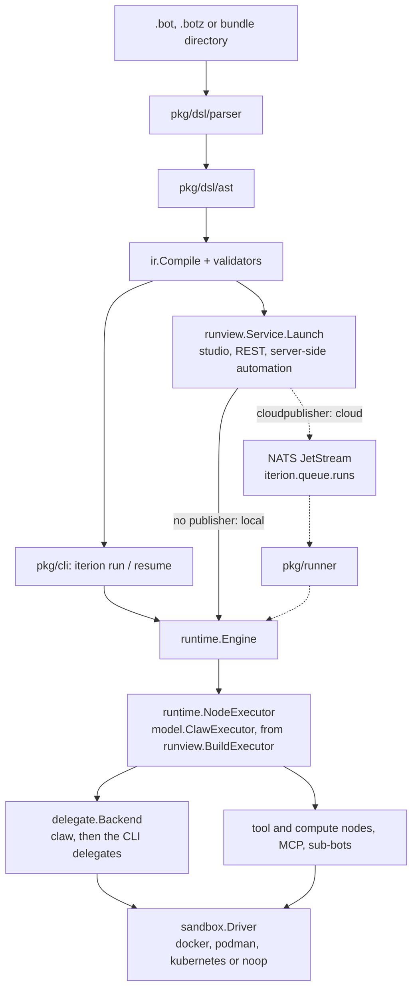

# Code architecture

This page is for contributors: it describes the shape of the code rather than
the behaviour of the system — the roles of the one binary, the seams and their
local and cloud adapters, the composition roots, where state lives, the guards
that keep the shape executable, and the style with its accepted deviations.
It links instead of repeating: the system end to end is
[architecture.md](architecture.md), the two cloud planes
[cloud-architecture.md](cloud-architecture.md), the import rules
[layering.md](layering.md), the doctrine [philosophy.md](philosophy.md), and
the flows are drawn in [diagrams/](diagrams/README.md).

## One binary, three roles

| Role | Command | Run store | Engine | Identity |
|---|---|---|---|---|
| Local | `iterion run` / `resume`, `iterion studio` | `FilesystemRunStore` under `.iterion` or `~/.iterion` ([local store](architecture.md#local-store)) | in process (a studio launch may use a managed child) | none: the studio stamps a synthetic super-admin `dev` identity and refuses a non-loopback bind unless `ITERION_STUDIO_INSECURE_NONLOOPBACK=1` |
| Control plane | `iterion server` with `ITERION_MODE=cloud` | Mongo + S3, built **without** a lock provider | never: it admits, persists and publishes | JWT, PAT or cookie; tenancy; the launch gates |
| Data plane | `iterion runner` | Mongo + S3, with the NATS-KV lock provider | `runtime.Engine`, one run in flight per pod | no public API: metrics and probes, plus, under the kubernetes sandbox, the per-run egress proxy (a network policy, secret inspection or the run's gateway credential starts it) its sibling sandbox pod dials at `ITERION_POD_IP`; executes under the tenant of the message it admitted |

The subcommand picks the role. `ITERION_MODE` ([pkg/config](../pkg/config/config.go):
`local` by default, or `cloud`) picks what `iterion server` builds: in `local`
it serves the same handlers as `iterion studio`, in `cloud` it builds the
stores, the publisher and the auth stack by hand
([server.go](../cmd/iterion/server.go)). `iterion runner` refuses to start in
any mode but `cloud` ([runner.go](../cmd/iterion/runner.go)). The desktop app
is a second binary, [`cmd/iterion-desktop`](../cmd/iterion-desktop/), compiled
under the `desktop` build tag: a Wails shell around the same server and studio
([desktop-architecture.md](desktop-architecture.md)).

### The runner pool and KEDA

A runner pod's fetch loop holds one in-flight run
([loop.go](../pkg/runner/loop.go)), so capacity is the pod count. The chart
grows that count with [KEDA](https://keda.sh), an optional Kubernetes
autoscaler ([prerequisites](cloud-deployment.md#prerequisites)):
under `runner.keda.enabled` (off by default, in `values.yaml` and in
`values-prod.yaml`) it renders a `ScaledObject`
([template](../charts/iterion/templates/runner-keda-scaledobject.yaml)) whose
`nats-jetstream` trigger polls `/jsz` on the NATS monitoring port (8222 by
default, not the client port; the render fails without a resolvable
endpoint) and scales the runner Deployment on the lag of one durable
consumer, between `runner.keda.minReplicas` and `runner.keda.maxReplicas`.
The lag threshold, the poll interval and the cooldown are `runner.keda.*`
settings too; [values.yaml](../charts/iterion/values.yaml) holds every
default. The runner Deployment then stops pinning `replicas`. Without KEDA
the pool stays at `runner.replicas`; the `runnerPools[]` Deployments have no
scaler.

No Go package imports KEDA: the runner neither knows the scaler exists nor
reads its settings. What couples them is a set of contracts between the
chart, the runner and the operator, among them the ones below. The chart
refuses to render without a monitoring endpoint, and the code fences a
rollout once the operator bumps the epoch; nothing checks the rest:

- **Names.** The trigger reads `config.nats.stream`, the value the runner
  receives as `ITERION_NATS_STREAM`, and must name the runner's durable
  consumer, the constant `iterion-runners` (`ConsumerRunners`,
  [nats.go](../pkg/queue/nats/nats.go)) that no setting renames.
  `runner.keda.consumerName` exists, but any other value points the scaler
  at a consumer no runner binds: the missing durable of the next bullet,
  for good. `runner.keda.account` must name the
  JetStream account that holds the stream (`$G` on a NATS without
  accounts), and KEDA must reach the monitoring port.
- **Existence.** Only a runner creates that durable, when it starts
  (`PrepareConsumer`, [nats.go](../pkg/queue/nats/nats.go)); the server
  creates a pool's durable
  ([runner_pool_reconciler.go](../pkg/server/runner_pool_reconciler.go)) but
  not the main one. A pool at `runner.keda.minReplicas: 0` whose durable
  goes away (a recreated stream, a deleted consumer) stays at zero on KEDA
  2.20 and later, since nothing creates the durable again; earlier versions
  wake a runner that recreates it
  ([troubleshooting](cloud-troubleshooting.md)). Keep the floor at one or
  more, or create the durable before the pool can reach zero.
- **The ceiling.** Every runner pod binds the same durable, so the
  durable's `MaxAckPending` (`ITERION_NATS_MAX_ACK_PENDING`, which the chart
  does not render) caps in-flight runs fleet-wide. Below
  `runner.keda.maxReplicas` it re-caps parallelism and the extra pods sit
  idle, silently.
- **Scale-down.** KEDA's scale-down deletes a pod the ReplicaSet picks
  without knowing it is busy, and a PodDisruptionBudget does not cover it.
  Under the default `config.runner.drainMode: complete` the SIGTERM drains
  the in-flight run up to `config.runner.drainTimeout`, inside
  `runner.terminationGracePeriodSeconds`; under `interrupt` it cancels the
  run, checkpoints it and lets another pod resume it
  ([pod turnover](cloud-deployment.md#pod-turnover--in-flight-runs)).
- **Rollouts.** The scaler may grow the old ReplicaSet as well as the new
  one, so ReplicaSet order fences nothing. The fence is
  `config.rollout.runnerEpoch`, rendered as literal env on each pod
  template: a runner delay-Naks a message stamped with a newer epoch, and a
  high-water mark in NATS KV keeps a lower-epoch process from consuming
  ([generation-aware rollout](cloud-deployment.md#generation-aware-rollout)).
  The code enforces that fence; bumping the epoch on every runner code
  change is the operator's duty, and nothing checks it.

Operating it: [cloud-deployment.md](cloud-deployment.md#nats-monitoring-endpoint-keda).

## The pipeline

`runview.Service.Launch` ([service_launch.go](../pkg/runview/service_launch.go))
is the door for the studio, the REST API, server-side automation and every
cloud launch: with no `LaunchPublisher` it starts the engine in this process,
with `cloudpublisher` it persists the run and publishes a `RunMessage` a
runner claims. `iterion run` / `resume` ([pkg/cli](../pkg/cli/run.go)) and
the local dispatcher's `EngineRunner` still build their engine directly (a
fresh dispatcher launch routes through the service under
`ITERION_DISPATCH_VIA_SERVICE`).
What every path shares is `ir.Compile`, `runview.BuildExecutor` and
`runtime.Engine`. `model.ClawExecutor` is the executor for **every** backend,
despite its name. The detail is drawn in
[flow-bot-to-running-graph.md](diagrams/flow-bot-to-running-graph.md) and
[flow-cloud-run-lifecycle.md](diagrams/flow-cloud-run-lifecycle.md).

## The seams

| Seam | Local adapter | Cloud adapter | Chosen in |
|---|---|---|---|
| `store.RunStore` ([iface.go](../pkg/store/iface.go)) | `FilesystemRunStore` ([store.go](../pkg/store/store.go)) | `mongo.Store` ([pkg/store/mongo](../pkg/store/mongo/)) with an S3 blob client ([pkg/store/blob](../pkg/store/blob/)) | `pkg/cli`; `newCloudMongoStore` ([cloud_wireup.go](../cmd/iterion/cloud_wireup.go)) |
| Run lock, `store.RunLock` | `flock(2)` on the run directory ([lock.go](../pkg/store/lock.go)) | NATS-KV lease `iterion-run-locks` ([lock.go](../pkg/queue/nats/lock.go)), runner only | `runRunner` injects the lock provider; the server's store has none |
| `runview.LaunchPublisher` ([service_launch.go](../pkg/runview/service_launch.go)) | nil: the engine runs in process | `cloudpublisher.Publisher` ([pkg/server/cloudpublisher](../pkg/server/cloudpublisher/)) | `server.Config.LaunchPublisher` |
| `eventbus.Bus` ([bus.go](../pkg/eventbus/bus.go)) | `InProcBus` | `NATSBus` | `server.Config.EventsBus`; `runRunner` |
| `runstream.Source` ([iface.go](../pkg/runview/runstream/iface.go)) | the service's in-process event broker and log buffer, plus fsnotify tailers | `MongoSource`: Mongo change streams | `server.Config.StreamSource` |
| `lease.Store` ([lease.go](../pkg/lease/lease.go)) | `MemoryStore` | `MongoStore` | `leaseStoreFor` ([leases.go](../pkg/server/leases.go)) |
| `sandbox.Driver` ([iface.go](../pkg/sandbox/iface.go)) | docker, then podman, then noop | kubernetes sibling pod, only under `runner.sandbox.enabled` or a pool's own `sandbox.enabled`; the chart default runs in the runner pod | [factory.go](../pkg/sandbox/factory.go) |
| `delegate.Backend` ([delegate.go](../pkg/backend/delegate/delegate.go)) | `ClawBackend` plus the CLI delegates | the same | `runview.BuildExecutor` ([executor.go](../pkg/runview/executor.go)) |
| `forge.Admin` ([admin.go](../pkg/forge/admin.go)) and its optional capabilities (`MergeApprover`, `AvatarSetter`, …) | GitHub, GitLab, Forgejo adapters ([pkg/forge](../pkg/forge/)) | the same; the forge stores have memory and Mongo twins | the connection's provider |
| `tracker.Tracker` ([tracker.go](../pkg/dispatcher/tracker/tracker.go)) | the native board on the filesystem; GitHub, GitLab, Forgejo | the native board on `boardmongo` | the dispatcher configuration |

Two leases, not one: `lease.Store` elects one holder for idempotent work, the
periodic nets first — a load-reduction election, not mutual exclusion — while
the run lease in NATS KV is what makes one runner the owner of a run. A seam
with a single implementation is the
[Nth-variant test](philosophy.md#the-nth-variant-test)'s business: build it
at the second variant.

## Composition roots

The graph is wired by hand, with no DI container, at a few roots:

- `runServer` in [server.go](../cmd/iterion/server.go) — the control plane,
  into one `server.Config{}` literal;
- `runRunner` in [runner.go](../cmd/iterion/runner.go) — the data plane;
- `pkg/cli` (`RunStudio`, `iterion run`) — the local roots, which is why
  `pkg/cli → pkg/server` is an accepted [layering](layering.md) exception;
- `runview.BuildExecutor` ([executor.go](../pkg/runview/executor.go)) — the
  one factory every run's executor comes from (a dry run swaps in its
  simulation executor): the backend registry, the
  tool registry, the hooks, the claw backend.

One `server.Config` ([server_config.go](../pkg/server/server_config.go)) serves
the studio, the desktop and the cloud because of one convention: a nil
dependency means the in-memory or local default, or the feature off, and each
field's comment says which. `LaunchPublisher` nil runs the engine in process;
`StreamSource` nil keeps the in-process broker; `Leases` nil derives a Mongo
store from the run store's database, or an in-memory one.

Optional capabilities are discovered by type assertion, not declared: the
`store.As*Store` helpers go through `capability[T]`
([capability.go](../pkg/store/capability.go)), which looks through decorators
so a wrapper never hides a capability. A nil answer means the store lacks it
and the call site skips the feature — right for a filesystem-only feature
(`AsPIDStore`: detach and reattach), a silent cloud hole for anything durable.
[ADR-073](adr/073-cloud-twins-for-fs-only-run-detail-seams.md) closed three
such holes; a new optional seam lands with both twins and the shared
conformance suite.

## Where state lives

The tenant is the **team**: `tenant_id` is the team id, stamped on the store
context by the auth middleware. The organisation sits above the teams for what
they share — the monthly budget, SSO, credential pools
([ADR-048](adr/048-org-team-hierarchy.md)).

| Where | What | Keyed by |
|---|---|---|
| MongoDB ([pkg/store/mongo](../pkg/store/mongo/) and each feature's Mongo twin) | the source of truth: runs and checkpoints, events, identity, sealed secrets, audit, schedules, boards, settings | `tenant_id` where reads are per tenant ([the layers](cloud-architecture.md#multitenancy-enforcement-layers)) |
| S3-compatible blob ([key.go](../pkg/store/blob/key.go)) | bulky bytes: artifact bodies, tool I/O, the compiled IR, attachments, backend sessions, run files | the run id (a staged upload by its upload id), no tenant in the key: tenancy rides the record the caller loads first, the run document or the staged upload |
| NATS ([pkg/queue/nats](../pkg/queue/nats/)) | the run queue and its DLQ, the run-lease KV, the rollout epoch, the event bus subjects | the lease by run id |
| Valkey or Redis ([pkg/valkey](../pkg/valkey/)) | ephemeral cross-replica state: forge OAuth and CSRF state, board-MCP run tokens, auth rate-limit buckets, forge publish grants, the merge gate's settle and verdict-order state | per feature |
| Filesystem ([storedir.go](../pkg/store/storedir.go)) | everything local: `<project>/.iterion` or `~/.iterion/projects/…` (`ITERION_HOME` moves the root) | single-tenant by construction |

The doctrine is that a run reads its settings from the database, not the
pod's environment: [ADR-132](adr/132-a-run-reads-no-environment.md) states
it (Proposed, the doctrine binding) and the proposed
[ADR-169](adr/169-a-run-reads-no-environment-and-the-catalogue-names-roles-not-vendors.md)
extends it. The migration is in progress: provider and model configuration
already cascade through database levels, the env tables remain runner-side
fallbacks ([gateway](agents/backends/gateway.md)), and dispatch still expands
`${VAR:-name}` routes from the pod's environment.

Tenant enforcement, exactly: the ctx-scoped store families build their tenant
clause in one `with*TenantFilter` helper that fails closed on a context with
no tenant — `pkg/store/mongo`'s panics (a cluster-level path opts out through
`store.WithoutTenantFilter`), the API-key, binding, generic-secret,
bot-source, plugin-source and run-secrets helpers return an error.
[`internal/tenantguard`](../internal/tenantguard/tenant_filter_test.go) holds
that shape, and lists by name, each with its reason, the sites that assign a
`tenant_id` key (`m["tenant_id"] = …`) outside it. It reads that assignment
form only: a clause written as a composite literal (`bson.M{"tenant_id": …}`),
a dotted key (`_id.tenant_id`) or a `bson.D` is outside its sight. Most listed
sites have a reason of their own — the tenant
comes from a record, the clause is a write rather than a read filter, a lent
key's row lives in its donor's tenant; the runstream backfills (`backfillEvents`, `backfillLogs`,
`runIsTerminal`) are the residual it names as such: they scope by run id and
add the context's tenant only when it carries one. Other stores take the tenant as an explicit parameter, and some
are reached by a key that precedes any tenant — a credential's token hash, a
forge callback's signed state; [the layers](cloud-architecture.md#multitenancy-enforcement-layers)
list them.

## The run

- One mutable document, `store.Run` — `run.json` locally, the `runs`
  collection in cloud — versioned by `CASVersion`: `SaveRun` accepts only the
  version its caller last read. Its embedded `Checkpoint` is the continuation
  state a resume restarts from.
- Beside it, append-only per-run streams: events, logs, artifacts,
  interactions, operator messages.
- Not event sourcing: state is never rebuilt from the events. Resume reads a
  few event types (a rewind marker, for one) and otherwise the checkpoint.
- Delivery is JetStream at-least-once; the NATS-KV lease admits one owner,
  `queue.Admit` ([admission.go](../pkg/queue/admission.go)) decides from the
  run document whether a delivery executes, resumes or drops, and the CAS
  write refuses a stale writer. Together a run's transitions happen
  effectively once; external effects do not
  ([ADR-152](adr/152-the-reliability-invariants-have-owning-layers.md#what-is-not-promised)).

## Executable guards

| Guard | Proves | Does not prove |
|---|---|---|
| [`internal/layerguard`](layering.md) | no non-test import crosses a forbidden layer, under every GOOS and build tag the tree compiles; accepted exceptions are counted and can only shrink | transitive edges (one hop), couplings in test files, name rules such as `pkg/log` and `pkg/errtrack` |
| [`internal/tenantguard`](../internal/tenantguard/tenant_filter_test.go) | every `with*TenantFilter` helper errors or panics without a tenant; every other `m["tenant_id"] = …` assignment is listed with its reason | that callers propagate the error (the per-store tests do), a clause written as a composite literal, a dotted key (`_id.tenant_id`) or a `bson.D`, stores that take the tenant as a parameter |
| [`pkg/store/storetest`](../pkg/store/storetest/conformance.go) | the `RunStore` contract and its optional seams behave the same on the filesystem and Mongo stores | the Mongo half runs only with `ITERION_TEST_MONGO_URI` (CI's `mongo-conformance`); stores outside `RunStore` have their own suites or none |
| [`pkg/backend/backendcaps`](backend-capability-registry.md) | one capability table, read by the compiler and the runtime alike | that a backend honours a cell at run time: implementation, published proof and live outcome are separate observations |
| [`internal/docsguard`](../internal/docsguard/doc.go) | links and anchors resolve as GitHub reads them (`task docs:links`), ADR numbers do not collide undeclared, the ER diagrams name the collections the code uses, a few prose facts match the code | that prose is true in general; and the link check is advisory in CI, not a required gate |

## The style, named

- A **modular monolith**: one Go module whose packages are the modules,
  shipped as the `iterion` binary (and the desktop shell around it).
- **Ports and adapters at the infrastructure edges** — storage, queue, bus,
  sandbox, forge, tracker, backend: the seams table. Inside, the core types
  are concrete: `runtime.Engine`, `ir.Workflow`, `store.Run`. (These ports
  are the hexagonal kind; the DSL's ports are a semantics the engine runs,
  [ADR-153](adr/153-ports-are-a-semantics-the-engine-runs-not-a-declaration.md).)
- **Package by feature with memory and Mongo twins** — [`pkg/cloudsched`](../pkg/cloudsched/)
  and [`pkg/audit`](../pkg/audit/) each hold the contract and both
  implementations — around three technical hubs: `pkg/runtime` (the engine),
  `pkg/store` (the run model and its persistence) and `pkg/server`, one
  package of transaction-script handlers on `*Server`.
- **Event-driven automation, message-driven runs.** Triggers ride a lossy
  fan-out bus made safe by durable outboxes
  ([ADR-094](adr/094-trigger-effect-outbox.md)) and
  [reconciliation nets](philosophy.md#a-lossy-bus-needs-a-reconciliation-net--and-both-paths-must-be-idempotent);
  runs are messages on a durable work queue under a lease. Two semantics, two
  transports ([bus.go](../pkg/eventbus/bus.go)).
- **CQRS-lite read models**: boards, pipelines and run views are projections
  over runs, checkpoints and git — [views are additive](philosophy.md#5-product-oriented-views-are-welcome--additively-pre-arbitrated).

Accepted deviations. First, the [layer map](layering.md)'s own exceptions,
each with its reason in the guard and a count that can only shrink
([the ratchet](layering.md#the-ratchet)), by family:

- `pkg/dsl/ir` → the `pkg/backend/*` leaves that hold the capability
  vocabulary (`backendcaps`, `toolcatalog`, `permission`, …): the compiler
  validates a `.bot` against that vocabulary where it is defined;
- `pkg/cli` → `pkg/server` and `pkg/server/projects`: the local
  composition roots;
- `pkg/backend/tool` → `pkg/dispatcher/native` and `boardops`,
  `pkg/backend/delegate` → `boardops`: the claw board tools and the MCP
  board bridge run every operation through the one `boardops` entry.

Then the couplings no layer rule forbids but the style still names:

- `pkg/runtime` imports `pkg/backend/*` packages — `model`, where the
  engine↔executor protocol lives (context keys, error types, output
  validation), and others such as `delegate`, `tool`, `credroute`, `cost`
  and the capability tables — and the concrete sandbox drivers. The engine
  is a hub over the backends, not a core they plug into. The edges stay;
  the concrete type assertions on them become optional interfaces under
  [#3476](https://github.com/SocialGouv/iterion/issues/3476).
- `pkg/dsl/ir` imports `pkg/store`: the compiler reads the failure-code and
  server-minted-secret vocabulary where it is defined.
- `pkg/server` stays one package, the hub the layer map forbids `pkg/` to
  import (`pkg/cli` excepted).

**Why not Clean Architecture.** One type per persisted document, tagged for
both JSON and BSON — `store.Run` is `run.json` and the `runs` document — is
what the local/cloud twin rule relies on, and what `preserveUnknownBSON`
([preserve_unknown.go](../pkg/store/mongo/preserve_unknown.go)) relies on to
keep, across a mixed-version fleet, the fields an older writer does not know.
Entity and DTO mappers between them would turn a forgotten field into silent
data loss: the mapped schema knows the field, so its omission clears it. The doctrine is the
[Nth-variant seam test](philosophy.md#the-nth-variant-test) plus the
executable guards above.

## The agent harness

`claw` is the reference harness — decided, and in progress. iterion runs its
**own** tool loop: `ClawBackend.Execute`
([claw_backend.go](../pkg/backend/model/claw_backend.go)) drives
`GenerateTextDirect` ([generation.go](../pkg/backend/model/generation.go)) over
the first-party [`pkg/claw`](../pkg/claw/) library, the former claw-code-go
folded into the tree; claw-code-go's own `ConversationLoop` stays internal and
is not the loop iterion drives. In a sandbox the same loop runs inside the
container through the hidden `__claw-runner`
([ADR-029](adr/029-sandboxed-claw-via-hidden-claw-runner-ndjson-ipc.md)), and
codemode is a property of this loop that a CLI delegate refuses
([ADR-165](adr/165-codemode-runs-the-models-code-in-a-child-process-behind-the-tool-door.md)).
The CLI delegates — `claude_code` as a legacy bridge, then codex, pi, kimi,
grok and opencode — are a lower support tier.

The written record is catching up: the ADR is
[#3454](https://github.com/SocialGouv/iterion/issues/3454), the declared tier
in `backendcaps` and its consumers
[#3455](https://github.com/SocialGouv/iterion/issues/3455), the rules after
the fold [#3466](https://github.com/SocialGouv/iterion/issues/3466). Until
they land, `backendcaps`' detection order still prefers `claude_code`, and
`AGENTS.md`, [backends.md](backends.md),
[backend-capability-registry.md](backend-capability-registry.md) and
[philosophy.md](philosophy.md#backend-parity--claw--claude_code-pre-arbitrated)
still state claw↔claude_code parity.
