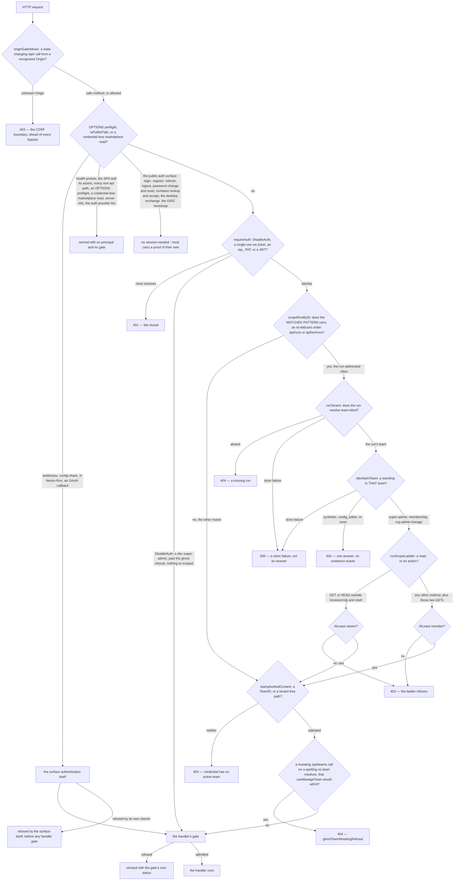

# Access control — who may do what

This page maps who may do what: the principals a credential resolves to, the gates that admit or refuse them, and the standing in a team or org a gate reads.

> Drawn from the code at commit `61a305262` — main at v3.266.1, after #2391, which carries the launch rung; how this page is kept true: [README](README.md). Every count below is of that one tree, the rung included.

## Who can call

An "API key" is not a principal kind: `api_keys` rows are BYOK provider keys, a credential iterion *uses*, never a credential a caller presents.

| Kind | Minted by | Carries | Passes team gates? |
|---|---|---|---|
| session user — a JWT bearer, the cookie `iterion_auth`, or `?t=<access-jwt>` on `/api/ws` and `/api/ws/*` alone. `authCookieWriteName` prefixes the cookie `__Host-` where the deployment can carry it, and `sessionCookie` under the prefix reads the prefixed name and refuses the bare one, and without it the prefixed name is ignored entirely | `JWTSigner.IssueAccess`; verified by `Verify` inside `requireAuth` ([pkg/auth/jwt.go](../../pkg/auth/jwt.go)) | `UserID`, `Email`, `OrgID`, `OrgRole`, `TeamID`, `Role`, `IsSuperAdmin`, `JTI` | yes |
| PAT — `iap_` bearer | `pat.MintToken` ([pkg/pat/pat.go](../../pkg/pat/pat.go)), resolved per request by `identityFromPAT` | the owner's identity, with the token's team as its request team — a super-admin's unpinned token takes the owner's default team, or none — but no boundary: `POST /api/auth/me/team/{team_id}` and `…/org/{org_id}` accept the PAT and answer a session JWT on another team its owner can enter; `Role` re-read from `GetMembership` at every use; `OrgRole` left empty | yes |
| WS ticket — `?ticket=` on `/api/ws`, every path under `/api/ws/` — `POST /api/ws/ticket` included — and the CDP dial | `POST /api/ws/ticket` behind `requireAuth`, redeemed single-use by `wsTicketIdentity` ([pkg/server/ws_ticket.go](../../pkg/server/ws_ticket.go)) | the minter's entire identity verbatim; one minute and one use per ticket, renewable through `POST /api/ws/ticket` | yes |
| dev-mode super-admin | the `requireAuth` short-circuit under `cfg.DisableAuth` | `UserID` `dev`, `IsSuperAdmin` true, no team on the identity (the store context is stamped tenant `dev`), no role | yes |
| inbound webhook — `KindWebhook` | `webhookAuth`, after the URL-id lookup: a token compare **in token mode only**, the enabled check, then the per-webhook rate limit, the tenant's and the webhook's monthly call quotas and the team's `CanLaunch`, then the stamp — for `SignModeHMAC` the provider handler checks `VerifyHMACSignature` only after all of that ([pkg/server/middleware_webhook.go](../../pkg/server/middleware_webhook.go)) | `webhook:<cfgID>`, the config's tenant, `RoleMember`, `Kind` webhook | no |
| config-share editor — `KindShare`, `iws_` bearer | `configShareAuth`: a per-IP rate limit, the share lookup, `VerifyToken` and `Active`, then a per-share rate limit ([pkg/server/middleware_configshare.go](../../pkg/server/middleware_configshare.go)) | `share:<shareID>`, the share's tenant, and no role at all; the pinned repo, ref and config path plus `AllowedPaths` / `VisiblePaths` and `ReadOnly` are the real authority | no |
| run-re-anchored identity — `Via` | `identityInTeam`, called only from `scopeRunByID` | the RUN's team, a role there — `admin` via `super-admin`, the caller's via `membership`, `viewer` via `org-admin-lineage` — and `Via` naming which standing carried it | yes, in that team |
| per-run board/runs MCP token — `X-Iterion-Run` | `newBoardMCPToken` ([pkg/server/mcp_board_handler.go](../../pkg/server/mcp_board_handler.go)) | no identity: a `boardMCPGrant` of capabilities, tenant, source issue and expiry | no |
| per-run forge publish grant — `X-Iterion-Run` | `injectForgePublishVars` at launch, into `forgePublishTokens` ([pkg/server/forge_publish.go](../../pkg/server/forge_publish.go)) | no identity: a `ForgePublishGrant` of team, connection, repo, bot and capabilities | no |
| internal background actor, synthetic | three background paths ([webhooks_debounce.go](../../pkg/server/webhooks_debounce.go), [forge_gate_autofix.go](../../pkg/server/forge_gate_autofix.go), [forge_gate_relaunch.go](../../pkg/server/forge_gate_relaunch.go)) | the actor string, the webhook config's tenant or the team of the gating run's `ForgePublishGrant`, `RoleMember`, `Kind` webhook | no |
| machine actor — `KindInternal` | `machineLaunchCtx` ([pkg/server/launch_gate.go](../../pkg/server/launch_gate.go)) | the metered tenant, the audited actor, `Kind` internal, and **no role at all** | never reaches one |
| anonymous | nobody — `authMiddleware` returns before `requireAuth` for `isPublicPath`, an `OPTIONS` preflight, or a credential-less marketplace read unless `DisableAuth` | nothing; `auth.FromContext` answers `ok=false` | no |

## Roles

- **The team ladder** — `viewer` (1) < `member` (2) < `admin` (3) < `owner` (4).
- No gate in `pkg/server` requires `AtLeast(RoleOwner)`.
- **`config_editor` is orthogonal, not a rung** (ADR-078). It ranks 0, so `AtLeast` places it nowhere. `canEditConfigShares` has a `config_editor` *term* (and `canEditBots`, which delegates to it). It is not thereby a one-capability role: the role-blind surfaces admit it like any team principal — for example `requireMemoryWriteAuth` on non-global spaces, `canMutateScopedRecord` for its own records, the cost-cap override, and the run list and stats of its active team.
- **The org ladder** — `member` (1) < `admin` (2) < `owner` (3). No gate asks for owner.
- **`is_super_admin` is a flag on the user, not a role value.** It short-circuits every team/org `can*` gate and bypasses `gateLaunch` entirely; some gates are not bypassed — the origin gate, the ghost refusal and `requirePlatformApiKey`, for example.
- **The org mirror rule** — `OrgRoleForTeamRole`: `AtLeast(RoleAdmin)` → `OrgRoleAdmin`, `AtLeast(RoleViewer)` → `OrgRoleMember`, anything off the ladder (`config_editor`, or an empty role) → `""`, i.e. no org membership at all — the runtime mirror writes none, skipping before its upsert; the `iterion migrate orgs` backfill does not skip it: its upsert of the empty role is refused, and the migration aborts mid-run.

## The decision points

Call sites are counted over `pkg/` and `cmd/`, excluding `_test.go`, as `grep -rn '\.<symbol>(' pkg cmd --include='*.go' | grep -v _test.go | wc -l` — the declaration is not a call site. Two rows do not take that form: `ghostTeamMutatingRefusal` is a package-level function, counted as `ghostTeamMutatingRefusal(` because the dotted form matches nothing, and the run WS mutating-envelope row names a surface whose gate is a map lookup inside `runConn.dispatch`, so it carries the count of its enforcement site. A third, `handlePutOrgMember`, is mounted as a function value, so the recipe answers 0.

| Point | File | Passes when | Call sites |
|---|---|---|---|
| `requireAuth` | [middleware.go](../../pkg/server/middleware.go) | `DisableAuth`, or a valid single-use ticket, or an `iap_` PAT that resolves, or a JWT that verifies — then `scopeRunByID` and `stampAuthedContext` both succeed, and the ghost refusal does not fire. `DisableAuth` short-circuits before the first two, not before the ghost refusal | 192 |
| `stampAuthedContext` | [middleware.go](../../pkg/server/middleware.go) | the identity carries a `TeamID`, or the path is tenant-free (`/api/auth/`, `/api/me/`, `/api/orgs/`, `/api/teams/`, `/api/admin/`, a public marketplace GET) | 2 |
| `scopeRunByID` | [run_scope.go](../../pkg/server/run_scope.go) | the request is outside the run-by-id class, or the run resolves team-blind, `identityInTeam` yields a standing and `runScopeLadder` accepts the method; either way `stampAuthedContext` runs next and can still refuse | 2 |
| `identityInTeam` | [run_scope.go](../../pkg/server/run_scope.go) | not synthetic, and, **in this precedence**: super-admin (re-anchored as `admin`); else the membership row if it is `AtLeast(RoleViewer)`, and a row that ranks LOWER (`config_editor`, an empty role) refuses outright; the parent-org admin/owner arm (re-anchored as `viewer`) applies only when NO membership row exists | 1 |
| `runScopeLadder` | [run_scope.go](../../pkg/server/run_scope.go) | `AtLeast(RoleViewer)` for a GET or HEAD outside `browser/cdp` and `shell`; `AtLeast(RoleMember)` for every other method and for those two GETs | 1 |
| `effectiveMembership` | [pkg/auth/service.go](../../pkg/auth/service.go) | a membership row wins; without one, a super-admin steps into any team and an org admin/owner into any team of THEIR org, re-anchored as `admin`. It decides which team and which role the next JWT carries, behind `POST /api/auth/me/team/{team_id}` — `requireAuth` and no further check | 1 |
| `canViewTeam` | [auth_authz.go](../../pkg/server/auth_authz.go) | not synthetic, and: super-admin, or the claim's team with `AtLeast(RoleViewer)`, or a stored membership `AtLeast(RoleViewer)`, or `orgAdminOfTeam` | 26 |
| `canManageTeam` | [auth_authz.go](../../pkg/server/auth_authz.go) | not synthetic, and: super-admin, or a stored membership `AtLeast(RoleAdmin)` — no claim shortcut — or `orgAdminOfTeam` | 52 |
| `canEditConfigShares` | [auth_authz.go](../../pkg/server/auth_authz.go) | not synthetic, and: super-admin, or `Role == RoleConfigEditor` on the claim's team or in the store, or `canManageTeam` | 3 |
| `canEditBots` | [auth_authz.go](../../pkg/server/auth_authz.go) | exactly `canEditConfigShares` | 3 |
| `canViewOrg` | [auth_authz.go](../../pkg/server/auth_authz.go) | not synthetic, and: super-admin, or the claim's org with a `Valid()` org role, or a stored org membership with a `Valid()` role | 9 |
| `canManageOrg` | [auth_authz.go](../../pkg/server/auth_authz.go) | not synthetic, and: super-admin, or a stored org membership `AtLeast(OrgRoleAdmin)` — the store, never the claim | 29 |
| `orgAdminOfTeam` | [auth_authz.go](../../pkg/server/auth_authz.go) | the team resolves, its `OrgID` is non-empty, and `canManageOrg` passes on that org | 3 |
| `requireOrgStandingToWriteOrgRole` | [auth_authz.go](../../pkg/server/auth_authz.go) | an org-membership role write, after the route's own gate: the written role mirrors to no org role, or the team has no parent org, or super-admin; else the writer's stored membership in that org `AtLeast` the role written | 1 |
| `requireSuperAdmin` | [middleware.go](../../pkg/server/middleware.go) | `requireAuth` passes and `isSuperAdmin` holds | 61 |
| `isSuperAdmin` | [middleware.go](../../pkg/server/middleware.go) | `cfg.DisableAuth`, or the ctx identity's `IsSuperAdmin` | 3 |
| `canMutateScopedRecord` | [generic_secrets_routes.go](../../pkg/server/generic_secrets_routes.go) | super-admin; or a user-scoped record whose `ScopeUserID` is the caller's; or an org-tier scope and `canManageOrg`; else `canManageTeam` | 2, from `canMutateApiKey` ([byok_routes.go](../../pkg/server/byok_routes.go), 2) and `canMutateGenericSecret` (2) |
| `requireMemoryWriteAuth` | [memory_routes.go](../../pkg/server/memory_routes.go) | the space's visibility is not `global`, or there is no identity store, or the caller is super-admin | 3 |
| `requirePlatformApiKey` | [admin_llm_routes.go](../../pkg/server/admin_llm_routes.go) | the addressed key exists and its `ScopeTeamID` is the platform tenant | 2 |
| `canRouteToConverseBot` | [webhooks_gitlab.go](../../pkg/server/webhooks_gitlab.go) | the webhook config's own allow-list admits the bot id and `botExistsForTeam` resolves it in the config's tenant — a bot allow-list, with no role term | 2 |
| run WS mutating-envelope gate | [runs_ws.go](../../pkg/server/runs_ws.go) | the envelope is not in `runWSMutatingTypes`, or the connection's role is empty (no auth context at all), or `AtLeast(RoleMember)` | 1 |
| marketplace moderation queue | [marketplace_cloud.go](../../pkg/server/marketplace_cloud.go) | `id.HasRole(RoleAdmin)` — no store re-read, no team path and no org-admin arm; it gates the `GET …/moderation` queue alone | 1 |
| `marketplaceModerateGate` | [marketplace_cloud.go](../../pkg/server/marketplace_cloud.go) | the approve and reject actions: an org-scoped entry takes `canManageTeam` on the submitting team, a public or instance entry takes a super-admin | 1 |
| `gateLaunch` | [launch_gate.go](../../pkg/server/launch_gate.go) | no identity store, or super-admin; else a non-empty `TeamID`, then the rung — `launchRungCleared`, i.e. `launchExemptPrincipal` or `AtLeast(RoleMember)`, else `member_role_required` — then a team that exists and `CanLaunch` (an unreadable team admits it ungated), its org `CanLaunch` (an org that cannot be read is skipped), then the per-repository quota, concurrency, launch rate and monthly caps | 10, plus the trigger spine's injected `l.gate`: eleven launch surfaces |
| `mutatingRungDenial` | [board_cloud_routes.go](../../pkg/server/board_cloud_routes.go) | no identity store, or a method that changes nothing, or super-admin, or `launchRungCleared` — the *same* rung `gateLaunch` reads. Same `member_role_required` 403, rendered through `writeRungDenial`, and no teamless arm of its own: a team-less credential is refused by `stampAuthedContext` before any mount | 3: `mutatingRungAuth` on the request path — plus `boardWriteDenial` and `triggerWriteDenial`, the per-family instances the class witnesses call and no production path does |
| `originGateAllows` / `requireSafeOrigin` | [middleware.go](../../pkg/server/middleware.go), [server_files.go](../../pkg/server/server_files.go) | `originGateAllows`: the request is not a state-changing `/api/` call, or its `Origin` is same-origin, loopback on the server's own port, the configured public URL, a desktop origin, an `ITERION_ALLOWED_ORIGINS` entry, or absent; `requireSafeOrigin` admits the same Origins; `ITERION_REQUIRE_ORIGIN=0` disables both | 2 and 85 |
| `handlePutOrgMember` | [team_lifecycle_routes.go](../../pkg/server/team_lifecycle_routes.go) | super-admin only | 0 by the recipe |
| `ghostTeamMutatingRefusal` | [middleware.go](../../pkg/server/middleware.go) | refuses — it never admits: a 404 for a state-changing call on `/api/teams/{id}` or a route below it whose `{id}` `canonicalizeTeamPathValue` could not resolve, and only where `canManageTeam` would have admitted the caller | 3 by the recipe — two calls plus the `func` line |

The table holds shared helpers and the handler gates the matrix has a row for; any handler may add a conjunct of its own.

## The gate decision



## The matrix

| Decision point | team viewer | member | admin / owner | config_editor | org member | org admin / owner | super-admin | synthetic webhook | synthetic share | machine-internal |
|---|---|---|---|---|---|---|---|---|---|---|
| `canViewTeam` | ✅ | ✅ | ✅ | ❌ | ❌ | `✅ their org's teams` | ✅ | ❌ | ❌ | `n/r` |
| `canManageTeam` | ❌ | ❌ | ✅ | ❌ | ❌ | `✅ their org's teams` | ✅ | ❌ | ❌ | `n/r` |
| `canEditConfigShares` | ❌ | ❌ | ✅ | ✅ | ❌ | `✅ their org's teams` | ✅ | ❌ | ❌ | `n/r` |
| `canEditBots` | ❌ | ❌ | ✅ | ✅ | ❌ | `✅ their org's teams` | ✅ | ❌ | ❌ | `n/r` |
| `orgAdminOfTeam` | ❌ | ❌ | ❌ | ❌ | ❌ | `their org's teams only` | `a team with an org only` | ❌ | ❌ | `n/r` |
| `canViewOrg` | ❌ | ❌ | ❌ | ❌ | ✅ | ✅ | ✅ | ❌ | ❌ | `n/r` |
| `canManageOrg` | ❌ | ❌ | ❌ | ❌ | ❌ | ✅ | ✅ | ❌ | ❌ | `n/r` |
| `requireSuperAdmin` / `isSuperAdmin` | ❌ | ❌ | ❌ | ❌ | ❌ | ❌ | ✅ | ❌ | ❌ | `n/r` |
| `handlePutOrgMember` — place an existing account in an org | ❌ | ❌ | ❌ | ❌ | ❌ | ❌ | ✅ | ❌ | ❌ | `n/r` |
| `canMutateApiKey` / `canMutateGenericSecret` → `canMutateScopedRecord` | `own` | `own` | `own` · team rows ✅ · `org-tier → org admin` | `own` | `own` | `own` · their org's team rows ✅ · their org's `org-tier` ✅ | ✅ | ❌ | ❌ | `n/r` |
| `requireMemoryWriteAuth` | `tenant ✅ · global ❌` | `tenant ✅ · global ❌` | `tenant ✅ · global ❌` | `tenant ✅ · global ❌` | `needs a team` | `tenant ✅ · global ❌` — step-in (admin claim) | ✅ | `n/r` | `n/r` | `n/r` |
| `canRouteToConverseBot` | `n/r` | `n/r` | `n/r` | `n/r` | `n/r` | `n/r` | `n/r` | `endpoint opt-in` | `n/r` | `n/r` |
| marketplace moderation queue (`HasRole`) | ❌ | ❌ | ✅ | ❌ | ❌ | `✅ via the step-in admin claim` | ✅ | ❌ | ❌ | `n/r` |
| `marketplaceModerateGate` — approve / reject | ❌ | ❌ | `org entry only` | ❌ | ❌ | `org entry only` | ✅ | ❌ | ❌ | `n/r` |
| the run-addressed surface — `scopeRunByID` + `runScopeLadder`, two exceptions: `browser/cdp` and `shell` | `ladder (GET viewer · action member)` | ✅ | ✅ | ❌ | ❌ | `org-admin-lineage → viewer`, and only with NO membership row | ✅ | ❌ | ❌ | `n/r` |
| run WS mutating envelopes | ❌ | ✅ | ✅ | ❌ | ❌ `identityInTeam`'s 404 first | ❌ | ✅ | `n/r` | `n/r` | `n/r` |
| launch — the member rung of `gateLaunch` | ❌ `member_role_required` (on resume the ladder's own 403 first; on the WS answer the socket's member rung first) | ✅ | ✅ | ❌ `member_role_required` (on resume and on the WS upgrade alike, `identityInTeam`'s 404 first) | `needs a team` (on resume and on the WS upgrade, `identityInTeam`'s 404 first) | `✅ step-in (admin claim)` — except resume and the WS answer | ✅ | ✅ `launchExemptPrincipal` | `n/r` | ✅ `launchExemptPrincipal` |
| board write — the same rung at `mutatingRungDenial`, through the `boardWriteAuth` mount | `read ✅ · write ❌ member_role_required` | ✅ | ✅ | `read ✅ · write ❌ member_role_required` | `needs a team` | `✅ step-in (admin claim)` | ✅ | `n/r` | `n/r` | `n/r` |
| trigger write — the same rung at `mutatingRungDenial`, through the `triggerWriteAuth` mount | `read ✅ · write ❌ member_role_required` | ✅ | ✅ | `read ✅ · write ❌ member_role_required` | `needs a team` | `✅ step-in (admin claim)` | ✅ | `n/r` | `n/r` | `n/r` |

Legend: ✅ passes · ❌ the gate refuses · `own` only a record whose `ScopeUserID` is the caller's · `org-tier → org admin` an org-tier scope defers to `canManageOrg` · `org entry only` the gate admits an org-scoped entry and reserves public and instance entries for a super-admin · `step-in (admin claim)` the principal holds no membership row but `effectiveMembership` — or `pickActiveTeamInOrg` on an org switch — minted an `admin` claim on the team · `ladder (GET viewer · action member)` the ADR-103 ladder, whose **only two exceptions are `browser/cdp` and `shell`** — GETs that hand live control, so they take a member · `their org's teams` the org-admin arm of a team gate is `orgAdminOfTeam`, which reads the team and defers to `canManageOrg` on **its** `OrgID`: a team of another org refuses · `a team with an org only` `orgAdminOfTeam` reads the team and defers on **its** `OrgID`: a team that does not resolve, or whose `OrgID` is empty, refuses — every caller admits a super-admin beside it · `tenant ✅ · global ❌` every visibility but `global` passes · `read ✅ · write ❌` a safe method is served, a state-changing one takes the rung · `endpoint opt-in` the surface authenticates the principal itself and reads no role · `n/r` not judged: that principal cannot address the surface — a self-authenticating credential only authenticates its own paths, and a machine-internal actor is a daemon of this process, not a request; a ❌ in the two synthetic columns says the gate would refuse the principal even if it got there.

Reading notes:

- A column is a standing, not a person, and holding two standings is not always holding the better one: **a stored membership row wins over the org-admin arm whatever its rank** — in `identityInTeam` on the run-addressed surface, in `effectiveMembership`, and on an org switch, where `pickActiveTeamInOrg` lands on any row the user holds in the org before it steps in.
- The two org rows read `OrgRole` only; a team role never admits them. A team admin usually also holds `admin` in the org because `OrgRoleForTeamRole` mirrored it there, not because the gate looked at the team.
- `needs a team`: an org-only principal carries no `TeamID`. An org admin/owner of the team's org leaves it only through a switch: `effectiveMembership` — or `pickActiveTeamInOrg` on an org switch — steps them into a team of their org where they hold no membership row, with a synthesized `admin` role, and `gateLaunch` reads `id.Role` off the claim with no store re-read — so **a role claim does not imply a membership row**.
- The launch row is the only one whose gate is also an **admission** gate: past the rung, `gateLaunch` is team status, org status, the per-repository quota, concurrency, launch rate and monthly caps, and *that* part fails open on a degraded store read.
- The config-editor schedule route is a door the rung does not hold: `PATCH …/config-editor/shares/{sid}/schedule` takes `canEditConfigShares`, so a `config_editor` can re-time a share's enabled schedule, and the tick launches it under the scheduler's machine identity.
- The run WS envelope gate: an org-admin-lineage connection arrives as a viewer and is refused.
- `POST /api/v1/limits/cost/override` reads no role at all: any authenticated principal with a team can lift the day's cost cap — a local-mode cap, which cloud does not keep.

## What is not RBAC

Other permission systems read no team role either — for example:

- [permissions.md](../permissions.md) — the node tool-permission modes (`off` / `ask` / `deny`): what the MODEL may call inside a run.
- [forge-permissions.md](../forge-permissions.md) — the forge connection's own token scopes: a bot's repo rights are the connection identity's rights, team-scoped and identical for every member, whatever their iterion role.
- [sandbox.md](../sandbox.md) — per-run network egress (`open`, `allowlist` or `denylist`): where a run may talk, not who may start it.
- [adr/018-bot-secret-binding-egress-enforcement.md](../adr/018-bot-secret-binding-egress-enforcement.md) — a bot secret binding's `AllowedHosts`, which can only narrow the workflow's hosts, never broaden them.
- [memory-and-knowledge.md](../memory-and-knowledge.md) — memory space visibility, a sharing axis rather than a role; only `global` crosses tenants; on the REST routes only `requireMemoryWriteAuth` admits a write there, while a `claw` node whose `memory:` block sets `enabled: true` and `visibility: "global"` (with its `scope:`; `write` defaults to true) writes it from a run with no gate.

Under all of them sits the store's tenancy stamping (`WithTenant`, `WithIdentity`, and documented escape hatches such as `WithoutTenantFilter` and `TeamBlind`, [pkg/store/tenant.go](../../pkg/store/tenant.go)): not a gate itself, and a boundary only where a store filters on it — see [cloud-architecture.md](../cloud-architecture.md).

## Surface

**452 routes.** Distinct method-plus-pattern literals registered through the recording mux, counted from the repository root:

```sh
for f in pkg/server/*.go; do case "$f" in *_test.go) continue;; esac
  grep -hoE 's\.mux\.Handle(Func)?\("[A-Z]+ [^"]+"' "$f"
done | sed -E 's/^s\.mux\.Handle(Func)?\("//; s/"$//' | sort -u | wc -l
```

Three things the count does not say:

- Sub-trees mounted on the bare `ServeMux` behind the recorder are not in it: [pkg/dispatcher/native/http.go](../../pkg/dispatcher/native/http.go) (`/api/v1/native`) and [pkg/dispatcher/manager.go](../../pkg/dispatcher/manager.go) (`/api/v1/dispatcher`) register their own, as do the board and runs MCP transports and the three `X-Iterion-Run` forge routes ([server_routes.go](../../pkg/server/server_routes.go), [route_recorder.go](../../pkg/server/route_recorder.go)).
- A route can be *absent* rather than refused with a 403, depending on the deployment.
- **74** of the 452 are the run-addressed class: a wildcard at the id position under `/api/runs` or `/api/ws/runs`.

## Related

- [cloud-architecture.md](../cloud-architecture.md) — the multitenancy enforcement layers and one deliberate cross-tenant case.
- [cloud-rest-api.md](../cloud-rest-api.md) — the per-route auth column for the surfaces it documents, and the credential list.
- [cloud-user.md](../cloud-user.md) and [cloud-admin-guide.md](../cloud-admin-guide.md) — the same ladder as a team member and as a platform or org admin sees it.
- [adr/078-config-editor-role-sso-team-scoped-access.md](../adr/078-config-editor-role-sso-team-scoped-access.md) — why `config_editor` is orthogonal; [adr/103-run-addressed-by-id-across-teams.md](../adr/103-run-addressed-by-id-across-teams.md) — the run-by-id contract.
- [config-share.md](../config-share.md) — the `iws_` token's pinned authority; [quotas-and-limits.md](../quotas-and-limits.md) — the launch admission `gateLaunch` enforces.
- [data-model-identity.md](data-model-identity.md) — the users, teams, memberships and orgs these roles are stored in.

