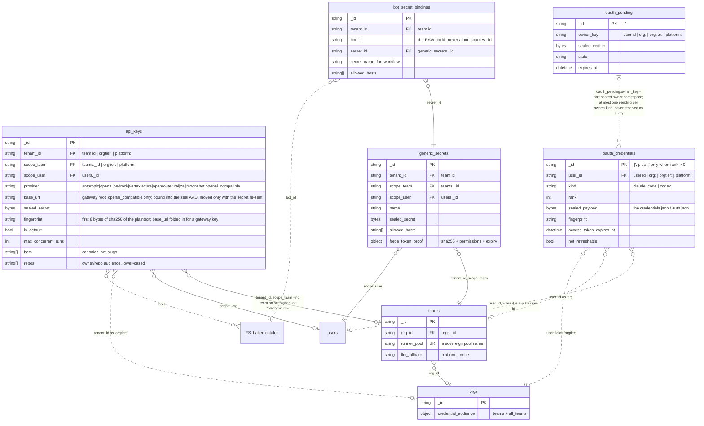
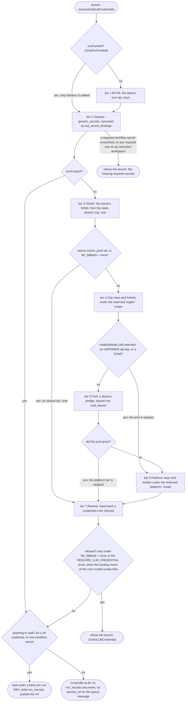

# Data model — credentials, metering and routing policy

Sixteen Mongo collections hold what funds a run: a credential sealed at rest, the bundle that carries it to a runner pod, the four meters that bill it, and the policy that decides where it may route.

> Drawn from the code at commit `d3df633a6` — main at v3.277.2, with #2652 and #2005 PR-A; how this page is kept true: [README](README.md).

## Block 1 — a credential at rest, and who may see it



- `api_keys`, `generic_secrets` and `bot_secret_bindings` are scoped by the **team** and fail **closed**. Two `api_keys` reads and writes are the stated exceptions: `GetOwned` carries no tenant term at all and is bounded by `scope_user` instead — only a key's own owner is served that way — and `MarkFingerprintUsed` fails open on a tenant-less context. Every `api_keys` write is a `$set` of the fields it names (`Patch`); the store has no whole-document writer, so a row keeps the columns a newer server build wrote on it and a stale read never carries back an `is_default` or a `last_used_at` another writer just moved.
- `oauth_credentials` has **no `tenant_id` field and no tenant filter at all**. Its whole tenancy model lives in the `user_id` owner namespace, and the spellings do not mean what they look like: `org:` carries a **TEAM** id, while the genuinely org-level one is `orgtier:`.
- A **bot id is a slug, never a key**: `bot_secret_bindings.bot_id`, `api_keys.bots` and `cred_pledges.bots` are compared by exact string equality — only `api_keys.bots` is canonicalised; bindings and pledges keep the raw spelling — and the launch resolves a slug through team `bot_sources`, then platform `bot_sources`, then the baked catalog on the server's own filesystem. An FK to `bot_sources._id` (a UUID) would be wrong.
- `(scope_team, name)` on `generic_secrets` is held by NOTHING: two team-wide secrets may share a name.
- `teams`, `users` and `orgs` are anchors — the identity model is [its own page](data-model-identity.md). **Every edge to `orgs` on this page is zero-or-one except `cred_pools.org_id`**, so no collection here but a pool may be read as proving a parent org.

## Block 2 — a credential in flight: the sealed bundle and the pool lease

```mermaid
erDiagram
  run_secrets {
    string _id PK
    string tenant_id FK "teams._id"
    string run_id FK "runs._id"
    string key_id "'dek'"
    bytes sealed_bundle
    datetime expires_at
    map bundle.api_keys "INSIDE the sealed body: provider -> plaintext"
    map bundle.pinned_api_keys "INSIDE: provider -> plaintext"
    map bundle.oauth_credentials "INSIDE: kind -> the credentials.json / auth.json"
    map bundle.oauth_record_refs "INSIDE: kind -> oauth_credentials._id"
    map bundle.generic_secrets "INSIDE: workflow secret name -> plaintext"
    map bundle.generic_secret_refs "INSIDE: generic_secrets._id"
    map bundle.pool_sourced "INSIDE"
    map bundle.platform_sourced "INSIDE"
    map bundle.org_sourced "INSIDE"
  }
  runs {
    string _id PK
    string tenant_id FK "teams._id"
    string project_path "the forge slug"
    string[] cred_fingerprints "API-key AND OAuth fingerprints"
    string[] credential_tiers "byok|oauth-forfait|org|pool|platform - NOT credusage's four"
    object llm_route_policy
  }
  cred_pools {
    string _id PK
    string org_id FK "orgs._id"
    bool enabled
    string[] audience.teams
    string[] audience.orgs
    bool audience.contributors
    bool audience.all_teams
  }
  cred_pledges {
    string _id PK "'<user_id>|<source>|<ref>'"
    string pool_id FK "cred_pools._id"
    string user_id FK "users._id"
    string source "oauth | api_key"
    string ref "the OAuth kind, or the provider"
    string key_id FK "api_keys._id"
    bool enabled
    string health "ok | token_expired | auth_failed"
    string[] bots "RAW bot ids"
    object limits "max_usd_per_day, _per_week, max_runs_per_day, max_concurrent_runs"
    datetime cooldown_until
    object window "timezone, start_hour, end_hour, weekdays"
    bool fallback_use
  }
  cred_leases {
    string _id PK
    string run_id FK "runs._id"
    string pledge_id FK "cred_pledges._id"
    string pool_id FK "cred_pools._id"
    string donor_id FK "users._id"
    string source "oauth | api_key"
    string ref "the OAuth kind, or the provider"
    string key_id FK "api_keys._id"
    string fingerprint
    string tenant_id FK "teams._id"
    string requester_id "the run's owner_id"
    string bot_id "a bot slug"
    float granted_cost_usd
    bool consumed_run_unit
    bool closed
    datetime expires_at
    datetime acquired_at
  }
  cred_pool_usage {
    string _id PK "'<pledge_id>|d|2026-08-03' or '<pledge_id>|w|2026-W31'"
    int runs
    int64 cost_usd_millis "integer millis"
    datetime period_start
  }
  run_secrets }o--|| runs : "run_id"
  run_secrets }o..o{ api_keys : "bundle.api_keys / bundle.pinned_api_keys - plaintext"
  run_secrets }o..o{ oauth_credentials : "bundle.oauth_record_refs"
  cred_pools }o--|| orgs : "org_id"
  cred_pledges }o--|| cred_pools : "pool_id"
  cred_pledges }o--|| users : "user_id"
  cred_pledges }o--o| api_keys : "key_id"
  cred_pledges }o..o| oauth_credentials : "user_id + ref, resolved to rank 0"
  cred_leases }o--o| cred_pledges : "pledge_id - a lease, open or closed, outlives a deleted pledge"
  cred_leases }o--|| cred_pools : "pool_id"
  cred_leases }o--|| runs : "run_id"
  cred_leases }o--|| users : "donor_id"
  cred_pool_usage }o..o| cred_pledges : "_id, whose first segment is the pledge id - never resolved as a key"
```

- **A sealed bundle carries the credential itself, not a pointer to it**. The **ref** maps ride beside it, and only the OAuth ref is drawn, dotted, because **no query on `run_secrets` resolves them** — they live inside `sealed_bundle`, not in an indexed field. The `api_keys` edge carries no id at all.
- The link runs the other way from what a reader expects: **the run document holds no `secrets_ref`**. `run_secrets` points back at the run.
- Deleting a pledge removes its own document and nothing else: the `cred_pool_usage` rows keyed on its id survive until their own 400-day TTL, which is why that edge is optional at both ends.
- **No DOCUMENT id links a lease and a bundle** — which is why no edge joins them. The lease's inlined `source` / `ref` / `key_id` name the pledged credential and are copied from the pledge, never resolved independently — which is why the lease draws no second edge to `api_keys`.
- The zero `audience` admits **only teams of the owning org** — the opposite polarity from `orgs.credential_audience`, whose zero value admits nobody.

## Block 3 — metering and policy: four meters on four identities

```mermaid
erDiagram
  credential_usage {
    string _id PK "'cred|<fingerprint>|<provider>|<tier>|<tenant>[|<repo>]|<YYYY-MM>'"
    string fingerprint FK "api_keys.fingerprint | oauth_credentials.fingerprint"
    string provider "a provider name, or an OAuth kind"
    string tier "team | pool | platform | org"
    string tenant_id FK "team id | empty"
    string repo_id "runs.project_path"
    string nature "metered | estimate"
    int64 cost_usd_millis
    datetime month_start
  }
  usage_windows {
    string _id PK "'<key>#<window>'"
    string key "'<backend>|<scope>' + '|fp:<fingerprint>' when the credential is known"
    string window "e.g. five_hour|seven_day|seven_day_opus|seven_day_sonnet|seven_day_overage_included|overage, plus frequency|spend|auth"
    float utilization "0..1"
    string status "e.g. allowed | allowed_warning | rejected"
    int refusals
    datetime observed_at
  }
  org_usage {
    string _id PK "'org|<id>|<month>'"
    int runs
    int64 cost_usd_millis
    datetime month_start
  }
  cred_pool_usage {
    string _id PK "'<pledge_id>|<d or w>|<bucket>'"
    int runs
  }
  model_prefs {
    ObjectId _id PK
    string tenant_id FK "team id"
    string user_id FK "users._id"
    string key
    int slot
    string model
    string backend
  }
  llm_routing_policies {
    string _id PK "'team:<team id>' | 'org:<org id>'"
    string[] policy.pair_order "(harness, credential) pairs, e.g. 'claude_code+claude_forfait'"
    string[] policy.triggers "usage_window | unavailable | transient_exhausted | auth"
    string policy.refused_pinned_key "forfait | park"
    string[] policy.locks
    map policy.model_classes "class -> family -> model"
    datetime updated_at
  }
  platform_settings {
    string _id PK "family: usage_caps|platform_credentials|runner_pools|budget_floor|bot_roles|sandbox|bot_vars"
    int five_hour_pct "usage_caps"
    bool enforce "platform_credentials"
    string[] teams FK "platform_credentials"
    bool keys_first "platform_credentials"
    string facade_default "platform_credentials - auto | tier | never | always"
    object routing "platform_credentials"
    object pools "runner_pools - name, providers_served, note, state"
    object reservations "budget_floor - per bot_id"
    object repo_quotas "budget_floor - per runs.project_path"
  }
  credential_usage }o--o| teams : "tenant_id"
  usage_windows }o..o| teams : "key - its 'tenant:<id>' scope segment"
  usage_windows }o..o| orgs : "key - its 'org:<id>' scope segment"
  org_usage }o..o| orgs : "_id - its subject segment"
  model_prefs }o--o| teams : "tenant_id"
  llm_routing_policies |o..o| teams : "llm_routing_policies._id as 'team:<id>'"
  llm_routing_policies |o..o| orgs : "llm_routing_policies._id as 'org:<id>'"
  platform_settings |o--o{ teams : "platform_settings.teams, in the platform_credentials family"
  teams }o..o| platform_settings : "runner_pool - resolved in the runner_pools family"
```

- **Four meters, four identities, and none substitutes for another.** Their tier vocabularies differ too: `credential_usage.tier` has four values because it merges a tenant's key and its subscription into `team`, where `runs.credential_tiers` keeps the publisher's five and holds `byok` and `oauth-forfait` apart.
- **Five dotted edges in this block carry the parent id inside a composed string**: `usage_windows.key`, `org_usage._id`, `llm_routing_policies._id`. No store joins on `orgs._id` or `teams._id`, so none of them is a key lookup. The solid edges are the ones whose field *is* the reference: `credential_usage.tenant_id` and `model_prefs.tenant_id`, both written verbatim, and `platform_credentials.teams`, an allow-list of team ids. The sixth dotted edge, `runner_pool`, is a pool name resolved in the `runner_pools` family.
- `org_usage`'s subject is a **team** id whenever the launch gate read the zero `Org` — an org-less team, or an org the gate could not read — so an `org|` subject is not proof of an org, and a meter row's owner is zero-or-one.
- `usage_windows.key` carries five scope spellings — `platform`, `local`, `tenant:<id>`, `org:<id>` and the literal `account`. Three of its windows (`frequency`, `spend`, `auth`) are not provider windows at all.
- `platform_settings` is **one collection, one document per family**. This page draws the four a run's funding and routing read — `platform_credentials`, `runner_pools`, `usage_caps` and `budget_floor`; the bot-facing families are drawn on [data-model-forge-bots.md](data-model-forge-bots.md). Sovereign runner pools are the `runner_pools` **family**, not a collection of their own.
- `llm_routing_policies` is not a `platform_settings` family: its documents are tenant data, one per org or team, while `platform_credentials.routing` holds the platform level of the same policy. A document is a team's **or** an org's, never both — its `_id` carries exactly one of the two prefixes.

## The credential tier walk

`walkCredentialPlan` enumerates seven tiers in a fixed order. These seven are the plan's own; what a run is stamped with is the five of `runs.credential_tiers`.



- The two gates are **not symmetric**: `HAS` closes the Pool tier and nothing else, so a team holding its own unpinned key still walks Platform. Of the two, only `PG` closes Platform.
- `SOV` is a **closure, not the skip of one tier**: a team mapped to a sovereign runner pool, or holding `llm_fallback: none`, loses Org, Pool *and* Platform. The two conditions diverge at the refusal: under `llm_fallback: none` the launch is refused as `RF` draws it, while a **pool-mapped team on the default fallback is, by default, at most warned**.
- `envFunded` removes every tier **except Generic**. It holds only for a run whose every model route names an `openai_compatible/…` model, and not for every such run — not, for example, when a route's model or provider text reads the environment.
- `RF`'s funding check reads the providers the walk attributes to the run's routes (`spendableProviders`), so a route the walk cannot read — an unpinned agent, a human gate's or a tool recovery's model, a forfait rung of the routing ladder, for example — can turn a refusal into a start, unless the policy is `llm_fallback: none` and the team holds no credential of its own.
- After the walk, the fallback door (`acquireDoorGrant`) can lease a pool credential; `SOV` shuts it.
- Tier 7 is not a fallback credential but a **retry posture**: a credential a tier passed over comes back only where the restore's own vetoes allow it; the run then parks on its refusal with a durable retry.
- **Outside the sovereign posture** nothing here refuses a credential-less run by default.

## Collections

| collection | package | document struct | tenant field (values) | unique / TTL indexes | twin |
|---|---|---|---|---|---|
| `api_keys` | `pkg/secrets` | `ApiKey` | `tenant_id`: team \| `orgtier:<org>` \| `platform:` | none unique; no TTL | none (cloud-only) |
| `oauth_credentials` | `pkg/secrets` | `OAuthRecord` | none — `user_id` namespace: user \| `org:<team>` \| `orgtier:<org>` \| `platform:` | `user_id+kind+rank` unique; no TTL | none (cloud-only) |
| `oauth_pending` | `pkg/secrets` | `OAuthPending` | none — `owner_key` namespace | `owner_key+kind` unique; TTL `expires_at` (10 min) | none (cloud-only) |
| `generic_secrets` | `pkg/secrets` | `GenericSecret` | `tenant_id`: team (empty in the file store, which pins `scope_team: local`) | none unique; no TTL | `file secrets.json` — the file and memory twins keep no order among duplicate names |
| `bot_secret_bindings` | `pkg/secrets` | `BotSecretBinding` | `tenant_id`: team | `tenant_id+bot_id+secret_name_for_workflow` unique | none (cloud-only) |
| `run_secrets` | `pkg/secrets` | `RunSecretsRecord` | `tenant_id`: team (fails **open** with no ctx) | none unique; TTL `expires_at` (24 h) | none (cloud-only) |
| `cred_pools` | `pkg/credpool` | `Pool` | none — `org_id` names the owning org (`GetByOrg` resolves on it) | none unique (`pool_org` only); no TTL | none (cloud-only) |
| `cred_pledges` | `pkg/credpool` | `Pledge` | none — `_id` is the donor's | none unique; no TTL | none (cloud-only) |
| `cred_leases` | `pkg/credpool` | `Lease` | `tenant_id`: team (audit + the cross-team takeover guard) | none unique; TTL `acquired_at` (90 d) | none (cloud-only) |
| `cred_pool_usage` | `pkg/credpool` | `ledgerDoc` | none — `_id` is pledge + period | none unique; TTL `period_start` (400 d) | none (cloud-only) |
| `credential_usage` | `pkg/credusage` | `usageDoc` | `tenant_id`: team \| empty (an `_id` segment) | none unique; TTL `month_start` (400 d) | none (cloud-only) |
| `usage_windows` | `pkg/usagecap` | `readingDoc` | none — scope inside `key`: `platform` \| `local` \| `tenant:<id>` \| `org:<id>` \| `account` | none unique; TTL `observed_at` (14 d) | `memory-only` |
| `org_usage` | `pkg/orgusage` | `usageDoc` | none — `_id` subject is an ORG (a team for an org-less team, or an org the gate could not read) | none unique; TTL `month_start` (400 d) | none (cloud-only) |
| `model_prefs` | `pkg/modelprefs` | `Pref` | `tenant_id`: team \| empty in local mode (an argument, not ctx) | `tenant+user+key` unique, `tenant+user+slot` unique partial | `file model-prefs.json` |
| `llm_routing_policies` | `pkg/platformcfg` | `RoutingPolicyRecord` | none — `_id` is `team:<id>` \| `org:<id>` | none (no `EnsureSchema`) | none (cloud-only) |
| `platform_settings` | `pkg/platformcfg`, `pkg/usagecap` (the `budget_floor` type is `pkg/budgetfloor`'s) | `PlatformCredentials`, `RunnerPools`, `settingsDoc`, `budgetfloor.Policy` | none — platform-scoped, one document per family | none | none (cloud-only) |
| `runs` | `pkg/store/mongo` | `store.Run` | `tenant_id`: team | drawn on [data-model-runs.md](data-model-runs.md) | `file runs/<id>/run.json` |
| `teams` | `pkg/identity` | `Team` | `_id` IS the tenant | `slug` unique, `runner_pool` unique partial | none (cloud-only) |
| `users` | `pkg/identity` | `User` | none | `email` unique | none (cloud-only) |
| `orgs` | `pkg/identity` | `Org` | `_id` IS the org | `slug` unique; `migrated_from_team_id` unique partial | none (cloud-only) |
| `FS: baked catalog` | `bots/` | — | — | — | FS, not Mongo |

## Related

- [secrets-reference.md](../secrets-reference.md) — every secret kind, the scope semantics, the sealer wire format and the per-record AAD table; [byok.md](../byok.md) for `api_keys` field by field and [oauth-forfait.md](../oauth-forfait.md) for the PKCE connect flow, the ranks and the refresh worker
- [cloud-llm-credentials.md](../cloud-llm-credentials.md) — the maintained resolution guide across every tier; [credential-pool.md](../credential-pool.md) for pledges, leases, the budget clamp and the audience; [sovereign-pools.md](../sovereign-pools.md) for the runner-pool registry and `llm_fallback: none`
- [usage-caps.md](../usage-caps.md) — the provider usage-window guard and the per-credential key format; [quotas-and-limits.md](../quotas-and-limits.md) for the launch-admission gate and the per-credential usage view
- [agents/engine/tenancy-credentials-spend.md](../agents/engine/tenancy-credentials-spend.md) — the per-package invariants of this whole domain
- [adr/123-run-bundle-dek-in-envelope.md](../adr/123-run-bundle-dek-in-envelope.md) · [adr/121-adaptive-routing-policy.md](../adr/121-adaptive-routing-policy.md) · [adr/032-quota-optimistic-inc-with-detached-context-rollback.md](../adr/032-quota-optimistic-inc-with-detached-context-rollback.md) · [adr/090-runtime-operational-settings-db-backed.md](../adr/090-runtime-operational-settings-db-backed.md)

