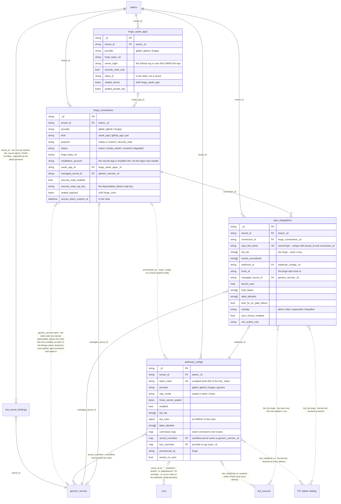
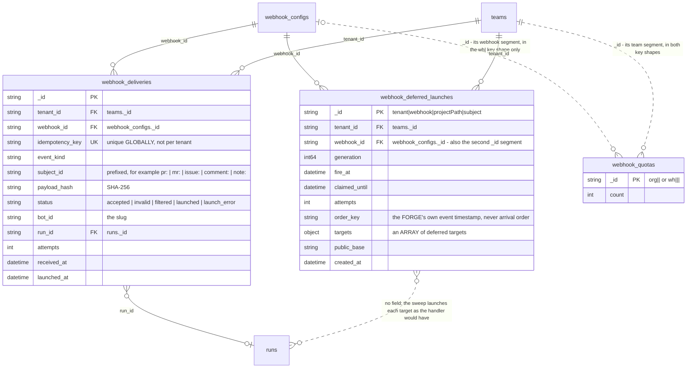
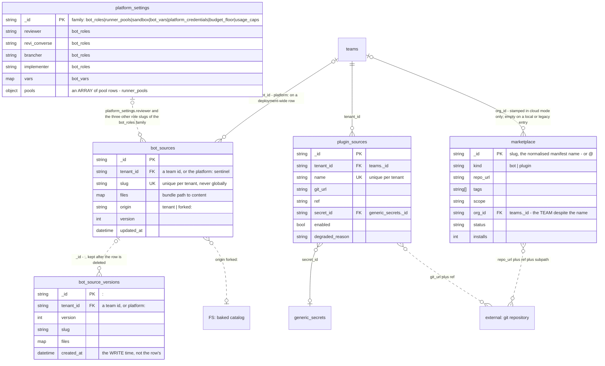
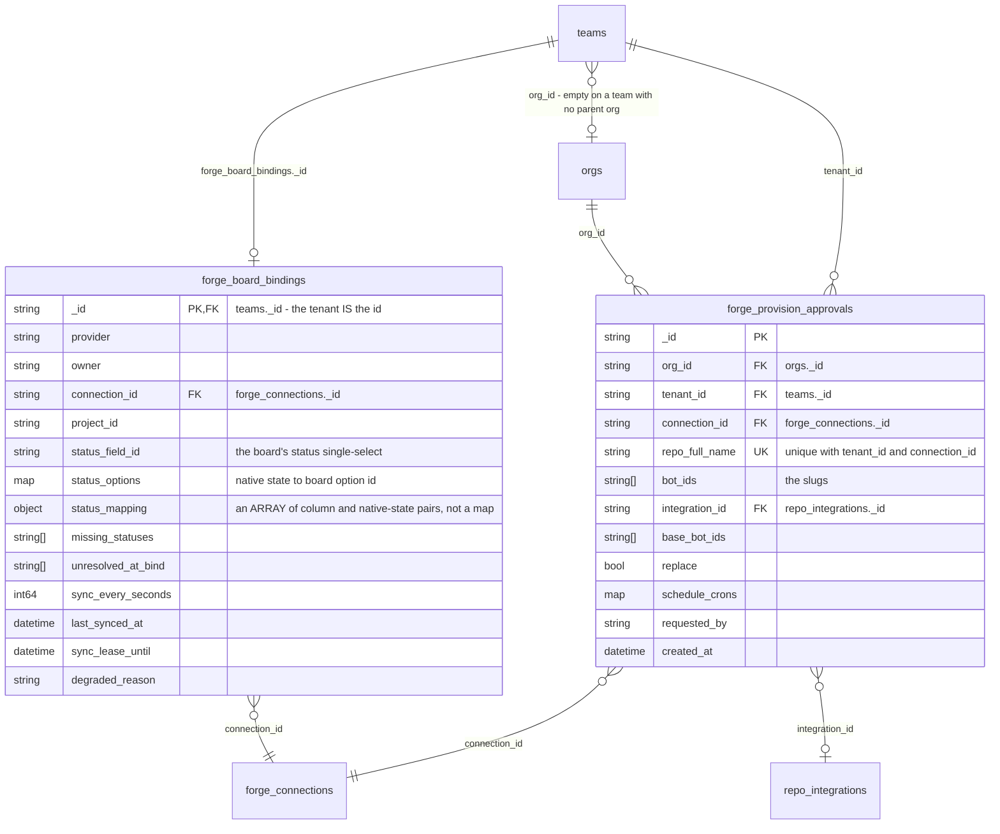

# Data model — forges, repositories and bots

Enabling a bot on a repository binds it in two documents — the webhook config that enforces the binding first, the integration row that records the repo's own choices second, with no transaction over the pair — and the bots they name are slugs a launch resolves through three tiers, never stored keys.

> Drawn from the code at commit `61a305262` — main at v3.266.1, after #2391, which carries the launch rung; how this page is kept true: [README](README.md).

## Block 1 — Revi bound to a repository, inside a team

- Six settings sit on both stores — hold labels, the label allowlist, overlap, the operator's launch vars (`operator_launch_vars` on the config), `bot_ids` and `min_author_role`. Which copy counts is a property of the lane, not of the store: every runtime reader of hold labels, the label allowlist and overlap takes the config's copy, while the zero-touch gate lane reads the INTEGRATION's `auto_fix_on_gate_failure` and its `launch_vars[gate_context]` pin. Nothing sets `min_author_role` on either store — the provision only carries the integration's existing value forward — so every lane reads it empty.
- `bot_ids` and `bot_rules[].bot_id` are slugs, not keys: nothing in Mongo resolves them. A launch tries the launching TEAM's `bot_sources` row, then the row under tenant `platform:`, then the baked catalog on disk — hence the dotted edges, and why the same slug can mean different code for two teams.
- The stored uniqueness is `(tenant_id, connection_id, repo_full_name)`; the reverse `(tenant_id, webhook_id)` index is NOT unique, so one webhook per integration is a provisioning invariant rather than a constraint.

## Block 2 — the inbound delivery lifecycle

- The `org|` prefix of a quota row names a key shape, not an `orgs` document: the segment is the webhook config's `tenant_id`, a TEAM.
- The debounce row's `_id` IS the subject key, so one push volley costs one review.
- Only `accepted`, `launched` and a post-insert `launch_error` occupy the lane's key: the refusal statuses — `invalid`, `filtered`, and a `launch_error` the launch gate denied before the insert — are filed under a random uuid.

## Block 3 — bot-definition tiers and team extensions

- `platform:` is an ordinary row in the same collection under a sentinel tenant, not a second collection.
- The baked tier is a FILESYSTEM: the tiered resolver reads the configured bot roots — by default `bots/`, `examples/` and `.botz/` under the work dir.
- `platform_settings` holds one document per family and carries no tenant at all. Sovereign runner pools are a FAMILY, not a collection.
- `marketplace` carries no `tenant_id`. `org_id` is where the tenant hides, and it holds the submitting TEAM: the viewer's reach is their own team id, so an `org`-scoped entry is visible to ONE team, never org-wide.

## Block 4 — the board binding and the provisioning gate

- The binding's `_id` IS the team id, so one board per team needs no unique index.
- An approval row exists while the decision is pending.

## Collections

| Collection | Package | Document struct | Tenant field (values) | Unique / TTL indexes | Twin |
|---|---|---|---|---|---|
| `forge_oauth_apps` | `pkg/forge` | `ForgeOAuthApp` | `tenant_id` — a team id | unique `(tenant_id, provider, forge_base_url, owner_login, security_read_only)`; the two legacy indexes are dropped by name first | `none (cloud-only)` |
| `forge_connections` | `pkg/forge` | `Connection` | `tenant_id` — a team id | none unique; `tenant_provider`, `token_expiry` | `none (cloud-only)` |
| `repo_integrations` | `pkg/forge` | `RepoIntegration` | `tenant_id` — a team id | `tenant_conn_repo_unique` on `(tenant_id, connection_id, repo_full_name)`; `tenant_webhook` | `none (cloud-only)` |
| `webhook_configs` | `pkg/webhooks` | `Config` | `tenant_id` — a team id | `token_hash_unique`; `tenant_created`; no TTL | `none (cloud-only)` |
| `webhook_deliveries` | `pkg/webhooks` | `Delivery` | `tenant_id` — a team id | `idempotency_unique` on the key ALONE; TTL `deliveries_ttl` on `received_at`, 90 days | `none (cloud-only)` |
| `webhook_deferred_launches` | `pkg/webhooks` | `DeferredLaunch` | `tenant_id`, and the first `_id` segment — a team id | none unique; `deferred_fire_at`; TTL `deferred_ttl` on `created_at`, 7 days | `none (cloud-only)` |
| `webhook_quotas` | `pkg/webhooks` | none — `MongoCounter` writes `{_id, count}` | none — the team is an `_id` segment | none declared, no TTL | `none (cloud-only)` |
| `bot_sources` | `pkg/botsource` | `BotSource` | `tenant_id` — a team id, or `platform:` | `tenant_slug_unique` on `(tenant_id, slug)` | `memory-only` |
| `bot_source_versions` | `pkg/botsource` | `BotSource`, `_id` rewritten to `<row id>:<version>` | `tenant_id` — a team id, or `platform:` | none unique; TTL `created_at_ttl`, 30 days | `memory-only` |
| `plugin_sources` | `pkg/pluginsource` | `PluginSource` | `tenant_id` — a team id | `tenant_name_unique` on `(tenant_id, name)`; `tenant_enabled` | `none (cloud-only)` |
| `marketplace` | `pkg/marketplace` | `Entry` | `org_id` — the submitting TEAM id, stamped on every cloud submission (empty on a local or legacy entry); the owner when `scope` is `org` | none unique; seven query indexes including `text_search` and `moderation_queue` | `file marketplace.json` |
| `platform_settings` | `pkg/platformcfg`, `pkg/usagecap` | one struct per family — `BotRoles`, `RunnerPools`, `Sandbox`, `BotVars`, `PlatformCredentials`, `budgetfloor.Policy` (the one family `pkg/platformcfg` stores whose type lives outside it), the usage caps | none — deployment-wide; the `_id` is the family | none declared, no TTL | `none (cloud-only)` |
| `forge_board_bindings` | `pkg/forge` | `BoardBinding` | the `_id` **is** the team id | none unique (the `_id` is the key); `board_binding_due` | `none (cloud-only)` |
| `forge_provision_approvals` | `pkg/forge` | `ProvisionApproval` | `tenant_id` — the requesting team; `org_id` — the approving org | `tenant_conn_repo_unique`; `org`; no TTL | `none (cloud-only)` |
| `teams` | `pkg/identity` | `Team` | the `_id` **is** the tenant | stub here | see [data-model-identity.md](data-model-identity.md) |
| `orgs` | `pkg/identity` | `Org` | the `_id` **is** the org | stub here | see [data-model-identity.md](data-model-identity.md) |
| `runs` | `pkg/store/mongo` | `store.Run` | `tenant_id` — a team id | stub here | see [data-model-runs.md](data-model-runs.md) |
| `generic_secrets` | `pkg/secrets` | `GenericSecret` | `tenant_id` — a team id | stub here | see [data-model-credentials.md](data-model-credentials.md) |
| `bot_secret_bindings` | `pkg/secrets` | `BotSecretBinding` | `tenant_id` — a team id | stub here | see [data-model-credentials.md](data-model-credentials.md) |
| `"FS: baked catalog"` | `pkg/botregistry` | not a collection | — | not a collection | the bundles shipped in the image, read from `bots/`, `examples/` and `.botz/` under the work dir; `//go:embed` carries four paths only |
| `"external: git repository"` | not a collection | — | — | not a collection | the repository a plugin source or a listing names |

## Related

- [forge-integrations.md](../forge-integrations.md) — connect a forge, enable a repo, the manifest `forge:` block, the normalized-to-native event table, the managed token, the operator-owned settings.
- [forge-permissions.md](../forge-permissions.md) and [forge-security-read.md](../forge-security-read.md) — who a bot acts as per connection kind, least privilege per call family, and the watch-only connection.
- [webhooks.md](../webhooks.md) — the inbound side end to end: token versus HMAC, the lanes, the matching filters, per-bot routing, the idempotency keys, limits and admission, the delivery statuses.
- [platform-bots.md](../platform-bots.md) and [plugins.md](../plugins.md) — the `platform:` override and its precedence, the git-hosted plugin sources and the quarantine contract.
- [github-board-sync.md](../github-board-sync.md) and [adr/097-github-projects-v2-board-sync.md](../adr/097-github-projects-v2-board-sync.md) — binding by address, the status reconciliation, the cadence and the lease.
- [adr/039-per-tenant-sealed-oauth-app-store-replaces-global-env.md](../adr/039-per-tenant-sealed-oauth-app-store-replaces-global-env.md), [secrets.md](../secrets.md), [cloud-rest-api.md](../cloud-rest-api.md) and [agents/engine/tenancy-credentials-spend.md](../agents/engine/tenancy-credentials-spend.md) — the sealed app store, the credential tiers, the route tables and the settings families.

## Sources

- `pkg/forge` — [types.go](../../pkg/forge/types.go) (`Connection`, `Purpose`), [connection_store.go](../../pkg/forge/connection_store.go) (`ConnectionStore`, `ExpiringBefore`), [repo_integration_store.go](../../pkg/forge/repo_integration_store.go) (`RepoIntegration`), [oauth_app_store.go](../../pkg/forge/oauth_app_store.go) (`ForgeOAuthApp`, `EnsureSchema`), [board_binding_store.go](../../pkg/forge/board_binding_store.go) (`BoardBinding`, `ClaimSync`), [provision_approval_store.go](../../pkg/forge/provision_approval_store.go) (`ProvisionApproval`), [orchestrator.go](../../pkg/forge/orchestrator.go) (`Provision`, `ensureManagedSecret`, `ensureBotBinding`, `narrowGitHubAppSecret`, `managedSecretName`, `syncSchedules`).
- `pkg/webhooks` — [types.go](../../pkg/webhooks/types.go) (`Config`, `BotRule`, `CommandRoute`, `Delivery`, `DeferredLaunch`, `DeferredTarget`), [mongo.go](../../pkg/webhooks/mongo.go) (`EnsureSchema`, `GetByIdempotencyKey`, `ClaimFailedRetry`, `Upsert`, `ClaimDue`, `MongoCounter`).
- bots and extensions — [botsource/botsource.go](../../pkg/botsource/botsource.go) (`BotSource`, `PlatformTenantID`, `MaxBundleBytes`), [botsource/mongo.go](../../pkg/botsource/mongo.go) (`snapshotVersion`, `GetVersionAtOrBefore`, `BotSourceVersionTTLDays`), [pluginsource/pluginsource.go](../../pkg/pluginsource/pluginsource.go) (`PluginSource`, `MarkDegraded`), [pluginsource/mongo.go](../../pkg/pluginsource/mongo.go) (`withTenantFilter`), [marketplace/types.go](../../pkg/marketplace/types.go) (`Entry`), [marketplace/mongostore.go](../../pkg/marketplace/mongostore.go), [marketplace/jsonstore.go](../../pkg/marketplace/jsonstore.go), [platformcfg/store.go](../../pkg/platformcfg/store.go) (`FamilyBotRoles`, `FamilyBudgetFloor`, `ColRoutingPolicies`), [platformcfg/platformcfg.go](../../pkg/platformcfg/platformcfg.go) (`BotRoles`, `RunnerPools`), [usagecap/settings_mongo.go](../../pkg/usagecap/settings_mongo.go), [budgetfloor/budgetfloor.go](../../pkg/budgetfloor/budgetfloor.go) (`Policy`).
- `pkg/server` — [bot_resolver.go](../../pkg/server/bot_resolver.go) (`resolveBotTieredRaw`, `resolveBotSource`, `teamBotRow`, `launchBot.Tier`), [webhooks_common.go](../../pkg/server/webhooks_common.go) (`resolveForgeEventBots`, `webhookForgeConnection`), [webhooks_debounce.go](../../pkg/server/webhooks_debounce.go) (`deferSubjectKey`, `dropReplayedTargets`), [platform_settings.go](../../pkg/server/platform_settings.go) (`roleBots`), [forge_publish.go](../../pkg/server/forge_publish.go) (`forgeConnectionForPR`), [middleware_webhook.go](../../pkg/server/middleware_webhook.go), [webhooks_routes.go](../../pkg/server/webhooks_routes.go), [forge_provisioning_routes.go](../../pkg/server/forge_provisioning_routes.go), [forge_approval_routes.go](../../pkg/server/forge_approval_routes.go).
- neighbours — [secrets/generic.go](../../pkg/secrets/generic.go) (`GenericSecret`, `ErrGenericSecretTenantMissing`, `withGenericSecretTenantFilter`), [secrets/bindings.go](../../pkg/secrets/bindings.go) (`BotSecretBinding`, `ErrBindingTenantMissing`), [secrets/local.go](../../pkg/secrets/local.go) (`LocalSecretsFileName`), [store/mongo/tenant.go](../../pkg/store/mongo/tenant.go) (`withTenantFilter`), [connection/store.go](../../pkg/connection/store.go) (`Store`, `MemoryStore`), [connection/file_store.go](../../pkg/connection/file_store.go) (`FileStore`), [identity/types.go](../../pkg/identity/types.go) (`Team`, `Org.RequireProvisionApproval`), [store/run.go](../../pkg/store/run.go) (`Run.BotSourceTier`, `Run.BotSourceTenant`), [botregistry/registry.go](../../pkg/botregistry/registry.go) (`DefaultPaths`, `NormalizeName`), [bots/embed.go](../../bots/embed.go), [bundle/manifest.go](../../pkg/bundle/manifest.go) (`DefaultForgeSecretName`).
