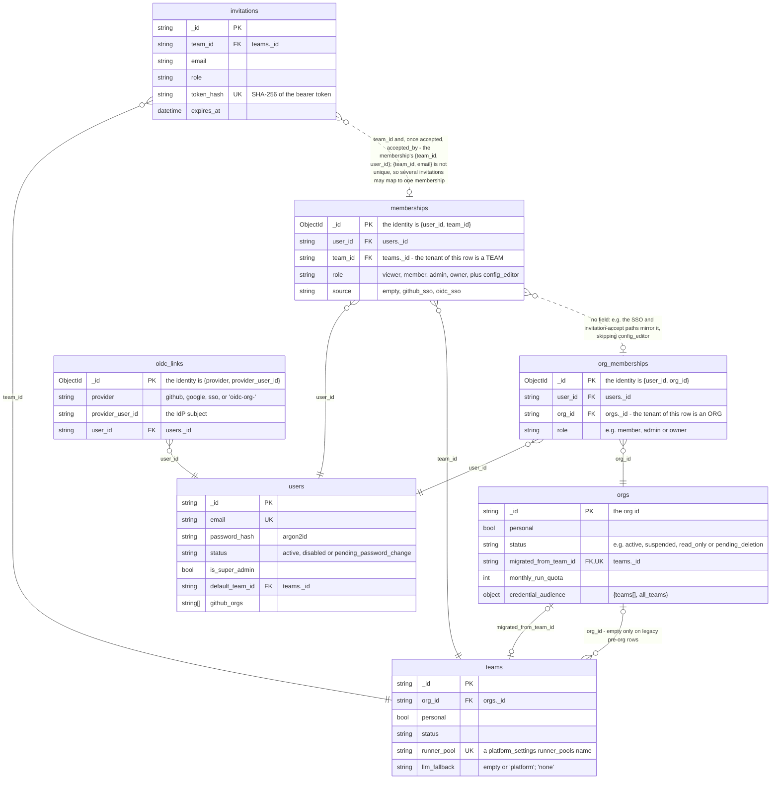
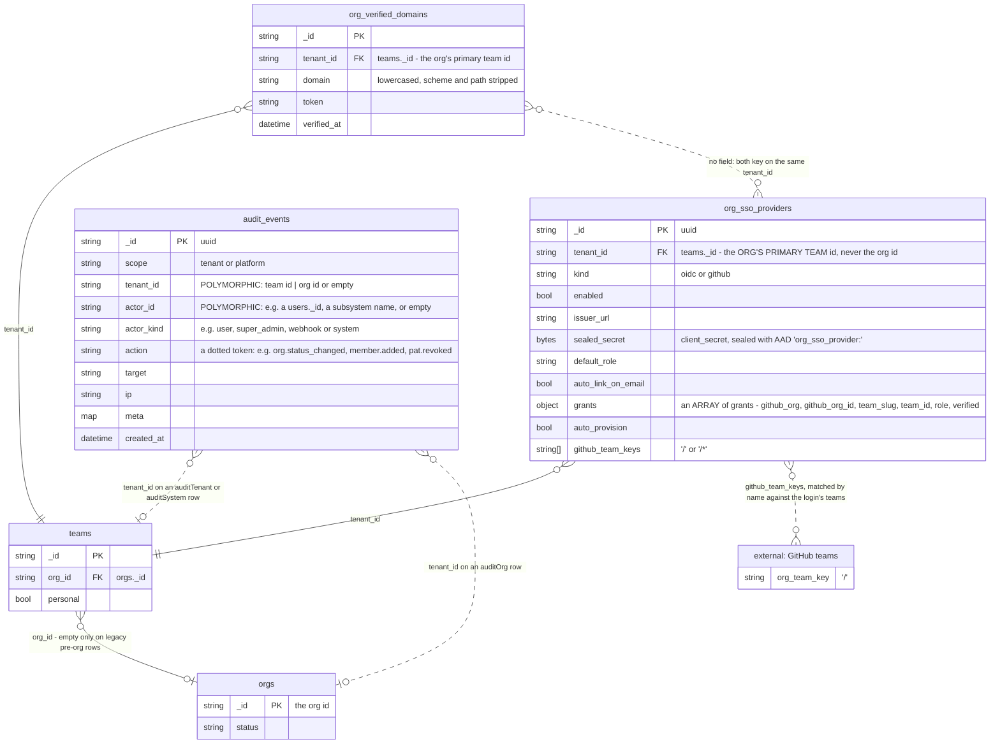

# Data model — identity and tenancy

A team id is the tenant of almost every resource an iterion deployment stores, a team belongs to at most one org, and the credentials a person signs in with all hang off a single user row.

> Drawn from the code at commit `61a305262` — main at v3.266.1, after #2391, which carries the launch rung; how this page is kept true: [README](README.md).

## Block 1 — Who is who



- `teams._id` is the tenant, not `orgs._id`. Plenty of rows key on the org instead.
- `memberships.role` is not a five-rung ladder. `config_editor` ranks 0, so `AtLeast` places it nowhere.

## Block 2 — How a credential is born and dies

```mermaid
erDiagram
    users {
        string _id PK
        string status "e.g. disabled, pending_password_change"
    }
    sessions {
        string _id PK "uuid"
        string user_id FK "users._id"
        string token_hash UK "SHA-256 of the refresh token"
        datetime expires_at
        datetime revoked_at
        string rotated_from "assigned by NO writer"
    }
    password_resets {
        string _id PK "uuid"
        string user_id FK "users._id"
        string token_hash UK "SHA-256 of the 'iar_' token"
        datetime expires_at
        datetime consumed_at
    }
    personal_access_tokens {
        string _id PK
        string user_id FK "users._id"
        string token_hash UK "SHA-256 of the 'iap_' bearer"
        string fingerprint
        string team_id FK "teams._id"
        datetime expires_at
        datetime revoked_at
    }
    oidc_states {
        string _id PK "the opaque 'state' parameter"
        string pending.codeverifier
        string pending.agentbinding
        string pending.tenantid FK "teams._id - the org's primary team"
        string pending.orgproviderid FK "org_sso_providers._id"
        string pending.linkuserid FK "users._id"
        datetime expires_at
    }
    desktop_sso_tickets {
        string _id PK "the random ticket"
        object result.user "the whole identity.User - INCLUDING password_hash"
        string result.accesstoken "a LIVE access JWT"
        string result.refreshtoken "a LIVE refresh token"
        datetime expires_at
    }
    ws_tickets {
        string _id PK "the random ticket"
        string identity.userid FK "users._id"
        string identity.teamid FK "teams._id"
        string identity.role
        string identity.kind "always empty here"
        datetime expires_at
    }
    sessions }o--|| users : "user_id"
    password_resets }o--|| users : "user_id"
    password_resets |o..o{ sessions : "no field: Consume then RevokeUserSessions by user_id"
    personal_access_tokens }o--|| users : "user_id"
    oidc_states }o--o| users : "pending.linkuserid"
    oidc_states |o..o| desktop_sso_tickets : "no field: a desktop flow mints the ticket at callback"
    ws_tickets }o--|| users : "identity.userid"
```

- The access JWT is not a document and is absent here on purpose. `sessions` holds refresh tokens only.
- Untagged Go structs are stored LOWERCASED with no underscores — so the embedded names above are the real query keys.
- Single use is a store primitive, not a flag. `oidc_states`, `desktop_sso_tickets` and `ws_tickets` redeem through `FindOneAndDelete`. `sessions` and `password_resets` instead compare-and-set `revoked_at` / `consumed_at`.
- `personal_access_tokens` has no TTL index and no `tenant_id`: rows survive expiry and revocation for audit, and the hash IS the credential.

## Block 3 — Org-level SSO config and the audit trail



- `tenant_id` on both org SSO collections is a TEAM id — the org's primary team — not an org id. Reading these rows by org id finds nothing.
- `audit_events.tenant_id` is polymorphic and nothing in the document says which kind it holds: `auditTenant` and `auditSystem` write a team id (none on an `auditTenant` row a team-less caller writes from a `/api/me/` route), `auditOrg` an org id, all with `scope: tenant`. The partition is only "which id was written", which is why two dotted edges leave the SAME field for different collections — the store never joins it.
- An unverified GitHub grant is stored but inert: it shows in `grants` and never in `github_team_keys`.
- `verified_at` carries the whole value of `org_verified_domains`: an unproven row exists so the operator can read the TXT challenge. A verified domain is not enough to auto-link onto an existing account.

## Collections

| collection | package | document struct | tenant field (values) | unique / TTL indexes | twin |
|---|---|---|---|---|---|
| `users` | `pkg/identity` | `identity.User` | none — platform-global | `email` unique; `status` | none (cloud-only) |
| `orgs` | `pkg/identity` | `identity.Org` | `_id` IS the org tenant | `slug` unique; `migrated_from_team_id` unique partial on `$exists`; `created_at`, `status` | none (cloud-only) |
| `teams` | `pkg/identity` | `identity.Team` | `_id` IS the resource tenant | `slug` unique; `runner_pool` unique partial on non-empty; `org_id`, `created_at`, `status` | none (cloud-only) |
| `org_memberships` | `pkg/identity` | `identity.OrgMembership` | `org_id` — an org | `{user_id, org_id}` unique; `{org_id, role}` | none (cloud-only) |
| `memberships` | `pkg/identity` | `identity.Membership` | `team_id` — a team | `{user_id, team_id}` unique; `{team_id, role}` | none (cloud-only) |
| `invitations` | `pkg/identity` | `identity.Invitation` | `team_id` — a team; an org invitation names one, defaulting to the org's primary team | `token_hash` unique partial on `$exists`; TTL `expires_at` at 0s; `{team_id, email}` | none (cloud-only) |
| `oidc_links` | `pkg/identity` | `identity.OIDCLink` | none — platform-global | `{provider, provider_user_id}` unique; `user_id` | none (cloud-only) |
| `sessions` | `pkg/auth` | `auth.Session` | none — the hash is the credential | `token_hash` unique; TTL `expires_at` at 0s; `{user_id, issued_at}` | none (cloud-only) |
| `password_resets` | `pkg/auth` | `auth.PasswordReset` | none — the hash is the credential | `token_hash` unique; TTL `expires_at` at 0s | none (cloud-only) |
| `personal_access_tokens` | `pkg/pat` | `pat.Token` | none — `team_id` is an optional pin to a team | `token_hash` unique; `{user_id, created_at}`; no TTL | none (cloud-only) |
| `oidc_states` | `pkg/auth/oidc` | `oidc.mongoStateDoc` wrapping `oidc.PendingAuth` | none; `pending.tenantid` is the org's primary team | TTL `expires_at` at 0s, 10 min as wired | memory-only |
| `desktop_sso_tickets` | `pkg/auth/desktopsso` | none — `{_id, result, expires_at}` built by `storekit.TicketMongo.Mint`; the payload is `auth.LoginResult` | none; `result.activeteamid` is a team | TTL `expires_at` at 0s, 2 min as wired | memory-only |
| `ws_tickets` | `pkg/auth/wsticket` | none — `{_id, identity, expires_at}` built by `storekit.TicketMongo.Mint`; the payload is `auth.Identity` | none; `identity.teamid` is the minter's team, re-scoped to the run's team on a run-addressed WS path | TTL `expires_at` at 0s, 1 min as wired | memory-only |
| `org_sso_providers` | `pkg/auth/orgsso` | `orgsso.OrgSSOProvider` | `tenant_id` — the org's primary TEAM id | `tenant_id` unique partial on `kind: github`; `{tenant_id, kind}`; `github_team_keys` partial on enabled github rows | none (cloud-only) |
| `org_verified_domains` | `pkg/auth/orgsso` | `orgsso.VerifiedDomain` | `tenant_id` — the org's primary TEAM id | `{tenant_id, domain}` unique | none (cloud-only) |
| `audit_events` | `pkg/audit` | `audit.Event` | `tenant_id` — a TEAM id on `auditTenant` and `auditSystem` rows (none on an `auditTenant` row a team-less caller writes from a `/api/me/` route), an ORG id on `auditOrg` rows, empty or either on `scope: platform` rows | TTL `created_at` at 400 days; `{tenant_id, created_at}`, `{scope, created_at}`, `{action, created_at}` | none (cloud-only) |
| `"external: GitHub teams"` | not a collection — GitHub's own roster | — | — | — | n/a (external) |

## Related

- [cloud-architecture.md](../cloud-architecture.md) — the four multitenancy boundaries and the auth metrics; [cloud-backup.md](../cloud-backup.md) — what a selective restore of these collections must include.
- [cloud-rest-api.md](../cloud-rest-api.md) — the credential kinds and the gate glossary these rows feed; [cloud-user.md](../cloud-user.md) — the end-user view of teams, invitations and PATs.
- [cloud-admin.md](../cloud-admin.md) and [cloud-admin-guide.md](../cloud-admin-guide.md) — bootstrap, signup modes, suspension, quotas, the audit log; [ticket-context.md](../ticket-context.md) — reading an account that signs in and sees nothing.
- [adr/048-org-team-hierarchy.md](../adr/048-org-team-hierarchy.md) — why the tenant key stays `team_id`, and the deliberate orgsso deviation; [adr/078-config-editor-role-sso-team-scoped-access.md](../adr/078-config-editor-role-sso-team-scoped-access.md) — the rank-0 capability and why it must not mirror up.
- [adr/035-per-org-sso-generic-oidc-plus-dedicated-connectors.md](../adr/035-per-org-sso-generic-oidc-plus-dedicated-connectors.md), [adr/037-sso-auto-link-requires-domain-dns-txt-not-idp-email-verified.md](../adr/037-sso-auto-link-requires-domain-dns-txt-not-idp-email-verified.md), [adr/038-github-team-gating-via-materialized-reverse-lookup-index.md](../adr/038-github-team-gating-via-materialized-reverse-lookup-index.md) — per-org SSO, the auto-link gate, the reverse-lookup index.
- [adr/103-run-addressed-by-id-across-teams.md](../adr/103-run-addressed-by-id-across-teams.md) — the run-by-id choke point a redeemed WS ticket also passes; [agents/engine/tenancy-credentials-spend.md](../agents/engine/tenancy-credentials-spend.md) — how the tenant stamped here reaches credential resolution.

