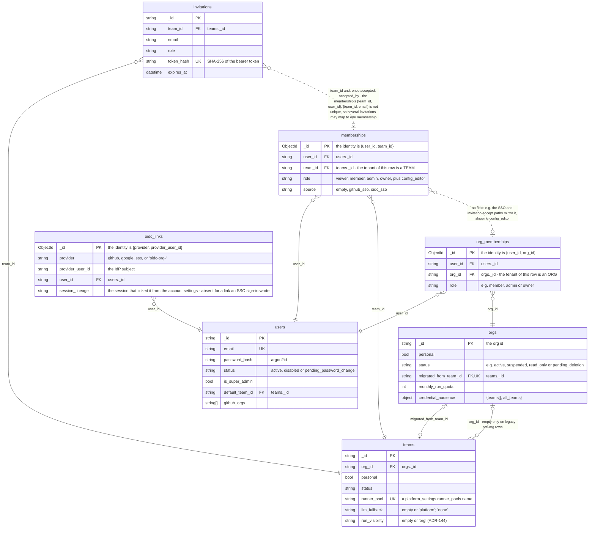
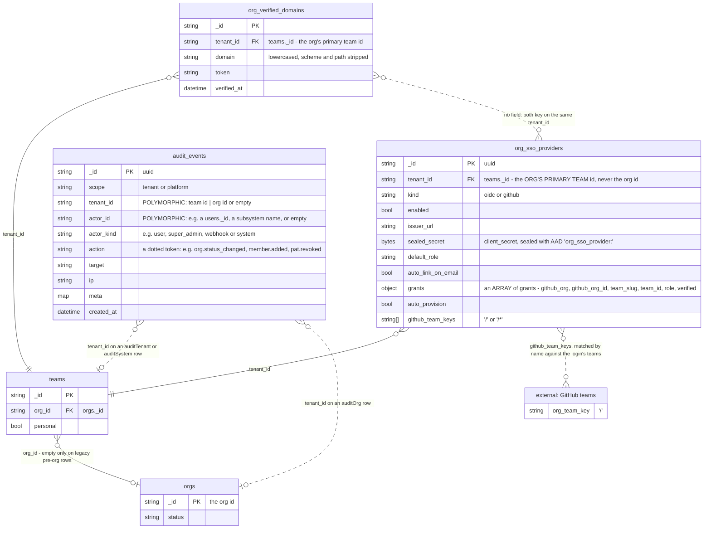

# Data model — identity and tenancy

A team id is the tenant of almost every resource an iterion deployment stores, a team belongs to at most one org, and the credentials a person signs in with all hang off a single user row.

> Drawn from the code at commit `98787101a` (branch fix/org-tree-errors-1668, on v3.276.0); how this page is kept true: [README](README.md).

## Block 1 — Who is who



- `teams._id` is the tenant, not `orgs._id`. Plenty of rows key on the org instead.
- `memberships.role` is not a five-rung ladder. `config_editor` ranks 0, so `AtLeast` places it nowhere.

## Block 2 — How a credential is born and dies

```mermaid
erDiagram
    users {
        string _id PK
        string status "e.g. disabled, pending_password_change"
    }
    sessions {
        string _id PK "uuid"
        string user_id FK "users._id"
        string token_hash UK "SHA-256 of the refresh token"
        datetime expires_at
        datetime revoked_at
        datetime delivered_at "when the token was first handed out - a root at its login, a successor when a refresh claims it; absent on a successor handed to nobody"
        string rotated_from "sessions._id of the session a rotation replaced"
        string lineage "sessions._id of the lineage's root - the root's own id, copied by every successor - absent on a row written before lineages, its own root"
        int generation "the account's session generation the lineage's login was born under - absent means 0"
        string rotation_nonce "set with revoked_at by the rotation that retired it"
        string rotation_kid "the signing key id the successor was derived under"
        string successor_hash "SHA-256 of the successor token"
        string rotation_ua "the client the rotation was for - the successor records it"
        string rotation_ip "the client the rotation was for - the successor records it"
    }
    session_revocations {
        string _id PK "family: lineage:<root session id>|account:<users._id>"
        string user_id FK "users._id - both families"
        int generation "account: raised by every revoke-all"
        datetime revoked_at "lineage: the revocation - account: the latest revoke-all"
    }
    password_resets {
        string _id PK "uuid"
        string user_id FK "users._id"
        string token_hash UK "SHA-256 of the 'iar_' token"
        datetime expires_at
        datetime consumed_at
    }
    personal_access_tokens {
        string _id PK
        string user_id FK "users._id"
        string token_hash UK "SHA-256 of the 'iap_' bearer"
        string fingerprint
        string team_id FK "teams._id"
        datetime expires_at
        datetime revoked_at
    }
    oidc_states {
        string _id PK "the opaque 'state' parameter"
        string pending.codeverifier
        string pending.agentbinding
        string pending.tenantid FK "teams._id - the org's primary team"
        string pending.orgproviderid FK "org_sso_providers._id"
        string pending.linkuserid FK "users._id"
        datetime expires_at
    }
    desktop_sso_tickets {
        string _id PK "the random ticket"
        object result.user "the whole identity.User - INCLUDING password_hash"
        string result.accesstoken "a LIVE access JWT"
        string result.refreshtoken "a LIVE refresh token"
        datetime expires_at
    }
    ws_tickets {
        string _id PK "the random ticket"
        string identity.userid FK "users._id"
        string identity.teamid FK "teams._id"
        string identity.role
        string identity.kind "always empty here"
        datetime expires_at
    }
    sessions }o--|| users : "user_id"
    sessions |o--o| sessions : "sessions.rotated_from - the successor names the session its rotation retired"
    sessions }o--o| sessions : "sessions.lineage - every session of a lineage names its root, the root itself included"
    session_revocations }o--|| users : "user_id"
    session_revocations |o..o{ sessions : "_id lineage:<sessions.lineage> covers every session of the lineage - the account row covers every session of a lower generation"
    password_resets }o--|| users : "user_id"
    password_resets |o..o{ sessions : "no field: Consume then RevokeUserSessions by user_id"
    personal_access_tokens }o--|| users : "user_id"
    oidc_states }o--o| users : "pending.linkuserid"
    oidc_states |o..o| desktop_sso_tickets : "no field: a desktop flow mints the ticket at callback"
    ws_tickets }o--|| users : "identity.userid"
```

- The access JWT is not a document and is absent here on purpose. `sessions` holds refresh tokens only.
- Untagged Go structs are stored LOWERCASED with no underscores — so the embedded names above are the real query keys.
- Single use is a store primitive, not a flag. `oidc_states`, `desktop_sso_tickets` and `ws_tickets` redeem through `FindOneAndDelete`. `sessions` and `password_resets` instead compare-and-set `revoked_at` / `consumed_at`.
- A refresh retires its session in the compare-and-set that records the rotation — `rotation_nonce`, `rotation_kid`, `successor_hash`, `rotation_ua`, `rotation_ip` — with `revoked_at` stamped by the database's clock (`$$NOW`), and the successor names it in `rotated_from` and copies its `lineage` and `generation`. `revoked_at` is written once: a sign-out or a revoke-all never moves it — their pass writes only the live sessions it covers, and a retired session keeps its rotation record, whose successor the revocation's record refuses at its delivery — so a session revoked with no rotation record was signed out, or revoked with its lineage or its account, while it was live. A successor is handed out once the refresh that writes it has checked it and claimed it (`delivered_at`, stamped once and only on a session not revoked); no refresh deletes a session it wrote, and a successor never claimed was handed to nobody, so its predecessor's next presentation completes it. `sessions` stores no refresh token, only hashes: the successor is re-derived from the token a client presents. A plaintext refresh token does rest in `desktop_sso_tickets` (above): a ticket carries the minted login, refresh token included, readable until the desktop redeems it or two minutes pass; an unredeemed ticket stays in the collection until Mongo's TTL monitor reaps it (a pass every 60 seconds, later under load), its insert rests in the oplog for the oplog's retention window, every backup taken meanwhile holds it, and its expiry does not end the session it carries ([cloud-admin.md](../cloud-admin.md) §2, [#2635](https://github.com/SocialGouv/iterion/issues/2635)).
- A lineage is one login's sessions: the root `IssueSession` writes and every successor rotated from it, all naming the root's id in `lineage`. A sign-out and reuse detection revoke one lineage (`RecordLineageRevocation`, then `RevokeLineageSessions`), "sign out everywhere" every session of the account (`RecordAccountRevocation`, then `RevokeAccountSessions`). Each first records itself in `session_revocations` — the lineage row, or the account row's `generation` raised — which is its commit point; its pass then revokes the live sessions it covers, after the answer, reading them through the `user_live` and `user_lineage_live` indexes, never the retired history; and every successor is checked against those rows before it is delivered and again once it is claimed (`SessionRevoked`): a successor written after the pass ran is covered by the row written before it. No row of `session_revocations` is ever reaped — a lineage's row covers a session its pass did not reach for as long as that session lives, whatever refresh TTL it was written under — so a restore of `sessions` brings `session_revocations` with it. A row with no `lineage` was written before lineages were recorded: it is its own root, every write that touches it stamps one, and a retired one presented again names no family, so its reuse revokes the account.
- `personal_access_tokens` has no TTL index and no `tenant_id`: rows survive expiry and revocation for audit, and the hash IS the credential.
- An `oidc_links` row linked from the account settings records the lineage of the session that linked it (`session_lineage`); a row an SSO sign-in wrote itself — the account's sign-up through the IdP, its first SSO sign-in — and a row written before links recorded it carry none. "Sign out everywhere" and an admin disable delete every row that carries one (`DeleteSessionOIDCLinks`), a reuse detection the rows of the reused lineage; a sign-out deletes none, and the rows with no `session_lineage` stay.

## Block 3 — Org-level SSO config and the audit trail



- `tenant_id` on both org SSO collections is a TEAM id — the org's primary team — not an org id. Reading these rows by org id finds nothing.
- `audit_events.tenant_id` is polymorphic and nothing in the document says which kind it holds: `auditTenant` and `auditSystem` write a team id (none on an `auditTenant` row a team-less caller writes from a `/api/me/` route), `auditOrg` an org id, all with `scope: tenant`. The partition is only "which id was written", which is why two dotted edges leave the SAME field for different collections — the store never joins it.
- An unverified GitHub grant is stored but inert: it shows in `grants` and never in `github_team_keys`.
- `verified_at` carries the whole value of `org_verified_domains`: an unproven row exists so the operator can read the TXT challenge. A verified domain is not enough to auto-link onto an existing account.

## Collections

| collection | package | document struct | tenant field (values) | unique / TTL indexes | twin |
|---|---|---|---|---|---|
| `users` | `pkg/identity` | `identity.User` | none — platform-global | `email` unique; `status` | none (cloud-only) |
| `orgs` | `pkg/identity` | `identity.Org` | `_id` IS the org tenant | `slug` unique; `migrated_from_team_id` unique partial on `$exists`; `created_at`, `status` | none (cloud-only) |
| `teams` | `pkg/identity` | `identity.Team` | `_id` IS the resource tenant | `slug` unique; `runner_pool` unique partial on non-empty; `org_id`, `created_at`, `status` | none (cloud-only) |
| `org_memberships` | `pkg/identity` | `identity.OrgMembership` | `org_id` — an org | `{user_id, org_id}` unique; `{org_id, role}` | none (cloud-only) |
| `memberships` | `pkg/identity` | `identity.Membership` | `team_id` — a team | `{user_id, team_id}` unique; `{team_id, role}` | none (cloud-only) |
| `invitations` | `pkg/identity` | `identity.Invitation` | `team_id` — a team; an org invitation names one, defaulting to the org's primary team | `token_hash` unique partial on `$exists`; TTL `expires_at` at 0s; `{team_id, email}` | none (cloud-only) |
| `oidc_links` | `pkg/identity` | `identity.OIDCLink` | none — platform-global | `{provider, provider_user_id}` unique; `user_id` | none (cloud-only) |
| `sessions` | `pkg/auth` | `auth.Session` | none — the hash is the credential | `token_hash` unique; TTL `expires_at` at 0s; `{user_id, issued_at}`; `{user_id, lineage}` | none (cloud-only) |
| `session_revocations` | `pkg/auth` | `auth.sessionRevocation` | none — `user_id` names the account | `_id` only, no TTL: no row is reaped | none (cloud-only) |
| `password_resets` | `pkg/auth` | `auth.PasswordReset` | none — the hash is the credential | `token_hash` unique; TTL `expires_at` at 0s | none (cloud-only) |
| `personal_access_tokens` | `pkg/pat` | `pat.Token` | none — `team_id` is an optional pin to a team | `token_hash` unique; `{user_id, created_at}`; no TTL | none (cloud-only) |
| `oidc_states` | `pkg/auth/oidc` | `oidc.mongoStateDoc` wrapping `oidc.PendingAuth` | none; `pending.tenantid` is the org's primary team | TTL `expires_at` at 0s, 10 min as wired | memory-only |
| `desktop_sso_tickets` | `pkg/auth/desktopsso` | none — `{_id, result, expires_at}` built by `storekit.TicketMongo.Mint`; the payload is `auth.LoginResult` | none; `result.activeteamid` is a team | TTL `expires_at` at 0s, 2 min as wired | memory-only |
| `ws_tickets` | `pkg/auth/wsticket` | none — `{_id, identity, expires_at}` built by `storekit.TicketMongo.Mint`; the payload is `auth.Identity` | none; `identity.teamid` is the minter's team, re-scoped to the run's team on a run-addressed WS path | TTL `expires_at` at 0s, 1 min as wired | memory-only |
| `org_sso_providers` | `pkg/auth/orgsso` | `orgsso.OrgSSOProvider` | `tenant_id` — the org's primary TEAM id | `tenant_id` unique partial on `kind: github`; `{tenant_id, kind}`; `github_team_keys` partial on enabled github rows | none (cloud-only) |
| `org_verified_domains` | `pkg/auth/orgsso` | `orgsso.VerifiedDomain` | `tenant_id` — the org's primary TEAM id | `{tenant_id, domain}` unique | none (cloud-only) |
| `audit_events` | `pkg/audit` | `audit.Event` | `tenant_id` — a TEAM id on `auditTenant` and `auditSystem` rows (none on an `auditTenant` row a team-less caller writes from a `/api/me/` route), an ORG id on `auditOrg` rows, empty or either on `scope: platform` rows | TTL `created_at` at 400 days; `{tenant_id, created_at}`, `{scope, created_at}`, `{action, created_at}` | none (cloud-only) |
| `"external: GitHub teams"` | not a collection — GitHub's own roster | — | — | — | n/a (external) |

## Related

- [cloud-architecture.md](../cloud-architecture.md) — the four multitenancy boundaries and the auth metrics; [cloud-backup.md](../cloud-backup.md) — what a selective restore of these collections must include.
- [cloud-rest-api.md](../cloud-rest-api.md) — the credential kinds and the gate glossary these rows feed; [cloud-user.md](../cloud-user.md) — the end-user view of teams, invitations and PATs.
- [cloud-admin.md](../cloud-admin.md) and [cloud-admin-guide.md](../cloud-admin-guide.md) — bootstrap, signup modes, suspension, quotas, the audit log; [ticket-context.md](../ticket-context.md) — reading an account that signs in and sees nothing.
- [adr/048-org-team-hierarchy.md](../adr/048-org-team-hierarchy.md) — why the tenant key stays `team_id`, and the deliberate orgsso deviation; [adr/078-config-editor-role-sso-team-scoped-access.md](../adr/078-config-editor-role-sso-team-scoped-access.md) — the rank-0 capability and why it must not mirror up.
- [adr/035-per-org-sso-generic-oidc-plus-dedicated-connectors.md](../adr/035-per-org-sso-generic-oidc-plus-dedicated-connectors.md), [adr/037-sso-auto-link-requires-domain-dns-txt-not-idp-email-verified.md](../adr/037-sso-auto-link-requires-domain-dns-txt-not-idp-email-verified.md), [adr/038-github-team-gating-via-materialized-reverse-lookup-index.md](../adr/038-github-team-gating-via-materialized-reverse-lookup-index.md) — per-org SSO, the auto-link gate, the reverse-lookup index.
- [adr/103-run-addressed-by-id-across-teams.md](../adr/103-run-addressed-by-id-across-teams.md) — the run-by-id choke point a redeemed WS ticket also passes; [agents/engine/tenancy-credentials-spend.md](../agents/engine/tenancy-credentials-spend.md) — how the tenant stamped here reaches credential resolution.

