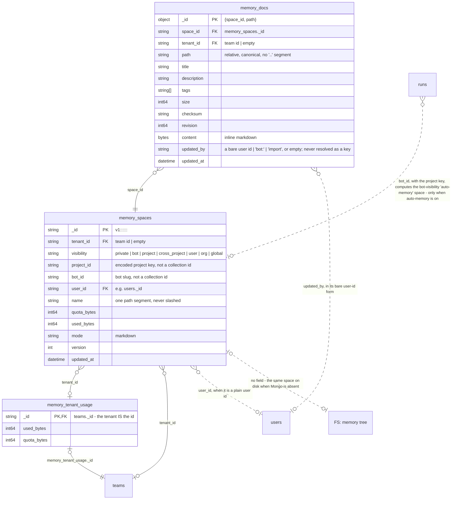
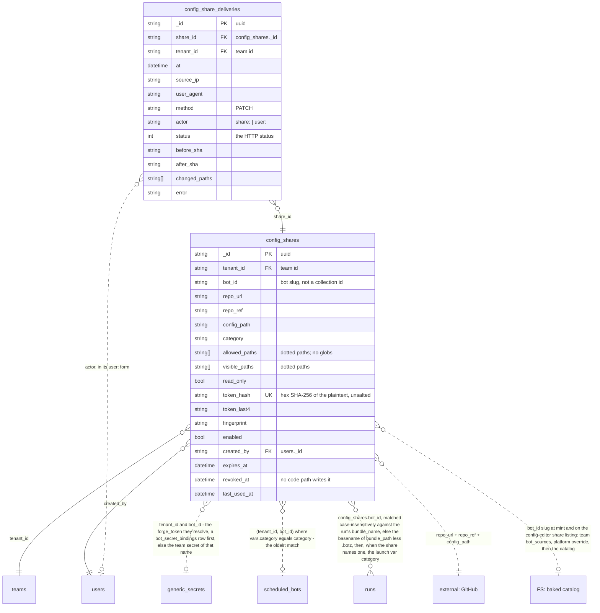
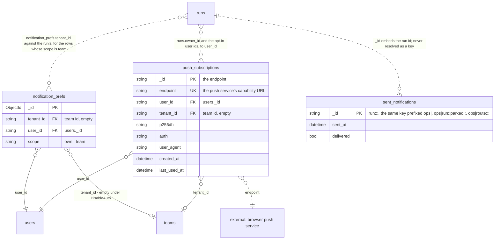

# Data model — memory, config shares and notifications

Three slices of a tenant's own content: the knowledge spaces bots and people share, the scoped config-edit grants a non-operator holds, and the per-user state that decides whose browser a finished run reaches.

> Drawn from the code at commit `61a305262` — main at v3.266.1, after #2391, which carries the launch rung; how this page is kept true: [README](README.md).

## Block A — Shared knowledge (memory)

- `_id` is the whole identity. Every read is keyed on `_id` or `space_id`: the Mongo adapter adds no `tenant_id` clause.
- `quota_bytes = 0` means **no** sub-cap, never "deny". A `global` space has no tenant, so it skips the aggregate counter.
- The counter the code names the "org aggregate" is one row **per team**: an operator's org ceiling is written onto each team the org has at that moment, and a team created later starts at the 1 GiB default.
- `memory_spaces.bot_id` is, on a `bot` space a run writes, the launch's resolved bot identity (`runview.ResolveBotID`: an explicit bot id, else the bundle's declared name, else the bundle directory a path names; when that leaves it empty, the executor falls back to the workflow's name); the memory routes take it from `?bot=`. Neither is resolved against a collection.

## Block B — Config share: the `iws_` token path

- Every field that shapes a write is pinned at mint: `repo_url`, `repo_ref`, `config_path`, `allowed_paths`.
- `token_hash_unique` is the only unique index. Nothing enforces one share per `(bot_id, category)`: an operator may hold several live grants on the same category.
- Rotation rewrites `token_hash`, `token_last4` and `fingerprint` in place; there is no `rotated_at` stamp, so only the `config_share.rotated` audit event dates it.
- Only `PATCH …/config` writes delivery rows. The pre-flight refusals record nothing, so no delivery row does not mean no mutating attempt.

## Block C — User notifications

- Absence is the default. A `notification_prefs` row exists only once a user saved a scope, so no row means `own`; the unique `(tenant_id, user_id)` index is the real identity.
- `push_subscriptions` stores the endpoint twice — as `_id` on insert and as a separately unique-indexed field.
- `sent_notifications` is keyed purely by episode, and four key shapes share it: the user dispatcher's bare run-outcome key, that same key under `ops|`, the operator dispatcher's parked-run key carrying (attempts, failure class), and the outcome router's `ops|route:` alert key.

## Collections

| Collection | Package | Document struct | Tenant field (values) | Unique / TTL indexes | Twin |
|---|---|---|---|---|---|
| `memory_spaces` | `pkg/store/mongo` | `memSpaceDoc` | `tenant_id` — a team id, empty for `visibility: global` | none unique, no TTL (`tenant_vis_recent` has no reader in the adapter, which only ever queries `_id`) | `file .quota/spaces/<checksum of the ref>.json` and the space tree |
| `memory_docs` | `pkg/store/mongo` | `memDoc` (`memDocID`) | `tenant_id` — a team id, omitted on a global space's docs | the composite `_id` is the only uniqueness; no TTL | `file <space root>/<path>` |
| `memory_tenant_usage` | `pkg/store/mongo` | none — written as `bson.M` | the `_id` **is** the team id | no declared index; the implicit `_id` index only | `file .quota/aggregate.json` |
| `config_shares` | `pkg/configshare` | `Share` | `tenant_id` — a team id | `token_hash_unique`; no TTL | `memory-only` |
| `config_share_deliveries` | `pkg/configshare` | `Delivery` | `tenant_id` — a team id, copied from the share | none unique; TTL `configshare_deliveries_ttl` on `at`, 90 days | `memory-only` |
| `notification_prefs` | `pkg/usernotify` | `Prefs` | `tenant_id` — a team id (the identity's active team), empty under DisableAuth | `tenant_user` unique on `(tenant_id, user_id)`; no TTL | `none (cloud-only)` |
| `push_subscriptions` | `pkg/usernotify/webpush` | `Subscription` | `tenant_id` — a team id, provenance only, empty under DisableAuth | `endpoint` unique; no TTL | `none (cloud-only)` |
| `sent_notifications` | `pkg/usernotify` | `SentRecord` | none — keyed by episode | the `_id` insert is the claim; TTL `sent_at_ttl`, 30 days | `none (cloud-only)` |
| `teams` | `pkg/identity` | `Team` | the `_id` **is** the tenant | stub here | see [data-model-identity.md](data-model-identity.md) |
| `users` | `pkg/identity` | `User` | none — a user spans teams | stub here | see [data-model-identity.md](data-model-identity.md) |
| `runs` | `pkg/store/mongo` | `store.Run` | `tenant_id` — a team id | stub here | see [data-model-runs.md](data-model-runs.md) |
| `generic_secrets` | `pkg/secrets` | `GenericSecret` | `tenant_id` | stub here | see [data-model-credentials.md](data-model-credentials.md) |
| `scheduled_bots` | `pkg/cloudsched` | `ScheduledBot` | `tenant_id` | stub here | see [data-model-automation.md](data-model-automation.md) |
| `"FS: memory tree"` | `pkg/memory` | `FSStore` | a path segment for `user`/`org`/`cross_project` only (`local` when empty); `bot` and `project` key on the project, `global` on neither | not a collection | the local twin of every space but `private` |
| `"FS: baked catalog"` | not a collection | — | — | not a collection | the bot bundles shipped in the image |
| `"external: GitHub"` | not a collection | — | — | not a collection | the forge a share commits through |
| `"external: browser push service"` | not a collection | — | — | not a collection | the endpoint a subscription names |

`connection.Connection` is drawn on [data-model-credentials.md](data-model-credentials.md): the cloud twin stores it in the `connections` collection, beside the `FileStore` over `<store dir>/connections.json` the local deployment reads.

## Related

- [memory-and-knowledge.md](../memory-and-knowledge.md) — the visibilities, the two quota levels, the REST surface and how bots consume memory.
- [config-share.md](../config-share.md) — the grant, the security model and the three route groups; [adr/076-scoped-config-share-editor.md](../adr/076-scoped-config-share-editor.md), [adr/077-declarative-per-bot-config-share-surface.md](../adr/077-declarative-per-bot-config-share-surface.md) and [adr/078-config-editor-role-sso-team-scoped-access.md](../adr/078-config-editor-role-sso-team-scoped-access.md) for why it has this shape.
- [notifications.md](../notifications.md) — which run events notify, recipient resolution, the sweep and the VAPID switch.
- [cloud-rest-api.md](../cloud-rest-api.md) — the memory and notification routes with their auth level.
- [data-model-forge-bots.md](data-model-forge-bots.md) — `plugin_sources`, the durable twin of a team's private plugin and its skills, and the bot tiers a `bot_id` slug resolves through.

