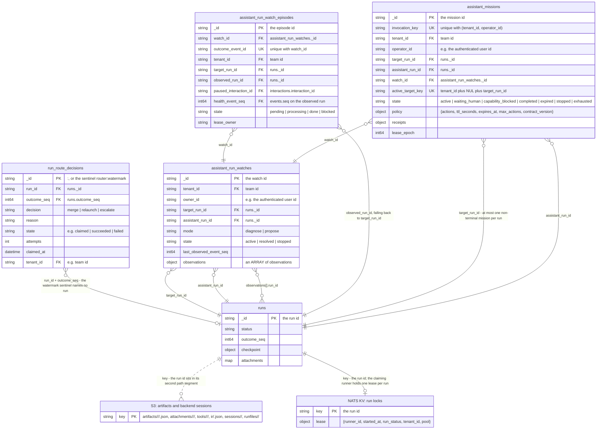
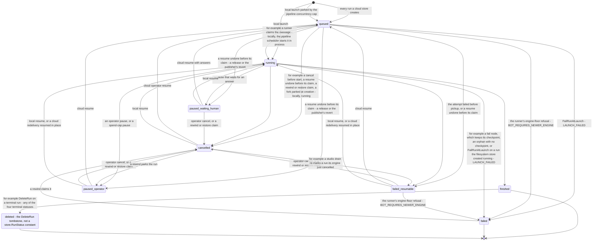

# Data model — runs and their satellites

A run is one execution; this page draws its per-run streams, its tree, the collections its launch and its outcome bind it to, and its assistant supervision.

> Drawn from the code at commit `61a305262` — main at v3.266.1, after #2391, which carries the launch rung; how this page is kept true: [README](README.md).

## Block 1 — the run and its per-run streams

```mermaid
erDiagram
    runs {
        string _id PK "the run id"
        string tenant_id FK "e.g. team id | dev"
        string owner_id "e.g. a user id, or an actor string such as webhook:<config id>, autofix:<config id>, gaterelaunch:<config id>, scheduler:<bot id>, board-dispatcher, trigger-spine or dev"
        string status "queued|running|paused_waiting_human|paused_operator|finished|failed|failed_resumable|cancelled, plus the tombstone 'deleted'"
        int64 outcome_seq
        string continuation_state "redelivery_pending|retry_armed|final; empty means UNKNOWN"
        string failure_code
        object checkpoint
        int64 version
        datetime deleted_at
    }
    events {
        ObjectId _id PK "the identity is the unique (run_id, seq)"
        string run_id FK "runs._id"
        int64 seq
        string type "the event vocabulary"
        map data
        int64 log_offset
        string tenant_id FK "team id"
        datetime ts
    }
    run_logs {
        ObjectId _id PK "the identity is the unique (run_id, offset)"
        string run_id FK "runs._id"
        int64 offset "byte offset"
        bytes data
        string tenant_id FK "team id"
        datetime ts
    }
    run_seq {
        object _id PK "{tenant_id, run_id}"
        int64 next_seq
        int64 next_plan_seq
        int64 next_note_seq
    }
    interactions {
        object _id PK "{run_id, interaction_id}"
        string run_id FK "runs._id"
        string interaction_id
        string kind "blocking (empty) | async | await | recovery"
        map questions
        object turns "an ARRAY of turns"
        datetime answered_at
        string tenant_id FK "team id"
    }
    user_messages {
        object _id PK "{run_id, message_id}"
        string run_id FK "runs._id"
        string interaction_id FK "interactions.interaction_id"
        string status "queued|delivered|consumed|cancelled"
        string text
        string node_id
        string[] skill_refs
        datetime queued_at
        string tenant_id FK "team id"
    }
    run_plans {
        ObjectId _id PK "the identity is the unique (run_id, seq)"
        string run_id FK "runs._id"
        int seq
        object todos "an ARRAY of plan todos"
        string tenant_id FK "team id"
        datetime ts
    }
    run_notes {
        ObjectId _id PK "the identity is the unique (run_id, seq)"
        string run_id FK "runs._id"
        int seq
        string author
        string body
        string tenant_id FK "team id"
        datetime ts
    }
    run_turns {
        ObjectId _id PK "the identity is the unique (run_id, node_id, loop_iter, turn_index)"
        string run_id FK "runs._id"
        int turn_index
        string model
        object usage
        bytes messages
        string tenant_id FK "team id"
        datetime ts
    }
    events        }o--|| runs : "run_id"
    run_logs      }o--|| runs : "run_id"
    run_seq       }o--|| runs : "_id.run_id"
    run_plans     }o--|| runs : "run_id"
    run_notes     }o--|| runs : "run_id"
    run_turns     }o--|| runs : "run_id"
    interactions  }o--|| runs : "run_id"
    user_messages }o--|| runs : "run_id"
    runs          |o--o| interactions : "checkpoint.interaction_id"
    user_messages }o--o| interactions : "interaction_id"
```



- Every stream names its run with a top-level `run_id`. `run_seq` is the one exception — its run id lives *inside* the compound `_id`. The counter is one row per (tenant value, run), not one per run.
- A gap in `seq` is normal.
- `interactions` is the durable question/answer record and `runs.checkpoint.interaction_id` is only a pointer to the pending one.
- `dev` is a tenant *value*, not a team. A server started with `DisableAuth` stamps the store ctx under the id `dev` for both tenant and owner, so every row written in that ctx — for example `events` — carries `tenant_id: dev`.

## Block 2 — the run tree and the run's identity edges

```mermaid
erDiagram
    runs {
        string _id PK "the run id"
        string tenant_id FK "e.g. teams._id | dev"
        string owner_id "e.g. a user id, or an actor string such as webhook:<config id>, autofix:<config id>, gaterelaunch:<config id>, scheduler:<bot id>, board-dispatcher, trigger-spine or dev"
        string runner_pool
        string bot_id "the bundle slug"
        string bot_source_tenant "e.g. a team id, or the platform: sentinel"
        string bot_source_tier "e.g. team|platform|baked"
        string parent_run_id FK "runs._id"
        map subbot_children FK "subbot execution key to child run id, held on the PARENT"
        string forked_from FK "runs._id"
        object delegation "{source_run_id, kind, episode_fingerprint, attempt}"
        object source "{kind, issue_id, issue_identifier, issue_title, schedule_id, schedule_name, client_id, conversation_id}"
        string[] watched_issue_ids FK "board_issues._id"
        string project_path
    }
    teams {
        string _id PK
        string org_id FK "orgs._id"
        string runner_pool UK
        int max_concurrent_runs
    }
    users {
        string _id PK "the user id"
        string email UK
        string default_team_id FK "teams._id"
    }
    bot_sources {
        string _id PK "the row id"
        string tenant_id FK "team id | platform:"
        string slug UK "unique per tenant, with tenant_id"
        map files
        int version
    }
    board_issues {
        string _id PK "native:<uuid>"
        string tenant_id FK "team id"
        object issue "stored with the lowercased Go names"
        string issue.lastrunid FK "runs._id"
    }
    scheduled_bots {
        string _id PK "the schedule id"
        string tenant_id FK "team id"
        string bot_id "the bundle slug"
        string cron "a 5-field cron"
        string last_run_id FK "runs._id"
    }
    run_secrets {
        string _id PK "the opaque SecretsRef"
        string tenant_id FK "team id"
        string run_id FK "runs._id"
        bytes sealed_bundle "ciphertext"
        datetime expires_at
    }
    retry_circuits {
        ObjectId _id PK "the identity is the unique (tenant_id, key)"
        string tenant_id FK "team id"
        string key "e.g. workflow:<workflow_hash>"
        int consecutive_failures
        datetime open_until
        string last_failure_run_id FK "runs._id"
        datetime updated_at
    }
    run_tags {
        ObjectId _id PK "the identity is the unique run_id"
        string run_id FK, UK "runs._id"
        string[] tags
        string tenant_id FK "team id"
    }
    run_gitmeta {
        ObjectId _id PK "the identity is the unique run_id"
        string run_id FK, UK "runs._id"
        string head_commit
        object files "an ARRAY of file statuses"
        object file_diffs "a MAP of path to persisted diff content"
        bool diffs_truncated
        string tenant_id FK "team id"
    }
    runs }o--o| teams : "tenant_id - absent on local and filesystem runs, and the dev tenant addresses no teams row"
    runs }o..o| teams : "runner_pool - matched by pool name, never joined on teams._id"
    runs }o..o| users : "owner_id, when it is a plain user id"
    runs }o..o| bot_sources : "(bot_source_tenant, bot_id) - no row at all when bot_source_tier is baked"
    runs }o--o| board_issues : "source.issue_id - only a native: value addresses a local row"
    runs }o--o{ board_issues : "watched_issue_ids"
    runs }o..o| scheduled_bots : "source.schedule_id - a cloud schedule id, a host-cron entry name or a trigger subscription id"
    board_issues }o--o| runs : "issue.lastrunid"
    scheduled_bots }o--o| runs : "last_run_id"
    run_secrets }o--|| runs : "run_id"
    runs }o..o| retry_circuits : "retry_circuits.key, derived from the run; the run stores no reference"
    retry_circuits }o--o| runs : "last_failure_run_id"
    run_tags |o--|| runs : "run_id"
    run_gitmeta |o--|| runs : "run_id"
    runs }o--o| runs : "parent_run_id"
    runs |o--o{ runs : "subbot_children - written on the PARENT"
    runs }o--o| runs : "forked_from - written by the fork service, which sets parent_run_id"
    runs }o--o| runs : "delegation.source_run_id - written by the delegation admission, which sets NO parent_run_id"
```

- The four self-edges look alike and mean different things. `parent_run_id` is the *tree*. `subbot_children` is the parent's subbot re-attach map. `forked_from` records the run a fork was taken from. A delegated run is not in its source's tree.
- `source.schedule_id` may be a cloud `scheduled_bots._id`, a host-cron entry name or a trigger subscription id — polymorphic, hence the dotted edge here, where the automation page draws one solid edge per resolvable value — `scheduled_bots` for a cloud schedule id.
- Every satellite here is optional.
- `run_secrets._id` never appears on the run document: the publisher writes it into the queue message.

## Block 3 — assistant supervision and outcomes



- One idempotence motif, three keys: `(run_id, outcome_seq)` settles a routing decision, `(watch_id, outcome_event_id)` settles a watch delivery, `(tenant_id, operator_id, invocation_key)` settles a mission. Each is a unique index.
- The run locks in NATS KV are the runner's execution lease. They are not the `leases` collection, which is charted on the automation page.

## Where a run's bytes live

Outside Mongo, a cloud run writes into six S3 key spaces of one bucket and one NATS KV bucket, and its launch travels on a JetStream subject; a second KV bucket holds the fleet's rollout epoch. The marked participants of Block 3 are the two stores a run itself writes; the streams are transport rather than state, so no entity draws them.

| store | key or name | what it holds |
| --- | --- | --- |
| S3, bucket `iterion-artifacts` (the default name) | `artifacts/<run>/<node>/<version>.json` | one object per artifact revision of a node |
| S3 | `attachments/<run>/<name>/<file>` | the attachment bodies `runs.attachments` indexes — plus the reserved name `__gitdiff`, where a per-file diff too large to inline is offloaded and deliberately left OUT of that index |
| S3 | `tools/<run>/<toolUseID>/input` · `/output` | one object per tool call and direction |
| S3 | `ir/<run>.json` | the compiled IR when it rides out of band |
| S3 | `sessions/<run>/<ref>` | the backend conversation a resume reattaches to |
| S3 | `runfiles/<run>/<rel path>` | tool-produced files |
| NATS KV `iterion-run-locks` | the run id | the runner's execution lease (`LeaseInfo`: runner id, started_at, run_status, tenant, pool); bucket TTL `LockTTL`, 60s by default |
| NATS KV `iterion-runner-rollout` | `epoch.high-water` | the monotonic runner rollout epoch, no TTL |
| JetStream `ITERION_RUNS`, `ITERION_RUNS_DLQ` | `iterion.queue.runs`, `iterion.queue.runs.dlq` | the run work queue and its park; a sovereign pool gets its own `ITERION_RUNS_POOL_<pool>` pair on an exact, never wildcard, subject |

## Run status vocabulary



- `IsTerminal` is `finished`, `failed`, `failed_resumable`, `cancelled`. `failed_resumable` and `cancelled` are terminal *and* resumable.
- A local resume has no queue and CASes from one of the four resumable statuses to `running` — on an answered human gate, `replayAnsweredGate` can first write `paused_waiting_human`, the status a replay that dies before its claim leaves.
- `continuation_state` says who owns a terminal run's future: `redelivery_pending` (the queue still holds the message), `retry_armed` (a scheduled retry will resume it), `final` (acting on it is the consumer's decision).
- `deleted` is written only by `DeleteRun`. A reader querying `runs` by status therefore meets a ninth value the enum does not declare.

## Collections

| collection | package | document struct | tenant field (values) | unique / TTL indexes | twin |
| --- | --- | --- | --- | --- | --- |
| `runs` | `pkg/store/mongo` | `store.Run` | `tenant_id` — team id, or `dev` under `DisableAuth`; empty on local runs | none unique beyond `_id`; no TTL | `file run.json` |
| `events` | `pkg/store/mongo` | `store.Event` | `tenant_id` — team id | unique `(run_id, seq)`; TTL `ts` after `eventsTTLDays` | `file events.jsonl` |
| `run_logs` | `pkg/store/mongo` | `runLogDoc` | `tenant_id` — team id | unique `(run_id, offset)`; TTL `ts` after `eventsTTLDays` | `file run.log` |
| `run_seq` | `pkg/store/mongo` | `bson.M` literal, no Go struct | inside `_id` — `{tenant_id, run_id}`, team id | `_id` only; no TTL | `none (cloud-only)` |
| `interactions` | `pkg/store/mongo` | `interactionDoc` wrapping `store.Interaction` | `tenant_id` — team id | `_id` `{run_id, interaction_id}`; no TTL | `file interactions/<id>.json` |
| `user_messages` | `pkg/store/mongo` | `userMessageDoc` wrapping `store.QueuedUserMessage` | `tenant_id` — team id | `_id` `{run_id, message_id}`; no TTL | `file user_messages.jsonl` |
| `run_plans` | `pkg/store/mongo` | `runPlanDoc` | `tenant_id` — team id | unique `(run_id, seq)`; TTL `ts` after `eventsTTLDays` | `file plans/<NNNN>.json` |
| `run_notes` | `pkg/store/mongo` | `runNoteDoc` | `tenant_id` — team id | unique `(run_id, seq)`; no TTL | `file notes/<NNNN>.json` |
| `run_turns` | `pkg/store/mongo` | `runTurnDoc` for `store.TurnCheckpoint` | `tenant_id` — team id | unique `(run_id, node_id, loop_iter, turn_index)`; TTL `ts` | `file turns/<node>/<iter>/<turn>.json` |
| `run_tags` | `pkg/store/mongo` | `runTagsDoc` | `tenant_id` — team id | unique `run_id`; no TTL | `file tags.json` |
| `run_gitmeta` | `pkg/store/mongo` | `runGitMetaDoc` | `tenant_id` — team id | unique `run_id`; no TTL | `file gitmeta.json` |
| `run_route_decisions` | `pkg/store/mongo` | `store.RouteDecision` | `tenant_id` — team id; the watermark sentinel is untenanted | unique `(run_id, outcome_seq)`; no TTL | `file route_decisions.json` |
| `retry_circuits` | `pkg/store/mongo` | `store.RetryCircuitState` | `tenant_id` — team id | unique `(tenant_id, key)`; TTL `updated_at` after 30 days | `none (cloud-only)` |
| `run_secrets` | `pkg/secrets` | `secrets.RunSecretsRecord` | `tenant_id` — team id | none unique beyond `_id`; TTL `expires_at`, `expireAfterSeconds` 0 | `none (cloud-only)` |
| `teams` | `pkg/identity` | `identity.Team` | `_id` **is** the tenant | unique `slug`, unique partial `runner_pool`; no TTL | `none (cloud-only)` |
| `users` | `pkg/identity` | `identity.User` | none — global | unique `email`; no TTL | `none (cloud-only)` |
| `bot_sources` | `pkg/botsource` | `botsource.BotSource` | `tenant_id` — team id, or `platform:` | unique `(tenant_id, slug)`; no TTL | `memory-only` (local mode and tests) |
| `board_issues` | `pkg/dispatcher/boardmongo` | `issueDoc` wrapping `native.Issue` | `tenant_id` — team id | `_id` is `native:<uuid>`; no TTL | `file issues/<id>.json` |
| `scheduled_bots` | `pkg/cloudsched` | `cloudsched.ScheduledBot` | `tenant_id` — team id | none unique beyond `_id`; no TTL | `none (cloud-only)` — the in-process store is test-only; `~/.iterion/schedules.yaml` is the host counterpart |
| `assistant_run_watches` | `pkg/runwatch` | `runwatch.Watch` | `tenant_id` — team id, a plain tenant parameter on the per-operator reads | unique partial `(tenant_id, owner_id, target_run_id)` on `state: active`; no TTL | `file assistant-run-watches.json` |
| `assistant_run_watch_episodes` | `pkg/runwatch` | `runwatch.Episode` | `tenant_id` — team id, ignored by the claim queries | unique `(watch_id, outcome_event_id)`; no TTL | `file assistant-run-watches.json` |
| `assistant_missions` | `pkg/assistantmission` | `assistantmission.Mission` | `tenant_id` — team id, a plain tenant parameter on the per-operator reads, ignored by the reconcile and claim queries | unique `(tenant_id, operator_id, invocation_key)`, unique partial `active_target_key`; no TTL | `file assistant-missions.json` |
| `"S3: artifacts and backend sessions"` | `pkg/store/blob` | key spaces, not documents | the run id is the key's second path segment | none | `S3` |
| `"NATS KV: run locks"` | `pkg/queue/nats` | `nats.LeaseInfo` | `tenant_id` inside the lease payload | bucket TTL `LockTTL`, default 60s | `NATS KV` |

## Related

- [persisted-formats.md](../persisted-formats.md) — the filesystem run-store layout, `run.json`, the status table, the checkpoint shape and the event vocabulary.
- [resume.md](../resume.md) — resume, rewind and fork over the checkpoint and `run_turns`.
- [outcome-router.md](../outcome-router.md) — the decision table, the activation watermark sentinel and the claim semantics of `run_route_decisions`.
- [assistant-dock.md](../assistant-dock.md) — the assistant-side contract over watches, episodes and missions.
- [cloud-architecture.md](../cloud-architecture.md) — control plane versus data plane, the queue internals and the multitenancy enforcement layers.
- [adr/095-terminal-state-contract-and-failure-taxonomy.md](../adr/095-terminal-state-contract-and-failure-taxonomy.md) · [adr/053-unified-run-streaming.md](../adr/053-unified-run-streaming.md) · [adr/073-cloud-twins-for-fs-only-run-detail-seams.md](../adr/073-cloud-twins-for-fs-only-run-detail-seams.md) · [adr/103-run-addressed-by-id-across-teams.md](../adr/103-run-addressed-by-id-across-teams.md)

