# The complete ERD — every collection, one diagram

The whole Mongo data model in a single entity-relationship diagram: all 79 collections plus the four marked non-Mongo participants, and every relationship the per-page diagrams draw — consolidated, no attributes. The per-entity detail (keys, value sets, indexes, twins) lives in the six data-model pages; this page answers "what relates to what" at a glance and is regenerated from them by construction.

The rendered SVG lives next to this page: [erd-complete.svg](erd-complete.svg).
Open it in a browser tab of its own for the full size — it is a vector image,
so it stays crisp at any zoom and the page scrolls natively. The Mermaid
source that generates it is `erd-complete.mmd`, next to the image.

*The image is the whole diagram: open `erd-complete.svg` in a browser tab of
its own for the full size — a vector image, crisp at any zoom, scrollable
natively. The Mermaid source that generates it is `erd-complete.mmd`, next to
the image. The per-entity detail (keys, value sets, indexes, twins) lives in
the six data-model pages.*

*Re-render the SVG after editing the source with
`mermaid-cli -i erd-complete.mmd -o erd-complete.svg`.*

*Drawn from the code at commit `61a305262` and held to the same source as the per-page diagrams. The [overview, conventions and glossary](README.md) explain the notation.*
