# The complete ERD — every collection, one diagram

The whole Mongo data model in a single entity-relationship diagram: all 79 collections plus the four marked non-Mongo participants, and every relationship the per-page diagrams draw — consolidated, no attributes. The per-entity detail (keys, value sets, indexes, twins) lives in the six data-model pages; this page answers "what relates to what" at a glance and is regenerated from them by construction.

```mermaid
erDiagram
    "NATS KV: run locks"
    "S3: artifacts and backend sessions"
    "api_keys"
    "assistant_missions"
    "assistant_run_watch_episodes"
    "assistant_run_watches"
    "audit_events"
    "board_config"
    "board_events"
    "board_issues"
    "bot_secret_bindings"
    "bot_source_versions"
    "bot_sources"
    "config_share_deliveries"
    "config_shares"
    "cred_leases"
    "cred_pledges"
    "cred_pool_usage"
    "cred_pools"
    "credential_usage"
    "desktop_sso_tickets"
    "events"
    "external: GitHub teams"
    "forge_board_bindings"
    "forge_connections"
    "forge_oauth_apps"
    "forge_provision_approvals"
    "generic_secrets"
    "interactions"
    "invitations"
    "leases"
    "llm_routing_policies"
    "marketplace"
    "memberships"
    "memory_docs"
    "memory_spaces"
    "memory_tenant_usage"
    "model_prefs"
    "notification_prefs"
    "oauth_credentials"
    "oauth_pending"
    "oidc_links"
    "oidc_states"
    "org_memberships"
    "org_sso_providers"
    "org_usage"
    "org_verified_domains"
    "orgs"
    "password_resets"
    "personal_access_tokens"
    "platform_settings"
    "plugin_sources"
    "push_subscriptions"
    "repo_integrations"
    "retry_circuits"
    "run_gitmeta"
    "run_logs"
    "run_notes"
    "run_plans"
    "run_route_decisions"
    "run_secrets"
    "run_seq"
    "run_tags"
    "run_turns"
    "runs"
    "scheduled_bots"
    "sent_notifications"
    "sessions"
    "teams"
    "trigger_effects"
    "trigger_subscriptions"
    "usage_windows"
    "user_messages"
    "users"
    "webhook_configs"
    "webhook_deferred_launches"
    "webhook_deliveries"
    "webhook_quotas"
    "ws_tickets"
    board_issues |o--o{ board_events : "event.issueid - empty on board_updated alone"
    board_config ||..o{ board_events : "event.seq - minted by an $inc on the seq:<team> document, never a key"
    board_events ||..o{ trigger_effects : "_id embeds board:cloud:<issue>:<seq>; the event itself is COPIED in"
    trigger_effects }o--o| trigger_subscriptions : "sub_id - empty on a projection row"
    trigger_effects }o--o| forge_board_bindings : "tenant_id, on a projection row - the binding _id IS the tenant"
    trigger_subscriptions }o..o{ board_issues : "issue.bot, stamped by board mode - no field points back"
    trigger_subscriptions }o..o| bot_sources : "bot_id (slug)"
    board_issues }o..o| bot_sources : "issue.bot (slug)"
    trigger_subscriptions }o..o| "FS: baked catalog" : "bot_id slug - the last tier, resolved at launch"
    board_issues }o..o| "FS: baked catalog" : "issue.bot slug - the last tier, resolved at launch"
    scheduled_bots }o--o| repo_integrations : "repo_integration_id - the provisioned id on the forge path, resolved from repo_url on CREATE in the manual path, never re-resolved by a PATCH; empty, for example, with no repo_url"
    trigger_subscriptions }o..o{ repo_integrations : "repo (slug) - compared to the EVENT repo, never joined to an integration; one slug may match several"
    scheduled_bots |o--o{ runs : "source.schedule_id - empty on a run no schedule launched"
    scheduled_bots }o--o| runs : "last_run_id"
    trigger_subscriptions |o--o{ runs : "source.schedule_id"
    scheduled_bots |o..o{ audit_events : "target_id on the schedule.* rows, never joined"
    api_keys }o--o| teams : "tenant_id, scope_team - no team on an 'orgtier:' or 'platform:' row"
    api_keys }o--o| users : "scope_user"
    api_keys }o..o| orgs : "tenant_id as 'orgtier:<org id>'"
    api_keys }o..o{ "FS: baked catalog" : "bots"
    oauth_credentials }o..o| users : "user_id, when it is a plain user id"
    oauth_credentials }o..o| teams : "user_id as 'org:<team id>'"
    oauth_credentials }o..o| orgs : "user_id as 'orgtier:<org id>'"
    oauth_pending |o..o{ oauth_credentials : "oauth_pending.owner_key - one shared owner namespace; at most one pending per owner+kind, never resolved as a key"
    generic_secrets }o--|| teams : "tenant_id, scope_team"
    generic_secrets }o--o| users : "scope_user"
    bot_secret_bindings }o--|| generic_secrets : "secret_id"
    bot_secret_bindings }o..o| "FS: baked catalog" : "bot_id"
    teams }o--o| orgs : "org_id"
    run_secrets }o--|| runs : "run_id"
    run_secrets }o..o{ api_keys : "bundle.api_keys / bundle.pinned_api_keys - plaintext"
    run_secrets }o..o{ oauth_credentials : "bundle.oauth_record_refs"
    cred_pools }o--|| orgs : "org_id"
    cred_pledges }o--|| cred_pools : "pool_id"
    cred_pledges }o--|| users : "user_id"
    cred_pledges }o--o| api_keys : "key_id"
    cred_pledges }o..o| oauth_credentials : "user_id + ref, resolved to rank 0"
    cred_leases }o--o| cred_pledges : "pledge_id - a lease, open or closed, outlives a deleted pledge"
    cred_leases }o--|| cred_pools : "pool_id"
    cred_leases }o--|| runs : "run_id"
    cred_leases }o--|| users : "donor_id"
    cred_pool_usage }o..o| cred_pledges : "_id, whose first segment is the pledge id - never resolved as a key"
    credential_usage }o--o| teams : "tenant_id"
    usage_windows }o..o| teams : "key - its 'tenant:<id>' scope segment"
    usage_windows }o..o| orgs : "key - its 'org:<id>' scope segment"
    org_usage }o..o| orgs : "_id - its subject segment"
    model_prefs }o--o| teams : "tenant_id"
    llm_routing_policies |o..o| teams : "llm_routing_policies._id as 'team:<id>'"
    llm_routing_policies |o..o| orgs : "llm_routing_policies._id as 'org:<id>'"
    platform_settings |o--o{ teams : "platform_settings.teams, in the platform_credentials family"
    teams }o..o| platform_settings : "runner_pool - resolved in the runner_pools family"
    forge_oauth_apps |o--o{ forge_connections : "oauth_app_id"
    forge_connections ||--o{ repo_integrations : "connection_id"
    repo_integrations |o--|| webhook_configs : "webhook_id"
    webhook_configs |o..o{ runs : "owner_id as '<lane>:<config id>' - 'webhook:', 'autofix:' or 'gaterelaunch:' for example - on a run a lane of the webhook config launches"
    webhook_configs }o..o| forge_connections : "provisioned_by - forge:<connection id>; empty on a hand-created config"
    forge_connections |o--o| generic_secrets : "managed_secret_id"
    repo_integrations }o--|| generic_secrets : "managed_secret_id"
    webhook_configs }o--o{ generic_secrets : "secret_overrides - a workflow secret name per entry"
    forge_connections }o..o| generic_secrets : "generic_secrets.name - the team-wide row named dependabot_tokens the store lists first (created_at order on the Mongo store), shared by every github_app connection that opted in"
    teams ||--o{ bot_secret_bindings : "tenant_id - one row per (tenant, bot, secret name), TEAM-GLOBAL, repointed by the latest provision"
    teams ||--o{ forge_oauth_apps : "tenant_id"
    teams ||--o{ forge_connections : "tenant_id"
    teams ||--o{ repo_integrations : "tenant_id"
    teams ||--o{ webhook_configs : "tenant_id"
    repo_integrations }o..o{ bot_sources : "bot_ids slugs - the team row, then the platform: row"
    repo_integrations }o..o{ "FS: baked catalog" : "bot_ids slugs - the last tier, resolved at launch"
    webhook_configs }o..o{ bot_sources : "bot_rules[].bot_id, resolved under tenant_id at every delivery"
    webhook_configs }o..o{ "FS: baked catalog" : "bot_rules[].bot_id - the last tier, resolved at every delivery"
    webhook_configs ||--o{ webhook_deliveries : "webhook_id"
    webhook_configs ||--o{ webhook_deferred_launches : "webhook_id"
    webhook_configs |o..o{ webhook_quotas : "_id - its webhook segment, in the wh| key shape only"
    teams ||--o{ webhook_deliveries : "tenant_id"
    teams ||--o{ webhook_deferred_launches : "tenant_id"
    teams ||..o{ webhook_quotas : "_id - its team segment, in both key shapes"
    webhook_deliveries }o--o| runs : "run_id"
    webhook_deferred_launches }o..o{ runs : "no field: the sweep launches each target as the handler would have"
    bot_sources |o..o{ bot_source_versions : "_id - <row id>:<version>, kept after the row is deleted"
    teams |o--o{ bot_sources : "tenant_id - platform: on a deployment-wide row"
    teams ||--o{ plugin_sources : "tenant_id"
    plugin_sources }o--o| generic_secrets : "secret_id"
    teams |o--o{ marketplace : "org_id - stamped in cloud mode only; empty on a local or legacy entry"
    platform_settings |o..o{ bot_sources : "platform_settings.reviewer and the three other role slugs of the bot_roles family"
    bot_sources }o..o| "FS: baked catalog" : "origin forked:<catalog id>"
    plugin_sources }o..o{ "external: git repository" : "git_url plus ref"
    marketplace }o..o{ "external: git repository" : "repo_url plus ref plus subpath"
    teams ||--o| forge_board_bindings : "forge_board_bindings._id"
    forge_board_bindings }o--|| forge_connections : "connection_id"
    orgs ||--o{ forge_provision_approvals : "org_id"
    teams ||--o{ forge_provision_approvals : "tenant_id"
    forge_provision_approvals }o--|| forge_connections : "connection_id"
    forge_provision_approvals }o--o| repo_integrations : "integration_id"
    orgs |o--o| teams : "migrated_from_team_id"
    org_memberships }o--|| users : "user_id"
    org_memberships }o--|| orgs : "org_id"
    memberships }o--|| users : "user_id"
    memberships }o--|| teams : "team_id"
    memberships }o..o| org_memberships : "no field: e.g. the SSO and invitation-accept paths mirror it, skipping config_editor"
    invitations }o--|| teams : "team_id"
    invitations }o..o| memberships : "team_id and, once accepted, accepted_by - the membership's {team_id, user_id}; {team_id, email} is not unique, so several invitations may map to one membership"
    oidc_links }o--|| users : "user_id"
    sessions }o--|| users : "user_id"
    password_resets }o--|| users : "user_id"
    password_resets |o..o{ sessions : "no field: Consume then RevokeUserSessions by user_id"
    personal_access_tokens }o--|| users : "user_id"
    oidc_states }o--o| users : "pending.linkuserid"
    oidc_states |o..o| desktop_sso_tickets : "no field: a desktop flow mints the ticket at callback"
    ws_tickets }o--|| users : "identity.userid"
    org_sso_providers }o--|| teams : "tenant_id"
    org_verified_domains }o--|| teams : "tenant_id"
    org_verified_domains }o..o{ org_sso_providers : "no field: both key on the same tenant_id"
    audit_events }o..o| teams : "tenant_id on an auditTenant or auditSystem row"
    audit_events }o..o| orgs : "tenant_id on an auditOrg row"
    org_sso_providers }o..o{ "external: GitHub teams" : "github_team_keys, matched by name against the login's teams"
    memory_docs }o--|| memory_spaces : "space_id"
    memory_spaces }o--o| memory_tenant_usage : "tenant_id"
    memory_tenant_usage |o--|| teams : "memory_tenant_usage._id"
    memory_spaces }o--o| teams : "tenant_id"
    memory_spaces }o..o| users : "user_id, when it is a plain user id"
    memory_docs }o..o| users : "updated_by, in its bare user-id form"
    runs }o..o| memory_spaces : "bot_id, with the project key, computes the bot-visibility 'auto-memory' space - only when auto-memory is on"
    memory_spaces |o..o| "FS: memory tree" : "no field - the same space on disk when Mongo is absent"
    config_share_deliveries }o--|| config_shares : "share_id"
    config_shares }o--|| teams : "tenant_id"
    config_shares }o--|| users : "created_by"
    config_share_deliveries }o..o| users : "actor, in its user:<id> form"
    config_shares }o..o| generic_secrets : "tenant_id and bot_id - the forge_token they resolve, a bot_secret_bindings row first, else the team secret of that name"
    config_shares }o..o| scheduled_bots : "(tenant_id, bot_id) where vars.category equals category - the oldest match"
    config_shares }o..o{ runs : "config_shares.bot_id, matched case-insensitively against the run's bundle_name, else the basename of bundle_path less .botz, then, when the share names one, the launch var category"
    config_shares }o..|| "external: GitHub" : "repo_url + repo_ref + config_path"
    config_shares }o..o| "FS: baked catalog" : "bot_id slug at mint and on the config-editor share listing: team bot_sources, platform override, then the catalog"
    notification_prefs }o--|| users : "user_id"
    notification_prefs }o--o| teams : "tenant_id - empty under DisableAuth"
    push_subscriptions }o--|| users : "user_id"
    push_subscriptions }o--o| teams : "tenant_id"
    runs ||..o{ sent_notifications : "_id embeds the run id; never resolved as a key"
    runs }o..o{ notification_prefs : "notification_prefs.tenant_id against the run's, for the rows whose scope is team"
    runs }o..o{ push_subscriptions : "runs.owner_id and the opt-in user ids, to user_id"
    push_subscriptions }o..|| "external: browser push service" : "endpoint"
    events }o--|| runs : "run_id"
    run_logs }o--|| runs : "run_id"
    run_seq }o--|| runs : "_id.run_id"
    run_plans }o--|| runs : "run_id"
    run_notes }o--|| runs : "run_id"
    run_turns }o--|| runs : "run_id"
    interactions }o--|| runs : "run_id"
    user_messages }o--|| runs : "run_id"
    runs |o--o| interactions : "checkpoint.interaction_id"
    user_messages }o--o| interactions : "interaction_id"
    runs }o--o| teams : "tenant_id - absent on local and filesystem runs, and the dev tenant addresses no teams row"
    runs }o..o| teams : "runner_pool - matched by pool name, never joined on teams._id"
    runs }o..o| users : "owner_id, when it is a plain user id"
    runs }o..o| bot_sources : "(bot_source_tenant, bot_id) - no row at all when bot_source_tier is baked"
    runs }o--o| board_issues : "source.issue_id - only a native: value addresses a local row"
    runs }o--o{ board_issues : "watched_issue_ids"
    runs }o..o| scheduled_bots : "source.schedule_id - a cloud schedule id, a host-cron entry name or a trigger subscription id"
    board_issues }o--o| runs : "issue.lastrunid"
    runs }o..o| retry_circuits : "retry_circuits.key, derived from the run; the run stores no reference"
    retry_circuits }o--o| runs : "last_failure_run_id"
    run_tags |o--|| runs : "run_id"
    run_gitmeta |o--|| runs : "run_id"
    runs }o--o| runs : "parent_run_id"
    runs |o--o{ runs : "subbot_children - written on the PARENT"
    run_route_decisions }o--o| runs : "run_id + outcome_seq - the watermark sentinel names no run"
    assistant_run_watches }o--|| runs : "target_run_id"
    assistant_run_watches }o--o{ runs : "observations[].run_id"
    assistant_run_watch_episodes }o--|| assistant_run_watches : "watch_id"
    assistant_run_watch_episodes }o--|| runs : "observed_run_id, falling back to target_run_id"
    assistant_missions }o--|| runs : "target_run_id - at most one non-terminal mission per run"
    assistant_missions }o--|| assistant_run_watches : "watch_id"
    runs ||..o{ "S3: artifacts and backend sessions" : "key - the run id sits in its second path segment"
    runs ||--o| "NATS KV: run locks" : "key - the run id; the claiming runner holds one lease per run"
```

*Drawn from the code at commit `61a305262` and held to the same source as the per-page diagrams. The [overview, conventions and glossary](README.md) explain the notation.*
