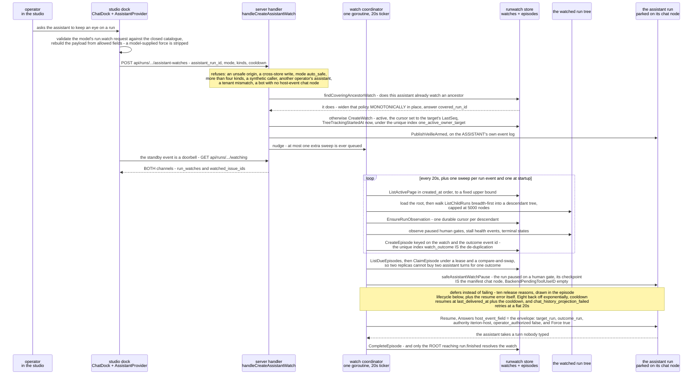
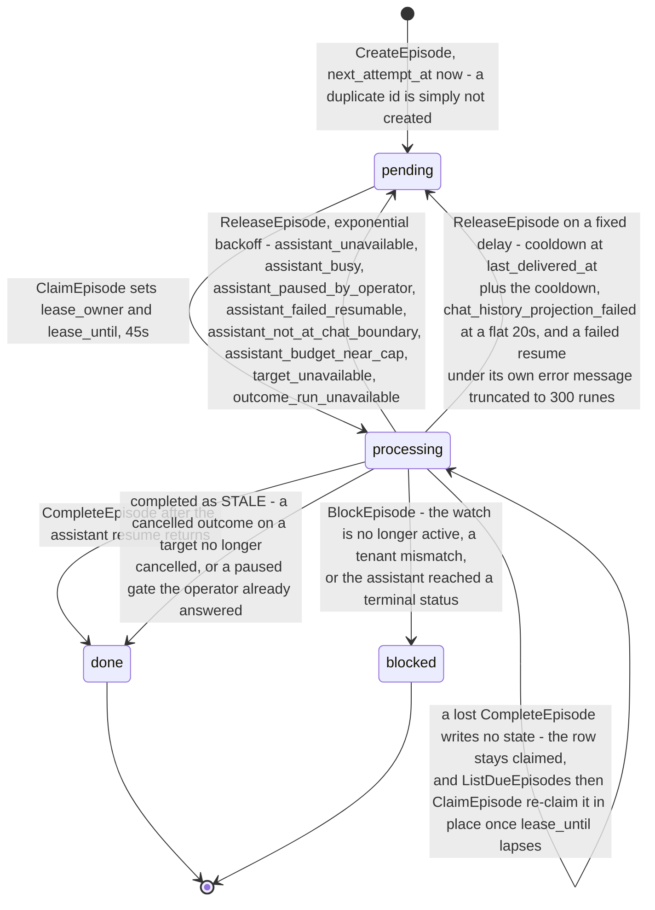
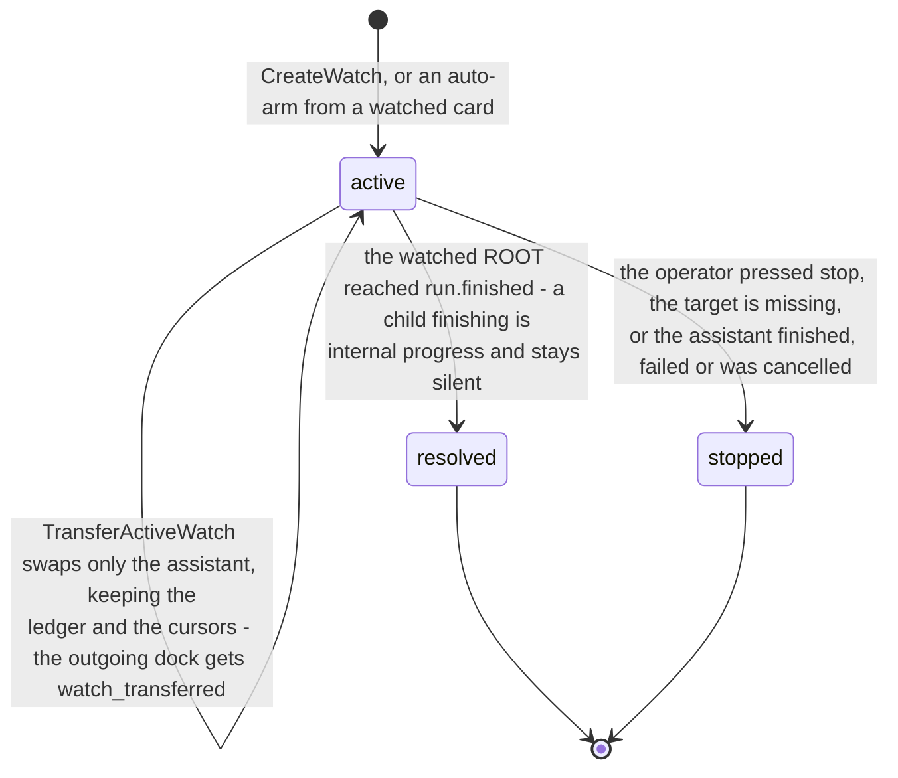
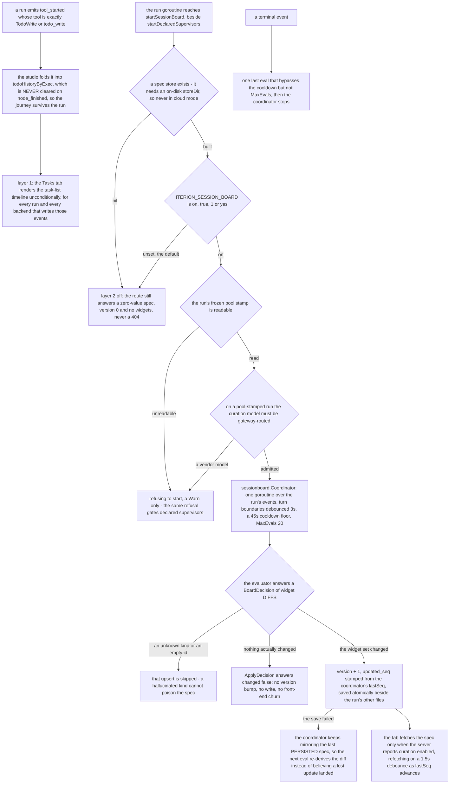

# Flow — the assistant dock, run watches and the session board

Three assistant surfaces meet at one seam: a bot's chat manifest declares a human pause with two doors, one for the operator's typed text and one for a host-attested event, and a durable run watch is what walks a watched run tree and knocks on the second door.

> Drawn from the code at commit `f564846d3`; how this page is kept true: [README](README.md).

## The seam: one pause, two doors

A bundle's `chat:` block says, per workflow node, how that node appears in a transcript. A `human` node is the operator's turn. `validateChatSurface` **fails the bundle** rather than warning when a node names an unknown kind, when a non-human node declares an answer field, or when a human node names neither `text_field` nor `approved_field` — the failure it prevents is a chat window that looks alive and swallows every message. `host_event_field` is the second door on that same pause: a field reserved for host-attested input, deliberately apart from `text_field` so automatic input can never read as operator speech or as an authorization.

Three surfaces stand over that seam. The **dock** is studio-side and holds no server state: `ChatDock` and `AssistantProvider` mount outside the route switch, the chat registry is built from each bundle's `chat` block served by `GET /api/v1/bots`, and a model's requested actions are re-validated host-side against a closed catalogue under a per-action policy in `localStorage`. The **run watch** is server-owned and durable: one coordinator goroutine mints episodes and force-resumes the assistant at its verified chat boundary. The **session board** is per-run, and only its second layer costs a token.

## A run watch, from arm to the woken turn

Every bug this path has is a handoff bug: who writes the row, who nudges the coordinator, who owns the cooldown and the lease — and above all that the *host*, not the operator, resumes the assistant through the second door of the same pause, with `operator_authorized: false`.

## Steps

| Actor | Action | Code |
|---|---|---|
| user | opens the dock from any authenticated route; it survives navigation because it mounts outside the route switch, and its presentation is persisted per user, not per route | `ChatDock`, `AssistantProvider`, `openedDock` |
| studio | resolves which bot answers from the manifest-driven registry, refusing the bot that owns the full-width route; one predicate decides whether the dock renders at all there | `useChatRegistry`, `resolveDockBot`, `dockStandsDown` |
| studio | mints the page-context chip and every dropped reference through ONE vocabulary: an id whose shape it rejects is refused, not repaired | `mintReference`, `referenceDragProps`, `addReferenceToDrag` |
| server | turns typed pointers into a bounded host-attested snapshot; the public error is generic so a store path cannot leak through it | `handleAssistantContextResolve`, `resolveAssistantReference` |
| studio | validates the model's action request against the closed catalogue and resolves the saved policy — deny, ask, explicit, allow | `validateAssistantActionRequest`, `decideAssistantAction` |
| server | gates the arm, then either widens a covering ancestor watch or creates the row | `handleCreateAssistantWatch`, `findCoveringAncestorWatch`, `mergeAssistantWatchPolicy` |
| store | holds one active watch per tenant, owner and target; the duplicate drives the idempotency, reconfigure and handoff ladder | `CreateWatch`, `ReconfigureActiveWatch`, `TransferActiveWatch` |
| server | writes the standby events on the ASSISTANT's log, so its transcript explains why it went quiet and later why it spoke | `publishVeille`, `store.PublishVeilleArmed` |
| server | nudges the coordinator from the bus — the callback does no store I/O, so unsubscribe cannot block — and sweeps anyway on a ticker, because the bus is lossy by design | `handleEvent`, `nudge`, `sweepLoop` |
| server | arms the second channel too: a terminal run whose card an assistant watches gets a watch on ARRIVAL, with narrower kinds than an operator may request | `armWatchesForTargetFrom`, `autoWatchKinds`, `reconcileArmedWatches` |
| server | walks the tree, keeps a cursor per descendant, and mints one episode per actionable outcome | `loadWatchTree`, `ensureTreeObservations`, `observePausedHumanGate`, `observeRunHealthInTree`, `observeTerminalForWatch` |
| server | claims one episode, then re-checks the delivery gate — capability is not permission to deliver | `deliverDue`, `attempt`, `safeAssistantWatchPause` |
| engine | resumes the assistant at its chat node with the host envelope, and the studio's own host events take the same admission | `runview.Service.Resume`, `deliverHostEventWithService` |
| studio | treats the standby events as a doorbell, re-reads both channels, and offers ONE stop that cuts both | `useRunVeille` |
| server | suppresses "your run is waiting on you" while an assistant is standing by | `hasActiveVeille` |
| cli | promotes one exact active watch into a bounded receipted mission over `run.resume` and `run.rewind` — the only client of those four routes | `iterion remote runs mission`, `handleCreateAssistantMission` |
| engine | spawns the session-board curator next to the declared supervisors, for the run's lifetime | `startSessionBoard`, `startDeclaredSupervisors` |
| studio | renders the deterministic task list always, the curated widgets only when the server says curation is on | `SessionBoardTab`, `useSessionBoardWidgets` |

## The episode lifecycle

An episode is one actionable outcome of one watch. Its id is derived from the watch and the outcome event id, so the fast path and the reconciliation sweep cannot double-deliver; a release is a deferral, not a failure.

| State | Means | Written by |
|---|---|---|
| `pending` | due, or waiting out the `next_attempt_at` a release set | `CreateEpisode`, `ReleaseEpisode` |
| `processing` | one worker holds the lease and is testing the delivery gate | `ClaimEpisode` |
| `done` | delivered — or deliberately dropped as stale, which keeps the watch itself alive | `CompleteEpisode` |
| `blocked` | the capability it was minted against is gone; never retried | `BlockEpisode` |

## The watch lifecycle

`createWatch`, `transferWatch` and `stopWatch` are the only writers, so the event the dock renders cannot drift from the state it describes.

## The session board — two layers

## Guards that refuse

- **The bundle's own gate** — `validateChatSurface` fails the bundle on an unknown node kind, an answer field on a non-human node, a human node with neither `text_field` nor `approved_field`, or no human node at all; a rejected block costs that bundle its catalog entry while its valid siblings still list.
- **The arm's origin and store** — `requireSafeOrigin` plus `rejectCrossStoreWrite` on every watch and mission create and stop: `decodeJSONCapped` does not check `Content-Type`, so without them any origin could arm an LLM-spending watch with a preflight-free `POST` at the loopback studio.
- **The policy** — `400` for a mode other than `diagnose` or `propose`, naming `auto_safe` as unavailable until server-side action authority exists; `400 invalid watch event kinds` beyond four, on a duplicate, or outside the five; `400 invalid watch limits` for a `max_episodes` outside `0–20` or a `cooldown_seconds` outside `0–86400`; a `max_episodes` inside is normalized to `0`, because a watch is now lifetime-bound.
- **The operator and the pair** — `400` when the target and assistant run ids are missing or equal, `404` for a target or assistant that does not resolve, `403` for a synthetic identity, for an assistant owned by another operator and for a tenant mismatch, `409` when the assistant is already finished, failed or cancelled.
- **Capability** — `409 assistant is not host-event capable`: `resolveAssistantChatCapability` reads the manifest and deliberately not the checkpoint, because arming usually happens mid-turn and reading the checkpoint there would silently skip a perfectly capable assistant.
- **Coverage and the incumbent** — `409 covering ancestor watch changed; retry the request` rather than manufacturing a nested watch from a stale decision; `409 this run already has an active assistant watch` when the incumbent is queued or running, or cannot be loaded at all.
- **The native retry** — no episode is minted for a `failed_resumable` target whose `RetryState.RetryAfter` is set: waking a model there would diagnose a failure already scheduled to disappear.
- **The young or covered stall** — a stall newer than one sweep interval, a stall with a matching `stall_recovered` twin, and a stall whose tree still holds a progressing descendant are all suppressed. The young stall and the one with a progressing descendant leave the cursor *before* the event, so the next pass re-evaluates it; a stall whose `stall_recovered` twin is already in the loaded page is settled, so the cursor advances past it.
- **The delivery gate** — `safeAssistantWatchPause` requires the assistant parked on a human gate, its checkpoint equal to the manifest's host-event chat node, and `BackendPendingToolUseID` empty. A checkpoint on an agent node is a mid-turn `ask_user`: the episode is released, never delivered, so the pending question is not stolen. The same admission gates `POST /api/runs/{id}/host-event`, which stamps `kind`, `authority` and `operator_authorized` **last** so a caller cannot claim operator authorization through the body.
- **The run-surface ladder** — every `/api/runs/{id}/…` route here crosses `scopeRunByID` before its handler: `GET`/`HEAD` take a viewer, every `POST`/`DELETE` takes a member; no standing answers `404` with no existence oracle, a wrong rung `403`, a membership-store failure `500`. `DELETE /api/assistant-watches/{watchID}` carries no wildcard under `api/runs` and is therefore outside that class: it rests on `requireAuth` plus the handler's own watch and run load.
- **The mission** — `409` under detached local mode, since a subprocess wire cannot preserve receipt identity; `400` for an action outside `run.resume` and `run.rewind` or listed twice, a TTL outside 60–86400 or `max_actions` outside 1–20; `409 mission requires exactly one active exact watch`, `409` when the target run already holds an active mission, and `409` for a `watch_id` that is not an active exact watch of this operator or an invocation key already bound to a different mission policy; and a receipt rejected with *rewinding the workflow entry is outside mission authority*.
- **The curation layer** — an unreadable pool stamp or a curation model that is not gateway-routed on a pool-stamped run both refuse the coordinator outright, logged `Warn` only; unknown widget kinds are dropped on apply and ignored on render.

## Collections touched

`assistant_run_watches` — the durable target→assistant link; `one_active_owner_target` is unique and partial on `state: active`, alongside `target_active`, `assistant_active` and `active_creation_order`. `assistant_run_watch_episodes` — one row per actionable outcome; `watch_outcome` unique on the watch and the outcome event id, `due_claim` on state, next attempt and lease. `assistant_missions` — `mission_invocation` unique per tenant, operator and invocation key, `one_active_target` unique and partial. `runs` — read for status, checkpoint, owner, tenant and `WatchedIssueIDs`, which is the *card* standby channel; written by the resume that delivers an episode. `events` — the standby events written on the ASSISTANT's log, and the run-health events the per-run cursor reads. `interactions` — the pending question the engine writes when a run parks on a human node; the delivery re-check never reads it, `pausedGateStillActive` loads the paused RUN and compares its checkpoint against the episode's `paused_node_id` and `paused_interaction_id`. `user_messages` belongs to the opposite surface: steering, and every supervisor intervention, queues a message there instead of resuming anything.

The session-board spec is **not** a collection: `sessionboard.FileStore` writes `runs/<id>/sessionboard.json` under the run store's base directory, and cloud mode, having no `storeDir`, has no twin — the route answers a zero-value spec there.

## Related

- [assistant-dock.md](../assistant-dock.md) — the dock's home page: the presentation states, the chat registry, the action policy table, the context chip, run watches and episodes, missions and the standby chip.
- [session-board.md](../session-board.md) and [supervisors.md](../supervisors.md) — the two layers of the Tasks tab, and the sibling coordinator whose decision queues a steering message instead of a widget diff.
- [adr/091-ubiquitous-assistant-chat-dock.md](../adr/091-ubiquitous-assistant-chat-dock.md) — why the dock and its session mount above the route tree, and why assistant and steering are named apart on a run page.
- [data-model-runs.md](data-model-runs.md) — `runs`, `events`, `interactions`, `user_messages`, the three `assistant_*` collections and the run status machine; [access-control.md](access-control.md) — the run-surface ladder and the principal kinds behind `requireAuth`.

