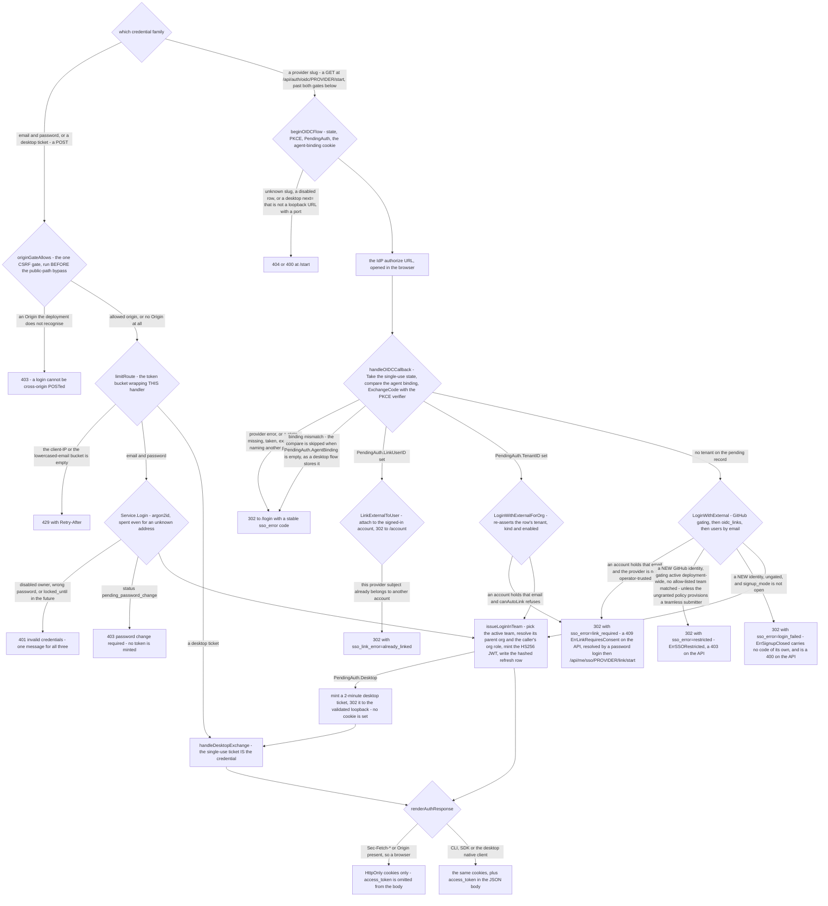
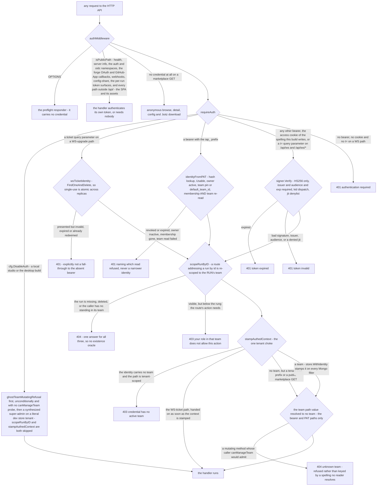
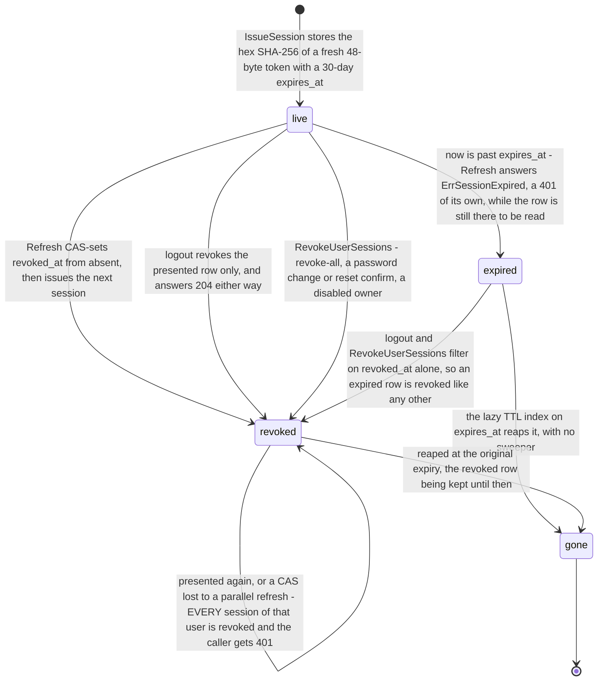

# Flow — signing in and authenticating a request

Six families of credential reach the iterion cloud API, and each one either converges on the single function that mints a session or on the single choke that turns a presented token into a tenant-scoped identity.

> Drawn from the code at commit `f564846d3`. How this page is kept true: [README](README.md).

## Minting a session

- The gates above are ordered as the code runs them, and neither covers the SSO entry points. The origin gate is the umbrella middleware's and runs before the public-path bypass, so it covers `/api/auth/login` even though `isPublicPath` lists it — but `originGateAllows` returns true for anything that is not a state-changing `/api/` call, and `/start` and `/callback` are GETs. The buckets are not middleware: `limitRoute` decorates the login handler (shared with the password change and both reset routes), register, refresh and the desktop exchange — the two SSO routes are registered bare.
- `POST /api/auth/register`, the forced rotation on `POST /api/auth/password/change` and the invitation acceptance paths are not drawn: each one ends in the same `issueLogin`, hence in the same minting node.
- A `/start` call maps every resolver failure to one `404 unknown provider`; only the callback splits `unknown_provider` from `disabled`, because that is where the user sees a banner.
- The tenant and the provider id come from `PendingAuth`, written at `/start` and keyed by the IdP-echoed state, so a slug presented at `/callback` cannot be coerced into another tenant's policy.
- `GitHubGatingActive` counts enabled `kind=github` rows with **no tenant filter**: one org's allow-list switches gating on for every GitHub login on the deployment, and a gated match then admits a user even under `invite_only`.

## Authenticating a later request

- `extractBearer` reads three channels: the `Authorization: Bearer` header, the access cookie of the spelling this build writes, and a `t=` query parameter accepted only on `/api/ws` and `/api/ws/*`, because a browser cannot attach a header to a WS upgrade. No shipped client sets the third one — the SPA uses the cookie and the desktop build runs with `DisableAuth` — and the server authenticates it all the same, so `/api/ws?t=<jwt>` is not an unauthenticated request.

## The refresh session

No access-token denylist is wired at boot, so a revoke-all lets outstanding access JWTs age out within their access-token TTL (`ITERION_ACCESS_TTL`, 15 minutes by default); `JWTDenylist` and `NewJWTSignerMulti` exist but nothing outside tests constructs them.

## Steps

| actor | action | code |
| --- | --- | --- |
| studio | lists the global connectors plus the per-org rows of every tenant resolved from a slug, an email or a domain — never a 404 | `handleListProviders`, `resolveOrgTenants` |
| server | refuses a cross-origin state-changing call before the public-path bypass | `authMiddleware`, `originGateAllows`, `requireSafeOrigin` |
| server | spends one bucket keyed by client IP and one by the lowercased email peeked from the body | `limitRoute`, `peekJSONField` |
| user | posts email and password; an unknown address still spends argon2id against `dummyHash` | `handleLogin`, `Service.Login` |
| store | counts the failure, locks at the fifth for 15 minutes, clears both counters on success | `Service.Login`, `LockoutThreshold`, `LockoutDuration` |
| server | starts an SSO flow and persists `PendingAuth` under the random state | `beginOIDCFlow`, `GenerateStateAndPKCE`, `MongoStateStore.Put` |
| provider | returns through the stable cloud callback; the state is taken once and the binding compared in constant time | `handleOIDCCallback`, `MongoStateStore.Take` |
| server | builds a per-org connector by unsealing its client secret behind the public-unicast SSRF guard | `resolveConnector`, `buildOrgOIDCConnector`, `outboundStrict` |
| store | resolves the GitHub gating context with one positive-only `$in` over the materialised keys | `githubGateContext`, `FindGitHubGrantingOrgs` |
| store | grants memberships grant-only, preserving an existing `Source`, and deletes only `github_sso` rows that stopped matching | `grantMembership`, `reconcileGitHubGrants` |
| server | picks the active team, resolves its org and org role, mints the JWT with a kid header, a UUID jti and an exp at the access-token TTL (15 minutes by default) | `issueLoginInTeam`, `pickActiveTeam`, `resolveOrgForTeam`, `JWTSigner.IssueAccess` |
| store | writes the refresh row; the plaintext token is returned and never persisted | `IssueSession`, `MongoSessionStore` |
| server | sets the HttpOnly cookies and echoes `access_token` only for a non-browser caller | `renderAuthResponse`, `isBrowserClient`, `setAuthCookies` |
| desktop | takes a single-use ticket at a validated loopback instead of cookies, then redeems it over its native client | `safeDesktopRedirect`, `handleDesktopExchange` |
| cli | signs in with a PAT, with email and password, or through a browser loopback on `127.0.0.1` | `runRemoteLogin`, `loginViaBrowser` |
| server | re-issues the access token alone on a team or org switch — no new refresh row | `handleSwitchTeam`, `Service.SwitchTeam`, `effectiveMembership` |
| server | verifies a later request: the WS ticket first, then an `iap_` PAT, then the JWT | `requireAuth`, `wsTicketIdentity`, `identityFromPAT`, `JWTSigner.Verify` |
| store | re-reads the PAT's owner, membership and team on every use; `last_used_at` is written off the hot path | `identityFromPAT`, `pat.Token.Usable` |
| server | re-scopes a run-addressed route to the run's team, then stamps the store tenant | `scopeRunByID`, `stampAuthedContext` |
| operator | turns auth off for a local studio or the desktop build, synthesizing a super-admin per request | `requireAuth` under `cfg.DisableAuth` |

## Credential states

| what | states | moved by |
| --- | --- | --- |
| `identity.UserStatus` | `active`, `disabled`, `pending_password_change` | the admin PATCH disables; `ChangePasswordPending` and a reset confirm activate; `disabled` refuses login, refresh and PAT use alike |
| `users` lockout | unlocked, `locked_until` set 15 minutes out | the fifth consecutive failure sets it; any success clears it; while locked, `Login` still spends argon2id and answers `ErrInvalidCredentials` |
| `auth.Session` | live, expired, revoked, TTL-reaped | the state diagram above |
| `pat.Token` | usable, revoked, expired | `Usable` is false once `revoked_at` is set or `expires_at` has passed; the row is kept after revocation for audit |
| `oidc.PendingAuth` | put, taken, TTL-expired | `Put` at `/start`, `Take` at `/callback` is single-use and re-checks the 10-minute expiry because TTL deletion is lazy |
| WS and desktop tickets | minted, redeemed, TTL-expired | `Mint` (60 seconds, or 2 minutes for a desktop ticket) and a `FindOneAndDelete` `Redeem` |
| `orgsso.OrgSSOProvider` | enabled, disabled | the org admin's routes; a disabled row answers `ErrProviderDisabled`, deliberately distinct from unknown |
| `orgsso.VerifiedDomain` | claimed, verified | a DNS TXT record under `_iterion-challenge.` sets `verified_at`; only a verified domain satisfies `canAutoLink` |
| `orgsso.GitHubTeamGrant` | inert, verified | `FlattenGitHubTeamKeys` skips an unverified grant, so it is stored and visible yet never matches at login |

## Guards that refuse

- **`requireSafeOrigin`** — 403 for a state-changing `/api/` call carrying an unrecognised `Origin`; an absent `Origin` passes (no ambient credential to ride), and `ITERION_REQUIRE_ORIGIN=0` disables the gate without a redeploy.
- **The token buckets** — 429 with `Retry-After` on the login, register or refresh bucket; the password change, both reset routes and the desktop exchange share the login bucket, and no bucket wraps `/start` or `/callback`. The backend is a seam: the in-process LRU is per replica and deliberately soft, the Valkey store makes the count exact across them.
- **`Service.Login`** — a disabled owner, a wrong password and a live `locked_until` all answer 401 `invalid credentials`, the message being collapsed in `handleLogin`. The response time is not: an unknown address and a live `locked_until` each spend a dummy argon2id cycle, while a disabled owner returns before any hashing, so `disabled` stays distinguishable by timing. A 403 `password change required` for `pending_password_change`, with no token minted.
- **`resolveConnector`** — 404 at `/start` for an unknown slug and for a disabled row alike; `ErrProviderDisabled` only becomes its own `sso_error=disabled` at the callback.
- **`MongoStateStore.Take`** — single-use plus an expiry re-check; every miss, and a `PendingAuth` naming another provider, becomes `sso_error=state_expired`.
- **The agent-binding compare** — constant-time, cleared whatever the outcome, `sso_error=agent_binding` on a mismatch; a desktop flow stores an empty binding on purpose and is bound instead by its loopback listener, the single-use state and PKCE.
- **`canAutoLink`** — five conditions: `AutoLinkOnEmail`, a domain store, a DNS-TXT-verified domain for the tenant, a target that is not a super-admin, and a target that administers no other non-personal team. Any failure is `ErrLinkRequiresConsent` → 409 on the API, `sso_error=link_required` on the callback.
- **The signup gates** — both sit on the NEW-identity branch, past `oidc_links` and past the email match: `ErrSSORestricted` → 403 for a gated GitHub identity matching no allow-listed team, `ErrSignupClosed` → 400 for an ungated one meeting a `signup_mode` other than `open`. A returning user keeps logging in — an `oidc_links` row, or an email match on an operator-trusted provider, ends in `issueLogin` with no gate check, and `reconcileGitHubGrants` merely deletes the `github_sso` memberships that stopped matching. On the callback both are a 302 instead: `sso_error=restricted` for the first, and `sso_error=login_failed` for the second, which falls into the `default` arm of `ssoErrorForAuth` alongside every other failure.
- **`safeDesktopRedirect`** — 400 at `/start` unless `next=` is an absolute `http` loopback URL with an explicit port, no userinfo and no fragment.
- **`wsTicketIdentity`** — a presented but dead ticket is a hard 401, never a fall-through to the bearer paths.
- **`identityFromPAT`** — distinct 401 messages for an invalid, revoked or expired token, an inactive owner, a vanished membership and a failed team read; the mint side refuses a token that resolves to no team unless its owner is a super-admin.
- **`JWTSigner.Verify`** — HS256 only, with issuer, audience and expiry required; 401 `token expired`, otherwise 401 `token invalid` (a denied jti included).
- **`scopeRunByID`** — 404 for a missing, deleted or invisible run, 403 for a role below the route's rung, 500 when the store fails.
- **`stampAuthedContext`** — 403 for a team-less identity on a tenant-scoped path, rather than handing the store an empty tenant; `/api/auth/`, `/api/me/`, `/api/orgs/`, `/api/teams/`, `/api/admin/` and public marketplace GETs pass team-less.
- **`ghostTeamMutatingRefusal`** — 404 for a mutating `/api/teams/{id}/…` whose id resolves to no team and whose caller `canManageTeam` would otherwise admit; under `cfg.DisableAuth` the same refusal runs first and unconditionally, the probe being pointless against a synthesized super-admin.

## Collections touched

- Read on every mint: `users`, `memberships`, `org_memberships`, `teams`, `orgs` — the active team, its parent org, the caller's roles and the org tree the response carries.
- Written on a password login: `users` (`failed_logins`, `locked_until`, `last_login_at`, and `updated_at`, which the store stamps on every patch — a failed sign-in moves it too) and `sessions` (one hashed refresh row per issued session).
- Written on an SSO login: `oidc_links`, plus `memberships` and `org_memberships` for a grant; a new non-gated identity also creates `orgs`, `teams` and their membership rows through `createPersonalTeam`.
- Read on the SSO path: `org_sso_providers` (the per-org row and the GitHub allow-list index) and `org_verified_domains` (the auto-link gate).
- Single-use credential stores: `oidc_states`, `desktop_sso_tickets`, `ws_tickets`.
- Read on every programmatic request: `personal_access_tokens`, then `users`, `memberships` and `teams` again.

## Related

- [data-model-identity.md](data-model-identity.md) — every collection above, its key line, its indexes and its twin.
- [access-control.md](access-control.md) — what the stamped identity is then allowed to do.
- [cloud-user.md](../cloud-user.md) · [cloud-admin.md](../cloud-admin.md) · [cloud-rest-api.md](../cloud-rest-api.md) — the user, operator and API-client views of the same routes.
- [browser-security.md](../browser-security.md) — the origin gate, the `__Host-` prefix and the asymmetric cookie read.
- [adr/035-per-org-sso-generic-oidc-plus-dedicated-connectors.md](../adr/035-per-org-sso-generic-oidc-plus-dedicated-connectors.md) · [adr/036-jws-id-token-verification-alg-allowlist.md](../adr/036-jws-id-token-verification-alg-allowlist.md) · [adr/037-sso-auto-link-requires-domain-dns-txt-not-idp-email-verified.md](../adr/037-sso-auto-link-requires-domain-dns-txt-not-idp-email-verified.md) · [adr/038-github-team-gating-via-materialized-reverse-lookup-index.md](../adr/038-github-team-gating-via-materialized-reverse-lookup-index.md) · [adr/040-oidc-callback-cookie-samesite-lax-not-strict.md](../adr/040-oidc-callback-cookie-samesite-lax-not-strict.md) · [adr/103-run-addressed-by-id-across-teams.md](../adr/103-run-addressed-by-id-across-teams.md)

## Sources

- [pkg/server/middleware.go](../../pkg/server/middleware.go) — `authMiddleware`, `originGateAllows`, `isPublicPath`, `isPublicMarketplaceRead`, `requireAuth`, `extractBearer`, `tenantFreePrefixes`, `stampAuthedContext`, `requireSuperAdmin`, `ghostTeamMutatingRefusal`.
- [pkg/server/auth_sessions.go](../../pkg/server/auth_sessions.go) — `sessionCookie`, `setAuthCookies`, `clearAuthCookies`, `refreshCookiePath`, `agentBindingCookiePath`, `refreshTokenFromRequest`, `handleLogin`, `handleRegister`, `handleRefresh`, `handleLogout`, `handleChangePassword`.
- [pkg/server/auth_routes.go](../../pkg/server/auth_routes.go) — the route table and the three buckets; [pkg/server/auth_ratelimit.go](../../pkg/server/auth_ratelimit.go) — `limitRoute`, `peekJSONField`; [pkg/server/auth_views.go](../../pkg/server/auth_views.go) — `renderAuthResponse`, `isBrowserClient`, `mapAuthErrorStatus`, `buildOrgTree`.
- [pkg/server/auth_oidc.go](../../pkg/server/auth_oidc.go) — the `ssoErr*` codes, `handleListProviders`, `beginOIDCFlow`, `handleOIDCCallback`, the agent-binding cookie; [pkg/server/sso_resolver.go](../../pkg/server/sso_resolver.go) — `resolveConnector`, `buildOrgOIDCConnector`, `outboundStrict`.
- [pkg/server/pat_routes.go](../../pkg/server/pat_routes.go) — `identityFromPAT`; [pkg/server/ws_ticket.go](../../pkg/server/ws_ticket.go) — `handleWSTicket`, `isWSTicketPath`, `wsTicketIdentity`; [pkg/server/desktop_sso.go](../../pkg/server/desktop_sso.go) — `handleDesktopExchange`, `safeDesktopRedirect`; [pkg/server/run_scope.go](../../pkg/server/run_scope.go) — `scopeRunByID`, `runScopeLadder`; [pkg/server/auth_teams.go](../../pkg/server/auth_teams.go) — `handleSwitchTeam`, `handleSwitchOrg`.
- [pkg/auth/service.go](../../pkg/auth/service.go) — `Login`, `ChangePasswordPending`, `issueLogin`, `issueLoginInTeam`, `pickActiveTeam`, `resolveOrgForTeam`, `effectiveMembership`, `Refresh`, `Logout`, `RevokeUserSessions`, `SwitchTeam`, `createPersonalTeam`.
- [pkg/auth/oidc_service.go](../../pkg/auth/oidc_service.go) — `LoginWithExternal`, `LoginWithExternalForOrg`, `LinkExternalToUser`, `provisionSubmitter`, `grantMembership`, `reconcileGitHubGrants`, `githubGateContext`, `applyGitHubGrants`, `canAutoLink`.
- [pkg/auth/jwt.go](../../pkg/auth/jwt.go) — `JWTSigner`, `IssueAccess`, `Verify`, `NewJWTSignerMulti`, `JWTDenylist`; [pkg/auth/refresh.go](../../pkg/auth/refresh.go) — `Session`, `IssueSession`, `HashRefreshToken`, `RevokeSessionIfNotRevoked`, `MongoSessionStore`.
- [pkg/auth/oidc/state_mongo.go](../../pkg/auth/oidc/state_mongo.go) — `PendingAuth`, `Put`, `Take`; [pkg/auth/wsticket/store_mongo.go](../../pkg/auth/wsticket/store_mongo.go) · [pkg/auth/desktopsso/store_mongo.go](../../pkg/auth/desktopsso/store_mongo.go) — the two ticket stores.
- [pkg/auth/orgsso/types.go](../../pkg/auth/orgsso/types.go) — `OrgSSOProvider`, `GitHubTeamGrant`, `FlattenGitHubTeamKeys`, `OIDCSlug`; [pkg/auth/orgsso/mongo.go](../../pkg/auth/orgsso/mongo.go) — `GitHubGatingActive`, `FindGitHubGrantingOrgs`; [pkg/auth/orgsso/domain.go](../../pkg/auth/orgsso/domain.go) — `VerifyDomainTXT`, `IsVerifiedForTenant`.
- [pkg/identity/types.go](../../pkg/identity/types.go) — `User`, `UserStatus`, `Role`, `OrgRole`, `Membership`, `MembershipSource*`; [pkg/pat/pat.go](../../pkg/pat/pat.go) — `Token`, `Usable`, `TokenPrefix`, `HashToken`.
- [cmd/iterion/remote.go](../../cmd/iterion/remote.go) — `runRemoteLogin`, `loginViaBrowser`; [cmd/iterion-desktop/cloud_client.go](../../cmd/iterion-desktop/cloud_client.go) — the desktop halves of the loopback exchange.
