# Board dispatch

A board card becomes a run when one dispatcher tick walks it through a gauntlet of guards, claims it under a fenced lease, hands its bot to a runner, and settles the card on exactly one of five dispositions.

> Drawn from the code at commit `f564846d3`. How this page is kept true: [README](README.md).

The machine exists twice with one semantics: a local daemon (`pkg/dispatcher`) whose single actor goroutine owns all mutable state, and a cloud twin (`pkg/server/boarddispatch.go` over `pkg/dispatcher/boardmongo`) that runs per replica with no leader election. The tick below is the local one; [the cloud twin](#the-cloud-twin) names every point where the same decision is taken differently. The run's own status machine belongs to [data-model-runs.md](data-model-runs.md#run-status-vocabulary) and is not redrawn here — a run status and a claim state are two of the five vocabularies the [glossary](README.md#glossary) keeps apart.

## One tick, from candidate to disposition

```mermaid
flowchart TD
    tick["tick - polling.interval_ms, default 30s, on the actor"]
    tick --> stalled["reconcileStalled - interrupt a run whose last event is older than stall.timeout_ms, default 10 min"]
    stalled --> refresh["refreshRunningStates - interrupt a run whose card no longer reads the state we moved it to, another eligible column included, and force-reap one that vanished from the tracker"]
    refresh --> sweeps["reconcileParked and reconcileStrandedPaused - the sweeps that run even while paused"]
    sweeps --> paused{"paused?"}
    paused -- "yes" --> stop1["return - paused means no NEW work"]
    paused -- "no" --> cap{"daily spend cap reached?"}
    cap -- "yes" --> stop1
    cap -- "no" --> gcap{"running at agent.max_concurrent?"}
    gcap -- "yes" --> stop2["return WITHOUT calling the tracker"]
    gcap -- "no" --> infl{"a discovery already in flight?"}
    infl -- "yes" --> stop2
    infl -- "no" --> disc["launchDiscovery OFF the actor - tracker.ListCandidates"]
    disc --> sorted["cmdCandidates back on the actor - re-check pause and cap, sort by priority desc, created_at asc, identifier asc"]
    sorted --> walk{"this candidate - a free slot, and not already claimed or retry-queued locally?"}
    walk -- "no" --> skipnext["break on the global cap, continue on a per-state cap or a local claim"]
    walk -- "yes" --> router{"the ticket router, on a card with no bot and no assignee - does a pull request already link it?"}
    router -- "yes" --> aside["recordDispatchSkip and a bot:billy label - the PR webhook owns the work, no claim"]
    router -- "no, or the router is off" --> bot{"resolveExplicitBot - the named bot resolves AND has an active route?"}
    bot -- "no" --> skip["recordDispatchSkip - the card stays eligible, no claim"]
    bot -- "yes" --> hold{"lastRunHoldBeforeClaim - does the card last_run forbid a sibling?"}
    hold -- "yes" --> held["recordLastRunHold - no Claim and Release churn every poll"]
    hold -- "no" --> claim["journal the entry, THEN Claim or ClaimLease - the CAS conflict authority"]
    claim -- "ErrClaimConflict" --> skip2["drop the journal entry - no slot allocated, no worker"]
    claim --> repark{"reparkClaimedIfLastRunWaiting - is last_run a dispatcher-owned pause?"}
    repark -- "yes" --> rpk["back to awaiting_input - the claim is KEPT and the dispatch abandoned, no fresh sibling"]
    repark -- "no" --> ws["resolveRunID and dispatchWorkspaceLifecycle - resume or fresh, a generation under .issue-workspaces-v2"]
    ws -- "ownership probe failed" --> rel["releaseClaim, token-less - no session exists yet, the dispatch is deferred to a later tick"]
    ws --> session["StartClaimSession, only now - renew the 15 min lease every lease/3 for the rest of the hold"]
    session --> setup["runDispatchSetup OFF the actor - fenced UpdateState to running_state, then the workspace mkdir"]
    setup -- "ErrClaimConflict" --> lostc["claim lost before launch - the run is NOT started"]
    setup --> hooks["after_create once, then before_run - sh -lc in the workspace"]
    hooks -- "hook failed" --> fin
    hooks --> run["runner.Dispatch - the compiled bot runs"]
    run --> afterrun["after_run - on every return of the dispatch, best-effort, it never overrides the verdict"]
    afterrun --> teardown["clean return only - before_remove, remove the directory, deregister the worktree"]
    teardown --> fin["finishRun on the actor - free the slot, stamp last_run, choose the disposition"]
    fin -- "err is nil" --> okd["COMPLETED - maybeTransitionToCompleted to completed_state, default review, then Release"]
    fin -- "ErrRunPaused, ErrRunPausedOperator, resume source changed" --> park["PARKED in awaiting_input - claim RETAINED, heartbeat stopped, never retried"]
    fin -- "ErrRunCancelled - an operator stop" --> heldc["HELD - no move, no retry, claim retained until an explicit resume"]
    fin -- "a deterministic failure code, or max_attempts reached" --> giveup["GAVE UP - failed_state, default blocked, plus a give-up stamp"]
    fin -- "any other failure" --> retry["REVERT to the source state, then Release - retry in 10s doubling, capped at max_retry_backoff_ms"]
    fin -- "a force-reap context.Canceled" --> reap["REVERT to the source state, then Release - NO retry entry, so the next tick re-picks the card and the attempt counter does not advance"]
    giveup -- "the board cannot represent failed" --> retry
    retry --> sorted
    reap --> sorted
```

The three **filing** dispositions — COMPLETED, GAVE UP, REVERT — are executed by an off-actor finish worker that does the transition **first** and `Release` **last**, stopping the heartbeat after its own last write: the claim is what keeps `ListCandidates` away until the card sits in its final, mostly non-eligible column. PARKED and HELD never reach that worker: the actor itself stamps `last_run`, stops the heartbeat and **keeps** the claim — no `Release` at all, which is the parking brake of ADR-014. PARKED also moves the card into `awaiting_input` on the actor, best-effort; HELD leaves it in its column with a visible skip.

| actor | action | code |
| --- | --- | --- |
| operator | boots the daemon — no argument takes the baked-in preset, an argument loads the YAML | `cli.RunDispatch`, `BuildDefaultConfig`, `dispatcher.Load` |
| server | takes the exclusive lock on the workspace root, persists the config, starts | `store.AcquireFileLock`, `Manager.SaveConfig`, `Manager.Start` |
| server | starts the actor, the boot claim sweeps and the gated watchdog | `Dispatcher.Start`, `sweepJournalledClaims`, `startClaimReaper` |
| server | the four reconcilers, then the tick's own early returns | `tick`, `reconcileStalled`, `refreshRunningStates`, `refreshCostCap` |
| server | closes the lifecycle of cards answered out of band, and re-parks a paused last_run after a reboot | `reconcileParked`, `reconcileStrandedPaused` |
| forge | discovery, off the actor: unclaimed cards in eligible columns whose hard blockers are done, or open issues by label | `Adapter.ListCandidates`, `BlockersSatisfiedForIssue`, the github, forgejo and gitlab adapters |
| server | sorts, prunes stale skips, walks against the global and per-state caps | `sortCandidates`, `cmdCandidates.apply`, `hasSlot` |
| server | routes a fully unassigned card **first**, and steps aside when a pull request already links it | `routeUnassignedIssue`, `linkedPRProbe` |
| server | refuses a card naming a bot it cannot resolve or route, instead of running the default workflow | `resolveExplicitBot`, `botregistry.ResolveBotPath`, `HasRoute` |
| store | the durable last_run holds, resolved BEFORE the claim | `lastRunHoldBeforeClaim`, `promoteIfOrphaned`, `resumeGenerationState` |
| store | journals the claim, then takes it — fenced where the backend carries a lease | `claimJournal.Record`, `Tracker.Claim`, `ClaimLeaser.ClaimLease` |
| server | re-parks a card whose last_run is a dispatcher-owned pause — claim kept, dispatch abandoned | `reparkClaimedIfLastRunWaiting`, `reparkToAwaitingInput` |
| server | resume versus fresh, and the workspace generation with its ownership marker | `resolveRunID`, `dispatchWorkspaceLifecycle`, `workspaces.CreateForRun` |
| server | starts the lease heartbeat only once the workspace is ours, and reports a supersession once | `StartClaimSession`, `claimSession.loop`, `cmdClaimLost` |
| server | the in-progress move and the mkdir, off the actor | `runDispatchSetup`, `fencedUpdateState`, `cmdDispatchSetupDone` |
| runner | the hooks and the dispatch, on the worker goroutine | `runWorker`, `Hook.Run`, `Runner.Dispatch` |
| server | `after_run` on every return of the dispatch, then teardown on a clean return only — both on the worker goroutine, before the claim is released | the `after_run` hook, `cleanupWorkspace`, the `before_remove` hook |
| server | the one choke point of the retry policy — five dispositions from one error | `finishRun`, `exhausted`, `retrypolicy.IsDeterministic` |
| store | the three filing dispositions: the chosen transition first, `Release` last, then the heartbeat stops | `runFinishWorker`, `maybeTransitionToCompleted`, `revertTransition`, `stampGiveUp` |
| server | PARKED and HELD, settled on the actor — claim kept, heartbeat stopped, no `Release` | `moveToAwaitingInput`, `stopClaimSession`, `recordDispatchSkip` |
| server | the retry queue — per-issue timer, accumulating attempt, resume pointer | `scheduleRetry`, `computeBackoff`, `sandboxBackoff`, `cmdRetryDue` |
| server | the watchdog: transfer the expired claim, re-decide with ownership, file, repark or release | `reapExpiredClaims`, `reapOne`, `ClaimReaper.ReclaimExpired`, `DecideStuckCard` |

## The claim

The claim's own state machine lives with the feature: [dispatcher.md — State machine](../dispatcher.md#state-machine).

| state | what it means | code |
| --- | --- | --- |
| `unclaimed` | `claim` empty or absent — the Mongo CAS reads an absent field as unclaimed | `Store.Claim`, `Coordinator.Claim` |
| `claimed` | the holder owns the card: `claim`, a bumped `claim_epoch`, `claimed_at`, `claim_lease_until` | `native.ClaimLeaseDuration` (15 min), `Store.ownedFilter` |
| `superseded` | the fence refuses this holder's writes — every later move and the release included | `tracker.ErrClaimConflict`, `claimSession.Lost` |
| `retained` | a deliberate long-term hold: the parking brake of a paused run, or an operator cancel | `finishRun`, `stopClaimSession`, ADR-014 |
| `recovery` | a watchdog holds the card under its own marker while it decides and files | `ReclaimExpired`, `ReaperMarkerPrefix`, `keepAfterTransfer` |

The watchdog never clears a claim before deciding: it CAS-**transfers** it, then re-takes the decision on the state it observed *with* ownership. One pure table serves both twins — a read error, a live run, any pause, an operator cancel and an armed continuation all conserve; a gone-but-recorded run is filed with a give-up stamp rather than re-dispatched. It is off unless `ITERION_BOARD_CLAIM_REAPER` is on, and a tracker without both `ClaimLeaser` and `ClaimReaper` logs one warning and stays off.

## The cloud twin

| the same decision | local daemon | cloud twin |
| --- | --- | --- |
| who may dispatch | one daemon per workspace root, held by a `flock` | every replica, every 5 s — the per-card `Claim` CAS elects one |
| candidates | every eligible column — `ready` *and* `in_progress` on the default board — unclaimed, hard blockers done | `ListDispatchable` — unclaimed cards in `ready` only (the tick's eligible set is that one column), carrying a bot, past their ledger `not_before`; oldest-updated first, capped at twice the concurrency. No blocker term in the query, and no per-card blocker gate anywhere on this path |
| admission | `resolveExplicitBot`, before the claim | `admitBoardCard`, before the claim; then `gateLaunch` as the synthetic `board-dispatcher` identity on the card's team |
| the run | `runner.Dispatch` in a per-issue workspace | `runs.Launch` onto the queue, then a 3 s poll to terminal |
| `last_run` on the card | stamped by `finishRun`, when the run ends | stamped right after the launch, so the studio links the LIVE run |
| a pause | parked in `awaiting_input`, claim **retained** | moved to `awaiting_input` and **released** — `sweepParked` closes it later |
| a refused launch | the ordinary retry ladder | the launch-refusal ledger: 1m, 2m, 4m … capped at 30m, filed `blocked` with a give-up stamp at the attempt cap (default 8) |
| a drain mid-run | the force-reap arm reverts | the card is left in place and only the claim is released — the run keeps executing on its pod |

## Guards that refuse

- **`paused`** — the manager's desired state: the sweeps still run, retries and stall detection still fire, nothing new is dispatched.
- **the daily spend cap** (`limits.max_cost_per_day_usd`) — the tick returns, and the gate is re-checked when the off-actor discovery lands.
- **`agent.max_concurrent`** — breaks the walk, and short-circuits the tick *before* the tracker call; **`agent.max_concurrent_by_state`** only skips that candidate, because another column may have room.
- **a linked pull request** — the ticket router runs *before* the bot guard, on a card with neither bot nor assignee: a linked PR means the inbound PR webhook already owns the work, so the dispatcher steps aside with a visible skip and a `bot:billy` label rather than starting a second, branch-less run. A tracker that cannot answer the probe routes to the implement bot instead.
- **`bot … can't be resolved`** / **`no active dispatch route`** — an operator-visible skip, no claim: running the default workflow would report a misleading success.
- **the last_run holds** — `refusing a fresh sibling` for a running, queued or foreign-paused run; `cancelled by the operator`, which names `--clear-last-run` as the way out; an unreadable run or an unopenable store holds too, fail-closed.
- **`tracker.ErrClaimConflict` on the claim** — the journal entry is removed and no slot is allocated.
- **a dispatcher-owned paused `last_run`, refused *after* the claim** — `reparkClaimedIfLastRunWaiting` moves the card back to awaiting-input (or records a skip when the board has no such column), keeps the claim and abandons the dispatch: the claim is what makes the re-park atomic against another dispatcher, and `in_progress` being eligible is why a fresh sibling would otherwise be minted from the workflow entry.
- **`tracker.ErrClaimConflict` on the in-progress move** — the one error that *inverts* the best-effort rule: `claim lost before launch`, the run is never started. `ErrTransitionRejected` and `ErrNotSupported` continue.
- **`tracker.ErrClaimConflict` on a renewal** — `cmdClaimLost` cancels only the run that owns the card *now*, with `ErrRunInterrupted`; a transient store error retries at the next beat, and the owner's own release is latched as such, never as a supersession.
- **the workspace ownership probe** — the claim is released and the dispatch deferred.
- **`errCardUnlaunchable`** (cloud) — no run service, no bot on the card, an unresolvable bot source or unparseable reserved bot-args: skipped in its column, never claimed, never `blocked`.
- **`gateLaunch` denials** (cloud) — `org_suspended`, `concurrency_cap_exceeded`, `launch_rate_limited`, `monthly_run_quota_exceeded`: a launch refusal, so the card goes back under machine provenance with the rule on its ledger.
- **`ShouldFileStuckCard`** — the watchdog does not overwrite a deliberate move, and keeps the recovery claim when its filing did not land.
- **`failed_state: none`** — an explicit opt-out: with no terminal column to move a doomed card into, the bounded ladder is the honest fallback and the give-up arm is never taken.
- **the workspace `flock`** — a second daemon on the same workspace root is refused outright.

## Collections touched

| collection | written by | what |
| --- | --- | --- |
| `board_issues` | both twins | the card: its column, `claim` / `claim_epoch` / `claimed_at` / `claim_lease_until`, `last_run_id`, `last_workdir`, the awaiting-input badge, the launch-refusal ledger and the give-up stamp |
| `board_config` | cloud twin | the board schema the eligible and terminal columns come from (read), and the per-tenant event-seq counter `seq:<tenant>` that every emitted board event `$inc`-upserts: claim, in-progress move, `last_run` stamp, final move, release, launch refusal, give-up |
| `board_events` | both twins | one event per content change — a lease renewal is liveness, so it appends nothing |
| `trigger_effects` | server | the durable `projection` row a native card move materializes for the bound forge board |
| `forge_board_bindings` | sync worker | the due list, the per-tenant sync lease and the degraded reason |
| `runs`, `events` | engine, runner | read by every hold, sweep and watchdog decision; written by the run itself |

Without Mongo the same documents are files under `<store>/dispatcher/`: `board.json`, `issues/<id>.json`, `events.jsonl`, the claim journal `claims.json` and the operator's intent in `runtime.json`; the workspaces and the single-instance lock live under `<workspace.root>`. That twin has no counter document — it recovers the next event seq from the highest one in `events.jsonl` when it opens the store.

## Related

- [dispatcher.md](../dispatcher.md) — the local daemon's reference: the YAML, the actor model, the hooks, the tracker adapters, the HTTP and WS surface.
- [native-tracker.md](../native-tracker.md) — the kanban the dispatcher polls; [github-board-sync.md](../github-board-sync.md) — the Projects v2 reconciliation.
- [data-model-automation.md](data-model-automation.md) — `board_issues`, `board_config`, `board_events` and the trigger spine; [data-model-runs.md](data-model-runs.md) — the run and its status machine; [data-model-forge-bots.md](data-model-forge-bots.md) — `forge_board_bindings` and the bot tiers.
- [flow-cloud-run-lifecycle.md](flow-cloud-run-lifecycle.md) — what `runs.Launch` does with a card's run; [access-control.md](access-control.md) — the principal kinds and the launch gate.
- [adr/012-dispatcher-before-remove-hook-on-worker.md](../adr/012-dispatcher-before-remove-hook-on-worker.md) · [adr/014-dispatcher-paused-run-parking.md](../adr/014-dispatcher-paused-run-parking.md) · [adr/015-dispatcher-retry-attempt-cap.md](../adr/015-dispatcher-retry-attempt-cap.md) · [adr/096-board-claim-lease-and-watchdog.md](../adr/096-board-claim-lease-and-watchdog.md) · [adr/097-github-projects-v2-board-sync.md](../adr/097-github-projects-v2-board-sync.md)

