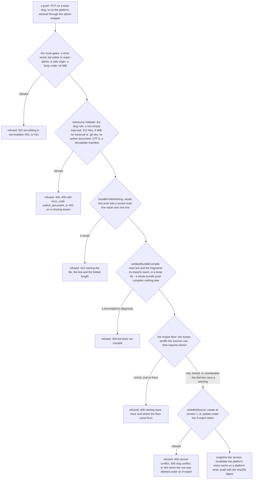
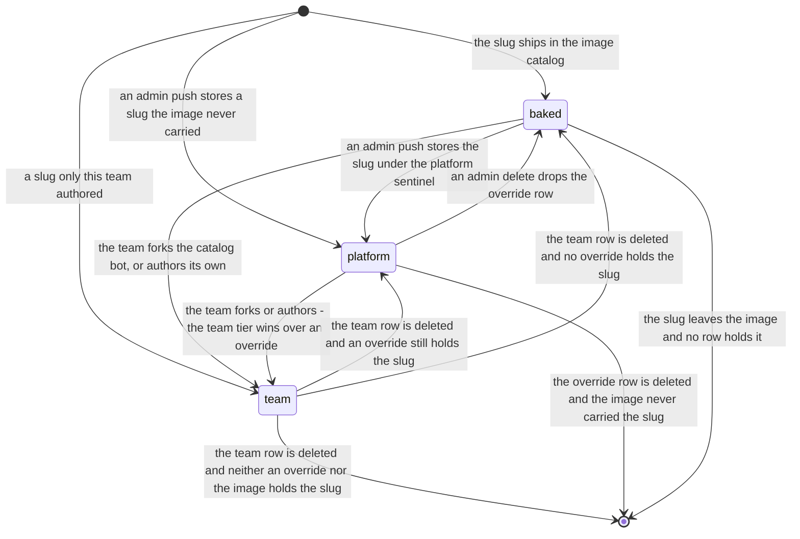

# Bot resolution — team row, platform override, baked catalog

Every site that turns a bot id into launchable source walks three tiers in one order — the launching team's own stored bundle, then the deployment's platform override, then the catalog baked into the image — and, on a cloud deployment, records which one served.

> Drawn from the code at commit `f564846d3`. One authority owns the walk, `pkg/server/bot_resolver.go`, and a static sweep test refuses a direct call to the six `botregistry` lookups it names from any `pkg/server` file outside the nine it allowlists by reason. How this page is kept true: [README](README.md).

## The cascade

The cascade is drawn on the feature page: [platform-bots.md § How it works](../platform-bots.md#how-it-works).

Reading notes, because the picture hides three things:

- **Two name passes per tier, in separate variables.** The baked tier tolerates spelling variants (`feature_dev`, `Feature-Dev` → `feature-dev`) and board cards rely on it, so the stored tiers tolerate the same set: the team tier by an indexed read then a normalized scan of that one tenant's rows, the platform tier through `platformSlug`. `slug` is never rewritten — a platform entry's canonical name would otherwise miss the team row and hijack the team tier.
- **Only `ErrNotFound` falls through.** Every other store error leaves the cascade as an explicit error naming the tier. The alternative is the façade this file exists to refuse: a Mongo blip silently launching the bundle the operator replaced.
- **The team tier applies on EVERY surface**, because every launcher knows the team it launches for — the card's, the subscription's, the schedule's, the webhook config's, the request identity's. `teamID` is a parameter and never a ctx read; a surface with genuinely no tenant passes the empty string and resolves platform over baked. **Metadata takes the same walk from the same team id.** `effectiveFindByNameForTeam`, `effectiveEntriesForTeam`, `botManifestFor`, `botExistsForTeam` and `entryOriginFor` describe the tier that SERVES the launch, so command routing, gate vars, retry policy and hand-off seeds cannot describe a different bundle from the one that runs. `resolvePipelineBot` pairs them per tier: a stored row answers through `storedBotEntry`, the baked tier through `bakedFindByName` with the 30s platform overlay OFF.

## The push that creates a stored tier

## Steps

| Actor | Action | Code |
|---|---|---|
| user | pushes a bundle dir: slug from its basename, the tree walked into a UTF-8 path-to-content map, one warning per executable file because the store drops modes | `RemoteAdminBotsPush`, `botsource.ReadBundleDir`, `ExecutableFiles` |
| server | the admin route re-scopes the request to the platform sentinel and delegates to the SAME core the team routes use | `registerAdminBotRoutes`, `platformBotReq`, `putBotSourceFor` |
| server | structural validation, the one chokepoint every write crosses: slug rule, non-empty `main.bot`, 512 files, 6 MiB, no traversal or `.git` key, no author document, UTF-8, a decodable manifest | `botsource.BotSource.Validate`, `ValidSlug`, `safeBundlePath` |
| server | refuses a write that would fold a stored multi-line value onto one line, naming the line and the resulting length | `bundleFoldsNothing`, `canon.Folds` |
| server | compiles before it persists: materialize to a temp dir, then parse, merge the bundle prompts and compile. The whole-bundle push selects nothing, so the unit compiled is `main.bot` and the fragments its imports reach; the per-file put and delete select the path they touch, and an authoring batch selects every `.bot` it modified | `validateBundleCompile`, `validateBundleCompileSelected`, `unit.LoadDir`, `runview.MergeBundlePrompts`, `ir.Compile` |
| server | holds the bundle to the deployment's engine floor: the syntax profile its sources use, then `requires.iterion` against the minimum of this build and every runner build seen on runs in the last 7 days | `guardBundleEngineRequirement`, `bundleSyntaxFloorGap`, `engineFloor` |
| server | on a platform push only: warns that provisioned webhook command maps and bot rules are built at provision time and will not pick the change up | `platformPushWarnings` |
| store | create mints a uuid, version 1, origin `tenant`, and appends the snapshot BEFORE the insert; update matches `version` when the caller presented one, increments it, then snapshots the re-read row | `MongoStore.Create`, `MongoStore.Update`, `snapshotVersion` |
| server | a platform mutation invalidates this replica's entry cache so it reads its own write, then audits on the PLATFORM log with the sha256 content digest; a team mutation audits on the team's log | `auditBotSource`, `invalidatePlatformBots`, `botsource.Digest` |
| server | a launch surface asks for a bot id together with the team the launch is for: the request identity's team on the interactive launch, which also passes the requested file path, the card's, the webhook config's, the schedule's, the subscription's; the assistant dock re-resolves a launched run's bundle from the run's own tenant | `handleLaunchRun`, `resolveBotSource`, `boardLaunchPreconditions`, `launchWebhookBot`, `launchScheduledBot`, `serviceLauncher.Launch`, `loadAssistantChatSurface` |
| server | infers an id from a catalog-shaped file path, then folds the slug against the platform entry set | `inferCatalogBotID`, `resolveBotTieredRaw`, `botregistry.NormalizeName`, `platformBotEntries` |
| store | team tier, then platform tier: the same read, under the team tenant and under the `platform:` sentinel; then the baked tier over the configured bot roots | `teamBotRow`, `GetBySlug`, `ListByTenant`, `botsource.PlatformTenantID`, `botregistry.ResolveBotEntry`, `effectivePaths`, `bundle.LoadManifest` |
| server | materializes one stored row into a launch-ready bundle, every file at 0644 | `storedLaunchBot`, `botsource.Materialize` |
| server | compares the stored manifest version against what would serve WITHOUT this row — the TTL-cached catalog with the platform overlay laid over it for a team row | `warnIfOverrideShadowsNewerBake`, `versionsBelow`, `shadowsNewerVersion`, `bundleVersionOrder` |
| server | cloud only: freezes the collection, encodes it to bytes plus a sha256 digest, materializes the frozen dir the compile reads | `snapshotLaunchBot`, `bundle.Snapshot.AddDir`, `Encode`, `Materialize` |
| server | one conversion site from the resolver's internal origin to the persisted tier, stamped on the launch spec | `launchBot.Tier`, `StampBundle` |
| server | stamps the run and the queue message, offloading a snapshot that would not fit | `botSourceTenantOf`, `queueBotBundleRef`, `offloadBundleSnapshot` |
| runner | opens the frozen bytes after the digest check and never substitutes its own catalog | `materializeBotBundle`, `bundle.DecodeSnapshot` |
| server | resume re-resolves by the RECORDED origin — that row, under its own tenant, at its current version — while a mission's rewind pins row id and version, falling back to the nearest older snapshot | `resolveResumeBot`, `errResumeResolveTransient`, `resolveResumeBotAtVersion`, `GetByVersion`, `GetVersionAtOrBefore` |
| server | a write aimed at the filesystem catalog for a name a stored tier owns is refused, and told which surface owns the edit | `refuseStoredBotEdit`, `entryOriginFor` |

## Which tier serves a slug

| Value on `runs.bot_source_tier` | Set when | What it means for resume and rewind |
|---|---|---|
| `team` | `storedLaunchBot` resolved the launching team's own row — origin `team` | resume re-resolves THAT row under its own tenant, at its current version |
| `platform` | the read under the `platform:` sentinel found a row — origin `platform` | the same, with `bot_source_tenant` holding the sentinel; an admin delete sends the next launch to the baked tier |
| `baked` | `ResolveBotEntry` answered off the filesystem — origin `catalog` | `ServedByStoredBot` is false whatever a stale tenant stamp beside it says |
| empty | a run of a local deployment (no publisher stamps it), a launch that predates the stamp, or one that resolved no bot at all — a loose `.bot` | `ServedByStoredBot` falls back to a non-empty `bot_source_tenant`, because the tier alone misses every pre-stamp stored run |

The pseudo-state is not a tier: entering it, the slug is held by no tier at all, `resolveBotTiered` answers nil and the caller keeps its own not-found — which is not the `empty` row above, a stamp on a run. Five other state vocabularies look like this one and are not it: `store.RunStatus`, the native board state, the dispatcher claim lifecycle, the forge board columns (`forge_board_bindings.status_mapping`) and `BankState` (see the [README glossary](README.md#glossary)). The row's own write outcomes — created at version 1, updated, `ErrVersionConflict`, deleted with its history retained — are store errors, not a persisted enum.

## Guards that refuse

- **`botSourceCtx`** — `501 bot editing is not enabled on this server` with no store wired, then `403 bot editor, team admin, or owner required`: `canEditBots` is `canEditConfigShares`, so the orthogonal `config_editor` capability, team admin or owner, an org admin or owner, or super-admin — and a synthetic principal is rejected outright.
- **`requireSuperAdmin`** — `403 super-admin only` on every `/api/admin/bots` route and on the history purge; the whole admin group is not even registered unless both the auth service and the bot-source store are wired. A platform override runs across all tenants: the trust level of publishing an image.
- **`requireSafeOrigin`** — every bot-source write, team or platform, passes the same-origin check before anything is read.
- **`botsource.Validate`** — `400` for a structural failure, `400` with `error_code: author_document` for a `.bot.yaml` draft pushed by name, `403` for `ErrTenantMissing`. `maxBotSourceBody` answers `413` above 16 MiB, before the JSON decoder.
- **`bundleFoldsNothing`** — `422`, naming the file, the line and the single-line length a fold would produce. A slug with nothing stored is a creation and folds nothing; a store that cannot be read is an error, never a quiet nothing-to-compare.
- **`validateBundleCompile` and `validateBundleCompileSelected`** — `400 bot does not compile: …` on any `SeverityError` diagnostic. The selection decides what is held: a whole-bundle push passes none and compiles `main.bot` alone, so a companion workflow no import of main's unit reaches is covered by the per-file routes and the authoring batch instead, each of which names what it changed. A per-file delete reports only the diagnostics the bundle did NOT already have, so shedding a file from a bundle that never compiled is still allowed.
- **`guardBundleEngineRequirement`** — `409` naming what the bundle wants, what the deployment has and where the floor came from. `?force=1` (`--force`) proceeds and returns the overridden requirement as a warning; a build nobody can order passes as an explicit unverified warning rather than silently.
- **The if-match token** — `409 ErrVersionConflict` when a concurrent editor advanced the version, `409 ErrSlugConflict` on a duplicate `(tenant, slug)`, and `404` — deliberately not `409` — when the row was deleted between the caller's read and the write while a token was presented. On the bodyless per-file delete the token rides `?version=`: absent is last-write-wins, a value that is not a positive integer is `400`.
- **The fall-through rule** — in the cascade itself, only `botsource.ErrNotFound` moves to the next tier. `storedLaunchBot` refuses a row whose `main.bot` is empty, and a file map that will not materialize is an error with the temp tree removed.
- **`snapshotLaunchBot`** — child depth over 8, an absolute or backslash or NUL source, a key escaping the collection, a missing child workflow, a parse error in the frozen copy, a symlink, over 32 MiB or over 4096 files. A child resolution that failed is wrapped as `errBotSnapshotResolve`, which resume re-reads as transient.
- **The runner** — `bundle.DecodeSnapshot` refuses bytes that do not match `SnapshotDigest`; a ref carrying both an inline and a stored payload is refused; a legacy ref with no snapshot refuses on `version drift: store has vN, launch resolved vM`.
- **`resolveResumeBot`** — a stored row deleted mid-run is an explicit refusal naming the remedy, while a transient store failure is typed so the retry sweeper re-arms instead of abandoning a paid retry.
- **`refuseStoredBotEdit`** — `409` on `PUT /api/v1/bots/{name}` and its `/overlay` when the active team or the platform tier owns the name, naming the surface that owns the edit.
- **What never refuses** — `warnIfOverrideShadowsNewerBake`. An override older than the bake is a legitimate pin: it is reported once per distinct shadow in the log and on every inventory row (`shadowed_version`, `shadows_newer_version`), and the launch proceeds. Unorderable versions and an unreadable catalog stay silent rather than claim nothing is shadowed — the listing says so with `shadow_check_unavailable`.

## Collections touched

| Collection | What this flow does with it |
|---|---|
| `bot_sources` | both stored tiers are rows of this one collection: the team row under its team id, the platform override under the `platform:` sentinel. Read by slug on every resolution, written by every push, fork and delete; `(tenant_id, slug)` is unique |
| `bot_source_versions` | one snapshot per write, `_id` of `<row id>:<version>`, 30-day TTL on its write time. Created BEFORE the insert, so a failed create leaves only an orphan no pin can name; retained across a delete, so a mission's pin still serves what its preview certified |
| `audit_events` | a platform mutation lands on the platform log as `platform.bot.<action>`, a team mutation on the team's as `bot_source.<action>`, each with the slug, the version and the content digest. The history purge takes the same split, as `history.purged`; the count of snapshots removed rides the response body, never the audit meta |
| `runs` | written, by the cloud publisher, with `bot_source_tenant` and `bot_source_tier`; read back by `ObservedRunnerBuilds` for the fleet half of the engine floor |
| `"S3: ir/<run_id>-bundle-<digest>.json"` | the frozen collection itself: the publisher parks it here when the queue envelope would not fit the payload limit, keyed by run id and snapshot digest, and the runner fetches it back through `SnapshotRef` before the digest check |

The adjacent source families do not take part in this precedence: `plugin_sources` is a team-scoped git binding resolved separately, and a `marketplace` install is local-mode only, landing in the workspace `.botz/` or the host plugin dir — no path promotes either into a `bot_sources` row.

## Related

- [platform-bots.md](../platform-bots.md) — the feature page: the push, pull, rm and fork loop, the trust model, `requires.iterion`, the shadowed-bake reporting and the known gaps; [bot-bundle-snapshots.md](../bot-bundle-snapshots.md) — the cloud freeze in full; [resume.md](../resume.md) — what a run served by a stored bot re-resolves.
- [cloud-rest-api.md](../cloud-rest-api.md) — the seven team routes and their gate; [plugins.md](../plugins.md) and [adr/080-git-backed-org-private-plugin-sources.md](../adr/080-git-backed-org-private-plugin-sources.md) — the adjacent plugin-source family; [adr/094-shared-subbot-bundles-bot-uri.md](../adr/094-shared-subbot-bundles-bot-uri.md) — the `bot://` dependency URI.
- [data-model-forge-bots.md](data-model-forge-bots.md) — `bot_sources`, `bot_source_versions` and the bot-definition tiers at rest; [data-model-runs.md](data-model-runs.md) — the run document the tier is stamped on; [data-model-identity.md](data-model-identity.md) — `audit_events`; [access-control.md](access-control.md) — `canEditBots` and `requireSuperAdmin` in the matrix; [flow-cloud-run-lifecycle.md](flow-cloud-run-lifecycle.md) — the launch this resolution feeds.

