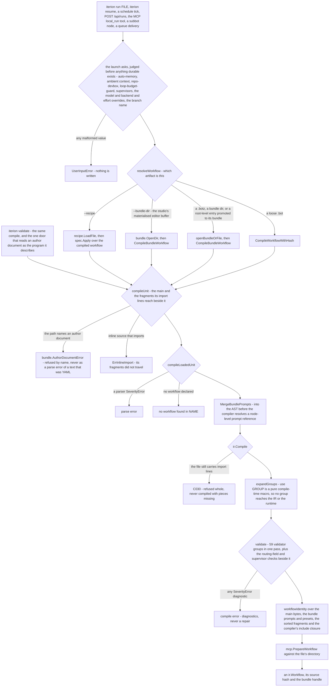
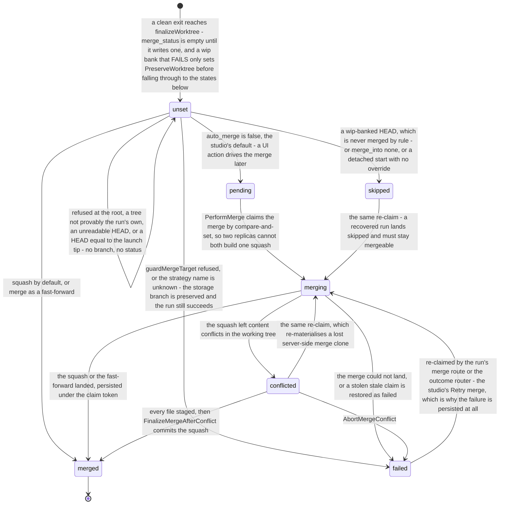

# From a `.bot` to a running graph

A `.bot` file, a `.botz` bundle or a bundle directory becomes a running graph through one compile path and one engine, whichever door opened it.

> Drawn from the code at commit `f564846d3`. How this page is kept true: [README](README.md).

The run's own status machine is drawn once, by [data-model-runs.md](data-model-runs.md#run-status-vocabulary); the cloud launch exchange and the queue delivery that carries a run to a runner pod are drawn by [flow-cloud-run-lifecycle.md](flow-cloud-run-lifecycle.md). This page draws what neither covers: the compile every door funnels through, the engine's setup order and its per-node pipeline, and the finalisation of the run's worktree.

## The compile

| actor | action | code |
| --- | --- | --- |
| user | names an artifact and packs every launch flag into one options struct | `runCmd`, `cli.RunOptions`, `cli.RunRun` |
| engine | judges the modes and overrides up front, and again when the real executor is built, so an injected executor cannot skip the check | `automemory.ValidateMode`, `ambient.Validate`, `runtime.ValidateLoopBudgetGuardMode`, `supervise.ValidateSupervisorsMode`, `model.ParseModelOverrides`, `git.ValidateBranchName` |
| engine | mints the run id, starts telemetry and seeds the engine options | `store.GenerateRunID`, `startRunTelemetry`, `runtime.WithEventObserver` |
| engine | forks on the artifact kind; a bundle entry is promoted to its bundle so its `skills/` and `prompts/` reach the run | `resolveWorkflow`, `openBundleOrFile`, `runview.CompileWorkflowPath` |
| engine | loads the unit, refuses a draft by name, merges the bundle's prompts, compiles, takes the identity, prepares the MCP servers | `runview.compileUnit`, `runview.compileLoadedUnit`, `runview.workflowIdentity` |
| engine | expands `use`, compiles prompts, schemas, nodes and edges, then validates | `ir.Compile`, `compiler.expandGroups`, `compiler.validate` |
| engine | applies the CLI budget overrides onto the workflow *before* the executor snapshots `Budget`, and records the raw ask on the run doc | `applyBudgetOverrides`, `runtime.WithBudgetAsk`, `runview.RunBudgetOverrides` |
| store | opens the project's managed store, tees `run.log` into it, then wires a hub per DSL-declared `supervisor` | `store.New`, `store.TeeRunLog`, `supervise.DeclaredEnabledOrWarn` |
| engine | builds the executor **first**, then health-checks the active MCP servers against that executor — the check takes it as an argument — and wires the subbot runner | `buildRunExecutor`, `runview.MCPHealthCheck`, `subbotRunnerForCLI`, `runtime.WithSubbotRunner` |
| engine | resolves the run inputs last, after the executor and its health check — the preset overlay, then `--var` — and refuses an operator-typed skill that resolves to nothing | `buildRunInputs`, `runtime.MergeBundlePresets`, `runtime.ResolveExtraSkills` |

## The run

```mermaid
flowchart TD
    EX{"runview.BuildExecutor - the compile phase's last step, the production NodeExecutor, model.ClawExecutor, over the delegate registry, the tool registry, the store event hooks and the secret guard"}
    EX -->|"a launch override re-targets a gated node at a backend no permission gate reaches"| XOV["refused by ValidateModelOverridePermissions"]
    EX --> LOCK["the exclusive per-run lock under the SIGINT-aware ctx, then Engine.Run"]
    LOCK --> DOC{"runResolveDoc - the queued row a cloud publisher pre-created becomes running, a row already running is waved through as a legitimate claim, or CreateRun mints one"}
    DOC -->|"a finished, failed, failed_resumable, cancelled or paused row - terminal or resume-only"| XCL["refused - already in status STATUS, refusing to restart. Two-writer contention is guarded by the queue lock and store.LockRun, never here"]
    DOC --> ADM{"admitRun - the single admission gate, deliberately before attachment promotion, workspace setup, sandbox start and the first model call"}
    ADM -->|"an untrusted workspace that resolves no container"| XUN["denied untrusted_without_sandbox, LAUNCH_FAILED"]
    ADM -->|"a context mismatch under policy enforce"| XCTX["denied context_mismatch, LAUNCH_FAILED - report and legacy record the violations and allow"]
    ADM --> VARS{"validateVarConstraints over run.Inputs, then refuseBundleRequiringNewerEngine"}
    VARS -->|"a value outside its enum or matching, or a bundle naming a newer engine"| XVAR["failed before a worktree or a sandbox is spun up - the stored values are never re-judged on resume, the engine requirement always is"]
    VARS --> WT{"worktree auto"}
    WT -->|"a subbot child whose parent declared no isolated:, a run that adopted a parent's sandbox, a store with no filesystem root, a non-git workspace, an unborn HEAD"| INPL["in place, each degradation logged - auto is best-effort isolation, never a precondition"]
    WT --> POOL["EnforceWorktreePoolBound, then git worktree add at the ANCHOR checkout's HEAD, not the main repo's - the bound warns, it never refuses a run"]
    POOL --> FIN0["the finalizeOnExit defer is installed here, covering every later exit path"]
    INPL --> WS
    FIN0 --> WS{"runPersistWorkspace - WorkDir, Worktree, RepoRoot, BaseCommit"}
    WS -->|"workDirDelegated, a main repo root that differs, and no parent run"| ADOPT["a tree the runtime did not create is adopted as a managed baseline - ADR-064"]
    WS --> SB["startSandbox, resourcesReady, then run_started carrying the named-loop bounds"]
    ADOPT --> SB
    SB --> HOP{"execLoop - at every hop ctx.Done first, then the operator pause signal, then drainOverrides at that safe boundary"}
    HOP -->|"a node id absent from wf.Nodes"| XNF["typed NODE_NOT_FOUND - the resume-after-source-edit wall, not the EXECUTION_FAILED catch-all"]
    HOP --> SPEC{"execLoopDispatchSpecial, with isSpecialDispatch deciding the bracketing"}
    SPEC -->|"done, fail - dispatched, but absent from isSpecialDispatch: no pre-node marker, and the terminate branch never reaches the anchor reset"| TERM["emitTerminalNodeEvents, then the terminal status write"]
    SPEC -->|"a human pause, a review gate, a fan-out or round-robin or llm router, compute, subbot, emit, wait, await_answers"| INL["run inline, each with its own pre-node boundary marker, and the remembered snapshot anchor invalidated afterwards"]
    SPEC -->|"a RouterCondition, an interaction llm human node, every other node"| STD["node_started, the daily spend cap then the per-run budget, the node input, the needs leases, then NodeExecutor.Execute under a per-node span"]
    STD -->|"the daily cap is over"| XCAP["paused_operator, reason cost_cap_daily"]
    STD -->|"a dimension at 100 percent, or at the 90 percent hard limit"| XBUD["a bounded exit-path grace, else BUDGET_EXCEEDED - or paused_operator under on_exceeded pause"]
    STD --> ROUTE{"ClawExecutor.executeNode routes by node kind"}
    ROUTE -->|"agent, judge"| BE{"executeBackend - resolve the backend NAME, resolve it in delegate.Registry, build the task, bracket auto-memory, dispatch the resolved fallback chain"}
    ROUTE -->|"an interaction llm human node, a tool node"| OTH["executeHumanLLM, executeToolNode"]
    BE -->|"a name the registry does not hold"| XBE["delegate: unknown backend NAME"]
    BE --> POST
    OTH --> POST["correct-and-validate against the schema, book the spend even when validation fails, commit the session slot, publish the artifact, node_finished, SaveCheckpoint, snapshot the worktree boundary"]
    POST --> EDGE{"selectEdge - a conditional when edge, then an iteration edge that still has work, then else, then the first bare edge written"}
    EDGE -->|"an unbounded loop whose source-output signature is unchanged across 3 crossings"| XST["the back-edge is declined as liveness_stall"]
    EDGE -->|"a ceiling reached, or another iteration the budget cannot fund"| XOF["declined as loop_cap, loop_out_of_fuel, or loop_budget_guard - the run leaves by its other edges"]
    EDGE -->|"nothing matches"| XNO["NO_OUTGOING_EDGE - but an overrun measured after this node is taken FIRST, so a redelivery cannot land on the same spent budget"]
    EDGE --> HOP
    INL --> HOP
    INL -->|"an llm router: execLLMRouter calls the executor itself - its own node_started, its own checkBudgetBeforeExec, then executeLLMRouterUnified, and never execLoopRunNode's booking or execLoopAfterExec, so no artifact publish and no SaveCheckpoint"| HOP
    TERM -->|"the done node"| T1["finished - deferred to the post-cleanup when the run holds borrowed resources"]
    TERM -->|"the fail node"| T2["failed, carrying the node's own code"]
    T1 --> FIN{"finalizeOnExit"}
    T2 --> FIN
```

| actor | action | code |
| --- | --- | --- |
| engine | builds the production executor and refuses a launch override that would un-gate a node | `runview.BuildExecutor`, `runview.ValidateModelOverridePermissions`, `ir.UngatedCrossingReasonForAskRules` |
| store | takes the exclusive per-run lock; a contended lock blocks but stays interruptible | `store.LockRun` |
| engine | loads or creates the run document, then admits the run once | `Engine.runResolveDoc`, `Engine.admitRun`, `refuseUntrustedWithoutSandbox`, `RunWillBeSandboxed` |
| engine | judges every `[enum:]` / `[matching:]` var on `run.Inputs` — the one check every launch surface funnels into — and the bundle's engine requirement | `Engine.validateVarConstraints`, `Engine.refuseBundleRequiringNewerEngine` |
| engine | bounds the worktree pool, then adds the worktree at the anchor checkout's tip | `EnforceWorktreePoolBound`, `worktreepool.EnforceBudget`, `setupWorktree` |
| engine | persists the workspace identity, with the ADR-064 delegation gate on adopting a tree it did not create | `Engine.runPersistWorkspace`, `gitlib.FindMainRepoRoot` |
| engine | starts the per-run sandbox and emits `run_started` | `Engine.startSandbox`, `pickMode`, `runStartedPayload` |
| engine | drives the loop: cancel, pause, steering, then dispatch — `isSpecialDispatch`, not the dispatcher's own switch, decides which inline node is bracketed | `Engine.execLoop`, `execLoopDispatchSpecial`, `isSpecialDispatch`, `Engine.execLLMRouter`, `Engine.drainOverrides` |
| engine | schedules a fan-out: plan the edges, cap concurrency, deep-copy the parent outputs, converge at the downstream `await:` node | `Engine.execFanOut`, `planFromEdges`, `validateWorkspaceSafety`, `resolveConvergence` |
| engine | the standard pipeline and its budget gates | `Engine.execLoopRunNode`, `checkBudgetBeforeExec`, `graceOrFailBudget`, `Engine.acquireResources` |
| provider | routes by node kind, resolves the backend name through its chain, dispatches the fallback chain | `ClawExecutor.executeNode`, `ClawExecutor.executeBackend`, `resolveBackendName`, `Registry.Resolve` |
| engine | everything a node owes after it returns | `Engine.execLoopAfterExec`, `correctAndValidateNodeOutput`, `persistArtifactIfPublished`, `snapshotAtNodeBoundary` |
| engine | selects the next edge and declines a loop that is not earning its crossing | `Engine.selectEdgeRS`, `evaluateEdgesWithLoopsRS`, `Engine.loopStalled`, `resolveLoopMaxBase` |
| engine | writes the terminal status | `publishRunFinished`, `failRunDeliberate`, `failRunErrWithCheckpoint`, `handleContextDoneWithCheckpoint` |

**The backend name** resolves in this order, first non-empty winning: the launch override, the node's `backend:`, the workflow's `default_backend:`, `ITERION_DEFAULT_BACKEND`, `detect.Resolve` over the host's credentials, then `claw`. Seven backends are registered: `claw` in process, `claude_code` and `codex` with their own backends, and `kimi`, `grok`, `pi` and `opencode` over the shared `CLIAgentBackend` seam (`pi` adds an RPC variant beside its print one). Only `claude_code` and `claw` are in `DefaultPreferenceOrder`; the other five are explicit opt-ins.

## Finalising the worktree

| state | what it means | code |
| --- | --- | --- |
| `unset` | finalisation has written nothing: a refusal, an unchanged HEAD, or the run is still live. The storage branch `iterion/run/<run id>` is created on every promoted HEAD, with a numeric suffix on collision — it is the GC guard. A **failed wip bank** is not one of these refusals: `stageRunWork`, `wipSetAside` and `gitCommitMessage` set `PreserveWorktree` and fall through, so a run that committed anything itself still gets its branch and, `WipBanked` having stayed false, still reaches the merge dispatch — the never-merge-a-banked-HEAD rule does not cover it | `finalizeWorktree`, `createBranchSafely`, `readHEAD`, `stageRunWork` |
| `pending` | the branch exists and the merge is deferred to an operator action — the studio's default, the CLI's opt-out | `finalizeOptions.autoMerge`, `Service.PerformMergeCtx` |
| `merging` | one worker holds the right to merge; every exit goes through the conditional write, so a claimant that lost its claim cannot overwrite the winner | `store.ClaimMerge`, `store.UpdateRunMergeIf`, `RunMergeUpdate.ExpectClaimedAt` |
| `conflicted` | `git merge --squash` left `UU` paths on disk and the operator resolves or aborts | `trySquashMerge`, `MergeConflictError`, `Service.ResolveMergeConflictFile` |
| `merged` | the target advanced; `MergedCommit` equals `FinalCommit` under `merge`, differs under `squash`. The **only** final status: it is the one value `ClaimMerge` refuses | `tryFastForward`, `trySquashMerge`, `persistMergeSuccess` |
| `skipped` · `failed` | the storage branch is the result for now and the run's own status is unaffected either way — but neither is a sink: `ClaimMerge` is claimable from `""`, `pending`, `failed`, `skipped` and `conflicted`, so an operator action re-enters `merging` from any of them | `finalizeWorktree`, `resolveMergeTarget`, `store.ClaimMerge`, `mergeClaimable` |

An error exit takes none of this: the worktree is **preserved for inspection**, or released outright when the refusal was early and produced nothing. A review gate that already finalised this run owns it — unless the recorded `FinalCommit` is stale, in which case finalisation re-runs at the true tip.

## Guards that refuse

- `UserInputError` — a malformed `--auto-memory`, `--ambient-context`, `--loop-budget-guard`, `--supervisors`, `--branch-name` or budget flag: nothing durable exists yet.
- `bundle.AuthorDocumentError` / the stable code `author_document` — a draft that documents an author never becomes a program, at every door that names one.
- `ErrInlineImport` and `C030` — a source whose `import` lines were never merged in is refused whole, rather than compiled with pieces missing.
- `C176`, through `ir.UngatedCrossingReasonForAskRules` — a route or a launch override that would strip a node's `permission:` gate, refused at compile time and again before the executor is built.
- `untrusted_without_sandbox` — `run.Trust` not trusted and the resolved sandbox is no container: `LAUNCH_FAILED`, persisted as `run.Admission`.
- `context_mismatch` — the resolved execution context disagrees with the run record under `ContextPolicyEnforce`; `report` and `legacy` record the violations and allow.
- Var constraints and `requires.iterion` — both fire before a worktree or a sandbox is spun up for a doomed run. On resume they part ways: the parent's stored values are never re-judged (only the keys a `fork --new-inputs` recorded, once, at the child's first resume — `judgeForkSuppliedInputs`, then the record is consumed), while `refuseBundleRequiringNewerEngine` runs on **every** resume, before the claim, leaving the run the resumable status it had.
- `NODE_NOT_FOUND` — a checkpoint pointing at a node the edited source no longer declares.
- `cost_cap_daily` and `budget_cap_run` — `paused_operator`, resumable; `BUDGET_EXCEEDED` when no pause policy is declared and the exit-path grace is spent.
- `liveness_stall`, `loop_cap`, `loop_out_of_fuel`, `loop_budget_guard` — a declined back-edge, never a killed run: the run leaves by its other edges, or dies of `LOOP_EXHAUSTED` when none matches.
- `NO_OUTGOING_EDGE` — the run has nowhere to go; a budget overrun measured after the same node outranks it.
- Refuse-at-the-root and `proveOwnWorktree` — finalisation writes nothing when the worktree path is the repository root or the tree hangs off another repository; `guardMergeTarget` refuses the merge when the target is not the currently-checked-out branch, the branch changed since the run started, or the main working tree is dirty (a failed `git status` reads as dirty, never as clean).
- The worktree pool bound is **not** a refusal: it reclaims oldest-first and returns a warning report.

## Collections touched

| collection | written by | what |
| --- | --- | --- |
| `runs` | engine | the document itself and every field above: status, `Admission`, `BudgetOverrides`, `WorkDir` / `Worktree` / `RepoRoot` / `BaseCommit`, the checkpoint, `artifact_index`, the steering and permission patches, `await_answers_waits.<token>` (a field on the run, not its own collection), and the finalisation block |
| `events` | engine | `run_started`, `node_started` / `node_finished`, `budget_exceeded`, `budget_exit_grace`, `run_steered`, `artifact_written`, `worktree_branch_failed`, `run_paused`, `run_failed`, `run_finished` |
| `run_seq` | engine | the per-run monotonic sequence `AppendEvent` allocates from |
| `run_turns` | provider | one document per LLM turn a node's model call produces, written by the store event hooks `BuildExecutor` wires — `OnLLMTurnCapture` → `WriteTurn`, keyed on run, node, loop iteration and turn index |
| `run_plans` | provider | one snapshot per plan-tool write, from the same hooks — `capturePlan` → `AppendPlanSnapshot`, secret-redacted, deduplicated against the previous snapshot |
| `interactions` | engine | a human pause's questions, and the async `ask_user_async` ones |
| `user_messages` | engine | the operator-message inbox the generation engine drains between the agent's tool iterations, through `model.StoreInboxBinder` over `store.DrainPending` and `store.MarkConsumed` |
| `"S3: artifacts/<run>/<node>/<version>.json"` | engine | `WriteArtifact` PUTs the body, appends the event and `$max`-es `run.artifact_index.<node>`; artifacts are not a collection |
| `"S3: tools/<run>/<tool-use-id>/<kind>"` | provider | a tool-call body over the inline threshold, redacted then set aside by the same hooks: one object per `input` and per `output`, through `WriteToolBlob`; under the threshold, or when the write fails, it rides the event capped inline |
| `"FS: <store-dir>/runs/<run-id>"` | engine | the local lane runs the same engine code against the filesystem store: `run.json`, `events.jsonl`, `run.log`, `turns/<node>/<iter>/<turn>.json`, `plans/`, the interaction files — no Mongo collection is touched |
| `"FS: <store-dir>/worktrees/<run-id>"` | engine | the per-run worktree, and the per-node snapshot refs under `refs/iterion/runs/` in the parent repository |

## Related

- [architecture.md](../architecture.md) — the same span at system altitude; [dsl.md](../dsl.md) — the language and the unit/import model; [agents/engine/dsl-and-runtime.md](../agents/engine/dsl-and-runtime.md) — the per-node-kind table; [agents/engine/dsl-backend-execution.md](../agents/engine/dsl-backend-execution.md) · [agents/engine/dsl-errors-resume.md](../agents/engine/dsl-errors-resume.md).
- [backends.md](../backends.md) · [delegation.md](../delegation.md) — backend selection and what each one can do; [routers.md](../routers.md) — the five router modes and convergence.
- [agents/engine/worktree-finalization.md](../agents/engine/worktree-finalization.md) · [worktree-pool.md](../worktree-pool.md) · [adr/064-worktree-finalization-requires-delegated-authority.md](../adr/064-worktree-finalization-requires-delegated-authority.md) · [sandbox.md](../sandbox.md) · [permissions.md](../permissions.md) · [resume.md](../resume.md) · [agents/engine/dsl-quick-reference.md](../agents/engine/dsl-quick-reference.md) — the budget dials and the edge grammar.
- [data-model-runs.md](data-model-runs.md) — the run, its streams and the status machine; [flow-cloud-run-lifecycle.md](flow-cloud-run-lifecycle.md) — the cloud launch and the queue delivery; [flow-revi-review-merge-gate.md](flow-revi-review-merge-gate.md) — the review gate that can finalise a run before its end.

