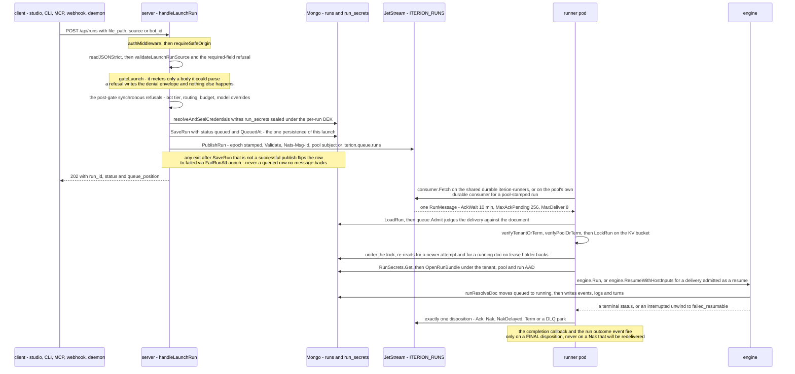
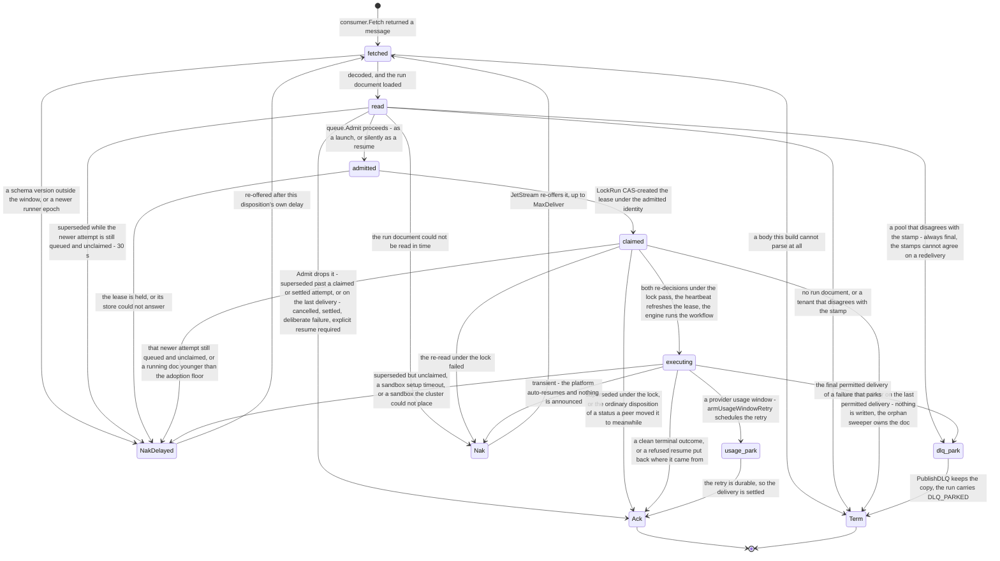

# Cloud run lifecycle

A cloud run is admitted once by the server, persisted as a queued document before anything is published, carried to a runner pod as a single queue message, executed under a key-value lease, and settled by exactly one disposition of that delivery.

> Drawn from the code at commit `f564846d3`. How this page is kept true: [README](README.md).

The run's own status machine is drawn once, by [data-model-runs.md](data-model-runs.md#run-status-vocabulary), and is not redrawn here. This page draws the two halves that table cannot express: the exchange that puts a run on the queue, and the lifecycle of the **delivery** that takes it off — a different vocabulary, decided by a different writer, and the reason `failed_resumable` is the platform's auto-retry state rather than an end.

## The launch exchange

| actor | action | code |
| --- | --- | --- |
| client | POSTs the launch body; the CLI and the operator MCP tool reach the same route | `cli.RemoteRunsLaunch`, `operatormcp` `remote_runs_launch` |
| server | authenticates every `/api/*` call, then checks the Origin allowlist | `authMiddleware`, `requireSafeOrigin` |
| server | the one admission gate every launch surface crosses, and the metering | `Server.gateLaunch`, `gateMonthlyCaps`, `orgusage.Counter.AllowRun` |
| server | arms the refund of the metered unit and the per-minute token | `launchAdmission.rollback`, `runview.RunMayHaveStarted` |
| server | refuses an unknown body field outright, then the named synchronous refusals | `readJSONStrict`, `validateLaunchRunSource`, `validateModelOverrides` |
| server | draining, run-id-taken and untrusted-without-publisher refusals; mints the run id | `runview.Service.Launch` |
| server | unknown inputs, the team's frozen pool, the registry state and the pool grammar | `Publisher.SubmitLaunch`, `runnerPoolForTeam`, `poolRoutes`, `queue.ValidPoolName` |
| server | seals the bundle under the per-run DEK and arms the credential-pool release | `resolveAndSealCredentials`, `secrets.SealRunBundle`, `RunBundleAAD` |
| server | judges every var against its declared range before the message carries it | `reviewtopology.InjectAll`, `runview.GateLaunchVars` |
| store | the single `SaveRun`, and the deferred choke point behind it | `store.SaveRun`, `store.FailRunAtLaunch` |
| server | offloads an oversized IR to the blob store, then retries only transient publishes | `offloadOversizedIR`, `store.AsIRBlobStore`, `publishWithRetry` |
| nats | stamps the runner epoch, validates the wire contract, picks the subject | `Conn.PublishRun`, `RunMessage.Validate`, `PoolSubject` |
| runner | long-polls one message at a time; one in-flight run per pod. A pool pod attaches its pool's durable consumer and refuses a missing or mis-pointed one; the shared pod prepares `iterion-runners` | `Runner.loop`, `processOne`, `Conn.AttachPoolConsumer`, `Conn.PrepareConsumer` |
| runner | the pure admission rule, shared with the DLQ replay refusal | `queue.Admit`, `dispositionForStatus` |
| runner | CAS-creates the lease, then holds it with a 20 s heartbeat against a 60 s TTL | `acquireRunLock`, `store.LockRun`, `executeHoldingLease` |
| runner | re-decides under the lease, before the engine: a newer queued attempt, and a `running` doc with no lease holder — old enough, it is CAS-promoted to `failed_resumable` / `PROCESS_ORPHANED` with the continuation `redelivery_pending`, and the delivery is converted into a resume | `supersededUnderLock`, `adoptRunningUnderLock`, `store.UpdateRunOutcome` |
| runner | hydrates the IR, opens the bundle, pre-flights the cap, clones the repository | `executeRun`, `injectCredentials`, `usageCapPreflight`, `prepareRepoWorkspace` |
| engine | the queued-to-running transition, and the refusal to restart any other status | `runResolveDoc`, `runStartQueued` |
| runner | picks the one disposition and decides whether anything is announced | `dispatchExecOutcome`, `outcomeSideEffectsFire` |
| server | closes the gap no runner can: a stale row with no lease | `sweepOrphanRuns` |

## The delivery

| state | what it means | code |
| --- | --- | --- |
| `fetched` | the pod holds one delivery; its ack window is `AckWait`, held open by `InProgress` | `Runner.loop`, `jsDelivery` |
| `read` | the body decoded and the run document loaded under the message's tenant | `decodeOrTerm`, `resolveDeliveryPreconditions` |
| `admitted` | the admission rule let it through, possibly converted to a resume | `queue.Admit`, `Admission.AsResume` |
| `claimed` | this pod owns the run; without the lease it may write neither outcome nor continuation. Two re-decisions run here, before the engine: a newer queued attempt, and a `running` doc no lease holder backs | `acquireRunLock`, `nats.LeaseInfo`, `supersededUnderLock`, `adoptRunningUnderLock` |
| `executing` | the engine holds the run, the heartbeat holds the lease, a lost refresh interrupts | `executeHoldingLease`, `startLeaseHeartbeat` |
| `Ack` | settled: nothing will be re-offered | `actionAck`, `ackTerminal` |
| `Nak` / `NakDelayed` | the platform itself will retry; `redelivery_pending` says so on the run | `actionNak`, `actionNakDelayed`, `ContinuationRedeliveryPending` |
| `Term` | refused for good: JetStream drops it without consuming the budget | `actionTerm`, `termTerminal` |
| `usage_park` | a retry is armed on the run, then the delivery is acked | `parkUsageLimitRetry`, `ScheduleRunRetry` |
| `dlq_park` | the parked copy is the recoverable artifact; a replay of it is refused | `parkOnDLQOnFinalDelivery`, `handleAdmissionMismatch`, `handleDLQReplay` |

`onLastDelivery` substitutes a different disposition when JetStream will re-offer nothing: a superseded-but-unclaimed delivery is dropped instead of re-offered, a held lock is archived on the DLQ, a schema mismatch is parked and the row flipped. A `Nak` into nothing leaves the continuation unknown, which is honest — nobody owns that run's future, and the orphan sweeper is what finds it.

## Guards that refuse

- `no_workspace` 403 — a signed-in caller with no `TeamID`, or a token naming a team the identity store answers `ErrNotFound` for.
- `member_role_required` 403 — `launchRungCleared`: a viewer or a `config_editor` does not clear the rung; a webhook delivery and the in-process daemons are exempt by kind.
- `org_suspended` 403 — `!team.CanLaunch()` or `!org.CanLaunch()`.
- `repo_quota_exceeded` 402 — one repository over its own ceiling inside the shared budget.
- `concurrency_cap_exceeded` 429 with `Retry-After: 30` — `CountActiveRunsByTenant` at `MaxConcurrentRuns`, lowered by reserves held for other workloads.
- `launch_rate_limited` 429 — the per-team token bucket keyed `orglaunch:<team>`; `rollback` refunds the token.
- `monthly_run_quota_exceeded` / `monthly_cost_cap_exceeded` 402 with `reset_at` — both decided from one post-increment document; the **run quota is tested first**, so an org over both reads the run-quota token.
- `author_document` 400 — a `.bot` that documents an author rather than declaring a workflow.
- No row at all — an unknown input name, a pool that is unmapped, unknown or not `active`, a var outside its `enum` or `matching`, a required secret that cannot resolve, an oversized IR with no blob-store seam: refused synchronously, before `SaveRun`.
- 503 `ErrServerDraining` and the queue-outage envelope; 429 `ErrUsageCapped`; 409 `ErrRunIDTaken`; 422 `ErrNoLLMCredential`.
- Runner side, Term — `tenant_mismatch`: a bare Term, nothing written, because the run is unsafe to execute under either tenant's scope.
- Runner side, the admission-mismatch disposition — `pool_mismatch`, when the pod's pool, the message's pool and the pool frozen on the document do not all agree. **Never a bare Term**: the three stamps cannot start agreeing on a redelivery, so the refusal is always final — the payload parks on the DLQ of the pool the message is stamped for, `FailQueuedRunIfAttempt` flips the document to a final failure under that exact queued attempt (`DLQ_PARKED`, or the refusal's own cause when the park failed), the delivery is Termed, and the completion callback and the run-outcome event fire last, only when that flip won.
- Runner side, Ack — `DeliberateFailure(FailureCode)`: a bot-defined or deterministic code is not auto-resumed, because the same step would fail identically.
- The lease refuses an unattributed caller (`ErrLeaseUnattributed`) and a holder whose stored admission disagrees (`ErrLeaseIdentityMismatch`); the sealed bundle refuses a record whose `tenant_id` is not the message's.
- The sweeper refuses itself: the whole `queued` pass is skipped while the shared consumer or any pool that is not disabled still reports backlog — those rows are waiting for a free runner, not orphaned.

## Collections touched

| collection | written by | what |
| --- | --- | --- |
| `runs` | server, engine, runner, sweeper | the one `SaveRun`, the launch-failure flip, the status transitions, the outcome and its continuation |
| `run_secrets` | server, runner | the sealed bundle, TTL 24 h, deleted on a terminal outcome |
| `staged_uploads` | server | the uploads a launch names, promoted to the run between its row and its queue message (`runview.PromoteForHandoff`), then discarded |
| `org_usage` | server, runner | the run unit at admission, its refund, and the run's cost and tokens |
| `credential_usage` | server, runner | the per-repository, per-credential meter: the repo-quota ceiling reads it, and every route a run charges writes its spend back |
| `teams`, `orgs` | reads | the frozen pool, the suspend state and the caps the gate reads |
| `platform_settings` | reads | one document per family: the `runner_pools` registry the publisher refuses an inactive pool from, the budget floor that lowers the concurrency cap, the sandbox image, and the usage-cap settings the runner's pre-flight reads |
| `events`, `run_logs`, `run_seq`, `interactions`, `run_gitmeta`, `run_turns` | engine, runner | the run's streams and its git metadata |
| `retry_circuits` | runner | the retry coordinator's circuit behind a usage-window park |
| `usage_windows` | runner | the recorded provider window the cap pre-flight reads |
| `cred_pools`, `cred_pledges`, `cred_leases`, `cred_pool_usage` | server, runner | a pool-funded slot and the spend reported against it |
| `webhook_deliveries` | server | the `launch_error` row an inbound denial writes |
| `"NATS KV: iterion-run-locks"` | runner | the claim itself: `LeaseInfo` under a 60 s bucket TTL |
| `"S3: ir/<run_id>.json"` | server, runner | the out-of-band IR when the envelope exceeds `max_payload` |

The `leases` collection is **not** on this path's claim: it elects idempotent server-side nets for load, never the runner's exclusion.

## Related

- [cloud-architecture.md](../cloud-architecture.md) — control plane versus data plane, the queue internals, the lock back-off and the orphan sweeper.
- [cloud-overview.md](../cloud-overview.md) — the governed loop and the webhook-to-review walkthrough; [cloud-deployment.md](../cloud-deployment.md) — the operator's topology.
- [quotas-and-limits.md](../quotas-and-limits.md) — the admission order, the denial envelope and which surfaces meter.
- [cloud-queue-schema-rollout.md](../cloud-queue-schema-rollout.md) — the wire-compatibility window and the deploy ordering.
- [outbound-callbacks.md](../outbound-callbacks.md) · [probes-and-graceful-shutdown.md](../probes-and-graceful-shutdown.md) — the announcement and the drain halves of the terminal story.
- [data-model-runs.md](data-model-runs.md) — the run, its streams and the status machine; [data-model-credentials.md](data-model-credentials.md) — the sealed bundle and the pool lease; [access-control.md](access-control.md) — the gate and the principal kinds.
- [adr/075-irref-fallback-for-oversized-cloud-queue-ir.md](../adr/075-irref-fallback-for-oversized-cloud-queue-ir.md) · [adr/095-terminal-state-contract-and-failure-taxonomy.md](../adr/095-terminal-state-contract-and-failure-taxonomy.md) · [adr/117-server-side-leader-lease-for-idempotent-nets.md](../adr/117-server-side-leader-lease-for-idempotent-nets.md)

