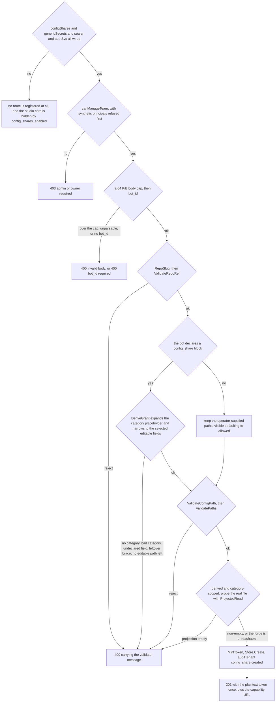
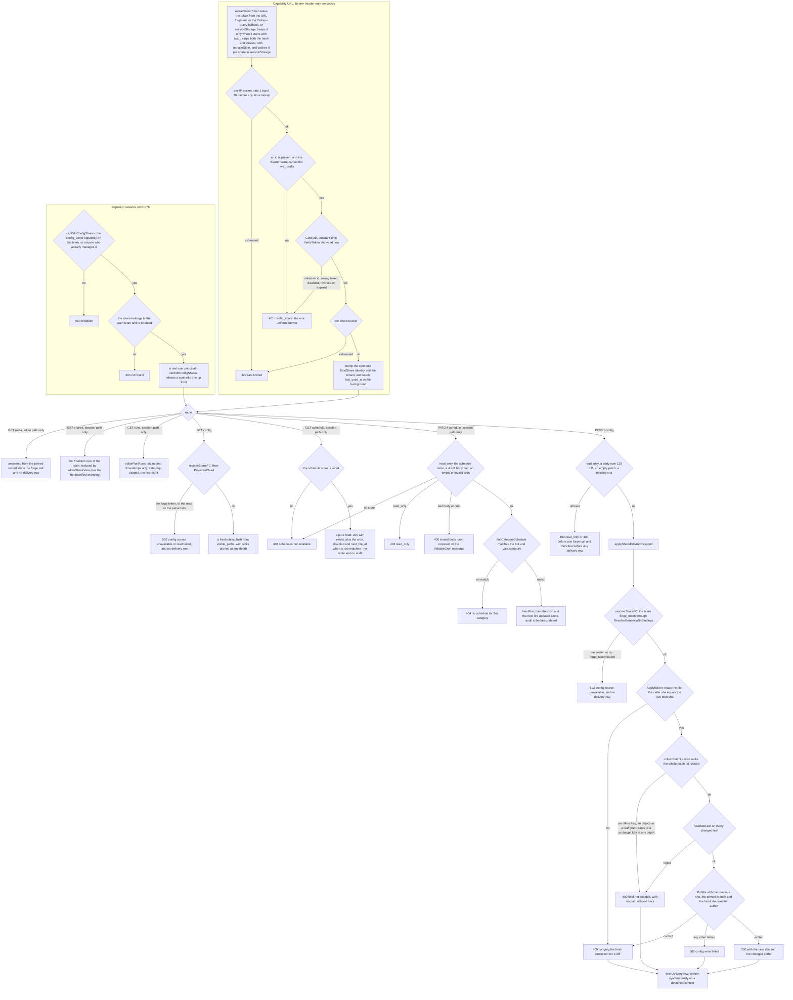
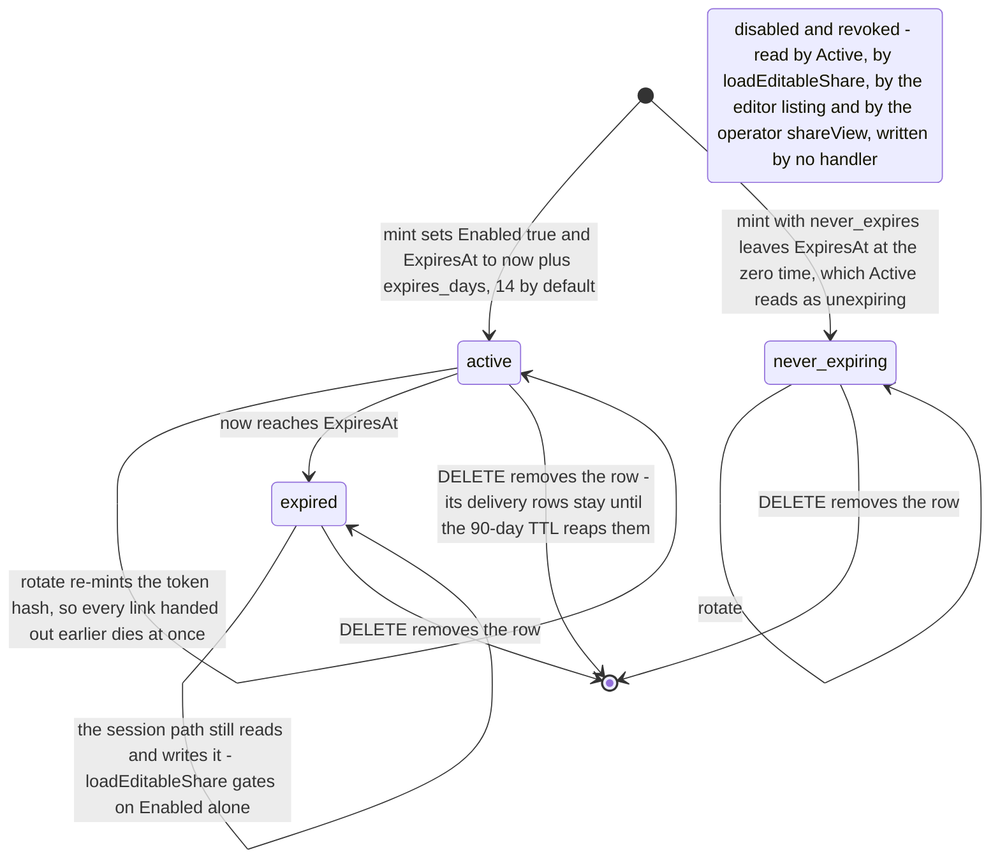

# Flow — config-share: the mint, the two access paths, the fail-closed write

A config-share is one grant that lets a non-operator edit a declared allow-list of fields in one JSON file of one repository — through a capability URL or a signed-in least-privilege session — and nothing else in iterion.

> Drawn from the code at commit `f564846d3`. No gate compares this page's prose with the code: the commit above is the claim a redraw must re-verify by hand. [Conventions](README.md).

## The mint

An operator who passes `canManageTeam` mints the grant, and the bot's own `manifest.yaml` decides what the grant may contain: a declared `config_share:` block is authoritative, so the operator supplies only a bot and a category.

## The two access paths and the one write

Two structurally different principals — a synthetic `auth.KindShare` bearer on JWT-bypassed public routes, and a cookie session holding the orthogonal `config_editor` capability — converge on `applyShareEditAndRespond`, which answers and audits identically for both so the surfaces cannot drift.

## Steps

| Actor | Action | Code |
|---|---|---|
| team admin | mints the grant: the gate, a 64 KiB body, `bot_id`, the target validators, the bot's declared surface, the category probe, then one row, one plaintext token and one audit event | `handleCreateConfigShare`, `botConfigShareSpec`, `DeriveGrant`, `MintToken` |
| editor, token path | opens the capability URL; the client takes the token from the fragment, the `?token=` fallback or `sessionStorage`, and keeps it out of the URL bar | `extractInitialToken`, `shareFetch` |
| middleware | per-IP bucket, the `iws_` prefix, `GetByID`, a constant-time verify and `Active`, then the per-share bucket, the synthetic principal and a detached `last_used_at` touch | `configShareAuth`, `bearerConfigShareToken`, `VerifyToken`, `Share.Active` |
| editor, session path | signs in and lists the team's enabled shares; every other session route re-loads the share through the same gate and the same team check | `handleConfigEditorList`, `loadEditableShare`, `canEditConfigShares` |
| server | reads: a fresh projection over `visible_paths`, plus the whole-file sha that becomes the if-match token | `handleConfigShareGet`, `handleConfigEditorGet`, `Service.ProjectedRead` |
| server | pre-flight on a write: `read_only`, the 128 KiB body cap, an empty patch, a missing sha — all before any forge call | `handleConfigSharePatch`, `handleConfigEditorPatch` |
| server | the one write both paths take: resolve the team `forge_token`, re-read the file, walk the patch fail-closed, validate every changed leaf, commit against the previous sha | `applyShareEditAndRespond`, `resolveShareFC`, `Service.ApplyEdit`, `collectPatchLeaves`, `ValidateLeaf`, `AdminClient.PutFile` |
| server | records all four write outcomes — conflict, rejection, forge failure, success — as one row, synchronously, on a detached context | `recordShareDelivery` |
| editor, session path | retunes the cadence of its own category, and reads the reduced run view to see the effect | `handleConfigEditorPatchSchedule`, `findCategorySchedule`, `ValidateCron`, `editorRunRows` |

## The grant's lifecycle

| State | Predicate | Entered by, left by |
|---|---|---|
| `active` | `Enabled`, `RevokedAt == nil`, `now` before `ExpiresAt` | the mint; left by the clock, or by `DELETE` |
| never-expiring | a zero `ExpiresAt`, which `Share.Active` treats as unexpiring | `never_expires` at mint; left only by `DELETE` — rotate cuts the links handed out earlier and keeps the share unexpiring |
| expired | `now` at or after `ExpiresAt` | the clock; the token path collapses to the uniform 401, while the session path keeps editing it |
| disabled, revoked | `!Enabled`, `RevokedAt != nil` | unreachable: four sites read them — `Active`, `loadEditableShare`, the editor listing and the operator `shareView`, the only one that exposes both to a client — and no handler writes either: `Enabled: true` at mint is the only assignment |
| `Delivery.Status` | not a lifecycle | the HTTP code of the one call that wrote the row; append-only, never transitioned |

## Guards that refuse

- **Feature wiring** — the public, operator and config-editor routes are registered together or not at all, on the same predicate `server_info` reports as `config_shares_enabled`; without it the studio card is hidden and every path is a 404.
- **`canManageTeam`** — mint, rotate and delete answer `403`; rotate and delete then answer `404` when the share's `TenantID` is not the path team. The list and the deliveries route take `canViewTeam` instead, and neither is audited.
- **`Identity.IsSynthetic`** — `canViewTeam`, `canManageTeam`, `canEditConfigShares` (hence `canEditBots`), `canViewOrg` and `canManageOrg` all refuse a `KindShare` principal up front, so an `iws_` token reaches nothing beyond its own three routes — not even the session editor built on the same service.
- **Target shape** — `RepoSlug`, `ValidateRepoRef`, `ValidateConfigPath` and `ValidatePaths` answer `400`: a clean `owner/name`, an explicit branch with no leading dash and no `..`, a normalized relative path outside `.git/`, `.github/`, `.gitlab-ci`, `dockerfile` and `.env`, and literal leaf grants with writable inside readable and none a prefix of another.
- **The mint's first two refusals** — a 64 KiB body cap answers `400 invalid body` and an absent bot answers `400 bot_id required`, both before any validator runs.
- **`DeriveGrant`** — `400` for a missing or malformed category, a field the bot never declared editable, a template whose placeholder stayed unresolved, or a declared surface that expands to no editable path at all.
- **The category probe** — `400 category … has no editable fields`, so a typo never hands out a link to an empty form; a forge outage does not block the mint.
- **Rate** — a per-IP bucket answers `429` before any store lookup, a per-share bucket answers `429` once the token is proven.
- **The uniform `401 invalid_share`** — an absent store, an empty id, a non-`iws_` bearer, an unknown id, a hash mismatch, `!Enabled`, a set `RevokedAt` and an expiry all collapse to it, so neither the id space nor the lifecycle is probeable.
- **Write pre-flight** — `403 read_only`, a 128 KiB body cap, `400 patch has no editable field` and `400 sha required` all answer before the forge is called, and therefore before any `Delivery` row exists.
- **The write itself** — a stale sha answers `409` with the fresh projection; `collectPatchLeaves` and `ValidateLeaf` answer `400 field not editable` with no path echoed; the forge answers `502 config write failed`. Each of the four outcomes writes one `Delivery` row — but a missing `forge_token` answers `502 config source unavailable` before `ApplyEdit` and leaves no row at all.
- **`sinks` and the prototype keys** — refused inside a patch value by `rejectForbiddenIn` and stripped from a projection by `pruneForbidden`, at any depth, whatever the grant's shape.
- **The read** — both `GET config` handlers answer `502 config source unavailable` when the forge client cannot be resolved and `502 read failed` when the read or the JSON parse fails; neither writes a `Delivery` row.
- **The cadence** — `403 read_only` and `404 schedules not available` answer first, then a 4 KiB body cap, `400 cron required` and `ValidateCron`; only then may a `config_editor` change the cron of the schedule whose `vars.category` equals its share's category, and no match is `404 no schedule for this category`, never an auto-creation. The `GET` is a pure read: `200` carrying `exists`, no `404` on a miss, no write and no audit.

## Collections touched

`config_shares` (written at mint, rotate, delete and the `last_used_at` touch; a unique `token_hash` index) · `config_share_deliveries` (one append-only row per write outcome, under a 90-day TTL) · `audit_events` (`config_share.created`, `.rotated`, `.deleted`, and `schedule.updated` from the editor) · `memberships`, `org_memberships` and `teams` (read by `canManageTeam`, `canViewTeam`, `canEditConfigShares` and the org-admin fallback `orgAdminOfTeam` → `canManageOrg`) · `generic_secrets` and `bot_secret_bindings` (read on every forge call, to resolve the team's `forge_token`) · `scheduled_bots` (read by `findCategorySchedule`, cron and next fire written by the editor) · `runs` (read only, reduced to status and timestamps, capped at eight).

The file itself is not a collection: it is a real commit on the pinned branch of the pinned repository, authored as `iterion-share-editor[bot]`.

## Related

- [config-share.md](../config-share.md) — the feature's home page: the share shape, the security model and the three API tables.
- [adr/076-scoped-config-share-editor.md](../adr/076-scoped-config-share-editor.md), [adr/077-declarative-per-bot-config-share-surface.md](../adr/077-declarative-per-bot-config-share-surface.md), [adr/078-config-editor-role-sso-team-scoped-access.md](../adr/078-config-editor-role-sso-team-scoped-access.md) — the capability URL, the bot-declared surface, the signed-in capability.
- [data-model-knowledge.md](data-model-knowledge.md) — `config_shares` and `config_share_deliveries` and their edges.
- [access-control.md](access-control.md) — the principal kinds and the gate matrix these routes sit in.
- [data-model-identity.md](data-model-identity.md) (`memberships`, `teams`, `audit_events`), [data-model-credentials.md](data-model-credentials.md) (`generic_secrets`, `bot_secret_bindings`), [data-model-automation.md](data-model-automation.md) (`scheduled_bots`), [data-model-runs.md](data-model-runs.md) (`runs`).
- [bot-runs/feed-watch.md](../bot-runs/feed-watch.md) — the bot hardening that makes an edited `editorial` safe to run.

