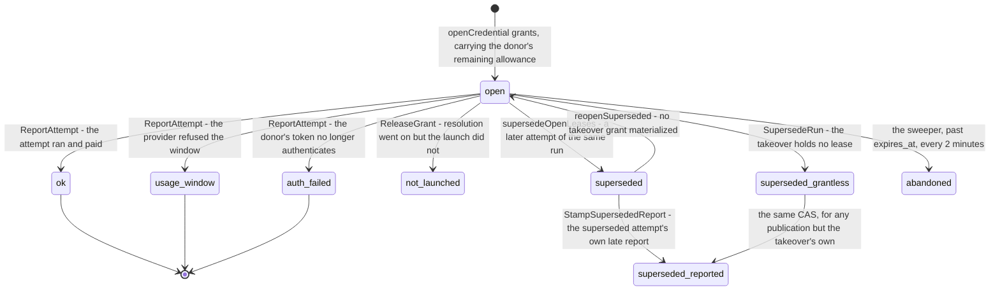

# Credential resolution — which credential funds a cloud run

Every cloud launch and every resume walks the same seven tiers to decide which LLM credential funds the run, then seals what it found under a key minted for that run alone.

> Drawn from the code at commit `f564846d3`. One chokepoint owns the walk — `Publisher.resolveAndSealCredentials` — and the tier order is `credential_plan.go`'s, shared by the live resolution and its metadata-only preview. How this page is kept true: [README](README.md).

## The walk

The walk is drawn on the page that owns the first tier: [BYOK API keys → Mental model](../byok.md#mental-model).

Reading notes, because the picture hides three things:

- The order is a plan, not a chain of calls: `walkCredentialTiers` visits the seven `credentialTier` constants and applies **exactly two** short-circuits — the Pool tier goes inactive once `holdsDefaultLLMCredential` is true of the bundle, and the Platform tier goes inactive once the pool granted. `walkCredentialPlan` exposes the same tiers, with their active bit, to the preview.
- Three postures amputate whole tiers: an **env-funded** run (`model.EffectiveProviders(...).OnlyEnvFunded()`) runs the Generic tier and nothing else; a team mapped to a **sovereign runner pool**, and a team whose `llm_fallback` is `none`, skip Org, Pool and Platform **and the fallback door** — `sharedTiersBlocked`, the door being the pool tier wearing another coat — while their own tiers and their own restore still walk.
- The gates drawn once are asked many times: the pair-order whitelist (`sealableSlot`) screens what every tier may seal, the usage-window verdict (`refusedUntil`) judges every key and every forfait, and each tier carries its own audience — `ServesBotForLaunch` for a BYOK key, `orgCredentialAudience`, `platformAudienceAllows`, `credpool.Audience.Allows`.

## Steps

| Actor | Action | Code |
|---|---|---|
| server | folds the routing policy from binding, bot, team, org, platform record, env dials and built-in defaults, clamped by the platform's triggers; an unreadable block refuses the launch | `resolveRunLLMRoutePolicy`, `llmroute.Validate`, `llmroute.Resolve`, `llmroute.Clamp` |
| publisher | reads the team's runner pool FRESH and demands the registry hold it `active`; freezes `runs.pinned_providers` before the document persists | `runnerPoolForTeam`, `poolRoutes`, `derivePinnedProviders` |
| publisher | refuses to seal without a `tenant_id`, then reads the team's `llm_fallback` FRESH | `resolveAndSealCredentials`, `llmFallbackForTeam` |
| publisher | pre-walk screens: env-funded routes, the shared-tier policy, the pair-order whitelist, the per-tier native probes | `model.EffectiveProviders`, `sharedTierPolicyFor`, `withSlotWhitelist`, `newTierNative` |
| store | tier 1 walks the keys visible from team and user: the webhook pin first, then user default, user other, team-wide default, team-wide other | `secrets.Resolve`, `OrderedAPIKeyCandidates`, `keyRank` |
| store | per key: the concurrency ceiling over alive runs, then the ledger's refusal | `apiKeyUsable`, `CountAliveRunsWithCredFingerprint`, `refusedUntil` |
| publisher | remembers, per provider, the key an unfiltered walk would have chosen, for tier 7 | the second `secrets.Resolve` with a nil predicate |
| publisher | tier 2 resolves the workflow secrets, each with its binding's egress allowlist and its record id | `secrets.ResolveGenericWithBindings`, `secrets.UnresolvedRequired` |
| publisher | tier 3 takes the owner's forfait per kind, then the team's shared record under `OrgOwnerKey(tenantID)` | `oauthForfait.ListByUser`, `secrets.OpenOAuthPayload`, `setOAuthCredential` |
| provider | a new or stale ledger reading costs one live usage probe, whose readings are recorded before the verdict is re-read | `forfaitWindowClosed`, `accountNeedsInitialProbe`, `staleSuggestsClosed`, `usageCaps.Record` |
| publisher | tier 4 fills per wire family from the org's own credentials under the `orgtier:<orgID>` sentinel | `fillFromOrg`, `orgCredentialAudience` |
| publisher | tier 5 derives the wants from the run's effective providers and asks the broker | `acquireFromPool`, `providerOfWant` |
| store | the broker supersedes this run's open leases, resolves the enabled pools, filters the pledges, ranks by fraction consumed, writes the lease | `credpool.Broker.Acquire`, `admit`, `eligiblePledges`, `openCredential` |
| publisher | tier 6 fills what is still empty from the deployment's own credentials, forfaits before keys | `fillFromPlatform`, `platformAudienceAllows` |
| publisher | tier 7 restores a passed-over credential into a family no tier served, tier by tier, keys in `allKnownProviders` order | the `credentialTierRestore` arm, `sealDecision` |
| publisher | the fallback door seals one donor-consented grant for a kind the ladder names, behind an amortization probe | `acquireDoorGrant`, `HasFallbackDonors`, `doorWantsFor` |
| publisher | materializes the advisory ladder and stamps the run: review families, spend-narrowed fingerprints, funded tiers, reopen instant | `llmroute.HeldPairs`, `ir.ApplyPolicyLadder`, `credResolution.applyTo` |
| publisher | seals under a fresh per-run DEK and persists the record; the ref and the key ride the message | `secrets.NewRunBundleDEK`, `secrets.SealRunBundle`, `runSecrets.Put` |
| publisher | clamps the budget to the donor's remaining allowance, and returns every grant on any non-launch exit | `clampBudgetToGrant`, `credPool.ReleaseGrant` |
| runner | fetches by ref, demands the tenants match, builds the sealer from the message key, opens, materializes the OAuth dirs, starts the refreshers | `Runner.injectCredentials`, `secrets.OpenRunBundle`, `materializeOAuthCredentials`, `startOAuthRefreshers` |

## The pool lease, from grant to close

`ReportAttempt` writes all three closing outcomes, keyed on `Outcome.Condition`, and the runner's spend loop is its only caller; `Broker.Report` is its attempt-blind twin — the same switch without the attempt identity, `attemptLease` and the superseded-stamp CAS — and no production path calls it.

| Outcome | Written by | What it means for the next attempt |
|---|---|---|
| `open` (no outcome) | `openCredential` | this pledge is serving the run; its slot and its daily unit are spent |
| `ok` | `ReportAttempt`, on an outcome carrying no condition | the attempt paid; the ledger has its spend |
| `usage_window` | `ReportAttempt`, on `ConditionUsageWindow` | the provider's window refused the donation; the pledge cools |
| `auth_failed` | `ReportAttempt`, on `ConditionAuthFailed` | the donor's token is dead; the pledge turns unhealthy |
| `not_launched` | `ReleaseGrant`, from the defer armed before the error check | the run unit is given back; a retry is admitted as new |
| `superseded` | `supersedeOpenLeases` at the next `Acquire` | a non-admission: the retry is admitted as new, not renewed for free |
| `superseded_reported` | `StampSupersededReport`, over an already-superseded lease | served and paid, so a later acquisition RENEWS the allowance |
| `superseded_grantless` | `SupersedeRun` | the takeover holds no lease, so no report may charge this one |
| `abandoned` | `sweepCredPoolLeases`, past `expires_at` | the spend is unknown; the donor's slot comes back and a retry is new |

Four other vocabularies look like this one and are not it: the seven `credentialTier` constants (the walk above), `credpool.Status` (a pledge: `active`, `paused`, `cooling`, `out_of_hours`, `exhausted`, `serving`, `unhealthy`, `bot_filtered`, `no_fallback_consent`), `platformcfg.RunnerPoolState` (`provisioning`, `active`, `draining`, `disabled`) and `sealOutcome` (`sealNone`, `sealDefault`, `sealPinnedOnly` — where a shared tier puts one key).

## Guards that refuse

- **`poolRoutes`** — a mapped team whose pool the registry does not know, or whose state is not `active`, or with no registry wired at all: refused, naming the state. A resume whose team has been remapped past the run's frozen stamp refuses with `ErrPoolRemapped`, which the retry sweeper abandons rather than re-arms.
- **`runnerPoolForTeam` / `llmFallbackForTeam`** — a store that cannot ANSWER refuses the launch (fail closed); `identity.ErrNotFound` is a definitive answer and proceeds on the shared default. An `llm_fallback` value `identity.ValidLLMFallback` does not know is refused, never read as the default.
- **Empty `tenant_id`** — no bundle is produced at all, with a Warn: a record stamped under the empty tenant could be opened by any team's runner.
- **`secrets.ApiKey.ServesBotForLaunch`** — the workload audience, checked INSIDE `Resolve` and BEFORE the pin exemption, so neither a webhook pin nor the tier-7 restore can hand a key to a bot its operator did not name. An empty list admits everything; a non-empty one refuses a run that names no bot. The refusal travels out through `onWithheld`.
- **`apiKeyUsable`** — the per-key `max_concurrent_runs` ceiling (fails OPEN on a count error: it is protection, not an invariant), then `refusedUntil`: the ledger's fresh provider refusal, the operator's `usage_caps` ceiling, or a budget-floor reserve another workload holds (`heldOutUntil`).
- **`forfaitWindowClosed`** — a forfait whose provider window is closed is SKIPPED, its reopening noted, and itself remembered for tier 7. A probe that errors or reports nothing leaves the credential trusted (fail open) and memoizes the empty answer.
- **`store.RunTrust.Trusted()`** — an untrusted workspace resolves no workflow secret; pairing it with a workflow that REQUIRES one refuses with `errUntrustedRequiresSecrets`. A required secret resolving to nothing refuses with `secrets.RequiredSecretsError`.
- **`orgCredentialAudience`** — fails CLOSED on an unreadable org, and on an audience that does not list the team; the tier is skipped, tiers below may still fund. **`platformAudienceAllows`** refuses with the remedy named.
- **`credpool.Audience.Allows`** and the pledge filter — `pool_disabled`, `no_enabled_pool`, `audience_rejected`, `no_eligible_pledge` carrying a per-pledge `Status`; a run id another team's open lease holds refuses with `ErrRunHeldElsewhere` BEFORE any lease is closed — `supersedeOpenLeases` scans the open leases for a foreign tenant first, so that refusal supersedes nothing. Separately, an acquire that DID supersede this team's own leases and then found no donor reopens them (`reopenSuperseded`).
- **`acquireDoorGrant`** — its `sharedTiersBlocked` arm refuses the fallback door FIRST, before any donor is looked for: a pool-mapped team and an `llm_fallback=none` team never carry a donation, because a donor's consent does not un-block a shared tier. The door also declines once the whole-bundle tier granted, on an env-funded run, and when no unpinned route is funded at all — such a run acquires through the pool tier, not the door.
- **The pair-order whitelist** (`sharedTierPolicy.sealableSlot`) — a slot the resolved policy does not name is read but never sealed, and an unlisted pool grant is refused and released cleanly.
- **`ITERION_CLOUD_REQUIRE_LLM_CREDENTIAL`** — refuses `runview.ErrNoLLMCredential` (HTTP 422, `NO_LLM_CREDENTIAL`) only when every LLM route pins a known provider and no tier funded any of them. Under `llm_fallback=none` the same refusal is armed STRICTLY, with no knob: every pinned provider must be funded by the team's own, and a team holding nothing at all is refused even for an unattributable workflow.
- **`secrets.SealRunBundle`** — refuses a tenant id carrying the AAD separator `/` and an invalid pool name; `queue.RunMessage` validation rejects a publish carrying a `BundleDEK` with no `SecretsRef`, and a key that is neither empty nor 32 bytes. On the runner, `rec.TenantID != msg.TenantID` refuses, and a `dek` record whose message carries no key fails with `secrets.ErrBundleDEKMissing`.

## Collections touched

| Collection | What this flow does with it |
|---|---|
| `api_keys` | tier 1 reads the keys visible from team and user; `MarkUsed` by id, detached on a tenant-carrying context; the runner bumps `MarkFingerprintUsed` |
| `generic_secrets`, `bot_secret_bindings` | tier 2 reads the workflow secrets and their bindings (the egress allowlist, the record id); `MarkUsed` detached |
| `oauth_credentials` | tier 3 lists by owner key and by `OrgOwnerKey(tenantID)`; the refresh worker rewrites the tokens a run follows |
| `usage_windows` | read as the refusal verdict for every candidate; written by the forfait probe's `Record` |
| `platform_settings` | the `platform_credentials` family (the shared-tier policy and the platform audience), `runner_pools` (the registry `poolRoutes` reads), `usage_caps` and `budget_floor` |
| `llm_routing_policies` | the team-level and org-level routing policy records the launch folds |
| `bot_sources` | the launching team's own bot row supplies the `routing:` layer of the same fold, consulted before the platform and baked tiers |
| `cred_pools`, `cred_pledges` | read by the broker: the enabled pools, their audiences, the eligible pledges |
| `cred_leases` | written: the grant, the supersede and its reopen, the release, the report, the sweeper's abandon |
| `cred_pool_usage` | the donor-side ledger the ranking and the allowance read |
| `run_secrets` | the sealed bundle, 24h TTL; the runner reads it by ref and deletes it only on a terminal-clean outcome |
| `runs` | read for the per-key concurrency count; written with `pinned_providers`, `llm_route_policy`, `cred_fingerprints`, `credential_tiers`, `skipped_cred_reopens_at` and the clamped `budget_overrides` |
| `teams`, `orgs` | read FRESH for the runner-pool mapping, `llm_fallback` and the org's `CredentialAudience`; the org id itself comes from the publisher's 5-minute `orgCache`, so a team moved to another org resolves against the previous one, and its org-tier credentials, for up to that long |
| `credential_usage` | not on this path: the runner books the per-route spend at metering time |

## Related

- [byok.md](../byok.md) — the BYOK tier in full: storage, the workload audience, the concurrency ceiling, the REST surface. [cloud-llm-credentials.md](../cloud-llm-credentials.md) — the provisioning guide for all six sources and the preview endpoint.
- [credential-pool.md](../credential-pool.md) — the mutualised pool a donor pledges to; [oauth-forfait.md](../oauth-forfait.md) — the subscription forfaits; [usage-caps.md](../usage-caps.md) — the ledger every refusal above is read from.
- [sovereign-pools.md](../sovereign-pools.md) — the isolation chain of a pool-mapped team, including this amputation; [adr/121-adaptive-routing-policy.md](../adr/121-adaptive-routing-policy.md) and [adr/123-run-bundle-dek-in-envelope.md](../adr/123-run-bundle-dek-in-envelope.md) — the pair order and the per-run DEK.
- [flow-secrets-sealed-bundle.md](flow-secrets-sealed-bundle.md) — what the last two steps do in full: the envelope, its AAD cohorts, the runner's injection and the delete.
- [data-model-credentials.md](data-model-credentials.md) — the collections above at rest; [data-model-runs.md](data-model-runs.md) — the run document the stamp lands on; [access-control.md](access-control.md) — the launch admission that runs before any of this.

