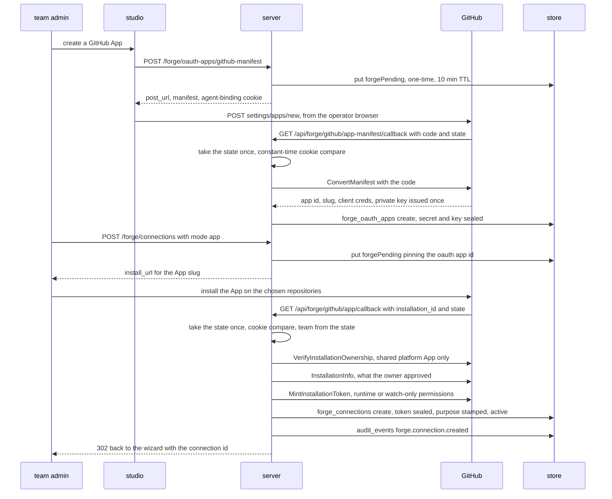
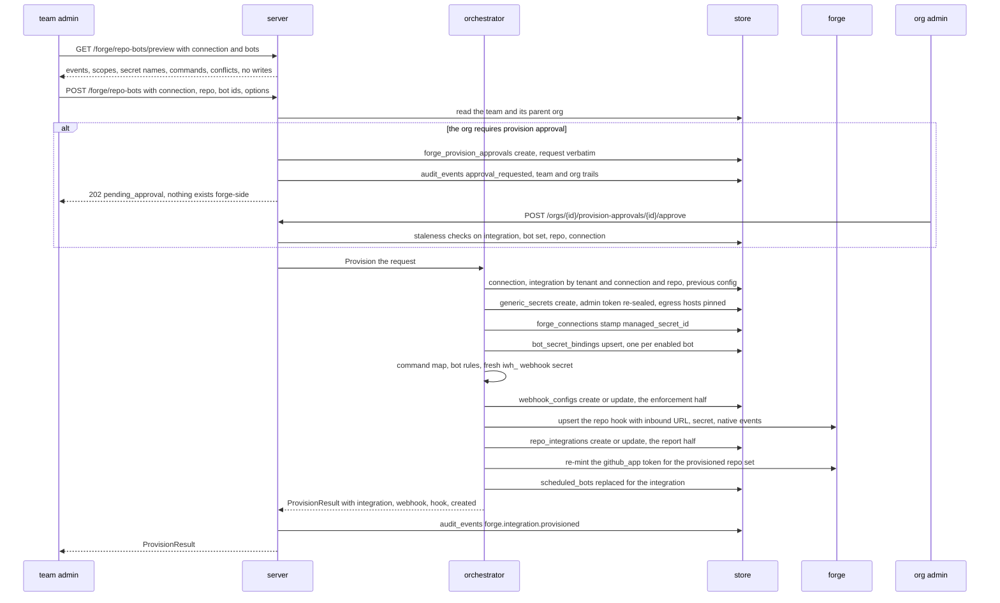
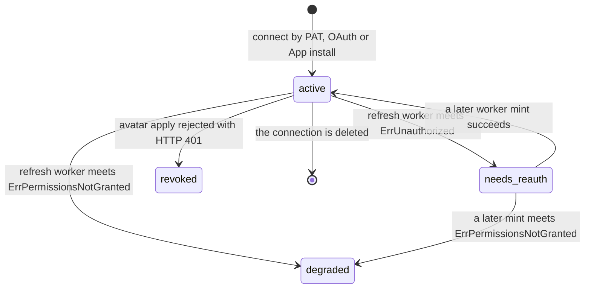

# Flow — connect a forge, enable a bot on a repository

Connecting a forge seals one credential for a team, and enabling bots on a repository derives a managed token from that credential, then writes the webhook config that enforces the binding, the forge-side hook and the integration row that reports it, in that order.

> Drawn from the code at commit `f7ef017b7`; how this page is kept true: [README](README.md).

Three connect modes write the same `forge.Connection` row: a pasted personal access token validated by `WhoAmI` before any store write, an OAuth app authorization, or a GitHub App install. The two browser round-trips return on **public** callbacks (`isPublicPath`), authenticated by a one-time signed state and the `iterion_forge_agent` binding cookie compared with `subtle.ConstantTimeCompare` — the team is resolved from the state, never from the URL. The token is sealed under AAD `forge_conn:<id>` and the connection is born `active`.

## Connect — the GitHub App path

The App path is drawn because it is the only one that calls out twice before persisting: `InstallationInfo` captures what the owner approved, and only then does `MintInstallationToken` ask for the intersection of that grant with iterion's wanted set. Asking for a permission the installation lacks fails the whole mint, so the order is load-bearing — the first token already carries the delivery grants.

## Enable — one request, a fixed write order

`Provision` is the one-action enable. Two stores hold the result and share no transaction, so the **enforcement** half (`webhook_configs`) is written before the forge hook, and the **report** half (`repo_integrations`) last: a failure between them leaves the repo applying settings the report has not caught up with, never a report certifying a configuration that is not in force. A fresh config is rolled back (`rollbackConfig`) on three downstream failures — the admin-client build, the hook upsert and the integration create; an integration *update* answers `ErrProvisionDiverged` instead, and a schedule-sync failure leaves the provision standing. Re-running the same request converges. Same bots, same events and a hook already on the right URL take the idempotent short-circuit, in this order: binding reconcile, operator-settings write, `BotRules` backfill, schedule sync when crons are given, `Created=false`.

The admin token the connection holds is never what a bot posts with: `ensureManagedSecret` re-seals it once per connection as a team-scoped `generic_secrets` row whose `AllowedHosts` pin the connection's forge host, and each bot gets that secret id under its declared secret name — as a webhook `SecretOverrides` entry (Tier-0 for the direct webhook launch) and as a `bot_secret_bindings` row (so a board-coordinator launch authenticates too). The inbound URL is the connection's `WebhookBaseURL` pin when set, else the deployment's public URL.

## The connection's status

| State | Written by | Leaves by |
|---|---|---|
| `active` | every connect path, and a successful worker mint (runtime or security-read) | a refusal below, or deletion |
| `needs_reauth` | `markRevoked` on `forge.ErrUnauthorized` — it writes this, not `revoked` — and it withdraws the security-read org entry | a later successful mint — or `degraded`, when a later mint meets `ErrPermissionsNotGranted`: the runtime lane's `markRevoked` leaves `AccessTokenExpiresAt` in the past and `ExpiringBefore` filters on kind and expiry only, so the sweep re-mints the connection on every tick |
| `degraded` | `markDegraded` on the terminal 422 `forge.ErrPermissionsNotGranted`, stamping the forge message and the remediation on `StatusReason` | nothing: `refreshOne` early-exits on a degraded connection, so no code path writes `active` back |
| `revoked` | one site only: an avatar apply meeting `ErrUnauthorized` on a PAT | nothing: a PAT is not refreshable, and further avatar applies refuse |

`Purpose` is its own axis, stamped once at the install callback from the App record (`purposeForApp`) and never recomputed: a narrowed runtime App must read as broken rather than relabel itself watch-only. The approval record carries no status field — its existence is the pending state, and approve or reject deletes it, leaving the audit trail as the only durable record.

## Steps

| Actor | Action | Code |
|---|---|---|
| team admin | start the self-service App creation | `handleStartGitHubManifest`, `BuildAppManifest` |
| GitHub | return the temporary code on the public callback | `handleGitHubManifestCallback`, `ConvertManifest` |
| server | seal the client secret and the private key per tenant | `createForgeOAuthApp`, `MongoOAuthAppStore.EnsureSchema` |
| team admin | paste a token instead | `connectForgePAT`, `forgeAdminForToken`, `admin.WhoAmI`, `forge.SealPAT` |
| team admin | authorize an OAuth app instead | `connectForgeOAuth`, `oidc.GenerateStateAndPKCE`, `handleForgeOAuthCallback` |
| server | resolve which App to install and hand out the install URL | `connectForgeGitHubApp`, `githubAppForInstall`, `forgeStateStore.put` |
| GitHub | return `installation_id` on the public Setup URL | `handleForgeGitHubAppCallback`, `forgeStateStore.take` |
| server | prove the completing user owns the installation | `forgegithub.VerifyInstallationOwnership`, `AppConfig.UserAuthConfigured` |
| forge | report the approved permissions, then mint | `InstallationInfo`, `RuntimePermissionsFor`, `SecurityReadInstallationPermissions`, `MintInstallationToken` |
| store | persist the connection and audit it | `forge.SealOAuthTokens`, `ConnectionStore.Create`, `auditTenant` |
| studio | preview exactly what the enable will subscribe to | `handlePreviewForgeEnable`, `forge.PreviewEnable`, `forge.ToNativeEvents` |
| team admin | request the enable | `handleEnableForgeRepoBots`, `canManageTeam`, `forgeConnForTenant` |
| server | apply the org ex-ante gate | `provisionOrgRequiringApproval`, `Org.RequireProvisionApproval`, `teamFundsItsOwnRuns` |
| store | park the request verbatim, nothing forge-side | `parkProvisionRequest`, `ProvisionApprovalStore.Create` |
| org admin | approve, replaying it, or reject | `handleApproveProvision`, `equalStringSets`, `handleRejectProvision` |
| orchestrator | load the connection, find or create the integration, read the previous config | `Orchestrator.Provision`, `GetByConnRepo`, `webhooks.ConfigStore.Get` |
| orchestrator | resolve each bot's forge block and invocations, union the events | `Bots`, `Invocations`, `unionAllEvents`, `ToNativeEvents` |
| orchestrator | derive the managed forge token, once per connection | `ensureManagedSecret`, `forgeTokenEgressHosts`, `secrets.SealGenericSecret` |
| orchestrator | bind it per bot, both ways | `SecretOverrides`, `ensureBotBinding`, `bundle.DefaultForgeSecretName` |
| orchestrator | build the routing surfaces and mint the hook secret | `buildCommandMap`, `resolveBotRules`, `webhooks.MintToken` |
| store | write the enforcement half | `webhooks.ConfigStore.Create` or `Update`, `carryOperatorWebhookSettings` |
| forge | register or update the repo hook | `AdminFor`, `upsertHook`, `UpdateHook`, `GetHook`, `CreateHook` |
| store | write the report half, carrying forward what provisioning does not own | `RepoIntegrationStore.Create` or `Update`, `MinAuthorRole` |
| orchestrator | narrow the App token and materialise the schedules | `narrowGitHubAppSecret`, `syncSchedules` |
| server | re-mint at the point of use, and rotate in the background | `EnsureManagedSecret`, `RefreshWorker.refreshOne` |

## Guards that refuse

- **Not a team admin** — `canManageTeam` on every connect, oauth-app and repo-bots mutation: `403 admin or owner required`. `canManageOrg` on approve and reject.
- **State store write fails at connect start** — `502`, rather than handing out an authorize URL whose callback can never complete.
- **Replayed or expired state, mismatched cookie** — `400 state expired or invalid` (`take` deletes first, then rejects past the 10-minute TTL, so a replay and an expiry are indistinguishable) and `400 agent binding mismatch`.
- **A pasted token the forge rejects** — `400` naming the missing scope on `forge.ErrUnauthorized`; any other `WhoAmI` failure is `502`, because nothing of iterion's own has been written yet.
- **A created App whose present permissions contradict the watch-only profile** — `502` and not recorded, naming the page where the orphan App must be deleted; a failure to record one answers `409` with the same link, because its private key is issued once.
- **A shared platform App that cannot verify installation ownership** — `412` fail-closed naming `ITERION_FORGE_GITHUB_APP_CLIENT_ID` and `_CLIENT_SECRET`; a verified-but-foreign installation is `403 installation is not owned by the authorizing user`.
- **An unreadable App record at the install callback** — `502 retry the install`: a connection born mislabelled runtime from a watch-only App would neutralise every `Purpose` guard.
- **A watch-only connection** — `422` at the route, which is the exhaustive guard: `handleUpdateForgeRepoBots` and `handleApproveProvision` reach `Provision` without one. `ensureManagedSecret` refuses again on the full-provision path, where it runs before the bindings — which matters because a binding is keyed `(tenant, bot, secret_name)` and therefore team-global, and nothing rolls it back; the idempotent short-circuit reconciles bindings without passing through it.
- **A cross-tenant connection or integration id** — `404 not found`, never `403`: `forgeConnForTenant` and `ErrConnectionNotFound` inside `Provision` do not leak existence.
- **The org approval gate cannot read the team or the org** — `503 provision-approval gate unavailable`, never a silent pass; a second pending request for the same tenant, connection and repo is a `409` duplicate.
- **A stale parked request** — `409` when the integration vanished, its bot set drifted, the repo was provisioned meanwhile, or the connection is gone; the record stays pending, including after a transient provision failure at replay.
- **A bot with neither a `forge:` block nor a forge or command invocation** — cannot auto-provision; an empty native event set refuses too; two bots claiming the same command without args disambiguation refuse in `addCommandRoute`.
- **Launch vars that would drop keys the repo pins** — `ErrLaunchVarsDrop` as `400` naming them; an absent map over a diverged integration and config pair is `ErrProvisionDiverged` as `500`.
- **A hook the connection's token may not manage** — `403 insufficient_scope` on `forge.ErrForbidden`, `400 connection_unauthorized` on `forge.ErrUnauthorized`, and the fresh config is rolled back.

## Collections touched

| Collection | Written here |
|---|---|
| `forge_oauth_apps` | the created or registered App: client secret and private key sealed, unique per tenant, provider, base URL, owner login and watch-only flag |
| `forge_connections` | one row per connect, token sealed under `forge_conn:<id>`; later stamped with `managed_secret_id`, and rewritten by the refresh worker |
| `forge_provision_approvals` | the parked request, verbatim, deleted on approve or reject |
| `generic_secrets` | the managed forge token, host-pinned, re-minted narrower after the integration write |
| `bot_secret_bindings` | one row per enabled bot so a board launch resolves the same token |
| `webhook_configs` | the enforcement half: project and event allowlists, bot rules, command map, secret overrides, operator settings, rate limit, hook secret hash |
| `repo_integrations` | the report half: bots, normalized events, webhook and hook ids, operator settings |
| `scheduled_bots` | replaced for the integration, one row per schedule invocation |
| `audit_events` | `forge.oauth_app.created`, `forge.connection.created`, `forge.connection.avatar_applied` on the PAT connect's bot-avatar tail, `forge.provision.approval_requested` on both trails, `forge.provision.approved` or `rejected`, `forge.integration.provisioned` |

## Related

- [forge-integrations.md](../forge-integrations.md) — the feature page: the three connect modes, the managed-token design, the normalized-to-native event table, the per-repo operator settings and the API table.
- [forge-permissions.md](../forge-permissions.md) and [forge-security-read.md](../forge-security-read.md) — who a bot acts as per connection kind, the least-privilege profiles and per-call-family minting, and the watch-only connection these guards refuse for runtime work.
- [ticket-context.md](../ticket-context.md) — the org governance half: the approval queue, its scopes and the replay refusals.
- [webhooks.md](../webhooks.md) — the inbound complement of the config this flow writes.
- [data-model-forge-bots.md](data-model-forge-bots.md) — `forge_oauth_apps`, `forge_connections`, `forge_provision_approvals`, `webhook_configs`, `repo_integrations`. [data-model-credentials.md](data-model-credentials.md) — `generic_secrets`, `bot_secret_bindings`. [data-model-automation.md](data-model-automation.md) — `scheduled_bots`. [data-model-identity.md](data-model-identity.md) — `audit_events`. [access-control.md](access-control.md) — the gates named above.

## Sources

- `pkg/server` — [forge_connect_routes.go](../../pkg/server/forge_connect_routes.go) (`handleConnectForge`, `connectForgePAT`, `connectForgeOAuth`, `connectForgeGitHubApp`, `handleForgeOAuthCallback`, `handleForgeGitHubAppCallback`, `purposeForApp`), [forge_github_manifest_routes.go](../../pkg/server/forge_github_manifest_routes.go) (`handleStartGitHubManifest`, `handleGitHubManifestCallback`), [forge_oauth_app_routes.go](../../pkg/server/forge_oauth_app_routes.go) (`createForgeOAuthApp`), [forge_state.go](../../pkg/server/forge_state.go) (`forgePending`, `forgeStateStore.take`, `forgeAgentBindingCookie`), [forge_provisioning_routes.go](../../pkg/server/forge_provisioning_routes.go) (`handleEnableForgeRepoBots`, `handlePreviewForgeEnable`, `writeForgeProvisionError`, `expandsProvisionSurface`), [forge_approval_routes.go](../../pkg/server/forge_approval_routes.go) (`provisionOrgRequiringApproval`, `teamFundsItsOwnRuns`, `parkProvisionRequest`, `handleApproveProvision`, `handleRejectProvision`), [forge_avatar_routes.go](../../pkg/server/forge_avatar_routes.go) (the one `StatusRevoked` site), [runs_launch.go](../../pkg/server/runs_launch.go) (the repo-targeted launch), [middleware.go](../../pkg/server/middleware.go) (`isPublicPath`).
- `pkg/forge` — [orchestrator.go](../../pkg/forge/orchestrator.go) (`Provision`, `ensureManagedSecret`, `ensureBotBinding`, `buildCommandMap`, `upsertHook`, `rollbackConfig`, `narrowGitHubAppSecret`, `syncSchedules`, `inboundURL`), [types.go](../../pkg/forge/types.go) (`Connection`, `ConnectionStatus`, `Purpose`), [refresh.go](../../pkg/forge/refresh.go) (`refreshOne`, `markRevoked`, `markDegraded`, `refreshSecurityOnly`), [connection_store.go](../../pkg/forge/connection_store.go), [repo_integration_store.go](../../pkg/forge/repo_integration_store.go), [oauth_app_store.go](../../pkg/forge/oauth_app_store.go), [provision_approval_store.go](../../pkg/forge/provision_approval_store.go), [preview.go](../../pkg/forge/preview.go).
- `pkg/forge/github` — [app_client.go](../../pkg/forge/github/app_client.go) (`UserAuthConfigured`, `MintInstallationToken`, `RuntimePermissionsFor`, `SecurityReadInstallationPermissions`, `InstallationInfo`), [app_manifest.go](../../pkg/forge/github/app_manifest.go) (`BuildAppManifest`, `ConvertManifest`), [app_verify.go](../../pkg/forge/github/app_verify.go) (`VerifyInstallationOwnership`).
- neighbours — [webhooks/types.go](../../pkg/webhooks/types.go) (`Config`, `BotRule`, `CommandRoute`), [webhooks/token.go](../../pkg/webhooks/token.go) (`MintToken`, `TokenPrefix`), [secrets/generic.go](../../pkg/secrets/generic.go), [secrets/bindings.go](../../pkg/secrets/bindings.go), [cloudsched/mongo.go](../../pkg/cloudsched/mongo.go), [identity/types.go](../../pkg/identity/types.go) (`Org.RequireProvisionApproval`, `EffectiveProvisionApprovalScope`), [cmd/iterion/remote_webhooks.go](../../cmd/iterion/remote_webhooks.go) (the `iterion remote forge` subcommands).
