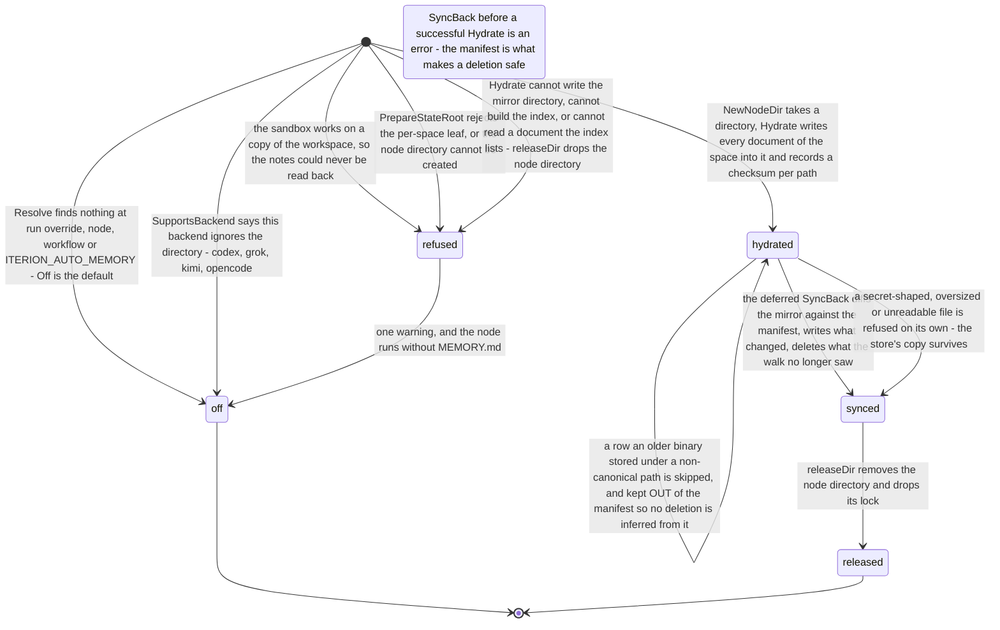

# Flow — memory and knowledge: four writers, one seam, two adapters

A memory space is a quota-governed tree of Markdown documents addressed by a visibility and the qualifiers that visibility needs, and the four surfaces that write one — the REST routes, an agent's memory tool, the auto-memory mirror folding a node's notes back, and the local CLI import — meet at a single store seam, each carrying a different share of the refusals a byte passes on its way in.

> Drawn from the code at commit `3e92b2c89`. What holds this page: `node docs/scripts/check-mermaid.mjs` — every block parses — and `task docs:links`. `internal/docsguard` globs `data-model-*.md` and `access-control.md` only, so no gate reddens when a flow page drifts: the commit above is the claim a redraw must re-verify by hand. [Conventions](README.md).

## A write, from the four writers down to the bytes

The surfaces that write a space meet at `knowledge.MemoryStore.WriteDocument`, which two adapters implement: Mongo in cloud mode, the filesystem everywhere else. Three of them carry refusals of their own; `iterion memory import` is a fourth, entering at the seam with nothing above it but the per-entry checks of `ImportSpace`. The refusals before the seam belong to the caller, the ones after it to the adapter — and the two adapters do not refuse the same things.

```mermaid
flowchart TD
    subgraph writers["The REST, tool and mirror writers"]
        R["REST - PUT or DELETE /api/memory/doc, POST /api/memory/import"]
        T["agent tool - memory_write, wired only when the node's memory: block sets write"]
        M["auto-memory - the deferred SyncBack of one node's mirror, on a context detached from the node's"]
    end
    C["cli - iterion memory import, straight to the FS store: the unsafe-path, 2 MiB and secret-scan checks of ImportSpace, and no gate above the seam"] --> SEAM
    R --> A0{"originGateAllows - the one CSRF boundary, reached before any credential is read, on PUT, DELETE and POST only"}
    A0 -- "an Origin the deployment does not recognise" --> E403O["403 cross-origin request rejected - unless ITERION_REQUIRE_ORIGIN is 0"]
    A0 -- "same-origin, loopback, the public URL, or no Origin at all" --> A1{"requireAuth - an iap_ PAT or a session JWT, from the Authorization header or the session cookie"}
    A1 -- "no bearer" --> E401["401 authentication required"]
    A1 -- "a bearer that fails" --> E401B["401 token expired, token invalid, or the PAT store's own refusal"]
    A1 -- "ok" --> A2{"stampAuthedContext - the identity must carry an active TeamID, which becomes the store tenant"}
    A2 -- "no active team, and /api/memory is deliberately NOT tenant-free" --> E403T["403 credential has no active team - super-admins included"]
    A2 -- "ok" --> A3{"memoryRef - name, visibility, bot and project from the query, tenant and user from the identity, then ResolveSpaceRef and SpaceRef.Validate"}
    A3 -- "no name, an unknown visibility, bot without a bot, bot or project without a project, a qualifier carrying a separator or a traversal" --> E400["400 invalid space - the message never names the missing project"]
    A3 -- "a read - usage, docs, doc or export" --> RD["no further gate, not even on a global space"]
    A3 -- "a mutation" --> A4{"requireMemoryWriteAuth - visibility=global only"}
    A4 -- "global, an identity store is wired, and the caller is not IsSuperAdmin" --> E403G["403 writing the global memory space requires super-admin"]
    A4 -- "not global, or local single-tenant, or super-admin" --> A5{"ValidateDocPath on the path param"}
    A5 -- "absolute, a .. segment, a NUL byte, a bare dot, or a non-canonical spelling" --> E400P["400 naming the canonical spelling"]
    A5 -- "ok" --> A6{"PUT only - io.ReadAll over io.LimitReader at the compiled 2 MiB plus one, never ITERION_MEMORY_MAX_DOC"}
    A6 -- "a longer body" --> A6T["cut at the bound, and the cut is never reported: only an adapter cap left at 2 MiB turns it into a 422"]
    A6T --> SEAM
    A6 -- "within" --> SEAM
    T --> TI{"installWorkspaceMemory calls store.Root on the resolved ref"}
    TI -- "a legacy scope: block resolves through LegacyBotRef to a tenant-less project ref, which the cloud adapter refuses" --> TF["the node fails with claw backend: memory"]
    TI -- "ok" --> SEAM
    M --> MI{"per file: the walk's 2 MiB cap and md-only filter, then the run's secret unmaterializer putting values back to placeholders, then the untouched checksum, then ScanForSecret"}
    MI -- "a literal credential shape, a non-markdown file, or one the walk could not read" --> MW["refused on its own and joined into ONE warning - the other notes still land, and the store's copy is kept"]
    MI -- "ok" --> SEAM
    SEAM["WriteDocument - the one knowledge.MemoryStore seam"] --> AD{"which adapter is wired"}
    AD -- "cloud" --> C1{"validateCloudTenant - every non-global ref needs a tenant"}
    C1 -- "no tenant" --> CE["refused before a query is built - a tenant-less id would sit outside every org's isolation"]
    C1 -- "ok" --> C2{"the body against DefaultMaxDocumentSize, 2 MiB compiled in"}
    C2 -- "over" --> Q422["422 carrying the store's error text - quota, revision conflict and bad path all collapse into this one status"]
    C2 -- "ok" --> C3["ensureSpace upserts the space row once, outside the retry loop: quota_bytes from DefaultQuotaFor, used_bytes 0, mode markdown"]
    C3 --> C4{"read this path's size and revision, then the caller's ExpectedRev"}
    C4 -- "pinned and stale" --> C409["memory: revision conflict, expected N have M"]
    C4 -- "ok" --> C5{"aggregate CAS on memory_tenant_usage, keyed on the TEAM id - skipped when the delta is not positive, and when the ref carries no tenant"}
    C5 -- "the conditional update matches nothing" --> Q422
    C5 -- "applied, or skipped" --> C6{"per-space CAS on memory_spaces - a quota_bytes of 0 means no sub-cap"}
    C6 -- "denied" --> C6R["compensate the aggregate back, then 422"]
    C6 -- "ok" --> C7{"ReplaceOne with upsert, filtered on the revision just read - the compare-and-swap"}
    C7 -- "duplicate key: a concurrent writer advanced the revision" --> C7R["compensate both counters, then retry until the context is done - or fail outright when ExpectedRev was pinned"]
    C7R --> C4
    C7 -- "matched" --> OK["revision N plus 1, with checksum, title, description and tags parsed from the markdown"]
    AD -- "local" --> F1{"ValidateDocPath again, then scopeFor maps the visibility to a path-clamped Scope"}
    F1 -- "visibility=private" --> FP["ErrUnsupportedVisibility - no durable FS home, while usage on the same ref still answers"]
    F1 -- "ok" --> F2{"maxDocumentSize, which honours ITERION_MEMORY_MAX_DOC - raising it widens what the store accepts, never what the REST surface reads"}
    F2 -- "over" --> Q422
    F2 -- "ok" --> F3{"the one cross-process lock under the data dir, 5 s of 20 ms spins"}
    F3 -- "still busy" --> FL["memory: quota lock busy"]
    F3 -- "held" --> F4{"stat the old size INSIDE the lock, then checkCeilings: the per-space sidecar first, the ONE tree-wide aggregate sidecar second"}
    F4 -- "either ceiling breached" --> Q422
    F4 -- "ok" --> F5["Scope.Write, then commitDelta persists both sidecars - revision stays 0, and ExpectedRev is ignored here"]
```

## Steps

| Actor | Action | Code |
|---|---|---|
| studio | Team page, Memory tab: one Load fetches usage and the document list, opening a row reads its body, and the export link streams the archive. The tab is read-only — no client writes, deletes or imports — and `bot` with no bot id is refused locally before any request | `MemoryTab`, `getMemoryUsage`, `listMemoryDocuments`, `readMemoryDocument`, `memoryExportURL` |
| server | refuses a state-changing `/api/` request whose `Origin` the deployment does not recognise, before any credential is read — the repository's one CSRF boundary, which on this surface means `PUT /doc`, `DELETE /doc` and `POST /import` | `authMiddleware`, `originGateAllows`, `requireSafeOrigin` |
| server | resolves the bearer, then stamps the identity's `TeamID` as the store tenant — the only source of tenancy a memory space has | `requireAuth`, `stampAuthedContext`, `tenantFreePrefixes` |
| server | builds the `SpaceRef` from the query plus the identity: there is no `?user=`, so a `user` space is always the caller's own, and `global` is forced tenant-less | `memoryRef`, `ResolveSpaceRef`, `SpaceRef.Validate` |
| server | gates the one cross-tenant space on `IsSuperAdmin`, on `PUT`, `DELETE` and `POST /import` only | `requireMemoryWriteAuth` |
| server | validates the document path at the boundary, with the same function both adapters re-run, then reads at most the compiled 2 MiB plus one byte of the body — `io.LimitReader` reports EOF at the bound, so an over-size body reaches the store truncated rather than refused | `memoryDocPath`, `knowledge.ValidateDocPath`, `handleMemoryWriteDoc` |
| store, cloud | the ordered write: tenancy, the per-document cap, the space row, the two byte counters under conditional updates, then the revision compare-and-swap with counter compensation on a lost race | `MongoMemoryStore.WriteDocument`, `ensureSpace`, `bumpTenant`, `bumpSpace`, `bumpCounter`, `compensate` |
| store, cloud | a delete reads the size in the same atomic operation that removes the document, so a racing write cannot make the credit stale; an absent document is a `204`, and a failed compensation only logs that `used_bytes` now drifts | `MongoMemoryStore.DeleteDocument`, `clampUsage` |
| store, local | one coarse cross-process lock, a per-space JSON sidecar and one tree-wide aggregate sidecar, all beside the space tree rather than inside it | `FSStore.WriteDocument`, `acquireQuotaLock`, `checkCeilings`, `commitDelta` |
| server | export walks the index, reads every body and refuses a literal credential — after the gzip headers are already set; a legacy non-canonical path is listed as unaddressable instead of aborting the archive | `handleMemoryExport`, `knowledge.ExportSpace`, `ScanForSecret` |
| server | import keeps only `docs/` entries, caps each at 2 MiB, scans each, and stamps `UpdatedBy` as `import` rather than the operator | `handleMemoryImport`, `knowledge.ImportSpace` |
| cli | `iterion memory du`, `export` and `import` are hardwired to the local filesystem store, so `import` reaches `WriteDocument` with none of the REST refusals above it; `iterion remote memory` is the HTTP client over the same seven routes | `memoryRefFromFlags`, `memory.DefaultFSStore`, `knowledge.ImportSpace`, `remoteMemoryCmd` |
| engine | a `memory:` block resolves the node's space — structured from the visibility, else `LegacyBotRef` on the repo root — then installs the index block, the autoload block, the tools and the pre-compact hook | `applyMemorySpec`, `installWorkspaceMemory` |
| bot | reads and lists behind `read:`, writes behind `write:` stamped `bot:` plus the bot id; before a compaction the index and autoload set are re-read and prepended as an injected user turn | `memoryReadTool`, `memoryListTool`, `memoryWriteTool`, `memoryPreCompactInjector` |
| runner | `auto_memory:` resolves the reserved `auto-memory` bot space, guards the per-space leaf against a symlink, gives each node its own mirror directory and materialises the space into it | `applyAutoMemory`, `autoMemoryLocation`, `PrepareStateRoot`, `NewNodeDir`, `Mirror.Hydrate` |
| runner | the deferred sync folds the node's edits back and deletes only what the walk actually saw; every body first passes the run's secret unmaterializer, so both the untouched comparison and the secret scan run on placeholders rather than on materialised values | `Mirror.SyncBack`, `Mirror.SetUnmaterialize`, `walkPaths`, `readMirror` |
| ops | the nightly org purge hard-deletes the memory rows of every team of an org past its grace | `Purger.PurgeOrg`, `teamScopedCollections` |
| boot | the two memory indexes are created idempotently at start, with the other schemas | `MongoMemoryStore.EnsureSchema` |

## The auto-memory round trip

One space, one mirror directory per node, and a diff on the way back: an untouched space costs no write at all.

| State | Vocabulary, and what holds it | Entered by, left by |
|---|---|---|
| absent, revision `N` | `memDoc.Revision` — absent reads as 0, and the composite `_id` is the only uniqueness the collection has | a CAS upsert filtered on the revision just read inserts 1 or advances to `N + 1`; a delete returns it to absent; no TTL exists, so a document lives until something deletes it |
| space row absent, present, purged | `memSpaceDoc` | `ensureSpace` upserts it on the first write with the visibility's default sub-cap; `UsageBytes` on an absent row answers 0 against that default without creating it; the org purge removes it |
| within cap, denied, drifting | `used_bytes` against `quota_bytes`, on `memory_spaces` and `memory_tenant_usage` | a positive delta applies only if the conditional update matches, and `quota_bytes` 0 means unlimited for a space; a denial rolls the other counter back; a non-positive delta always applies and `clampUsage` resets a negative counter to 0; nothing recomputes a counter from the documents |
| off, refused, hydrated, synced, released | this page's names for the mirror round trip: `automemory.Mode` has `off` and `on` and contributes only `off` here, while `Mirror` carries no phase field — its one real marker is a `hydrated` map that stays nil until `Hydrate` succeeds, which is what `SyncBack` refuses on | resolved per node from the precedence chain; every failure is a warning, never a failed node |
| imported, skipped, renamed, replaced | `knowledge.ImportStrategy`, per archive entry | absent is imported; existing plus `skip`, the default, is skipped; existing plus `rename` is written beside it and counted in both `renamed` and `imported`; existing plus `overwrite` — or any value the switch does not recognise — is replaced |
| active, pending deletion, purged | `identity.Org` status, as it governs memory data | a soft delete sets the grace; the nightly sweep past it hard-deletes `memory_docs` and `memory_spaces` for each team; a restore before the sweep makes the purge a no-op |

## Guards that refuse

- **`originGateAllows`** — `403 cross-origin request rejected`, the repository's single CSRF boundary, taken in `authMiddleware` ahead of `requireAuth`. It covers the three state-changing routes and none of the four reads; an absent `Origin` passes, a non-browser caller having no ambient credential to ride; `ITERION_REQUIRE_ORIGIN=0` disables it for a rollback without a redeploy, and the same check is also callable per handler as `requireSafeOrigin`.
- **`requireAuth`** — `401 authentication required` when no bearer reaches it at all, `token expired` or `token invalid` for a JWT that fails, and the PAT store's own text (`token revoked or expired`, `token owner unavailable`) for an `iap_` one. A `?ticket=` is never accepted here: `isWSTicketPath` admits `/api/ws`, `/api/ws/*` and a run's `/browser/cdp` only, so a ticket on a memory route falls through to the bearer path and 401s.
- **`stampAuthedContext`** — `403 credential has no active team`, because `/api/memory` is deliberately absent from `tenantFreePrefixes`. There is no `canViewTeam` or `canViewOrg` anywhere on these routes: the space is derived from the token's active team, never from a path id, so there is no membership probe to pass.
- **`SpaceRef.Validate`** — `400 invalid space`: a name that is not a single segment, an unknown visibility, a missing bot or project for the visibilities that need them, and any qualifier containing `/` or `\`, or that **is** `.` or `..` — the dot is not in the cutset, so `?project=my.app` validates. The clamp is what keeps an untrusted `?project=` out of `scopeFor`.
- **`requireMemoryWriteAuth`** — `403 writing the global memory space requires super-admin`, on `PUT /doc`, `DELETE /doc` and `POST /import` only. Reading and exporting a global space stay open to any authenticated caller, and no audit row and no log line records either outcome.
- **`knowledge.ValidateDocPath`** — `400` from `ErrInvalidDocPath`: relative, no NUL byte, no `..` segment, not the bare `.`, and canonical — one document, one spelling, which is what makes the two adapters agree.
- **`validateCloudTenant`** — a store error, `requires a tenant in cloud mode`, for any non-global ref with no tenant. A legacy `memory: scope:` block resolves to exactly such a ref, so that form fails the node in cloud mode.
- **The per-document ceiling** — a `QuotaError` the handler renders as `422`. The cloud adapter uses the compiled 2 MiB; the filesystem adapter honours `ITERION_MEMORY_MAX_DOC`, and the cloud one honours no `ITERION_MEMORY_QUOTA_*` variable at all. That override widens the store, not the REST surface: `PUT /doc` reads at most the compiled 2 MiB plus one byte and never reports the cut, so against an adapter cap raised past 2 MiB an over-size body is stored truncated under a `200` instead of being refused — `ImportSpace`, on the archive path, compares each entry against the same cap and errors instead.
- **The two byte ceilings** — `422` carrying used, delta and quota. The aggregate is skipped when the ref has no tenant, so a global write in cloud mode passes no aggregate ceiling, while the filesystem adapter still charges its tree-wide sidecar: the two disagree on the same space.
- **The revision CAS** — `memory: revision conflict` when the caller pinned `ExpectedRev`, otherwise a retry bounded only by the context, each round with its counter bumps compensated. The filesystem adapter ignores `ExpectedRev` and always reports revision 0.
- **The quota lock** — `memory: quota lock busy` after 5 s, on the local adapter only.
- **`ErrUnsupportedVisibility`** — `private` has no filesystem home, while `UsageBytes` on the same ref validates and answers, so one ref gets two different verdicts on a local server.
- **Export and import** — a literal credential is `*ErrSecretInExport`, but the export handler has already set the gzip headers and only logs, so the client receives a successful response with an empty body; an import refuses an unsafe tar path and any entry over 2 MiB, and never validates `?strategy=`.
- **The compiler** — `C170` for an unknown `visibility:` and `C171` for `visibility:` together with the legacy `project_root:` are errors; `C047` for a `memory:` block on a backend other than claw and `C132` for `auto_memory:` on a backend that ignores it are warnings.
- **Status shape** — a write maps every store error to `422`, a document read maps every one to `404`, and a delete, a document listing and a usage read map theirs to `500`: the same refusal reaches the client as three different codes depending on the verb.

## Collections touched

`memory_docs` (bodies stored inline, written by the three writers that reach the configured store through the server or the runner — the local CLI import writes the filesystem twin instead — and deleted explicitly or by the mirror's inferred delete) · `memory_spaces` (upserted on the first write, carrying the per-space sub-cap and its running counter) · `memory_tenant_usage` (the enforced aggregate counter, whose `_id` **is** the team id — it carries no `tenant_id` field, so the org purge's field filter cannot match it) · `orgs` (`MemoryQuotaBytes`, read to compute the ceiling) · `teams` (enumerated to propagate that ceiling per team, and again by the purge) · `audit_events` (`org.updated` from the admin quota change — no memory mutation writes one).

Without Mongo the same three live on disk: the space tree under the global data dir, plus `.quota/spaces/<checksum of the ref>.json` and one `.quota/aggregate.json`.

## Related

- [memory-and-knowledge.md](../memory-and-knowledge.md) — the feature's home page: the visibility table, the two quota levels, the REST surface, export and import, the CLI, how bots use the tools, and the whole `auto_memory:` mechanism.
- [data-model-knowledge.md](data-model-knowledge.md) — `memory_spaces`, `memory_docs`, `memory_tenant_usage` and their edges, with the key lines and the filesystem twins.
- [quotas-and-limits.md](../quotas-and-limits.md) — where the memory ceiling sits among the other quotas, and the org usage view that reports it.
- [cloud-rest-api.md](../cloud-rest-api.md) — the seven routes in the API reference; [dsl.md](../dsl.md) and [settings-precedence.md](../settings-precedence.md) — the `memory:` block and the `auto_memory:` precedence chain.
- [flow-org-team-lifecycle.md](flow-org-team-lifecycle.md) — the soft delete and the nightly purge that takes these rows; [data-model-identity.md](data-model-identity.md) — `orgs`, `teams`, `audit_events`.
- [access-control.md](access-control.md) — the principal kinds and the gate matrix these routes sit in.

## Sources

- [pkg/knowledge/scope.go](../../pkg/knowledge/scope.go) — `Visibility`, `SpaceRef`, `SpaceRef.Validate`, `SpaceRef.ID`, `ValidateName`, `ValidateDocPath`, `ErrInvalidDocPath`.
- [pkg/knowledge/quota.go](../../pkg/knowledge/quota.go) — `DefaultOrgAggregateQuota`, the per-visibility sub-caps, `DefaultMaxDocumentSize`, `DefaultQuotaFor`.
- [pkg/knowledge/iface.go](../../pkg/knowledge/iface.go) — `MemoryStore`, `Document`, `DocumentMeta`, `DocumentInput`, `QuotaError`, `ErrDocNotFound`, `ErrUnsupportedVisibility`.
- [pkg/knowledge/export.go](../../pkg/knowledge/export.go) — `ExportSpace`, `ImportSpace`, `ImportStrategy`, `ImportSummary`, `ErrSecretInExport`, `ScanForSecret`.
- [pkg/store/mongo/memory.go](../../pkg/store/mongo/memory.go) — `MongoMemoryStore`, `validateCloudTenant`, `WriteDocument`, `DeleteDocument`, `ensureSpace`, `ensureTenant`, `bumpCounter`, `lteAddExpr`, `clampUsage`, `compensate`, `SetTenantQuota`, `TenantUsedBytes`, `EnsureSchema`.
- [pkg/memory/fsstore.go](../../pkg/memory/fsstore.go) — `FSStore`, `ResolveSpaceRef`, `LegacyBotRef`, `ProjectKey`, `scopeFor`, `pathSeg`, `WriteDocument`, `UsageBytes`.
- [pkg/memory/quota_fs.go](../../pkg/memory/quota_fs.go) — `acquireQuotaLock`, `checkCeilings`, `commitDelta`, `envQuota`, `spaceQuotaFor`, `maxDocumentSize`, `usageSidecar`.
- [pkg/server/memory_routes.go](../../pkg/server/memory_routes.go) — `registerMemoryRoutes`, `memoryStore`, `memoryRef`, `requireMemoryWriteAuth`, `memoryDocPath`, the seven handlers, `identityActor`.
- [pkg/server/middleware.go](../../pkg/server/middleware.go) — `authMiddleware`, `originGateAllows`, `isStateChangingMethod`, `requireAuth`, `stampAuthedContext`, `tenantFreePrefixes`, `requireSuperAdmin`.
- [pkg/server/server_files.go](../../pkg/server/server_files.go) and [pkg/server/ws_ticket.go](../../pkg/server/ws_ticket.go) — `requireSafeOrigin`, `isAllowedOriginReq`, the `ITERION_REQUIRE_ORIGIN` switch, and `isWSTicketPath` with the three paths a ws ticket may redeem on.
- [pkg/server/admin_orgs_routes.go](../../pkg/server/admin_orgs_routes.go) — `effectiveOrgMemoryQuota`, `tenantMemoryQuotaSetter`, `tenantMemoryUsageReader`, the per-team propagation and the summed usage view.
- [pkg/backend/model/memory_tools.go](../../pkg/backend/model/memory_tools.go) — `installWorkspaceMemory`, `renderIndexBlock`, `renderAutoloadBlock`, `memoryReadTool`, `memoryWriteTool`, `memoryListTool`, `memoryAttribution`, `memoryPreCompactInjector`.
- [pkg/backend/model/claw_backend.go](../../pkg/backend/model/claw_backend.go) and [pkg/backend/model/executor_build_task.go](../../pkg/backend/model/executor_build_task.go) — the memory arm of the claw call, and `applyMemorySpec`.
- [pkg/backend/model/executor_auto_memory.go](../../pkg/backend/model/executor_auto_memory.go) — `autoMemoryMode`, `applyAutoMemory`, `autoMemoryLocation`, `autoMemorySpaceRef`, `autoMemoryAttribution`.
- [pkg/backend/automemory/automemory.go](../../pkg/backend/automemory/automemory.go) — `Mode`, `Resolve`, `ResolveSourced`, `SupportsBackend`, `NeedsPromptSection`, `SpaceName`, `PromptSection`.
- [pkg/backend/automemory/mirror.go](../../pkg/backend/automemory/mirror.go) — `Mirror`, `Hydrate`, `partitionMaterialisable`, `SyncBack`, `SetUnmaterialize`, `walkPaths`, `readMirror`, `NewNodeDir`, `SweepStaleNodeDirs`, `syncBudget`.
- [pkg/backend/delegate/delegate.go](../../pkg/backend/delegate/delegate.go) — `MemorySpec`, `Task.Memory`, `Task.AutoMemoryDir`.
- [pkg/dsl/ir/validate_nodes.go](../../pkg/dsl/ir/validate_nodes.go) and [pkg/dsl/ir/diagnostics_codes.go](../../pkg/dsl/ir/diagnostics_codes.go) — `knownMemoryVisibilities` and the `C047` / `C131` / `C132` / `C170` / `C171` diagnostics.
- [cmd/iterion/memory.go](../../cmd/iterion/memory.go) and [cmd/iterion/remote_gov.go](../../cmd/iterion/remote_gov.go) — the local CLI and the remote memory group.
- [cmd/iterion/server.go](../../cmd/iterion/server.go) and [cmd/iterion/runner.go](../../cmd/iterion/runner.go) — where the cloud store is wired and its schema ensured.
- [pkg/cloud/orgsweep/sweep.go](../../pkg/cloud/orgsweep/sweep.go) — `teamScopedCollections`, `PurgeOrg`, `Sweeper.Sweep`.
- [studio/src/api/memory.ts](../../studio/src/api/memory.ts) and [studio/src/views/teams/tabs/MemoryTab.tsx](../../studio/src/views/teams/tabs/MemoryTab.tsx) — the read-only studio client.
