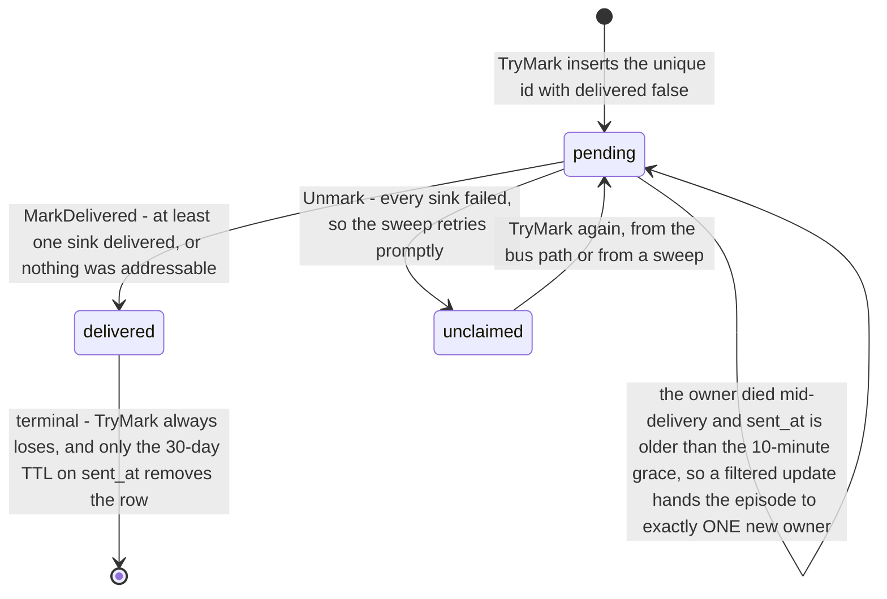
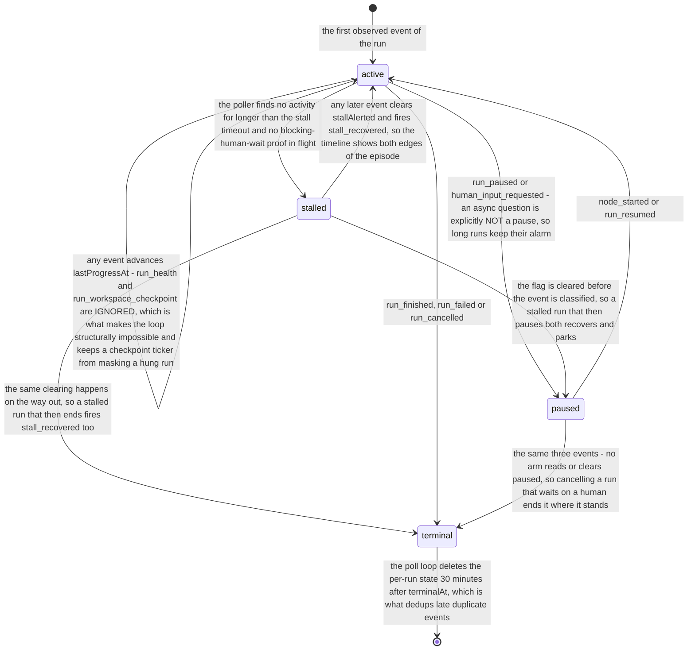

# Flow — notifications and callbacks: one outcome event, three outbound families

A run that pauses or terminates publishes one outcome event, and three independent outbound families read it — a browser push to the run's users, a signed POST to the callback URL its launcher supplied, and an operator alert — each deduped by a claim on the episode rather than by trusting the bus to deliver once.

> Drawn from the code at commit `f564846d3`; how this page is kept true: [README](README.md).

## The spine and the three families

`trigger.BuildRunOutcome` is the shared authority: both emitters — `runview.emitRunOutcome` in process, `Runner.fireOutcomeEvent` on a cloud runner pod — re-read the persisted run, let its status override the kind derived from the body error, and mint the same per-episode id. That id is what makes delivery idempotent, because the bus is deliberately lossy: with no subscriber at publish instant the event is gone, so the push and the operator-alert families each keep a twin 2-minute reconciliation sweep that rebuilds the *same* canonical event from the store and replays it through the *same* handler. One Mongo collection holds every claim; the operator family namespaces its keys with an `ops|` prefix so the two families share it without colliding.

The third family does not ride the bus at all: the run-completion callback is fired directly by the same two sites, before the event is published, and is pure best effort. `pkg/mail` is not a channel here — it serves invitations and password resets only.

```mermaid
flowchart TD
%% enrolment - the only user-facing surface
    EN["the user flips the Notifications toggle: permission prompt, service-worker registration, then pushManager.subscribe under the server VAPID public key"] --> SUB{"POST api/v1/notifications/push/subscriptions"}
    SUB -- "the feature is off, so the route was never registered" --> E404["404 web push is not configured - only GET prefs reaches the JSON 404, the mutating routes fall through to the catch-all and answer 405"]
    SUB -- "a missing endpoint, p256dh or auth" --> E400["400 subscription requires endpoint, keys.p256dh and keys.auth"]
    SUB -- "accepted" --> ROW["upsert push_subscriptions keyed on the endpoint - tenant_id is provenance only, never a delivery filter"]
%% the spine
    PAUSE["the engine reaches a human node: doPause writes the interaction, emits human_input_requested then run_paused, and saves the checkpoint with the paused status in one write"] --> BUILD
    TERM["the run terminates: finished, failed, failed_resumable or cancelled"] --> BUILD
    BUILD["trigger.BuildRunOutcome re-reads the run: the persisted status overrides the body-error kind, failed and failed_resumable both map to run.failed, and the episode id folds the run id, the pending interaction or the status, and updated_at to the second"] --> FIRE
    FIRE{"the two emitters"}
    FIRE -- "in process, after the run body" --> CB1
    FIRE -- "a cloud runner pod, on a FINAL delivery disposition only - an ack or a park" --> CB1
    FIRE -- "a plain Nak with redeliveries left, or an interrupted run on drain or a lost heartbeat" --> NOFIRE["nothing fires - the redelivery auto-resumes the run, and firing here pushed one failed episode per redelivery"]
    CB1["the run-completion callback fires first, then the event is published"] --> BUS
    BUS{"eventbus - a NATS queue group in cloud so exactly one replica sees each event, the trigger coordinator in-proc bus locally"}
    BUS -- "subscribe failed, or no bus is wired at all" --> ONLY["a warning, not a fatal - the sweep becomes the only delivery path"]
    BUS -- "usernotify" --> KIND
    BUS -- "operator-alerts, run.failed only" --> CLASS
%% the user family
    SWEEP["the usernotify sweep, every 2 minutes on each replica: every run still paused_waiting_human with no time bound, plus terminal runs updated within 24h, keyset-paginated by updated_at over at most 20 pages of 500"] --> PRE{"IsMarked on the key derived from the listing alone"}
    PRE -- "claimed" --> SKIP["skip without loading the run"]
    PRE -- "unclaimed" --> KIND
    KIND{"Dispatcher.Handle - kindFor maps the event to a Kind"}
    KIND -- "a run.paused whose payload carries an empty interaction_id is an operator soft-pause" --> NOONE["return nil - the operator initiated it, there is nobody to notify"]
    KIND -- "a run.paused carrying an interaction id, mapped to human_input_requested" --> VETO{"pauseSuppressor: is the run parked on a standby, a watched issue id or an active assistant watch row"}
    KIND -- "a terminal kind - run.finished, run.failed and run.cancelled skip the veto and are never suppressed" --> CLAIM
    VETO -- "yes" --> MUTE["return nil, no claim taken - an assistant waiting on a card is not waiting on the operator"]
    VETO -- "no" --> CLAIM{"SentStore.TryMark on the episode id"}
    CLAIM -- "lost: already delivered, or pending inside the 10-minute grace" --> DEDUP["return nil - this is how the bus path, the sweep and every other replica dedup"]
    CLAIM -- "won, or a stale pending claim taken over" --> RES["fill the gaps from the run under WithoutTenantFilter, resolve recipients as the owner union the tenant team-wide opt-ins, render title and body, set the runs deep link and the run id as the collapse tag"]
    RES --> ADDR{"are there recipients, and is at least one sink wired"}
    ADDR -- "no recipient, OR no wired sink - either one alone refuses" --> CONF["MarkDelivered and return - a deliberate no-op is CONFIRMED so neither the sweep nor the grace takeover retries it"]
    ADDR -- "at least one of each" --> FAN["one goroutine per sink, each under its own 30s timeout on an uncancellable copy of the context so a cancelled request cannot kill an in-flight delivery"]
    FAN --> PUSH{"webpush.Sink: one ListForUsers query, deliberately NOT tenant-filtered, then 8-way parallel VAPID sends with a 24h TTL and high urgency"}
    PUSH -- "no recipient has a browser enrolled" --> NOSUB["nil - not a failure"]
    PUSH -- "the push service answers 404 or 410 Gone" --> PRUNE["prune the endpoint and count the attempt failed"]
    PUSH -- "2xx" --> TOUCH["touch last_used_at, best effort"]
    PUSH --> VERD{"did any sink deliver"}
    VERD -- "yes" --> MD["MarkDelivered confirms the pending claim"]
    VERD -- "no" --> UNM["Unmark releases it and Handle returns an error, so the sweep retries promptly"]
%% the operator family
    CLASS{"OpsDispatcher.classify loads the run under WithoutTenantFilter"}
    CLASS -- "already resumed or finished by the time classify looked" --> OWED["return nil - nothing owed"]
    CLASS -- "failed_resumable" --> PARK["run_parked: a retry armed with an ETA, a retry stopped, or no retry armed and an operator resume needed"]
    CLASS -- "failed" --> HARD["run_failed with a 200-character error excerpt and the typed failure code"]
    PARK --> OCL
    HARD --> OCL{"TryMark the ops-prefixed episode key - a parked run keys on status, attempts and failure class, so the retry bookkeeping that rewrites the row every sweep-minute does not spam"}
    OCL -- "lost" --> STAMP["stamp the transition marker ONLY when WasDelivered is true - certifying a pending claim would race its Unmark and silence a parked-no-retry alert forever"]
    OCL -- "won" --> OFAN{"the deployment webhook and the errtrack sink - only the sinks that can report failure decide the verdict"}
    OFAN -- "every error-reporting sink failed" --> OUN["Unmark, warn, and return nil - the 2-minute operator-alert sweep retries"]
    OFAN -- "one took it" --> ODONE["MarkDelivered, then stamp the transition marker"]
    ROUTE["the outcome router escalates through the same dispatcher: notifyRouteDecisionErr builds a route_escalated or route_action_failed alert under a route episode key"] --> NOP{"NotifyOperator: claim, then the same fan-out"}
    NOP -- "no dispatcher is wired - a local studio, or no alerts webhook" --> SILENT["nil - the registry row and the warn log are the whole surface"]
    NOP -- "every channel failed" --> RETRY["an error back to the router, which leaves the registry row CLAIMED for the 15-minute lease steal instead of burning the 3-attempt cap"]
%% the callback family
    CB1 --> GATE{"FireForRun re-reads the run: does it carry a callback URL, and does shouldNotify accept the status - a predicate that borrows RunStatus.IsTerminal"}
    GATE -- "no URL, the common case" --> OUT["return"]
    GATE -- "paused_waiting_human or paused_operator" --> OUT2["skipped - the resume that actually terminates fires it"]
    GATE -- "terminal" --> ANS{"resolveFinalAnswer: the pinned callback answer node ONLY, else probe the artifact index in Go map order and take whichever matching node comes up first - unpinned, the node is not deterministic"}
    ANS --> SSRF{"the SSRF guard: http or https only, then one host resolution that fails closed, strict unless private receivers are allowed"}
    SSRF -- "a URL that does not parse, a rejected scheme, or a host resolving to loopback, link-local, RFC-1918 or a metadata address" --> REF["warn and no POST at all - the warning for a URL that does not parse prints it whole, query string included"]
    SSRF -- "one validated IP" --> POST["POST the versioned JSON envelope through a per-delivery dialer pinned to that IP, redirects refused, and an HMAC-SHA256 signature header over the exact bytes sent when a secret is configured"]
    POST -- "a transport error, or a status of 300 and above" --> WARN["warn only - a callback never affects the run outcome"]
```

## The episode claim

One collection, one `_id` per episode, two phases. `IsMarked` reads true for a pending claim inside the grace; `WasDelivered` is strictly narrower, and a consumer certifying side-state off another claim's outcome must read that one.

| State | Means | Written by |
|---|---|---|
| absent | no row: the episode was never claimed, was released, or its TTL reaped it | `Unmark`, the `sent_at_ttl` index |
| pending | `delivered:false` — a live fan-out holds it, and shields it for `ClaimGrace` | `TryMark`, and its own stale-claim takeover |
| delivered | `delivered:true` — settled, never retried | `MarkDelivered` |

## Run health, observed in process

`alert.Manager` is the local lane: it has no bus and no claim store, and tracks liveness off the observed event stream with a persisted `run_health` twin. It is blind to runner pods, which is why the cloud `OpsDispatcher` exists.

| State | Means | Fires |
|---|---|---|
| active | liveness advancing, `currentNode` recorded | `budget_warning`, `budget_exceeded` |
| paused | an intentional wait: `checkStalls` skips the candidate and leaves its state untouched, so only `node_started`, `run_resumed` or a terminal event moves it | nothing |
| stalled | `stallAlerted`, once per episode; the next observed event of any kind clears it | `stall`, then `stall_recovered` on the way out |
| terminal | `terminalAt` stamped, reaped after 30 minutes | `run_failed` |

## Steps

| Actor | Action | Code |
|---|---|---|
| user, studio | registers the service worker, subscribes under the server's VAPID key, POSTs the subscription — the worker is registered here and never at page load | `enablePush`, `swRegistration` |
| server | gates on the feature, validates the three fields, upserts on the endpoint with the identity's team as provenance | `webPushEnabled`, `handlePushSubscribe`, `Upsert` |
| user, server | sets the per-user scope; a row exists only when the user leaves the default, so absence means own-runs-only | `handlePutNotificationPrefs`, `ValidScope` |
| engine | writes the interaction, emits `human_input_requested` then `run_paused`, saves the checkpoint with the paused status in one write | `doPause`, `pauseEventData`, `PauseRun` |
| server, runner | fire the completion callback, then publish the outcome event — the runner only on a final delivery disposition | `FireForRun`, `emitRunOutcome`, `fireOutcomeEvent` |
| engine | re-reads the run, overrides the kind with the persisted status, mints the per-episode id | `BuildRunOutcome`, `RunOutcomeEventID` |
| server | subscribes the two consumers on the spine, and starts both sweeps | `startUserNotify`, `startOperatorAlerts`, `Attach` |
| server | maps the event to a kind, vetoes a standby pause, claims the episode | `kindFor`, `hasActiveVeille`, `TryMark` |
| server, store | resolves recipients as the owner union the team-wide opt-ins, renders, deep-links | `build`, `ListTeamWide`, `render`, `deeplink.Run` |
| provider | lists the recipients' subscriptions in one query and pushes in bounded parallel, pruning a dead endpoint | `Deliver`, `ListForUsers`, `push`, `Prune` |
| store | settles the episode: confirmed on one success, released when every sink failed | `MarkDelivered`, `Unmark` |
| server | replays what the bus dropped, pre-checking the claim before loading a run | `SweepOnce`, `sweepRefs`, `IsMarked`, `ListNotifiableRuns` |
| server | resolves the final answer, vets and pins the host, POSTs the signed envelope | `resolveFinalAnswer`, `resolveCallbackIP`, `deliver`, `Sign` |
| server | classifies a failed run for the operator and claims an ops-prefixed episode | `classify`, `opsEpisodeKey`, `fanOut` |
| server | escalates a router decision through the same dispatcher and the same claim | `notifyRouteDecisionErr`, `NotifyOperator` |
| server | observes the event stream, fires stall and budget alerts, reaps terminal state | `Observe`, `checkStalls`, `Start` |
| user, studio | the service worker renders the OS notification and focuses or navigates the studio tab on click | the `push` and `notificationclick` handlers |

## Guards that refuse

- **`webPushEnabled`** — a subscription store plus **both** VAPID keys. Without it `registerNotificationRoutes` is never called, so the five push and prefs routes do not exist: `GET /api/v1/notifications/prefs` reaches the SPA handler's JSON `404`, while the mutating ones hit the `GET /` catch-all and answer `405 Method Not Allowed`. A route that does exist answers `404 web push is not configured on this server` when the store is later nil.
- **The subscription payload** — `400 subscription requires endpoint, keys.p256dh and keys.auth`; a bad body is `400 invalid subscription payload`. Unsubscribe passes the caller's own user id into `DeleteByEndpoint`, so one user cannot delete another's endpoint.
- **`ValidScope`** — `400 scope must be own or team`; a server with no prefs store answers `404 notification prefs are not available on this server`. `handlePushTest` additionally needs the live sink only `startUserNotify` builds.
- **`kindFor`** — a `run.paused` carrying an empty `interaction_id` is an operator soft-pause and maps to no kind at all; an event with an empty subject id is dropped the same way.
- **`pauseSuppressor`** — the standby veto, applied before any claim so the episode stays replayable: a run holding watched issue ids, or an active assistant watch row, gets no *pause* push. It is consulted on the `human_input_requested` kind only — a terminal outcome never reaches it, so the same assistant-watched run still pushes its finished, failed or cancelled notification.
- **`TryMark`** — the claim: a `delivered` row, or a `pending` one inside `ClaimGrace`, loses. This single refusal is what dedups the bus path against the sweep and against every other replica.
- **The addressable check** — no recipient or no wired sink confirms the claim instead of releasing it, so a deliberate no-op is never retried by the sweep or by the grace takeover.
- **`WasDelivered`** — the operator dispatcher stamps a transition marker only for a *confirmed* episode: certifying a pending claim races its `Unmark` and would make every later sweep skip a released episode before `Handle` runs.
- **`classify`'s default arm** — a run that resumed or finished between the publish and the load owes nothing.
- **`startOperatorAlerts`** — refuses out loud when the alerts webhook is set but no claim store is wired, because every replica and the sweep would otherwise re-send each episode.
- **`shouldNotify`** — paused statuses are skipped: the run is waiting, not done, and the resume that terminates it fires the callback then.
- **The SSRF guard** — `http` or `https` only, one host resolution that **fails closed**, strict unless private receivers are explicitly allowed, the single validated IP pinned into a per-delivery dialer, and redirects refused so no `3xx` hop re-opens the rebinding window. The outbound callback has no role gate: this *is* its authorization decision.
- **The ignored event types** — `run_health` and `run_workspace_checkpoint` never count as progress, so the alert manager cannot alert on its own twin and a workspace ticker cannot make a hung run read as alive; a blocking-human-wait proof found in flight cancels a stall about to fire.

## Collections touched

`push_subscriptions` (upserted on the endpoint, listed by `user_id` with no tenant filter, pruned on `404`/`410`, touched on success) · `notification_prefs` (written by the prefs route, read for the team-wide opt-ins) · `sent_notifications` (the episode claim — `_id` *is* the key, no tenant field at all, a 30-day TTL on `sent_at`, shared with the operator family under an `ops|` prefix) · `runs` (read by `BuildRunOutcome`, `build`, `classify` and `FireForRun`, and listed by `ListNotifiableRuns`, under `WithoutTenantFilter` — except the runner's `FireForRun`, which reads the run under the queue message's tenant identity, and the veto's read, which rides the handler's own context) · `assistant_run_watches` (read by the standby veto through `ListActiveByAssistant`, one query per pause episode) · `interactions` (written by `doPause`, read for the human-input body) · `events` (the pause and failure events the alert manager observes, and the persisted `run_health` twin it writes).

## Related

- [notifications.md](../notifications.md) — the user web-push family: notified events, recipient resolution, reliability, VAPID enablement and the REST surface; [outbound-callbacks.md](../outbound-callbacks.md) — how to request a callback at launch, the versioned payload and the signature scheme.
- [usage-caps.md](../usage-caps.md) and [outcome-router.md](../outcome-router.md) — the operator webhook and which router decision raises which alert kind; [observability.md](../observability.md) — the alert-kind to tracker-level mapping.
- [data-model-knowledge.md](data-model-knowledge.md) — `push_subscriptions`, `notification_prefs`, `sent_notifications` and the four key shapes that share the last one; [data-model-runs.md](data-model-runs.md) — `runs`, `events`, `interactions` and the run status machine; [data-model-automation.md](data-model-automation.md) — the trigger spine this flow publishes onto.
- [flow-cloud-run-lifecycle.md](flow-cloud-run-lifecycle.md) — the delivery dispositions that decide whether the outcome event fires at all; [access-control.md](access-control.md) — `requireAuth` is the whole gate on the notification routes.

