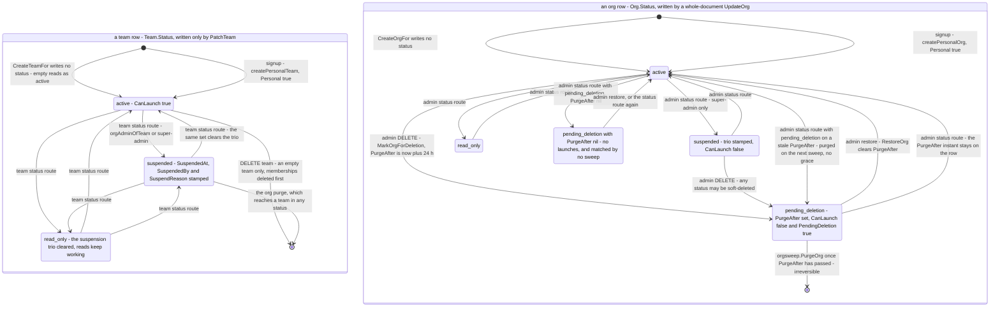
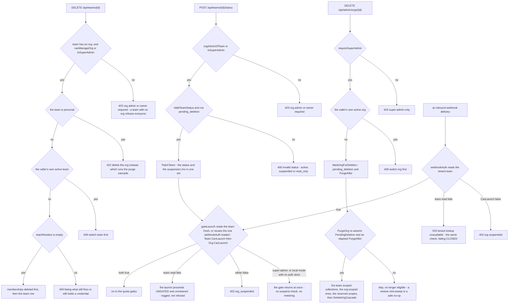

# Flow — org and team lifecycle: suspend, soft-delete, purge

An org and the teams under it share one status field written by different callers, and only an org can be scheduled for deletion and then swept away with everything its teams own.

> Drawn from the code at commit `f564846d3`; how this page is kept true: [README](README.md).

## The status machine — one type, two accepted sets

`identity.TeamStatus` types both `Team.Status` and `Org.Status`. A team takes `active`, `suspended` or `read_only`; an org takes those three plus `pending_deletion`, the soft-delete state that carries a purge instant. An empty value is what every create path leaves behind — the field is `omitempty` and no creator writes it — and reads as `active` through `EffectiveStatus`; no reader compares `Status` directly.

- The two lanes are independent writers of the same type. A team's status gates that team; the org's status gates every team under it, because the launch gate asks `Team.CanLaunch` and then `Org.CanLaunch` on the same request. Those two calls plus the webhook middleware's are the whole enforcement: `Org.Suspended` and `Team.Suspended` are defined and read by nothing, so a suspended or soft-deleted row refuses run launches and no other surface.
- Entering `suspended` stamps the trio, and every other transition clears it. On a team that is one `$set` in `PatchTeam`, so a concurrent rename cannot resurrect a resumed team's `SuspendedAt`; the org writers are whole-document replaces, so two concurrent org edits can each carry back what the other wrote.
- `pending_deletion` is the one state with a second field, `PurgeAfter`: `MarkOrgForDeletion` sets both, `RestoreOrg` clears both. The admin status route also accepts it — `ValidTeamStatus` admits the fourth value its own 400 message omits — and writes no `PurgeAfter`, so what that write means depends on what the row already carried. `PurgeAfter` nil and `ListOrgsPendingPurge` matches it never; a `PurgeAfter` left over from an earlier soft-delete and the next sweep purges the org with no grace at all, `PurgeOrg`'s three re-asserted terms all passing. The route never clears `PurgeAfter` either, so leaving `pending_deletion` through it keeps the instant on an `active` row — which is where the stale one comes from; only `RestoreOrg` clears it.
- A team row can also disappear with no status transition at all: `DELETE /api/teams/{id}` removes an empty one, and the org purge removes all of them.

## Who may move it, and what refuses

The two enforcement points read the same predicate and disagree on a degraded store read: the launch gate fails open and says so in the log, the webhook middleware answers 503 to a machine that will redeliver. A team the store answers is GONE is not that case on either path — 403 `no_workspace`, and 403 `tenant no longer exists`. They also differ at the top: only the launch gate carries a bypass, and the synthetic identity a delivery is stamped with is never a super-admin, so the webhook lane always reads the team.

## Steps

| Actor | Action | Code |
|---|---|---|
| super-admin | create an org: the org row, the owner's org membership, then a seeded default team — three writes, no transaction | `handleAdminCreateOrg`, `auth.Service.CreateOrgFor`, `UpsertOrgMembership` |
| org admin | add a team to an org they administer, or to the JWT's active org | `handleCreateOrgTeam`, `handleCreateTeam`, `CreateTeamFor` |
| a new user | open signup, a first OIDC login granted no team, or an admin-created user: an org and a team of its own, with the owner memberships — the only writer of `Personal: true`, the flag the team delete answers 422 | `registerOpen`, `CreateUserAndPersonalTeam`, `createPersonalOrg`, `createPersonalTeam` |
| operator | backfill a pre-org deployment: an org per team, then relink the team — the one write that moves a team under another org's status, and the reverse unlinks it | `cli.MigrateTeamsToOrgs`, `createOrgUniqueSlug`, `linkTeam`, `ReverseTeamsToOrgs`, `identity.TeamPatch` |
| team or org admin | rename a team through a patch, so a rename cannot carry back the status it read | `handleUpdateTeam`, `identity.MongoStore.PatchTeam` |
| org admin | set a team's status, with the suspension trio in the same write | `handleSetTeamStatus`, `identity.TeamPatch` |
| super-admin | set an org's status with a whole-document replace | `handleAdminSetOrgStatus`, `identity.MongoStore.UpdateOrg` |
| super-admin | soft-delete an org: `pending_deletion` plus a `PurgeAfter` 24 h out | `handleAdminDeleteOrg`, `orgDeletionGrace`, `MarkOrgForDeletion` |
| super-admin | cancel a scheduled deletion; a no-op 200 on an org that is not pending | `handleAdminRestoreOrg`, `auth.Service.RestoreOrg` |
| sweeper | nightly at 02:00 UTC, plus one catch-up at boot, list the orgs whose grace elapsed | `orgsweep.Sweeper.Run`, `Sweep`, `nextRun`, `ListOrgsPendingPurge` |
| sweeper | re-assert eligibility, then delete each team's collections, the org-scoped ones and the reserved scopes | `orgsweep.Purger.PurgeOrg`, `teamScopedCollections`, `orgScopedCollections`, `secrets.OrgOwnerKey`, `secrets.OrgTierTenantID` |
| sweeper | the identity rows last: per team the memberships and pending invitations, then the team, then the org memberships and the org | `auth.Service.DeleteOrgCascade` |
| server | start one sweeper per replica — idempotent, no leader election | `goUntilShutdown` with `server.orgPurgeSweeper`, `cfg.OrgPurgeSweeper` |
| org admin | delete an empty team: probe the residue, revoke the memberships, drop the row | `handleDeleteTeam`, `teamResidue` |
| engine | at every launch, read the team fresh — or reuse the one `webhookAuth` stashed on the request — and ask both levels, unless the caller is a super-admin | `gateLaunch`, `teamFromContext`, `orgForTeam`, `Team.CanLaunch`, `Org.CanLaunch`, `denyOrgSuspended` |
| server | on an inbound delivery, check the tenant before stamping the synthetic identity | `webhookAuth` |
| studio | Admin → Organisations → status section and danger zone | `OrgStatusSection.tsx`, `OrgDangerZone.tsx` |
| operator CLI | `iterion remote teams status` / `delete`, `iterion remote admin orgs status` / `delete` / `restore` — the status word is forwarded verbatim, so `pending_deletion` reaches the org route from a shell | `cmd/iterion/remote_team_lifecycle.go`, `cmd/iterion/remote_admin.go` |

## States

| Status | Accepted on | Written by | What it refuses | Leaves by |
|---|---|---|---|---|
| `""` | both — the value of every row nobody has set a status on | no creator — every create path omits the field, so a fresh row and a pre-field row look alike | nothing: `EffectiveStatus` reads it as `active` | the first status write |
| `active` | team and org | both status routes; `RestoreOrg` | nothing | any other status |
| `suspended` | team and org | both status routes, which stamp the trio | run launches by a non-super-admin caller, at both enforcement points, with `org_suspended` | any other status; the trio is cleared |
| `read_only` | team and org | both status routes | the same run launches only — no middleware blocks a mutating route, so reads and edits keep working | any other status |
| `pending_deletion` | org only — the team route 400s it, a team having no sweeper | `MarkOrgForDeletion` with `PurgeAfter`; also the org status route, which writes none and keeps whatever the row held | the same run launches, through `Org.CanLaunch` at its two sites and nothing else | `RestoreOrg`, the status route, or the purge, which deletes the row |

## Guards that refuse

- `requireSuperAdmin` — 403 `super-admin only` on every `/api/admin/orgs…` route: create, update, status, delete, restore. `/api/admin/` is a tenant-free prefix, so a team-less super-admin still reaches it.
- `orgAdminOfTeam` or `IsSuperAdmin` — 403 on the team status route. A team admin suspending their own team is harmless; one resuming a suspension their org imposed would undo governance from inside the thing governed.
- `canManageOrg` on the team's parent org — 403 on `DELETE /api/teams/{id}`; the same condition refuses a team whose `OrgID` is empty for every caller, super-admin included.
- `ValidTeamStatus`, plus the explicit `pending_deletion` exclusion — 400 `invalid status` at the team route. The org route runs the first half only.
- `Team.Personal` — 422 naming the org delete, because a personal team is deleted with its org.
- The caller's own tenant — 409 on the active team, 409 on the active org: no self-lockout, switch first.
- `teamResidue` — 409 listing what survives: repo integrations, forge connections, active runs, API keys, inbound webhooks, named secrets, the team forfait and team-authored bots. A refusal list, not a cascade; inert history is deliberately not counted.
- `ghostTeamMutatingRefusal` — 404 on a mutating `/api/teams/{id}/…` whose id resolves to no team and whose caller would otherwise pass, so no row is keyed by a spelling no reader resolves.
- `gateLaunch` — 403 `org_suspended` when either level cannot launch, 403 `no_workspace` when the team is gone. Its first statement is a bypass: a super-admin, and local or filesystem mode where there is no auth store, return before any status is read, so that launch is neither suspend-checked nor metered. A degraded team read fails open and logs `launching UNGATED`; an org that `orgForTeam` cannot resolve skips the org arm with no log at all.
- `webhookAuth` — 403 `org suspended`, 403 `tenant no longer exists`, 503 `tenant lookup unavailable`.
- `PurgeOrg` — re-asserts `PendingDeletion` and an elapsed `PurgeAfter` before an irreversible delete, and logs `no longer eligible` instead. A per-collection delete error is logged and counted zero: this sweep can under-purge, never cross a tenant.

## Collections touched

- Written by the lifecycle itself: `orgs`, `teams`, `memberships`, `org_memberships`, `invitations`, and `audit_events` — platform rows for the org actions, and `team.status_changed` written twice, tenant scope and org scope. `users` is read for the named owner.
- Deleted per team by the purge: `runs`, `run_seq`, `events`, `interactions`, `user_messages`, `memory_docs`, `memory_spaces`, `memory_tenant_usage`, `forge_connections`, `forge_oauth_apps`, `repo_integrations`, `api_keys`, `generic_secrets`, `run_secrets`, `bot_secret_bindings`, `org_sso_providers`, `org_verified_domains`, `trigger_subscriptions`, `webhook_configs`, `webhook_deliveries`, `webhook_quotas`, `board_issues`, `board_config`, `board_events`.
- Deleted by org id: the `audit_events` rows whose `org_id` or `tenant_id` is the org itself, and the rows no tenant field reaches — `oauth_credentials` under each team's org-owner key and the org-tier owner key, `api_keys` under the org-tier tenant, `llm_routing_policies` by composite id, `org_usage` by its `org|` and `forkauthor|` id prefixes. A personal forfait is deliberately kept: it belongs to a user, who outlives the org.
- Named residue, both bounded only by a 400-day TTL and by nothing the purge does: an `org_usage` row whose second id segment is a TEAM id — written when the gate meters a team with no resolvable org; and every `audit_events` row whose `tenant_id` is a TEAM id, which is every `auditTenant` write, the `team.status_changed` tenant copy and `member.added` with the member's email among them. `audit.Event` has no `org_id` field, the purge's org filter matches `org_id` or `tenant_id` against the ORG id, and `audit_events` is absent from `teamScopedCollections`, so the per-team loop never reaches it either.
- Without Mongo there is no org lifecycle: `identity.MemoryStore` mirrors `PatchTeam` and `ListOrgsPendingPurge` for tests, and the sweeper is wired only where the cloud database is.

## Related

- [cloud-admin-guide.md](../cloud-admin-guide.md) — §1.2 create an org, §1.3 quotas, §1.4 suspend and read-only, §1.5 the audit tokens; [cloud-admin.md](../cloud-admin.md) — signup modes and tenant management; [ticket-context.md](../ticket-context.md) — the team-lifecycle action table and the org-first repair order.
- [data-model-identity.md](data-model-identity.md) — the ER page of `orgs`, `teams`, `memberships`, `org_memberships`, `invitations` and `audit_events`; the purge's reach spans [data-model-runs.md](data-model-runs.md), [data-model-forge-bots.md](data-model-forge-bots.md), [data-model-credentials.md](data-model-credentials.md), [data-model-automation.md](data-model-automation.md) and [data-model-knowledge.md](data-model-knowledge.md).
- [access-control.md](access-control.md) — the gates named above as a matrix; [quotas-and-limits.md](../quotas-and-limits.md) — the denial tokens the launch gate returns and how to debug one.
- [adr/048-org-team-hierarchy.md](../adr/048-org-team-hierarchy.md) — why resources stay team-keyed under an org; [agents/engine/tenancy-credentials-spend.md](../agents/engine/tenancy-credentials-spend.md) — where the tenant stamped here reaches credential resolution.

