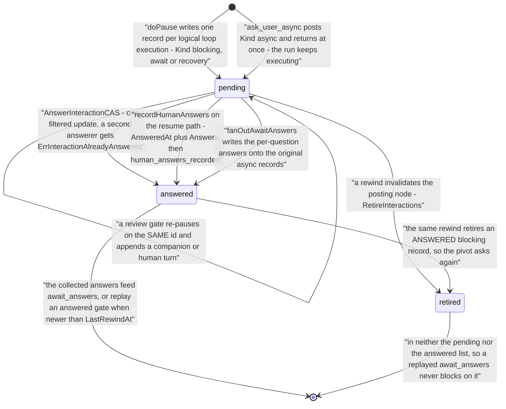

# Pause, resume and rewind

A run parks durably when a question needs a person or an operator stops it, comes back through a ladder of refusals whose surface verdicts all precede the claim while the budget preflight follows it and re-parks the run, and an explicit rewind moves its checkpoint backwards instead of forwards.

> Drawn from the code at commit `f564846d3`. How this page is kept true: [README](README.md).

The whole run-status machine — the launch edges, the terminal edges, the delete tombstone — is drawn once by [data-model-runs.md](data-model-runs.md#run-status-vocabulary) and is not redrawn here. The parked subgraph is drawn by [resume.md](../resume.md#resumable-states), each edge naming the function or the predicate that owns it: **five** producers write `paused_waiting_human` — four through the shared `doPause`, the parallel-branch gate through `store.PauseRun` itself — **four** write `paused_operator`, one compare-and-set brings a run back, and a rewind lands in `paused_operator` with a marker of its own. The record a pause leaves behind — the question — has its own lifecycle and its own vocabulary, drawn below.

## Who parks a run, and what brings it back

The diagram lives on [resume.md](../resume.md#resumable-states), beside the resumable-status matrix it belongs to; what each of its states means here:

| state | what it means here | code |
| --- | --- | --- |
| `running` | the engine holds the run: every pause that parks it is written from here, the post-claim budget preflight too, and a rewind refuses the status because its engine owns the checkpoint | `Engine.execLoop`, `doPause`, `isRewindableStatus` |
| `paused_waiting_human` | a question is pending and its id is on the checkpoint. The one status `RequiresResumeAnswers` names, so a resume without answers is refused; `CarriesPausePointer` admits the pointer on both paused statuses and on `queued` | `store.PauseRun`, `RunStatus.RequiresResumeAnswers`, `CarriesPausePointer` |
| `paused_operator` | parked by a hand or a cap, no question owed. Resumes through the failure-style path — which re-parks it here when the budget is still spent — and every successful rewind lands here | `pauseOperatorWithCheckpoint`, `pauseSpentBudgetBeforeResume`, `Service.Rewind` |
| `failed_resumable` | an interrupted execution with its checkpoint; terminal for polling and resumable for both an operator and machinery | `RunStatus.CanAutoResume`, `resumeFromFailure` |
| `cancelled` | the checkpoint survives a cancel, so `IsResumable` admits it while `CanAutoResume` excludes it: an operator's stop is never overridden by machinery | `RunStatus.IsResumable`, `CanAutoResume` |
| `failed` | no resume admits it, yet the checkpoint is preserved, so an explicit rewind can still recover it | `rewindableStatuses` |
| `queued` | the cloud resume hop only: the publisher flips a resumable run, the runner's claim writes `running`, and a refusal before that claim releases the run to `ResumeSpec.PriorStatus`. A plain queued launch never reaches `Engine.Resume` | `Publisher.SubmitResume`, `casResumeClaim`, `releaseRefusedResume` |
| `rewinding` | between the rewind's claim and its park. The six rewindable statuses are `failed`, `failed_resumable`, `cancelled`, `paused_operator`, `paused_waiting_human` and `queued` | `rewindableStatuses`, `Service.Rewind` |

## The question a pause leaves behind

| state | what it means | code |
| --- | --- | --- |
| `pending` | `AnsweredAt == nil`. The four kinds are the blocking pause (`Kind` empty), `async`, `await` and `recovery` | `store.Interaction`, `ListPendingAsyncInteractions` |
| `answered` | `AnsweredAt` and `Answers` set. A recovery answer is audit only — the node re-executes rather than taking it as output | `AnswerInteractionCAS`, `recordHumanAnswers`, `resumeFromRecoveryPause` |
| `retired` | `RetiredAt` set by a rewind, on the `async` and blocking records of the invalidated nodes: `Service.Rewind` asks for the blocking set, so a review gate's record — `Kind` empty, told apart only by its `Turns` — is retired with them, while `await`, `recovery` and every other typed kind are left alone, carrying protocol state a retire cannot represent | `store.RetireInteractions`, `Service.Rewind` |
| await wait token | not an interaction: one `AwaitAnswersWaits` entry per invocation on the run document, written only while the run is `running`, and the only persisted proof that exempts a silent run from the stall watchdog. `PauseRun` unsets them all | `store.SetAwaitAnswersWait`, `store.HasBlockingHumanWait` |
| subbot child pointer | `Run.SubbotChildren[execKey]`: a parent re-attaches to a child paused on its own gate across a restart, and a rewind detaches the dropped nodes' children | `ReattachSubbotChild`, `detachSubbotChildren` |

## The steps

| actor | action | code |
| --- | --- | --- |
| engine | reaches a `human` node and branches on its interaction mode: `human` and an explicit `none` pause, `llm_or_human` may skip | `execLoopDispatchSpecial`, `pauseAtHuman`, `execAutoOrPauseHuman` |
| engine | resolves the gate's incoming edges into the read-only questions | `persistPause`, `buildNodeInputRS` |
| engine | records what the node left on disk and opens the parked window, so a later scoped rewind cannot read the operator's own edits as the run's production | `capturePauseBoundary` |
| engine | mints one stable id per logical loop execution, encoding the full iteration path when a node belongs to several loops | `interactionIDForPause` |
| engine | drains the run- and node-scoped operator inbox into the questions under a reserved key | `drainOperatorMessagesForPause`, `delegate.QueuedOperatorMessagesKey` |
| engine | writes the record, emits `human_input_requested` then `run_paused`, and lets one atomic write carry the status and the checkpoint | `doPause`, `store.PauseRun` |
| engine | routes a mid-step interaction request: a permission marker always pauses, an await key escalates, `llm` answers in place | `handleNeedsInteraction`, `pauseForBackendInteraction`, `handleAwaitEscalation` |
| bot | posts a non-blocking question and keeps working | `storeAsyncAskHook.Post` |
| engine | the sync point arms the in-process doorbell BEFORE reading the store, then parks on the bell, a 5 s ticker, the deadline or cancellation | `awaitAsyncAnswers` |
| engine | writes the per-invocation wait token, and fails the node when the deferred clear cannot remove it | `store.SetAwaitAnswersWait` |
| user | answers an async question while the run is running or paused, which queues a node-scoped delivery and rings the doorbell | `handleAnswerInteraction`, `Service.AnswerInteractionCtx`, `model.RecordAsyncAnswer` |
| user | answers a blocking gate through one of six doors: the studio form and the CLI post the resume route, the run WebSocket carries an `answer` envelope, plus `answer-human`, the host-event gate and the operator MCP tools | `handleResumeRun`, `handleAnswer`, `handleAnswerHuman`, `handleDeliverHostEvent`, `local_resume` |
| server | meters a resume as a launch and hands the unit back on every return before the engine may have started | `Server.gateLaunch`, `launchAdmission.rollback` |
| server | runs the preflight BEFORE promoting staged uploads, because promotion consumes them and would make the studio's forced retry impossible | `Service.PreflightResume`, `promoteAnswerUploads` |
| server | the surface tier, in a load-bearing order: the scratch and the lineage are judged before the source digest, and a forceable refusal is shown behind them | `Service.Resume`, `validateResumable`, `ValidateResumeScratch`, `ValidateResumeLineage`, `scratchBeforeForce` |
| engine | repeats every *surface* refusal under its own boundary and before the claim, so a run refused there keeps the status it had | `Engine.ResumeWithHostInputs` |
| engine | re-applies the checkpoint's budget accounting and the recorded raises AFTER the claim and before the sandbox, so a resume with no raise never provisions one to rediscover the cap | `failSpentBudgetBeforeResume`, `pauseSpentBudgetBeforeResume`, `finalizeSpentBudgetBeforeResume` |
| engine | routes by status, and flips back to the pause path when the gate's recorded answer is still valid | the status switch of `ResumeWithHostInputs`, `answeredHumanGateReplay`, `replayAnsweredGate` |
| engine | coerces string answers to the node's schema, fans an await's answers out, resolves uploaded files, records the answers as the node's output | `coerceAnswersToSchema`, `fanOutAwaitAnswers`, `resolveFileAnswers`, `recordHumanAnswers` |
| engine | claims by compare-and-set, consumes the pause pointer, emits `run_resumed`; a delivery's resume claims before any write | `claimPause`, `claimForResume`, `casResumeClaim`, `claimsFirst` |
| engine | restarts the sandbox and restores the banked scratch before the first node | `resumeRebuildState`, `restoreBankedScratch` |
| engine | closes the parked window, selects the outgoing edge, or re-invokes the backend with the session, conversation and pending tool use rehydrated | `markPreNodeBoundary`, `selectEdgeRS`, `reInvokeBackend` |
| engine | banks the container-local scratch at every teardown but a finished run's, and says in `sandbox_scratch_banked` why it could not | `bankScratchOnCleanup`, `bankScratch` |
| operator | rewinds: compile the CURRENT source with no digest check, promote a fan-out body pivot to its router, drop the forward-reachable non-ancestor outputs, supersede their artifacts, detach their children, retire their questions | `handleRewindRun`, `Service.Rewind`, `detachSubbotChildren`, `store.RetireInteractions` |

## Guards that refuse

- **404** — `scopeRunByID` answers for a run of another tenant before a handler runs, and the store's own `withTenantFilter` makes a cross-team read not-found. No role check gates these routes.
- **The launch denial envelope** — `gateLaunch` on a resume: suspend, concurrency, rate, daily cost cap, monthly quota, super-admin bypassed. The subject comes from the run, so a reserved bot faces the ceiling its own reservation lowered.
- **`no answers provided`** — `validateResumable`: `RequiresResumeAnswers()` is true for `paused_waiting_human` alone.
- **`run_not_resumable`** (`ErrRunNotResumable`) — `CanOperatorResume()`, or `CanAutoResume()` for machinery, does not admit the status. A stable code, so the loser of a two-resumer race can tell it from a malformed request.
- **`SCRATCH_NOT_PORTABLE`** — `ValidateResumeScratch` at the surface, `refuseResumeLosingScratch` pre-claim, `restoreBankedScratch` at restore time. `--force` never waives it: only `--accept-scratch-loss` does.
- **`workflow_source_changed`** and an incompatible artifact contract — `checkWorkflowHash` and `validateArtifactContracts`; `--force` waives both, and `scratchBeforeForce` names a scratch loss first so every consent is shown at once.
- **`BOT_REQUIRES_NEWER_ENGINE`**, a severed worktree gitdir, a superseded delivery — `refuseBundleRequiringNewerEngine`, `checkWorktreeLinkage`, `supersededBy`. All pre-claim, all leaving the status resumable.
- **`already being executed; refusing duplicate resume`** — the `claimForResume` CAS lost; a durable mission resume narrows the allowed set to its exact expected status.
- **The budget preflight** — the refusal that runs PAST the claim, on the failure-style and recovery-pause paths: `failSpentBudgetBeforeResume` restores the checkpoint's accounting and `Run.BudgetRaises`, then re-parks the run `paused_operator` under `on_exceeded: pause` (`pauseSpentBudgetBeforeResume`, `ErrRunPausedOperator`) or ends it `failed_resumable` with `budget_exceeded` (`finalizeSpentBudgetBeforeResume`). A run already inside its bounded exit allowance is let through to `checkBudgetBeforeExec` instead.
- **409** — `ErrNotAwaitingHuman` on `answer-human`, `ErrInteractionNotAsync` and `ErrInteractionAlreadyAnswered` on an async answer, `ErrRunNotActive` on `pause` (no cross-process pause exists), and the assistant host-boundary refusals on `host-event`.
- **`cannot park await_answers on run <id> in state <status>`** — `SetAwaitAnswersWait` writes the exemption token only on a `running` run, and an expired token never exempts.
- **Rewind** — `ErrRewindNotRewindable` (`running` excluded: its engine owns the checkpoint), `nothing to rewind` (no checkpoint), `ErrRewindNodeNotReached`, `ErrRewindScopeUnavailable` (`--restore-scope produced` cannot be served for a worktree run), `ErrRewindAmbiguous` (an `--auto` edit on independent branches, candidates named), and a version-checked `SaveRun` for a concurrent writer.
- **C240 / C241 / C267 / C271** — compile diagnostics, not runtime refusals. C271 warns that a synchronous interaction mode on `codex`, `kimi`, `grok` or `opencode` never pauses: the protocol survives as prompt text only.

## Collections touched

| collection | written by | what |
| --- | --- | --- |
| `runs` | engine, server | the status, the checkpoint and its pause pointer, `await_answers_waits`, `LastRewindAt`, `ResumeRequiresExplicit`, `SubbotChildren` |
| `interactions` | engine, server | one record per question: `Kind`, `Questions`, `Answers`, `AnsweredAt`, `Turns`, `RetiredAt` |
| `user_messages` | server, engine | the node-scoped answer delivery, and the operator inbox a pause drains into its questions |
| `events` | engine, server | `human_input_requested`, `run_paused`, `human_answers_recorded`, `run_resumed`, `sandbox_scratch_banked`, `sandbox_scratch_restored`, `run_rewound` |
| `run_seq` | store | the per-run sequence every event append allocates |

The scratch bank is not a document: `runs/<id>/scratch-bank.tgz` on the filesystem, `sessions/<run>/scratch.tgz` in S3, one gzipped tar under a 256 MiB compressed cap. A rewind also writes artifact tombstone versions to blob storage.

## Related

- [resume.md](../resume.md) — the resumable-status matrix, what the checkpoint preserves, the overrides and the whole rewind contract.
- [human-in-the-loop.md](../human-in-the-loop.md) — the `human` node, the interaction modes and the gate's payload; [async-interaction.md](../async-interaction.md) — the async pair and answer delivery; [stall-human-waits.md](../stall-human-waits.md) — the exemption oracle; [review-merge-gate.md](../review-merge-gate.md) — the review gate's own resume path.
- [adr/081-async-human-interaction.md](../adr/081-async-human-interaction.md) · [adr/084-subbot-reattach-across-restarts.md](../adr/084-subbot-reattach-across-restarts.md) · [adr/106-resume-restores-the-scratch-banked-at-teardown.md](../adr/106-resume-restores-the-scratch-banked-at-teardown.md)
- [data-model-runs.md](data-model-runs.md) — the run, its streams and the full status machine; [flow-cloud-run-lifecycle.md](flow-cloud-run-lifecycle.md) — the delivery a cloud resume rides; [access-control.md](access-control.md) — the run-surface ladder and the principal kinds.

## Sources

- [pkg/runtime/resume.go](../../pkg/runtime/resume.go) — `doPause`, `interactionIDForPause`, `drainOperatorMessagesForPause`, `pauseAtHuman`, `persistPause`, `handleNeedsInteraction`, `pauseForBackendInteraction`, `ResumeWithHostInputs` and its status switch, `resumeFromPauseWithHostInputs`, `resumeFromRecoveryPause`, `answeredHumanGateReplay`, `replayAnsweredGate`, `gateReplayAllowed`, `resumeParallelPause`, `recordHumanAnswers`, `claimPause`, `claimForResume`, `casResumeClaim`, `claimsFirst`, `supersededBy`, `resumeRebuildState`, `markPreNodeBoundary`; [pkg/runtime/pause.go](../../pkg/runtime/pause.go) — `pauseOperatorWithCheckpoint` and its three callers; [pkg/runtime/recovery_dispatch.go](../../pkg/runtime/recovery_dispatch.go) — `pauseForRecovery`; [pkg/runtime/engine_exec.go](../../pkg/runtime/engine_exec.go) — the human-node dispatch; [pkg/runtime/review.go](../../pkg/runtime/review.go) — `pauseReviewGate`, `resumeReviewGate`, `gateSelectEdge`; [pkg/runtime/branch.go](../../pkg/runtime/branch.go) — `pauseBranchAtHuman` and its per-branch interaction id; [pkg/runtime/budget_resume_preflight.go](../../pkg/runtime/budget_resume_preflight.go) — `failSpentBudgetBeforeResume`, `pauseSpentBudgetBeforeResume`, `finalizeSpentBudgetBeforeResume`.
- [pkg/runtime/await_answers_node.go](../../pkg/runtime/await_answers_node.go) — `awaitAsyncAnswers`, `awaitAnswersOutput`, `handleAwaitEscalation`; [pkg/backend/model/async_ask.go](../../pkg/backend/model/async_ask.go) — `storeAsyncAskHook.Post`, `RecordAsyncAnswer`; [pkg/runtime/scratch_bank.go](../../pkg/runtime/scratch_bank.go) — `bankScratchOnCleanup`, `refuseResumeLosingScratch`, `ValidateResumeScratch`, `ResumeScratchRefusal`, `restoreBankedScratch`, `scratchBankMaxBytes`.
- [pkg/runview/service_launch.go](../../pkg/runview/service_launch.go) — `Service.Resume`, `PreflightResume`, `validateResumable`, `resumeSourceRefusal`, `scratchBeforeForce`; [pkg/runview/service_interactions.go](../../pkg/runview/service_interactions.go) — `AnswerInteractionCtx`; [pkg/runview/service_commands.go](../../pkg/runview/service_commands.go) — `AnswerHumanCtx`; [pkg/runview/service_control.go](../../pkg/runview/service_control.go) — `Pause`, `QueueMessage`; [pkg/runview/rewind.go](../../pkg/runview/rewind.go) — `Service.Rewind`, `rewindableStatuses`, `detachSubbotChildren`, the `run_rewound` payload; [pkg/runview/rewind_auto.go](../../pkg/runview/rewind_auto.go) — the `--auto` pivot and its refusals; [pkg/runview/subbot.go](../../pkg/runview/subbot.go) — `ReattachSubbotChild`.
- [pkg/server/runs_launch.go](../../pkg/server/runs_launch.go) — `handleResumeRun`, the gate and the upload promotion; [pkg/server/runs_steer.go](../../pkg/server/runs_steer.go) — `handleAnswerInteraction`, `handleAnswerHuman`, `steerGate`; [pkg/server/runs_control.go](../../pkg/server/runs_control.go) — `handlePauseRun`, `handleRewindRun` and its path containment; [pkg/server/assistant_host_event.go](../../pkg/server/assistant_host_event.go) — `handleDeliverHostEvent`; [pkg/server/runs.go](../../pkg/server/runs.go) — the route spellings; [pkg/server/launch_gate.go](../../pkg/server/launch_gate.go) — `gateLaunch` and `launchAdmission.rollback`, the admission a resume crosses; [pkg/server/run_scope.go](../../pkg/server/run_scope.go) — `scopeRunByID`, called by [pkg/server/middleware.go](../../pkg/server/middleware.go); [pkg/server/cloudpublisher/publisher.go](../../pkg/server/cloudpublisher/publisher.go) — `SubmitResume`.
- [pkg/queue/types.go](../../pkg/queue/types.go) — `ResumeSpec` and its `PriorStatus`, `ExpectedStatus`, `AcceptScratchLoss`; [pkg/runner/loop.go](../../pkg/runner/loop.go) — `releaseRefusedResume` and `refusalCode`.
- [pkg/store/lifecycle.go](../../pkg/store/lifecycle.go) — `CanOperatorResume`, `CanAutoResume`, `RequiresResumeAnswers`, `CarriesPausePointer`; [pkg/store/run.go](../../pkg/store/run.go) — `RunStatus`, `IsResumable`, `Interaction`, `InteractionTurn`; [pkg/store/iface.go](../../pkg/store/iface.go) — `ClaimQueuedRunIfAttempt`, `ReleaseQueuedRunIfAttempt`; [pkg/store/mongo/runs.go](../../pkg/store/mongo/runs.go) · [pkg/store/store_run.go](../../pkg/store/store_run.go) — `PauseRun` and the queued-attempt CAS; [pkg/store/store_scratch_bank.go](../../pkg/store/store_scratch_bank.go) — the filesystem bank path; [pkg/store/mongo/interactions.go](../../pkg/store/mongo/interactions.go) — `AnswerInteractionCAS`; [pkg/store/interactions_async.go](../../pkg/store/interactions_async.go) — `ListPendingAsyncInteractions`, `RetireInteractions`; [pkg/store/await_answers_wait.go](../../pkg/store/await_answers_wait.go) · [pkg/store/human_wait.go](../../pkg/store/human_wait.go) — the wait token and the exemption oracle; [pkg/store/blob/scratch_bank.go](../../pkg/store/blob/scratch_bank.go) — the bank's key space.
- [cmd/iterion/resume.go](../../cmd/iterion/resume.go) · [cmd/iterion/rewind.go](../../cmd/iterion/rewind.go) · [cmd/iterion/runs.go](../../cmd/iterion/runs.go) — the CLI surface; [pkg/cli/resume.go](../../pkg/cli/resume.go) — `--force-stale` and its staleness floor; [pkg/cli/auto_resume.go](../../pkg/cli/auto_resume.go) — the bounded auto-resume loop; [pkg/operatormcp/tools_local.go](../../pkg/operatormcp/tools_local.go) — `local_resume`, `local_answer`, `local_questions`; [pkg/dsl/ir/validate_async_backend.go](../../pkg/dsl/ir/validate_async_backend.go) — C271.
