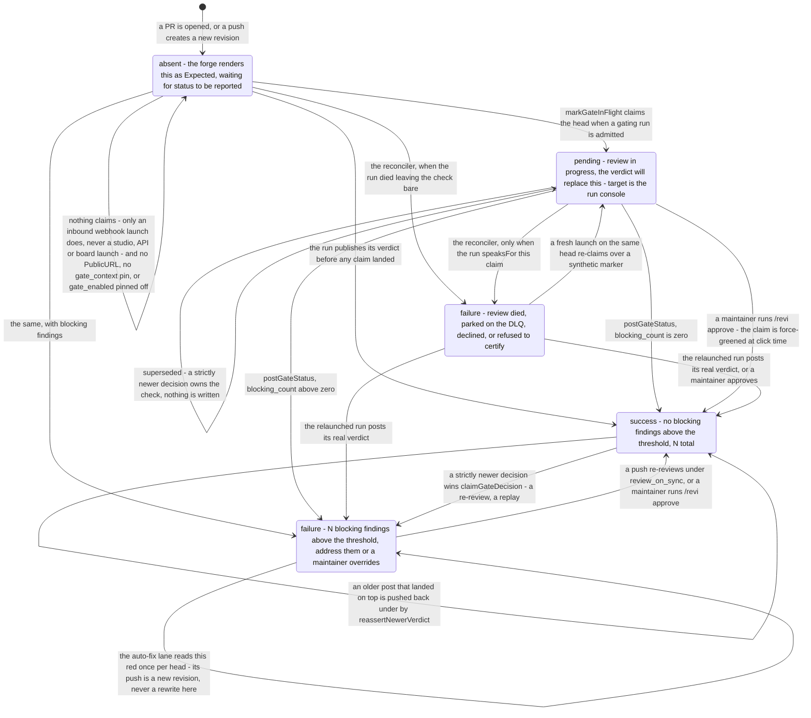
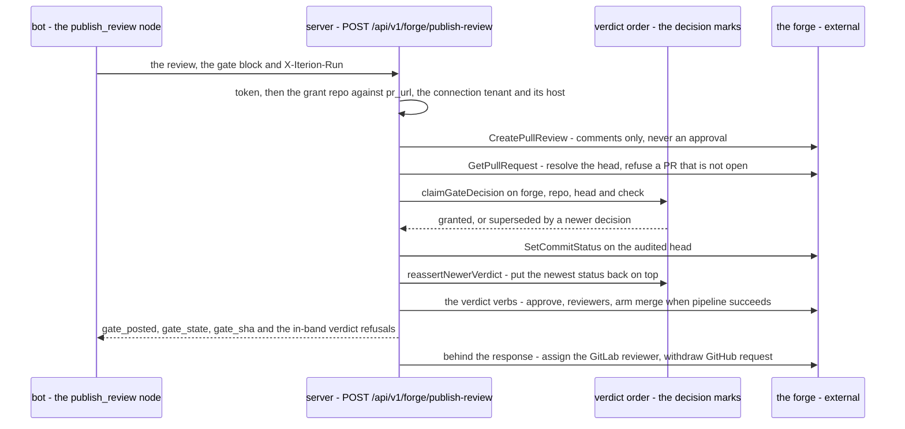

# The revi/review merge gate

A reviewer bot's findings are advice; what blocks a merge is a deterministic commit status on the pull request head, written by six writers of which four take the same verdict-order claim first.

> Drawn from the code at commit `f564846d3`. How the pages here are kept true: [README](README.md).

The check is named by the `gate_context` var — the repo's pin, else the gating bot's declared default (`revi/review` for Revi), and `merge-gate` when a gate payload names none; one shared value when several bots gate one branch. The bot computes a **count** of findings at or above `gate_severity` and the server maps it onto the status: `success` when the count is zero, `failure` otherwise. Everything else on this page exists so that the check on a given revision is never silent, never answered by a stale decision, and never green by omission.

## The check on one head SHA

Reading notes:

- **One head, one diagram.** A push is a *new* revision with its own `absent` start state, and the gate refuses to retarget a verdict whose `audited_sha` no longer matches the head. One exception: a **recorded refusal** answers the head the pull request is at *now*. The repair reads and writes that head, and posts a `failure` naming the refusal on a revision this run never reviewed — because the premise behind standing down, "the newer head has its own review", is exactly what a refused pin leaves unproven when `review_on_sync` is off.
- **A claim is not an answer.** `isGateInFlight` keeps the two apart: a guard reading "this head has a status, so someone answered" would silence the repair, and a guard reading every claim as unanswered would paint `review died` over a live review.
- **`failure` is two states, not one.** `isSyntheticGateInterruption` matches the reconciler's own descriptions; the auto-fix lane refuses to run on one, because there are no findings behind it.
- **Four of the six writers claim.** The publish endpoint, a deferred replay, `/revi approve` and the synthetic failure all take `claimGateDecision` on the forge, repo, head and check before writing; `reassertNewerVerdict` writes under the claim it already holds, and the launch's claim is a deliberately unguarded read-then-write — self-healing, because the verdict that follows it always claims the authority and lands on top.
- `forge.CommitStateError` is reserved: no writer here constructs one. It exists on the read side — `commitStateFromGitLab` maps a canceled or skipped job to it, and a non-empty state that is neither the claim nor a synthetic marker is read as a real verdict, so the repair stands down on it.

## The publish round trip

## Steps

| Actor | Action | Code |
|---|---|---|
| forge | Delivers a `pull_request` event; the URL id selects the tenant, then the token (non-HMAC providers only — the middleware never reads the body), `Enabled`, the per-webhook rate limit, the org's monthly quota and the team's `CanLaunch` | `webhookAuth` |
| server | Verifies the raw-body signature before any delivery row, then dispatches by event kind | `handleGitHubWebhook` |
| server | A closed or merged PR stops every run still bound to it and disarms their retries | `stopRunsForDeadPR` |
| server | Fork guard on the auto path: a head repo that is not the base, or withheld, never auto-launches | `forkGuardRefusal` |
| server | Resolves the push lane — `ReviewOnSync` and a synchronize action and an open-or-unknown state — then the hold-label veto over every auto-launch | `gateResync`, `suppressedByHoldLabel` |
| server | A dequeued PR with a healable reason dispatches the brancher and stands down from the gate: its revision rides `fix_head_sha`, never `head_sha` | `NeedsAutoHeal`, `autoHealMission` |
| server | Admits the event: reviewable (`opened`, `reopened`, `ready_for_review`, never a draft), or the resync, or a review re-request; the scope filters read the PR author | `IsReviewable`, `MatchProject`, `MatchAuthor` |
| server | Fans the delivery out to every bot rule claiming the event, one idempotency key per tenant, webhook, repo, PR, head SHA and bot | `resolveForgeEventBots` |
| server | Parks a synchronize launch for the quiet window; the sweeper re-reads the live config before firing it | `shouldDeferSyncLaunch`, `runWebhookDeferSweeper` |
| server | Mints the per-run publish grant — url, token, capabilities — plus the repo's launch policy; an untrusted workspace has every grant var deleted | `injectForgePublishVars` |
| server | Claims the repo's `gate_context` as `pending` on the run's `head_sha`, target = the run console | `markGateInFlight` |
| engine | Runs the review DAG: `diff_precheck`, `tier_expand`, the `topology` router, the `reviewer_*` nodes, `merge_reviews`, then the merge twin the launch's family picks (`converge`, or `converge_gpt` under `mono_family=gpt`), then `pr_gate` — which skips the publish when no `pr_url` was given | `bots/review-pr/main.bot` |
| bot | Counts findings at or above `gate_severity`; an unknown severity blocks; an unresolved diff scope or unparseable findings fail closed to one | `publish_review` |
| bot | POSTs the review and the gate block — context, count, threshold, totals, `audited_sha`, note — with the grant token | `publish_review` |
| server | Authenticates the token, re-enforces the grant's repo against the parsed `pr_url`, the connection's tenant and host; drops unanchorable comments instead of failing the batch | `handleForgePublishReview` |
| server | Posts the review as comments only — the review type carries no approval verb | `CreatePullReview`, `forge.NewReview` |
| server | Resolves the head, refuses a non-open PR or a stale or unreadable pin, claims the check for this decision, writes the status, re-asserts a newer verdict that landed under it | `postGateStatus`, `claimGateDecision`, `reassertNewerVerdict` |
| server | Executes the gating bot's verdict verbs on the head the gate just answered, each pinned to `audited_sha` | `applyPublishVerdict` |
| server | Records the verdict or the refusal on the grant, or parks a rate-limited one with a `RetryAt`; then, behind the response, assigns the GitLab reviewer and withdraws GitHub's pending request | `recordGateVerdict`, `recordGateRefusal`, `deferGateVerdict` |
| server | On the run's terminal event: settles what is answered, comments the pause or DLQ notice once, re-reads the live status on the head the PR is at now — the reviewed head, except after a recorded refusal — and decides ownership by the status target URL | `reconcileGateForRunID`, `gateRunTarget.speaksFor` |
| server | Posts the synthetic `failure` naming cause and remedy, its decision anchored at the run's `FinishedAt` clamped to now | `gateInterruptedDescriptionFor`, `gateDecisionAt` |
| server | Re-runs the same bot once per tenant, repo, PR, head and bot; a second death or a spent launch budget escalates to the board and comments the PR | `relaunchDeadGateRun`, `gateRelaunchIdemKey` |
| server | One elected replica re-offers terminal gating runs every 60 s over a 60-minute window, with a horizon-wide pass every 30th tick; settle marks skip what is answered | `runElectedGateSweeper`, `settleGateRun` |
| server | Replays a deferred verdict once its wait is over, at most twelve posts for one verdict | `replayGateDeferral`, `retireDeferredGrant` |
| server | Opt-in zero-touch lane: launches the fixer on a red non-synthetic status on the reviewed head, once per head and at most five times per PR | `autofixForRunID`, `maxAutofixAttemptsPerPR` |
| user | Comments `/revi approve` with a reason: force-greens the repo's pinned context through the same claim, decided at click time, launching no run | `handlePRForgeReviewApprove`, `postApproveGateStatus` |
| CI | A `merge_group` branch is not a pull request, so no review runs on it: a repo-owned job mirrors the PR head's verdict onto the queue SHA | `.github/workflows/merge-queue-gate.yml` |

## States

| State | Written by | Carries | Replaced by |
|---|---|---|---|
| `absent` | nobody | the forge's own "Expected" rendering — indistinguishable from a review that never launched, which is why the launch claims | any writer below |
| `pending` | the launch | the in-flight description and the run console URL | the run's own verdict; the reconciler, only when the dead run owns the claim |
| `success` | the publish endpoint, or `/revi approve` | the threshold and the total finding count, or `approved by @user` with the comment as target | a strictly newer decision only |
| `failure` (verdict) | the publish endpoint | the blocking count and the remedy; `gate.note` replaces the description when the count is not the real reason | a re-review, an approve, a newer decision |
| `failure` (synthetic) | the reconciler | `review died (reason)`, the DLQ resume line, the decline line, or `review refused to certify (reason)` | a real verdict, a fresh claim on the same head; never re-asserted over a landed verdict |
| `error` | nobody here | reserved by `forge.CommitState`; reached only when reading a canceled or skipped GitLab job back under this context | — |

Run-side marks are a **different** vocabulary: `settleGateRun` writes one `gateSettlement` per terminal episode — `merged`, `closed`, `head_moved`, `verdict_success`, `verdict_failure`, `unpinned`, `superseded`, `refused` — beside the publish grant, not on the forge. They only decide whether the sweep re-offers a run; `closed`, `head_moved` and `refused` are reversible and lapse after six hours, the rest live one hour past the run's horizon.

## Guards that refuse

- **Delivery** — unknown id or bad token: `401 invalid webhook`; disabled: `410`; over the rate or the monthly quota: `429`; vanished tenant: `403 tenant no longer exists`; suspended org: `403 org suspended`. A bad body signature is refused before any delivery row exists.
- **Admission** — a fork or unproven head, a draft, an out-of-scope project or author, a hold label, no bot rule claiming the event: a filtered `200`, and the delivery row says why. Only a `/command` is exempt from the hold label, never the fork guard.
- **Publish** — missing header: `401`; unknown or expired token: `401`; a `pr_url` outside the grant's repo: `403`; a malformed verdict block, an empty review, a `pr_url` off the connection's host: `400`; a provider with no review client: `501`; a failed review still posts the gate, then answers `502`.
- **Gate status** — a PR that is not open: no status on a head that left the merge decision; an `audited_sha` that is not 7-40 hex, or that no longer equals the head: refused and recorded as a `gateRefusal` on the grant; an absent pin still posts and reports `gate_sha_unpinned`; a lost `claimGateDecision`: `superseded`, nothing written; `SetCommitStatus` refused for insufficient scope: `gate_error`, the review stands as advice.
- **Verdict verbs** — no enabled gate, a gate that did not post, a PR no longer open, a head that moved, `mode: dry_run`, a capability the grant was not minted with: each an in-band `Refused`. On a **red** check, approve and arming are skipped and only the reviewer escalation runs; an approval that was requested and failed skips the arming.
- **Repair** — a paused run or one awaiting an armed retry: no synthetic failure; a grant that is not the run's own: a loud tenant refusal; no `gate_context` pinned, or `gate_enabled` pinned off: the run owes nothing; a run naming no reviewed revision: settled `unpinned`; statuses this provider cannot list: abstain, because a writer that cannot read must not write.
- **Auto-fix** — the integration flag off, the context not pinned or not the run's, a moved head, a closed PR, a fork, a synthetic failure, the fixer being the run's own bot, a hold label that cannot be ruled out, five attempts spent: no launch.
- **Approve** — below the maintainer floor (a webhook's `MinReplierRole` may only raise it, and the replier allowlist is deliberately nulled here), the bot's own comment, the PR's own author, a review bot not enabled on the webhook, a `gate_context` that resolves nowhere (the repo's pin, then the webhook's manifest union, then the gating bot's declared default — `revi/review` for Revi, so an unpinned repo still force-greens the check Revi itself posts under): refused; no connection and no `forge_token` binding, or an installation withholding `statuses:write`: refused with the grant to approve named.

## Collections touched

| Collection | Role in this flow |
|---|---|
| `webhook_configs` | the tenant selector and the policy: token hash, `Enabled`, rate limit, bot rules, author and project allowlists, hold labels, `ReviewOnSync` and its operator pin |
| `webhook_deliveries` | the idempotency and retry ledger of every lane — launch, deferred launch, relaunch, auto-fix, approve — with the terminal status it ended on |
| `webhook_deferred_launches` | a synchronize launch parked for the debounce window |
| `webhook_quotas` | the per-org monthly and per-webhook call counters |
| `repo_integrations` | the repo's pinned launch vars (`gate_context`, `gate_enabled`, review tier) and `AutoFixOnGateFailure` |
| `forge_connections` | the team connection the status and the review are written through, re-checked for tenant and host at every writer |
| `runs` | the run inputs the repair reads back — `pr_url`, `head_sha`, `gate_context`, the grant token — and `FailureCode` / `FinishedAt` |
| `bot_sources` | the team-authored bot row the gate context and the fixer role are resolved from |
| `leases` | the `merge-gate-sweeper` election, one replica at a time |
| `teams` | `CanLaunch` on the inbound path |
| `audit_events` | the grant refusals and every mutating verdict verb |

Not Mongo: the verdict-order marks, the settle marks and the publish grants live in Valkey when the deployment has it and in memory otherwise, under `iterion:gate:decision:`, `iterion:gate:settled:` and `iterion:forgepub:tok:`. A lost **settle** mark costs one re-read, never a wrong answer. A lost **verdict-order** mark costs the ordering — no store, an unreadable mark or a full in-memory table can grant a post — so a verdict decided earlier can land over a newer one: a stale green on a required check.

## Related

- [merge-gate.md](../merge-gate.md) — the feature page: the determinism doctrine, the bot vars, review tiers, merge queues and auto-heal, one gate across several bots, overriding a finding, the in-flight claim and the interrupted-review repair.
- [revi-billy-loop.md](../revi-billy-loop.md) and [forge-conversations.md](../forge-conversations.md) — the fixer habit this gate feeds, and the non-blocking questions channel beside it.
- [adr/118-merge-gate-settle-marks-and-verdict-attribution.md](../adr/118-merge-gate-settle-marks-and-verdict-attribution.md), [adr/124-gating-bot-merge-gestures.md](../adr/124-gating-bot-merge-gestures.md), [adr/101-review-request-withdrawal-after-publish.md](../adr/101-review-request-withdrawal-after-publish.md) — the marks, the verdict verbs, the withdrawal.
- [data-model-forge-bots.md](data-model-forge-bots.md) — the webhook, integration and connection documents; [data-model-runs.md](data-model-runs.md) — the run and its status machine; [data-model-identity.md](data-model-identity.md) — teams and the audit trail.
- [flow-webhook-to-run.md](flow-webhook-to-run.md) — the shared admission ladder and launch tail this flow enters through, drawn there once; the step rows above repeat only what the gate depends on.
- [access-control.md](access-control.md) — the per-run forge publish grant as one of the twelve principal kinds.

