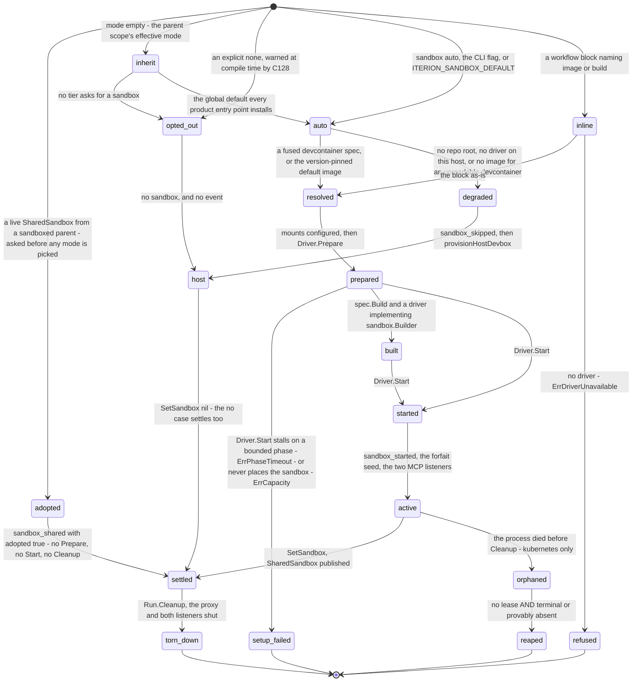

# Flow — sandbox isolation

A four-tier precedence picks one of four sandbox modes, a host-kind factory picks a driver, and then the mode alone decides what an absent container runtime means: auto degrades to the host with a visible event, inline refuses with a typed failure.

> Drawn from the code at commit `f564846d3`. How this page is kept true: [README](README.md).

## Resolution and boot

```mermaid
flowchart TD
    ENTRY["a product entry point installs the global default - ResolveGlobalSandboxDefault returns ITERION_SANDBOX_DEFAULT when set, else auto"]
    PF{"iterion run ONLY - ITERION_SANDBOX_PREFLIGHT set to 1, true, yes or on - the strict battery, each probe capped by ITERION_SANDBOX_DOCTOR_TIMEOUT"}
    ADM{"Engine.Run calls admitRun - after the run document exists, before workspace setup and any model call"}
    UNTRUST{"refuseUntrustedWithoutSandbox asks RunWillBeSandboxed, which walks this same chain"}
    ADOPT{"Engine.startSandbox asks for a live SharedSandbox from a sandboxed parent - BEFORE any precedence walk"}
    MODE{"pickMode - the CLI flag or ITERION_SANDBOX_OVERRIDE, then the workflow sandbox block, then ITERION_SANDBOX_DEFAULT, then the built-in auto"}
    AUTO{"mode auto - devcontainer.ReadFromRepo at the repo root"}
    DRIVER{"selectSandboxDriver - Factory.DriverForSpec over this host's preference order"}
    POLICY{"the MODE decides, never the tier that named it"}
    DEGRADE["sandbox_skipped on the run's own stream, then nil, nil"]
    HOST["the run executes on the host - provisionHostDevbox installs the bot's and repo's devbox.json there and prepends an iterion shim to PATH"]
    MOUNTS["every mount configured BEFORE Prepare - attachments, run-files, bundle, scratch, claw binary, worktree git dir, file secrets, and the host_state binds - the iterion home, ~/.claude, ~/.claude.json, ~/.codex, ~/.gitconfig and five tool caches, every one read-write at its own host path"]
    FINAL["finalizeMountsForDriver drops the host binds this driver cannot honour and WITHDRAWS the variables they promised"]
    PROXY["startNetworkProxy - compile the egress policy, mint the per-run bearer token, bind at the DRIVER's address - nothing starts at all when the policy is open and no secret rewriter asks for inspection"]
    PREP{"Driver.Prepare - Spec.Validate and the Mode.IsValid it calls, the driver's own ValidateSpec, the image pull"}
    START["Driver.Start - one long-lived container per run, PID 1 sleep infinity, HostGatewayAlias settled at container creation"]
    SETTLE["settled - the forfait config dirs seeded, the board and ask-user MCP listeners bound, SetSandbox, SharedSandbox published"]

    ENTRY --> PF
    PF -->|"a check fails"| XPF["the launch aborts before the engine boots"]
    PF -->|"off by default, or every check passes"| ADM
    ADM -->|"run.Trust is not trusted"| UNTRUST
    UNTRUST -->|"no container resolves"| XADM["admission denied, code untrusted_without_sandbox - the fork's agent never executes in the runner's trust domain"]
    UNTRUST -->|"a container resolves"| ADOPT
    ADM -->|"trusted"| ADOPT
    ADOPT -->|"adopt - the rule for a subbot child that declares no sandbox of its own"| SHARED["adoptSharedSandbox - the parent's handle, sandbox_shared with adopted true, no Prepare and no Start"]
    ADOPT -->|"no live parent sandbox, or a child declaration honoured on a bind-mount parent"| MODE
    ADOPT -->|"shouldAdoptSharedSandbox refuses - a declaration, or a pausable child, under a copy-based parent"| XADOPT["the sandbox boot fails"]
    MODE -->|"none or empty - non-overridable opt-out"| OFF["no sandbox, and no event"]
    MODE -->|"auto"| AUTO
    MODE -->|"inline - requires a workflow block, else a hard error"| INLINE["the block as-is, host-side variables expanded"]
    AUTO -->|"found"| FUSE["fuseDevcontainerSpec - the repo file wins on image, build, mounts, user, post_create and workspace_folder - the mounts it wins are screened at Driver.Start, not trusted"]
    AUTO -->|"ErrNotFound, or unusable - a parse error or refused runArgs - with a default image"| DEFIMG["the version-pinned published image, the reason carried in source"]
    AUTO -->|"no repo root, or an unreadable devcontainer and no default image"| DEGRADE
    AUTO -->|"ErrNotFound and no default image - embedders only, every product entry point resolves one"| XSPEC["a hard error, the boot fails - no event, no degrade"]
    FUSE --> DRIVER
    DEFIMG --> DRIVER
    INLINE --> DRIVER
    DRIVER -->|"docker then podman on local and desktop, kubernetes in cloud"| MOUNTS
    DRIVER -->|"the selection falls through to noop - ErrDriverUnavailable"| POLICY
    POLICY -->|"mode auto - isolate if you can"| DEGRADE
    POLICY -->|"mode inline - the refusal IS the guarantee"| REFUSE["RuntimeError SANDBOX_DRIVER_UNAVAILABLE - the run parks, retrypolicy classes it Deterministic, failure_code persisted"]
    MOUNTS --> DEVBOX["applyDevboxProvisioning appends devbox install to post_create and prepends the profile bins to PATH - gated on SupportsPostCreate"]
    DEVBOX --> FINAL
    FINAL --> PROXY
    PROXY --> PREP
    PREP -->|"refused or the pull fails"| XPREP["the proxy is shut down and the boot fails"]
    PREP --> START
    START -->|"a bounded setup phase stalls - ErrPhaseTimeout - or the sandbox is never placed - ErrCapacity"| XSETUP["failed_resumable, SANDBOX_SETUP_TIMEOUT or SANDBOX_CAPACITY - classed Infrastructure, so the runner NAKs for redelivery"]
    START --> SETTLE
    OFF --> HOST
    DEGRADE --> HOST
```

Reading notes:

- **The mode decides, the source only labels.** `sandboxDefaultSource` rides the `sandbox_skipped` event so an operator reads which knob spoke, and nothing keys behaviour on it: keying it on the source is what made one host condition answer two different ways depending on where the word `auto` was written.
- **`--sandbox=auto` is the one tier that yields.** A workflow block already naming `image:` or `build:` is the more specific expression of the same intent, so it wins over the flag. `none` from the CLI wins everywhere.
- **The proxy precedes `Prepare`, not the reverse.** Its endpoint and CA ride `sandbox.RunInfo` into `Start` and `Builder.Build` — `Prepare` takes the spec alone — and the proxy is listening before `Prepare` runs, so a `Prepare` failure shuts down a proxy that is already up. The bind pair is the driver's: `0.0.0.0:0` advertised as `host.docker.internal` on docker and as the runner pod's IP on kubernetes, `127.0.0.1:0` only for a driver with no `ProxyConfigurer`.
- **`sandboxSettled` is set in both outcomes.** A guard that must fail closed while the question is open hears the answer even when it is "no", and `attachmentsContainerDir` stops being a forecast.

## The sandbox a run gets

| State | What it means | Code |
|---|---|---|
| `inherit` | `Mode` is the empty string: the parent scope's effective mode. A node-level declaration is **not** a scope here — `pickMode` reads the workflow's block only | `sandbox.ModeInherit`, `pickMode` |
| `opted_out` | `sandbox: none`, `--sandbox none` or `ITERION_SANDBOX_DEFAULT=none` — non-overridable, and silent by design | `sandbox.ModeNone`, `validateSandboxOptOut` |
| `auto` / `inline` | The two active modes: `IsActive` is what every caller keys on, and the only two that reach driver selection | `Mode.IsActive`, `resolveSandboxSpecWithFallback` |
| `degraded` | Terminal for the feature: `sandbox_skipped` carries mode, source, the obstacle and `file_secrets_dropped`, then the run proceeds unsandboxed | `autoDegradePayload`, `EventSandboxSkipped` |
| `adopted` | A subbot child handed its parent's live sandbox executes in it: the parent owns Prepare, Start and Cleanup, and the child only scopes its own devbox project | `shouldAdoptSharedSandbox`, `adoptSharedSandbox` |
| `setup_failed` | Terminal for the attempt, not for the run: `failed_resumable` with `SANDBOX_SETUP_TIMEOUT` or `SANDBOX_CAPACITY`, both classed `DispositionInfrastructure`, so the runner NAKs and a healthy pod re-runs it | `setupFailureStatus`, `sandbox.ErrPhaseTimeout`, `sandbox.ErrCapacity` |
| `refused` | Terminal: the typed code the schedule's `last_run_error_code` and the studio's failure row read; the event carries `refused: true` first | `ErrCodeSandboxDriverUnavailable`, `store.FailureSandboxDriverUnavailable` |
| `prepared` / `built` / `started` | Driver-side: validate and pull, optionally `docker buildx build`, then one container whose later nodes are execs | `Driver.Prepare`, `buildSandboxImageIfRequested`, `Driver.Start` |
| `settled` | `sandboxSettled` is true in both the yes and the no case; `${PROJECT_DIR}` is remapped and a `SharedSandbox` is published for subbot children | `Engine.startSandbox`, `SharedSandbox` |
| `orphaned` / `reaped` | `Run.Cleanup` only fires on a graceful exit, so a sibling runner collects labelled pods, Secrets and NetworkPolicies liveness-first | `runSandboxReaper`, `ReapOrphanResources` |

## Steps

| # | Actor | Action | Code |
|---|---|---|---|
| 1 | user | A product entry point installs the global default on the engine; an engine built without it stays neutral and runs unsandboxed workflows unsandboxed | `ResolveGlobalSandboxDefault`, `WithSandboxDefault` |
| 2 | user | Opt-in strict pre-flight on the exact resolved spec — driver availability, `Spec.Validate`, docker daemon, image resolvability without a pull, k8s context and compatibility, allowlist syntax — the same battery `iterion sandbox doctor --strict` prints. `iterion run` is its only caller: a resume, the runner and the server never run it, so the gate aborts nothing in cloud | `sandboxPreflightEnabled`, `PreflightSandbox`, `buildStrictReport` |
| 3 | engine | The single admission gate, before workspace setup and any model call; the verdict is persisted on the run | `Engine.Run`, `admitRun`, `persistAdmission` |
| 4 | engine | A fork-lane run is asked the one sandbox question its own boot will ask, and refused when the answer is "no container" | `refuseUntrustedWithoutSandbox`, `RunWillBeSandboxed`, `admissionRepoRoot` |
| 5 | engine | Assemble the params: attachments dir, the per-run artifact-files dir, the bundle dir, the worktree git dir, the project env overlay, the resolved secret vars, the driver seam, the board MCP handler | `Engine.startSandbox`, `SandboxParams`, `EnsureRunFilesDir` |
| 6 | engine | Walk the precedence chain and label the source | `pickMode`, `sandboxDefaultSource` |
| 7 | engine | `auto` reads the repo's devcontainer and fuses it with the workflow block — workflow env keys win per key, the repo file wins on the container fields, the deny class strips repo env keys and the operator's overlay is merged over the result | `devcontainer.ReadFromRepo`, `fuseDevcontainerSpec`, `mergeEnvironmentOverlay` |
| 8 | engine | An inactive resolved mode ends the path: silent for an explicit opt-out, `sandbox_skipped` for a degraded `auto` | `resolveAndStartSandbox`, `autoDegradePayload`, `workflowHasFileSecrets` |
| 9 | engine | Select the driver: host kind from `ITERION_MODE`, `KUBERNETES_SERVICE_HOST` or the desktop binary, then that host's order; docker and kubernetes are wrapped with the run logger so their commands land in the run log | `selectSandboxDriver`, `Factory.DriverForSpec`, `preferenceOrder`, `detectHost` |
| 10 | engine | The one place the degrade-vs-refuse policy lives | `resolveAndStartSandbox`, `EventSandboxSkipped`, `ErrCodeSandboxDriverUnavailable` |
| 11 | engine | Configure every mount before `Prepare`; the capability decides which are even possible — no host bind means no bundle declaration and no shared state dir. `host_state: auto`, the default, binds the iterion home, `~/.claude`, `~/.claude.json`, `~/.codex`, `~/.gitconfig` and the Go, npm, pnpm and yarn caches read-write at their own absolute paths, under a uid-owned tmpfs `HOME`; a candidate nested in the workspace bind, one that contains it, or one missing on the host is skipped. `host_state: none` suppresses all of it including the scratch, and passes the host's git identity as four env vars instead | `applyHostStateMounts`, `collectHostStateMounts`, `pickHostState`, `seedGitIdentityEnv`, `applyScratchMount`, `addClawBinaryMount`, `addWorktreeGitMount` |
| 12 | engine | Devbox tooling: the repo's `devbox.json` then the bundle's appended to post_create, their profile bins prepended to PATH, and a source deliberately not installed reported rather than dropped | `applyDevboxProvisioning`, `resolveDevboxProjects`, `addDevboxSkips` |
| 13 | engine | Drop every host bind the driver cannot honour — the bot's own `sandbox.mounts:` as well as the runtime's — and withdraw the variables those binds promised | `finalizeMountsForDriver`, `dropUnsupportedHostBinds` |
| 14 | engine | `as: file` secrets and the resolved Claude or ChatGPT forfait files become per-run secret-file mounts, and their config-dir paths are exported on the container env before the container starts | `addSecretFileMounts`, `addClaudeOAuthSecretFile`, `addCodexOAuthSecretFile`, `exportForfaitConfigDirs` |
| 15 | engine | Bind the host-side CONNECT proxy at the driver's address with a per-run bearer token, minting an ephemeral CA when secret-egress rewriting asks for TLS inspection — and start nothing, minting no token and binding no port, when the policy is open and no rewriter asks, which a workflow naming no `network:` block makes the default; a spec fused from a repo devcontainer is the path that differs, defaulted upstream to the `iterion-default` allowlist | `startNetworkProxy`, `ResolveNetworkPolicy`, `proxyAddressesForDriver`, `netproxy.NewEphemeralCA` |
| 16 | provider | Validate and do the slow IO, then optionally build, then launch one long-lived container whose PID 1 is `sleep infinity` | `Driver.Prepare`, `buildSandboxImageIfRequested`, `Driver.Start`, `emitSandboxStarted` |
| 17 | engine | Copy the read-only forfait mount into the writable config dir the delegate points sandboxed CLI spawns at; a failed seed shuts the sandbox down rather than resurfacing as an auth failure hours in | `seedClaudeConfigDir`, `seedCodexConfigDir` |
| 18 | engine | Bind the two per-run MCP listeners on the driver's gateway: the board transport, and the ask-user transport behind a freshly minted token. Their intents are decided before `Driver.Start`, because the alias must exist at container creation | `startSandboxMCPListener`, `workflowHasHostCapability`, `workflowHasInteractiveNode`, `askusermcp.NewRunToken` |
| 19 | engine | Settle: push the handle into the executor, remap `${PROJECT_DIR}`, publish a `SharedSandbox` a subbot child adopts — or, with no sandbox, provision devbox on the host | `Engine.startSandbox`, `SetSandbox`, `shouldAdoptSharedSandbox`, `provisionHostDevbox` |
| 20 | engine | A claw node under an active sandbox execs the hidden in-container runner and speaks NDJSON envelopes; placement splits filesystem and process tools from the launcher-held ones | `ClawBackend.executeViaSandboxRunner`, `iterion __claw-runner`, `SandboxPlacementOf` |
| 21 | runner | Teardown best-effort, and because `Cleanup` only fires on a graceful exit, a sibling runner reaps orphaned kubernetes resources at boot and on a ticker | `activeSandbox.shutdown`, `runSandboxReaper`, `sandboxResourceReapable` |

## Guards that refuse

- **`refuseUntrustedWithoutSandbox`** → admission `denied`, code `untrusted_without_sandbox`, returned as `store.FailureLaunchFailed`: a run whose `Trust` is not the trusted default and whose sandbox resolves to no container. The reason names the tier that spoke, so the operator reads which knob decided.
- **`Factory.DriverForSpec`** → `sandbox.ErrDriverUnavailable`: an active mode may not fall through to the `noop` passthrough driver. It is a capability report and never a policy — `iterion sandbox doctor --strict` and the pre-flight read the same answer.
- **`resolveAndStartSandbox`** → `ErrCodeSandboxDriverUnavailable` / `store.FailureSandboxDriverUnavailable` for `inline`; `auto` is not refused here, it degrades.
- **`docker.validateMount`** (inside `Driver.Start`, and `ValidateSpecMounts` on the doctor path) → refuses a `type=bind` whose source is a sensitive host path — the docker or podman socket, `/proc`, `/sys`, `/root`, `/boot`, `/etc/shadow` and `/etc/sudoers`, any `.ssh`, `.aws`, `.gnupg`, `.kube`, `.docker`, `.gcloud`, `.azure`, `.npmrc` or `.pypirc` component — a spec carrying a control character, or one beginning with `-`. The mounts an `auto` run inherits from the repository's devcontainer are screened here, not trusted: the working tree at run time may be a checked-out PR. In `Builder.Build`, `validateContainsWorkspace` refuses a `build:` context or Dockerfile resolving outside the workspace for the same reason.
- **`kubernetes.ValidateSpec`** → refuses `build:` (local-only, pin a pre-built image), a missing `image:`, `host_state: auto` (no host filesystem in a pod) and a non-numeric `user` (the driver enforces `runAsNonRoot`). A **missing** `user` is not refused on the engine path: `Driver.Prepare` defaults it to `1000:1000` — the uid every published `iterion-sandbox-*` image runs as — before it validates. Only the doctor and the pre-flight, which call `ValidateSpec` on the resolved spec themselves, fail a cloud workflow that names none.
- **the noop file-secret gate** → a hard error: file secrets require a real driver, because the mount **is** their delivery channel.
- **`tool.SandboxPlacementOf`** → `PlacementRefused` for an unclassified tool name, because the engine cannot promise it stays in the container; an MCP-family name is `PlacementLauncher` and is proxied back over `tool_call` envelopes.
- **the claw runner's bootstrap** → fatal before any model call on a `permission_policy` envelope that will not decode, and on a gateway task arriving without the gateway capability marker.
- **`shouldAdoptSharedSandbox`** → typed refusals: a child declaring a sandbox of its own under a copy-based parent, and a pausable child under a copy-based parent or one whose scratch lives in the container.
- **`compileSandboxBlock` (C044 `DiagInvalidSandboxMode`), `validateSandboxOptOut` (C128), `DiagGatedCLIBackendSandbox` (C136)** → compile-time: a mode that is none of `""`, `none`, `auto` and `inline` — a network mode written on the `sandbox:` block gets its own message, that being the one name the two blocks share — every explicit `sandbox: none` (a node-level one flagged as **not honoured**), and a gated route needing a host-side run on a workflow that does not opt out. `Mode.IsValid` is not this guard: its one caller is `Spec.Validate`, inside `Driver.Prepare`.
- **`sandboxResourceReapable`** → fails safe, and the unknowns matter more than the knowns: a lease held or a lease check that errored, a transient store error, a `running` or `paused` status all **keep** the resource; only no lease plus a terminal status or `store.RunAbsent` reaps. The whole reaper is off under `ITERION_SANDBOX_OVERRIDE=none` — the runner is then itself the boundary and spawns no sibling pod.
- **`PreflightSandbox`** → `UserInputError` on any failed check when `ITERION_SANDBOX_PREFLIGHT` is `1`, `true`, `yes` or `on`; warnings are logged only. `iterion run` is its only call site, so a cloud run aborts on nothing it would have caught.

## Collections touched

| Collection | What this flow does to it |
|---|---|
| `runs` | The admission decision is persisted under the run's CAS contract before a refusal returns, so the run record explains itself; an `inline` refusal stamps `failure_code` with `SANDBOX_DRIVER_UNAVAILABLE` (`failed`, `DispositionDeterministic` — a parked run), while a stalled setup phase stamps `SANDBOX_SETUP_TIMEOUT` and an unplaced sandbox `SANDBOX_CAPACITY` (`failed_resumable`, `DispositionInfrastructure` — redelivered, not parked) |
| `events` | The feature's whole audit surface: `sandbox_skipped` (degrade, **and** refusal with `refused: true`), `sandbox_started`, `sandbox_shared`, `sandbox_host_state_mounted`, `sandbox_user_remap`, `sandbox_uid_mismatch_warning`, `sandbox_devbox_provisioned`, `sandbox_env_denied`, `sandbox_network_defaulted`, `sandbox_claw_routed_via_runner`, the `sandbox_build_*` triple, `sandbox_scratch_banked` / `_restored`, `sandbox_workspace_export_failed`, and `network_blocked` per refused host |
| `run_logs` | In cloud, the run logger is teed into the store, so `docker run`, `kubectl apply`, post-create output and the `sandbox active` line are readable after the fact — which is why the driver is wrapped with the run logger at selection |

## Related

- [sandbox.md](../sandbox.md) — the feature in prose. It covers the two guarantees, the setup phases and their timeouts, the workspace and host-state mounts, the network policy, the full configuration surface and precedence, the default image variants, the claw-runner IPC, the MCP-origin table, the cloud section and troubleshooting
- [data-model-runs.md](data-model-runs.md) — the ER of `runs`, `events` and `run_logs`; [access-control.md](access-control.md) for the launch and run-surface gates named above
- [adr/082-sandbox-by-default.md](../adr/082-sandbox-by-default.md) · [adr/031-sandbox-one-long-lived-sleep-infinity-container-per-run.md](../adr/031-sandbox-one-long-lived-sleep-infinity-container-per-run.md) · [adr/030-sandbox-network-proxy-binds-all-interfaces-not-loopback.md](../adr/030-sandbox-network-proxy-binds-all-interfaces-not-loopback.md) · [adr/029-sandboxed-claw-via-hidden-claw-runner-ndjson-ipc.md](../adr/029-sandboxed-claw-via-hidden-claw-runner-ndjson-ipc.md) · [adr/070-kubernetes-sandbox-orphan-gc.md](../adr/070-kubernetes-sandbox-orphan-gc.md) · [adr/006-sandbox-strict-doctor.md](../adr/006-sandbox-strict-doctor.md)

