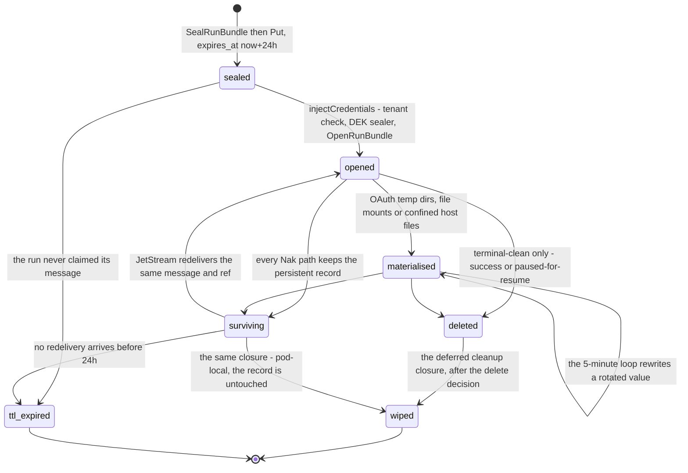

# Flow — the sealed credentials bundle

A cloud run's credentials travel in two halves that never share a channel: the sealed bundle waits in Mongo under a random ref, and the only key that opens it rides the run's own queue message.

> Drawn from the code at commit `f564846d3`; how this page is kept true: [README](README.md).

## The exchange

The sequence is drawn on the page that owns the bundle: [Cloud architecture → Sealed credentials bundle lifecycle](../cloud-architecture.md#sealed-credentials-bundle-lifecycle).

Reading notes:

- **The two channels are the feature.** Mongo holds the ciphertext, the queue message holds the 32-byte DEK; neither alone opens a bundle, and the runner process boots with `SealerOptional` — no platform key is needed to open a current (`dek`) bundle.
- **The binding is cryptographic, not just a field check.** `RunBundleAAD` is `run_secrets:<tenant>/<pool>/<run>`, so a record served under another identity cannot open even when the `rec.TenantID == msg.TenantID` comparison is satisfied. The run-only AAD is `legacyRunBundleAAD`, reserved for id-less records.
- **A resume re-resolves and re-seals.** `SubmitResume` mints a fresh bundle, ref and DEK rather than re-publishing the old ref; the previous record is dropped on the paused run's clean exit, and the TTL covers the rest.
- **No bundle is a legitimate state.** An empty `SecretsRef` proceeds credential-less (the runner falls back to pod env); the publisher also produces no bundle at all when the run has neither an LLM credential nor a generic secret, when the store or sealer is unwired, or when the tenant id is empty.
- **Local mode is the same pipeline** over a file-backed sealed store: `ResolveLocalCredentials` stamps the same `secrets.Credentials` with no queue and no DEK.

## Steps

| # | Actor | Action | Code |
|---|---|---|---|
| 1 | team admin | Create a generic secret: seal the value under AAD `generic_secret:<id>`, stamp last4 + fingerprint, land the row in the team it is created **for** | `handleCreateGenericSecret`, `SealGenericSecret`, `teamTenantCtx` |
| 2 | team admin | Bind that secret to one bot under the workflow's declared name, optionally narrowing `allowed_hosts` | `handleCreateBotBinding`, `validateBindingSecret`, `teamPathTenantCtx` |
| 3 | forge | The managed-token path: mint the forge token, seal it with its own egress lock, ensure a binding per enabled bot; a GitHub App installation token is re-minted narrowed to the repo set and stamped with a fresh `ForgeTokenProof` | `forge.Orchestrator.ensureManagedSecret`, `narrowGitHubAppSecret`, `ensureBotBinding` |
| 4 | server | Launch admitted, then the publisher resolves: the team's `llm_fallback` policy read fresh, empty `RunBundle` maps, `audienceBotID` folded for the BYOK audience only | `runs_launch.go`, `resolveAndSealCredentials`, `llmFallbackForTeam`, `botregistry.NormalizeName` |
| 5 | server | Generic tier trust gate: an untrusted workspace resolves no workflow secret, because this tier is what writes a forge token into a tree the PR author wrote | `credentialTierGeneric` branch, `store.RunTrust.Trusted` |
| 6 | store | Four-tier resolution per declared name; a binding-sourced value carries `IntersectHosts(secret lock, binding hosts)` | `ResolveGenericWithBindings`, `buildGenericResolution`, `IntersectHosts` |
| 7 | server | Required-secret gate: every non-`optional` declared secret must hold a non-empty plaintext, before the run document is saved | `requiredSecretNamesForWorkflow`, `UnresolvedRequired`, `RequiredSecretsError` |
| 8 | server | Fill the bundle: plaintext, the narrowed host list, and the store **id** per name — ids only, so the runner can re-read mid-run | `RunBundle.GenericSecrets`, `GenericSecretHosts`, `GenericSecretRefs` |
| 9 | server | Detached, tenant-scoped, 5 s: bump `last_used_at` on every secret the bundle drew on | `goSafeDetached`, `MongoGenericSecretStore.MarkUsed` |
| 10 | server | Mint a fresh per-run DEK, seal the JSON bundle under the full-identity AAD, stamp `key_id` `dek` | `NewRunBundleDEK`, `NewAESGCMSealer`, `SealRunBundle` |
| 11 | store | Persist the record under a random UUID ref with `expires_at = now + 24h` | `NewSecretsRef`, `RunSecretsRecord`, `MongoRunSecretsStore.Put` |
| 12 | server | Save the run (credential fingerprints and tiers stamped), then publish the message with both `SecretsRef` and `BundleDEK` | `store.SaveRun`, `queue.RunMessage`, `SchemaVersion` |
| 13 | runner | Consume: decode and gate the schema version before anything touches the workflow | `decodeOrTerm`, `RunMessage.Validate`, `handleSchemaMismatch` |
| 14 | runner | Fetch the record by ref under the run's tenant ctx, then compare tenants | `injectCredentials`, `store.WithIdentity`, `MongoRunSecretsStore.Get` |
| 15 | runner | Build the per-run sealer from the message key, open the bundle, derive the audit fingerprint map, stamp the ctx | `secrets.DEKKeyID`, `OpenRunBundle`, `secrets.WithCredentials` |
| 16 | runner | Materialise what must exist as a file: OAuth blobs in 0700/0600 temp dirs; `as: file` secrets as sandbox mounts or confined 0600 host files | `materializeOAuthCredentials`, `addSecretFileMounts`, `materializeFileSecretsNoSandbox` |
| 17 | runner | Mid-run freshness: re-read each `GenericRefs` record every 5 minutes and rewrite the file, or push it through the driver | `refreshFileSecretsLoop`, `refreshSandboxFileSecretsLoop`, `sandbox.SecretFileRefresher` |
| 18 | sandbox | Egress: a placeholder is substituted only toward a permitted host, and a real value leaving toward any other is blocked | `effectiveSecretHosts`, `secretguard.Guard.ExfiltratesTo`, `Guard.MaterializeForHostWithin` |
| 19 | runner | Delete the record on a terminal-clean outcome, then wipe the plaintext — the wipe is the deferred closure, so it runs last on every return | `deleteRunSecrets`, the deferred `cleanup` closure |

## The record's own lifecycle

| State | What it means | Code |
|---|---|---|
| `sealed` | Ciphertext in `run_secrets` under a random ref, `key_id` `dek`, 24 h expiry; the key exists only on the publisher and the message | `resolveAndSealCredentials`, `RunSecretsRecord` |
| `opened` | The bundle is plaintext in the runner's memory and on the run ctx | `injectCredentials`, `secrets.WithCredentials` |
| `materialised` | Values also exist as files: OAuth config dirs, `as: file` mounts, the clone's git credential | `materializeOAuthCredentials`, `addSecretFileMounts`, `materializeFileSecretsNoSandbox` |
| `wiped` | Local hygiene: keys and generic values zeroed, temp dirs removed — the persistent record is untouched. Registered as a `defer` before the body runs, so it fires **after** the delete decision | the `cleanup` closure of `injectCredentials` |
| `deleted` | Removed from the store, detached with a 5 s timeout, on a clean or paused outcome only | `deleteRunSecrets`, called once in the body of `executeRun` |
| `surviving` | Kept on purpose so a redelivery of the same message re-opens the same ref | the `runErr == nil \|\| ErrRunPaused` condition at the delete site |
| `ttl_expired` | Reaped by the `run_secrets_ttl` index on `expires_at`; a resume re-resolves and re-seals | `DefaultRunSecretsTTL`, `MongoRunSecretsStore.EnsureSchema` |

Three key schemes read, one writes: `dek` (per-run key, full AAD) is all the publisher produces; an empty `key_id` opens through the ring with the legacy run-only AAD, and a ring id through `KeyedSealer.OpenWith` — the 24 h TTL retires both older cohorts.

## Guards that refuse

- **`canManageTeam`** → 403 `admin or owner required` on creating a team secret and on every binding mutation; **`canViewTeam`** → 403 `not a member` on the lists. `canMutateGenericSecret` adds the per-record rule: a user-scoped record only for its owner, a team-scoped one under the create right, a super-admin always.
- **Request shape** → 400 `name + secret required` (`validGenericSecretName`, empty value), 400 `no active team` on `/api/me/secrets` without an active team, 400 `secret_id is not a team-scoped secret in this org` (`validateBindingSecret`).
- **Uniqueness** → the `tenant_bot_name_unique` index forbids two bindings of one declared name for one bot in one team.
- **Fallback policy** → `llmFallbackForTeam` refuses the launch, before any tier is consulted, on an unreadable `teams` row or on an `llm_fallback` value `identity.ValidLLMFallback` rejects: the policy decides whether platform credentials may be sealed into a sovereign team's run, so it is read fresh and never guessed. A missing team row is a definitive answer — the platform default.
- **Trust** → `errUntrustedRequiresSecrets`: an untrusted workspace plus a non-`optional` declared secret stops the launch; with only optional secrets, the tier is skipped and logged.
- **Required secrets** → `secrets.RequiredSecretsError`, raised before `SaveRun`, so the run never exists with a credential silently unset.
- **AAD grammar** → `SealRunBundle` refuses a tenant id carrying `/` and a pool name failing `validPoolName`, at the chokepoint both seal callers traverse.
- **Wire shape** → `RunMessage.Validate` refuses `queue: BundleDEK without SecretsRef — corrupt publish` and a DEK that is not exactly 32 bytes, on publish and again on consume.
- **Schema version** → `queue.ErrSchemaVersion` outside `[MinSchemaVersion, SchemaVersion]` goes to `handleSchemaMismatch` and on to `handleAdmissionMismatch`: a delayed Nak on **every** delivery, and on the last permitted one — `planAdmissionMismatch` marks the plan `final` when `delivered >= maxDeliver` — the payload parks on its pool's DLQ, the shared DLQ when the run carries no pool (`dlqPublishSubject`), with the run document flipped from `queued` to `failed_resumable`. A pre-v24 runner refuses a v24 message instead of failing at injection.
- **Tenant binding** → `run_secrets tenant mismatch (msg=%q sealed=%q)`; an empty stored tenant does not bypass it.
- **Key scheme** → `secrets.ErrBundleDEKMissing` for a `dek` record whose message carries no 32-byte key; `the record predates per-run keys (key_id=%q) but this runner carries no key ring` for an older cohort on a keyless pod.
- **Store tenancy** → `ErrGenericSecretTenantMissing` and `ErrBindingTenantMissing` refuse a call with no tenant in ctx; `withRunSecretsTenantFilter` instead passes through for privileged tenant-less callers, and the AAD is what keeps that safe.
- **Credential-level drops** (warned, the launch continues) → a dangling binding or webhook override, one pointing at a personal or cross-team secret (`bindableGenericSecretForBotBinding`), a sealed blob that will not open.
- **Mount paths** → an unsandboxed run refuses an out-of-tree `mount_path` (`RelativeToSecretFilesMountDir`, confined to `/run/iterion/secrets`); a sandboxed one refuses a relative, unclean, control-character or duplicated mount path.
- **Egress** → `effectiveSecretHosts` encodes two disjoint allowlists as the deny-all sentinel `[""]`, which `hostMatch` never matches; the proxy answers 403 `blocked by sandbox secret policy` when a real value heads for an unapproved host.

## Collections touched

| Collection | What this flow does to it |
|---|---|
| `generic_secrets` | Written sealed on create and on rotation (value, fingerprint, and the forge proof — re-stamped by the minting and refresh paths, `narrowGitHubAppSecret` and `RefreshWorker.rewriteManagedSecret`, cleared only on a hand-rotated value, by `secrets.SealInto` and `handleUpdateGenericSecret`); read by the resolver, and re-read by the mid-run loops through `GenericSecretRefs`; `last_used_at` bumped detached |
| `bot_secret_bindings` | Written by an admin or by the forge orchestrator; read per `(tenant, bot)` to resolve the binding tier and its host narrowing |
| `run_secrets` | One record per launch or resume: sealed bundle, `key_id`, tenant, run, 24 h TTL; read once by the runner, deleted on a clean outcome |
| `api_keys`, `oauth_credentials` | Read by the LLM tiers of the same resolution; their plaintext and blobs ride the same bundle |
| `cred_pools`, `cred_pledges`, `cred_leases` | The last-resort tier, reached only by a run holding no credential of its own: `credpool.Broker.Acquire` supersedes the team's open leases, walks the eligible pledges and admits one — the donated subscription or key rides the same bundle, in the slot its kind belongs to |
| `teams` | Read fresh at every launch and resume for the credential-fallback policy (`llm_fallback`), which decides whether the shared tiers are walked at all |
| `runs` | Saved before the publish with the credential fingerprints and tier tags; flipped by a DLQ park |
| `webhook_configs` | The webhook token or HMAC selects the tenant, and its `secret_overrides` are the highest resolution tier |
| `forge_connections` | The managed forge token's own record: the minter writes the secret and the binding beside it |
| `audit_events` | `secret.created`, `binding.created` and their siblings, under the team the record belongs to |

## Related

- [secrets.md](../secrets.md) — the engine-side layers: detection, sink redaction, placeholders, file secrets, TLS-inspection egress, the kill-switches
- [secrets-reference.md](../secrets-reference.md) — every secret kind, the scope rules, the sealer wire format and the per-record AAD table; [cloud-architecture.md](../cloud-architecture.md) hosts this flow's § in prose, [cloud-admin.md](../cloud-admin.md) the operator setup
- [data-model-credentials.md](data-model-credentials.md) — the ER of `generic_secrets`, `bot_secret_bindings`, `run_secrets`, `api_keys`, `oauth_credentials` and the tier walk; [data-model-runs.md](data-model-runs.md) for `runs`, [data-model-forge-bots.md](data-model-forge-bots.md) for `webhook_configs` and `forge_connections`, [data-model-identity.md](data-model-identity.md) for `audit_events`
- [access-control.md](access-control.md) — the gates named above as rows of the matrix
- [adr/123-run-bundle-dek-in-envelope.md](../adr/123-run-bundle-dek-in-envelope.md) · [adr/018-bot-secret-binding-egress-enforcement.md](../adr/018-bot-secret-binding-egress-enforcement.md) · [adr/069-mid-run-file-secret-refresh-for-sandboxed-runs.md](../adr/069-mid-run-file-secret-refresh-for-sandboxed-runs.md)

