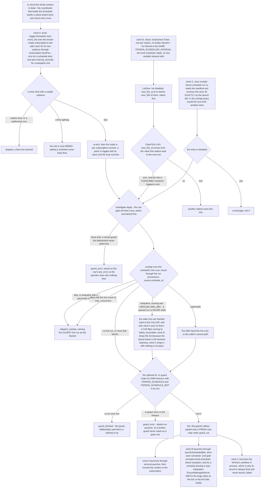
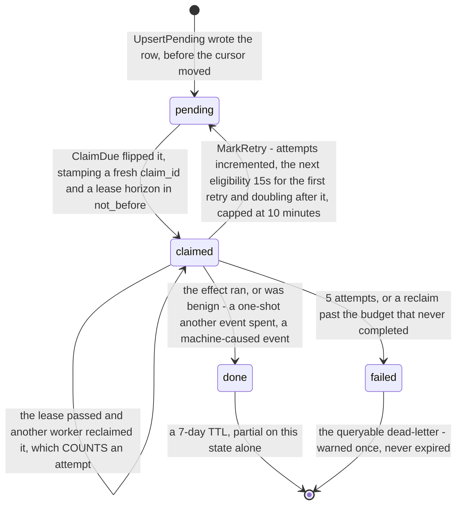

# Flow — triggers and schedules: five sources, two deliveries, three clocks

A stored binding becomes a run when an event matches it or its clock comes due, through one matching prelude, one of two deliveries, and the same launch admission every other surface passes.

> Drawn from the code at commit `f564846d3`; how this page is kept true: [README](README.md).

Two objects carry a binding and they are not interchangeable. A `trigger.Subscription` (`trigger_subscriptions`, or an in-memory store seeded from bot manifests locally) binds a `Matcher` to a bot launch and is fired by events — plus, for its schedule and keepalive kinds, by the resident `trigger.Scheduler`. A `cloudsched.ScheduledBot` (`scheduled_bots`) is the cloud cron and keepalive row, fired by `cloudsched.Ticker` alone. Three facts readers get wrong: cloud board events never touch the event bus, a schedule-kind **subscription** has nothing to fire it in cloud (the scheduler is built only beside a native board store, and scopes itself to tenant `""`), and a skipped tick is a normal audited outcome rather than a failure.

## From an event to an effect

```mermaid
flowchart TD
    BT["local: native.Store.Subscribe tails events.jsonl through fsnotify"] --> FLT{"enqueue keeps card created, state and updated events carrying an issue id"}
    FLT -- "any other type, or no issue id" --> DROP0["ignored"]
    FLT -- "the 128-slot buffer is full" --> DROPQ["dropped with a warn - the dispatcher's 30s poll still reaches the card on the promote arm, a candidate being listed on its STATE alone, but a direct-mode launch dropped here is LOST: this lane has no outbox"]
    FLT -- "queued" --> NORM["NormalizeBoardEvent re-reads the CURRENT card - labels, title, body and state live there, not on the audit event - and blanks the actor on machine provenance"]
    NORM -- "tracker.ErrNotFound: the card is gone" --> DROP1["a definitive skip"]
    NORM -- "any other read error" --> DROP2["skipped too: this tail has no cursor to protect"]
    NORM --> BUS
    RO["run outcome: emitRunOutcome in process, and the cloud runner pod's own fireOutcomeEvent"] --> BUS
    EM["POST /api/v1/triggers/emit - source forced to custom, vars capped at 1 MiB, answered 202"] --> BUS
    FW["local: emitForgeTriggerEvent - the inbound webhook mirror, carrying launched_run_id - it reaches for the local coordinator's bus and nothing else, so it is a no-op in cloud, unlike the emit route and the run-outcome publisher"] --> BUS
    BUS["eventbus: InProcBus fans out to each subscriber's 256-slot worker, NATSBus publishes a Core NATS subject that one replica of the queue group consumes - lossy either way, by design"] --> AUTH{"the trigger-evaluator subscriber: a run-source event is REBUILT from the run document by BuildRunOutcome"}
    AUTH -- "unknown run, or a tenant or kind the document contradicts" --> DROPF["dropped with a warn - the wire payload feeds the launch plan and the runner publishes with the platform credential"]
    AUTH -- "a status that is neither an exit nor a human-gate pause" --> DROPR["dropped - the default classification would fire finished-subscriptions on a run still going"]
    AUTH -- "paused_waiting_human or paused_operator: the rebuild re-kinds it run.paused, and it RELAYS" --> PRE
    AUTH -- "no run store wired: the check is OFF, logged loudly" --> PRE
    AUTH -- "doc-derived, or any non-run source" --> PRE
    CT["cloud: cloudBoardSource.tickOnce every 3s per replica, over the tenants holding an enabled board subscription"] --> CUR["drainTenant reads the trigger cursor, then board_events after it, 200 at a time"]
    CUR --> GAP{"trimAtYoungGap cuts the batch at the first seq gap"}
    GAP -- "younger than 30s" --> TRUNC["truncated, retried next tick - emit allocates the seq BEFORE inserting, so a young gap is an insert in flight"]
    GAP -- "older than the grace: a dead allocation, stepped over with a warn" --> PRE
    GAP -- "contiguous" --> PRE
    PRE{"the ONE matching prelude both deliveries share - matchingSubscriptions"}
    PRE -- "an enumerated machine reason: a watchdog repair, a column rename" --> NOEF["no effect fires, and no one-shot is spent"]
    PRE -- "the payload carries launched_run_id" --> NOEF2["observational: the inline webhook already launched it"]
    PRE -- "20 consecutive unreadable reads of one seq" --> POIS["poisoned: logged ONCE at Error and skipped, so the triggers behind it resume"]
    PRE -- "a store error" --> ABORT["the cloud batch aborts BEFORE the cursor and retries - the bus path just returns it"]
    PRE -- "ListCandidates, then the pure Matcher: OR within a dimension, AND across, every label required" --> SPLIT{"which delivery"}
    SPLIT -- "the bus path, nothing matching" --> NOTHING["nothing happens - this lane owes a row to no one"]
    SPLIT -- "the bus path, a match" --> EFF
    SPLIT -- "the cloud board path, whether a subscription matched or not" --> MAT["MaterializeEffects: one trigger_effects row per matched pair, PLUS one projection row when a card MOVED on a tenant with a bound external board - owed BEFORE the match is computed, so a move matching no subscription still reflects"]
    MAT --> UPS["UpsertPending writes them with setOnInsert, so racing replicas collapse on the row key"]
    UPS --> CAS["and ONLY THEN AdvanceTriggerCursor CAS-advances the per-tenant cursor - a lost CAS is the nominal multi-replica case, the rows being already durable"]
    CAS --> WRK["EffectWorker claims up to 20 due rows, oldest eligibility first, under a fresh claim id and a 2-minute lease"]
    WRK --> RES{"applyClaimedEffect re-resolves the subscription at EXECUTION time"}
    RES -- "deleted, disabled, another tenant's, or no longer matching" --> TERM["a terminal drop: the CURRENT rule decides, never the stale match"]
    RES -- "a projection row - it names no subscription at all" --> REFL["ReflectCard pushes the card's column onto the bound external board"]
    RES -- "still armed" --> EFF
    EFF{"sub.EffectiveMode"}
    EFF -- "board" --> PROM["Promote stamps the card's Bot and BotArgs ONLY - a card already pinned to that bot is left untouched, so an event storm converges"]
    PROM --> NUDGE["locally an optional Nudger dispatches now instead of at the next poll - the dispatcher's Claim stays the SOLE launch authority, which is why fast path and poll cannot double-launch"]
    EFF -- "direct, with consume_labels, on a board event" --> CONS{"one atomic label strip makes the matcher's labels a re-armable one-shot"}
    CONS -- "another event already spent it" --> SPENT["the row retires as done with NO launch"]
    CONS -- "stripped" --> MARK["the outbox persists consume_marked BETWEEN the consume and the launch, so a retry re-launches without re-spending it"]
    MARK --> PLAN
    EFF -- "direct" --> PLAN["buildPlan: the event payload's vars first, then issue_id for a direct board plan, then the subscription's static vars - operator pins win - then the subject title and body under args_var"]
    PLAN --> LCH["serviceLauncher stamps the plan's tenant and the actor trigger-spine, resolves the bot team then platform then baked, folds the retry and routing layers"]
    LCH --> GATE{"gateLaunch: the SAME admission every launch surface passes - suspend, concurrency, launch rate, monthly caps"}
    GATE -- "denied" --> DENY["the denial travels up as the effect's error: raised on the subscription's last_error, retried on the outbox backoff"]
    GATE -- "admitted" --> RUN["runview.Service.Launch with AllowUnknownInputs - the metered slot is handed back only when RunMayHaveStarted is false"]
```

## Three clocks, one gate

## Steps

| Actor | Action | Code |
|---|---|---|
| user | writes a subscription: the active team is the tenant, `bot_id` is required, the policy is validated and a guard a cloud pod would run is refused | `handleCreateTrigger`, `triggerTenant`, `schedgate.Validate`, `cloudGuardRefusal` |
| studio | or enables a manifest invocation in one click, through the same `From*` constructors every provisioning path uses | `handleTriggerFromInvocation`, `FromScheduleInvocation`, `FromBoardInvocation`, `FromKeepaliveInvocation` |
| user | writes the cloud cron row instead: cron XOR `interval_seconds`, the keepalive floor, `supersede` refused here, then the first `next_fire_at` | `handleCreateSchedule`, `ValidateReapable`, `NextFireForBot` |
| store | tails the native board, filters, and normalizes against the current card | `native.Store.Subscribe`, `BoardSource.enqueue`, `NormalizeBoardEvent` |
| server | publishes on the bus, and verifies a run-lifecycle event against the run document before anything matches | `InProcBus.Publish`, `NATSBus.Publish`, `verifyRunEventAuthority`, `runStatusRelayable` |
| server | in cloud, poll-tails `board_events` per tenant and guards the contiguous prefix | `cloudBoardSource.tickOnce`, `drainTenant`, `trimAtYoungGap`, `poisoned` |
| server | matches once for both deliveries, declining machine-caused and already-launched events | `matchingSubscriptions`, `machineCaused`, `tracker.IsMachineReason`, `ListCandidates`, `Matcher.Match` |
| server | materializes durable rows, then advances the cursor — never the other order | `MaterializeEffects`, `projectionOwed`, `UpsertPending`, `AdvanceTriggerCursor` |
| server | claims due rows under a lease and a claim id, and re-resolves the subscription at execution time | `EffectWorker.Tick`, `ClaimDue`, `applyClaimedEffect` |
| server | promotes the card, or strips the one-shot labels and launches | `NativeBoardEffect.Promote`, `ConsumeMatchLabels`, `boardmongo.ConsumeLabels`, `MarkConsumed` |
| server | builds the plan and launches as `trigger-spine`, past the shared admission | `Evaluator.buildPlan`, `serviceLauncher.Launch`, `gateLaunch`, `runview.Service.Launch` |
| store | raises the verdict on the binding itself, only when the message changes, on a detached context | `recordLaunchVerdict`, `MarkLaunchError` |
| server | ticks the three clocks and crosses the one gate | `Scheduler.tick`, `Scheduler.fire`, `Ticker.Tick`, `RunScheduleRun`, `schedgate.Apply` |
| server | decides overlap, classifies staleness, runs the guard | `EvaluateOverlap`, `LiveAndStaleRunsForSchedule`, `RunGuard` |
| server | reaps what the gate declared stale — on clock A's gate alone, the two others drop the list | `Server.scheduleGate`, `UpdateRunStatusIf` |
| server | audits every tick decision: a JSONL line locally, a `schedule.tick.<decision>` row in cloud | `schedgate.TickRecord`, `jsonl.AppendJSON`, `cloudScheduleAudit`, `ToAuditMeta` |
| server | back-writes the launched run's terminal outcome onto the schedule under a monotonicity guard | `handleScheduleOutcomeEvent`, `MarkRunOutcome` |

## The effect row

Only the cloud board lane has an outbox: the local path publishes onto the lossy bus, where a dropped notification is reconciled by the dispatcher poll on the promote arm and by nothing at all on the direct arm; `MemoryEffectOutbox` is the test twin, wired nowhere in production. Each row is one effect an event owes — to a matched subscription, or to the tenant's board binding.

| State | Means | Written by |
|---|---|---|
| `pending` | runnable, or waiting out its backoff in `not_before` | `UpsertPending`, `MarkRetry` |
| `claimed` | one worker holds it — reclaimable once `not_before`, the lease horizon, passes | `ClaimDue`, two phases so a reclaim spends an attempt |
| `done` | terminal success, a spent one-shot included | `MarkDone` |
| `failed` | terminal exhaustion at `MaxEffectAttempts`, kept for an operator | `MarkFailed`, from `executeOne` or from the reclaim check |

Every `Mark*` filters on the row's `claim_id`, so a worker whose lease was stolen finds its late writes are no-ops. A second field carries its own fact: `consume_marked` flips false to true between the atomic label consume and the launch, which is what lets a retry re-launch without re-spending the one-shot.

Each tick of each clock lands exactly one `schedgate.TickDecision`: `fired` (overlap and guard passed, a launch was attempted), `skipped_overlap` (a live run held the slot — audited, and deliberately not raised on `last_error`: busy is not unhealthy), `guard_blocked` (the guard exited non-zero, and it clears a stale error), `guard_error` (the guard could not run, and it raises one), `launch_failed` (the launch itself errored and the slot is spent — `LaunchDecision` is the single place that mapping lives).

## Guards that refuse

- **The member rung on every trigger write** — `403 member_role_required` through `writeRungDenial`, from `mutatingRungAuth`: inert on reads and on a deployment with no identity store, owed here because a stored subscription is a standing launch order and the spine executing it launches under a machine principal the gate exempts.
- **`canViewTeam` / `canManageTeam` on the schedule routes** — `403 not a member` for the list, `403 admin or owner required` for create, patch and delete; a row of another team answers `404` through `scheduleForTeam`, so ids cannot be probed across teams. A trigger of another tenant answers `404 ErrSubscriptionNotFound` for the same reason, never `403`.
- **The policy validators** — `400` for an incoherent policy. `ValidateReapable(canReap=false)` on the host-cron and cloud-schedule surfaces additionally refuses `overlap: supersede`, which cannot mean anything where the caller drops `ReapRunIDs`; the trigger route calls plain `Validate`, so a subscription may store and run it.
- **`cloudGuardRefusal`** — `422` unless the deployment sets `ITERION_CLOUD_SCHEDULE_GUARDS=allow`, and only when the request CHANGES the stored guard, so an existing row stays editable and pausable.
- **The cadence refusals** — `400` for both or neither of cron and `interval_seconds`, for an interval under `bundle.KeepaliveMinInterval`, for an invalid cron, and for a bad retry or routing block.
- **The one-click enablement** — `404` for a bot outside the team's own tier, `400` for an index out of range, a cron override on a non-schedule kind, a schedule with no `suggested_cron`, a board invocation with no `board:` block, a keepalive with no valid interval, and a forge or command kind; `409`, carrying the existing `subscription_id`, for a second bot-home trigger of that kind.
- **The custom ingress** — `503` when no spine is enabled, `400 kind is required`, `400 vars payload too large` past 1 MiB, and the launch gate's own denial envelope as a pre-check whose metered slot is rolled back at once, because one emit fans out to however many launches each meter themselves.
- **The relay's entry check** — no status, a bus: a run event whose claimed tenant or kind the document contradicts, or whose status is neither an exit nor a human-gate pause, is dropped with a warn and never matched. `paused_waiting_human` and `paused_operator` relay, the rebuild re-kinding them `run.paused`, so a subscription on that kind does fire.
- **The matching prelude** — an enumerated machine reason and a `launched_run_id` payload both yield no effect and spend no one-shot.
- **The execution-time re-resolution** — a deleted, disabled, cross-tenant or no-longer-matching subscription drops the row terminally; only a transient store error retries.
- **The overlap gate and the guard** — a live run, a `max_concurrent` ceiling, a non-zero guard exit or a guard that could not run each pass the slot, audited; the host-crontab surface returns exit 0 on all of them, because a non-zero would mail the operator on every blocked tick.
- **No application gate at all on the host crontab** — whoever can write the schedule manifest and the user's crontab controls that surface.

## Collections touched

`trigger_subscriptions` (the binding; `last_error` and `last_error_at` written targeted, only on a change) · `scheduled_bots` (the cloud cron and keepalive row; `next_fire_at` and `last_fire_at` by CAS, `last_error*` and `last_run_*` targeted) · `trigger_effects` (the cloud outbox, claimed under `tenant_state_due`, `done` rows expiring after 7 days) · `board_events` (read by the poll-tail over `tenant_seq`, and WRITTEN by the one-shot consume — an `issue_updated` row whose labels are already gone, holding a seq the tail then reads) · `board_config` (the per-tenant document `trigger-cursor:<tenant>`, seeded at the highest INSERTED seq so a fresh deployment never replays history) · `board_issues` (promote stamps `issue.bot` and `issue.botargs`, the consume pulls labels) · `forge_board_bindings` (the projection lane reads it twice: `HasBoardBinding` at materialization decides whether a row is owed, `ReflectCard` reads it again at execution; the `_id` is the team) · `runs` (launched with `source.schedule_id`, queried back through the partial index `tenant_source_schedule_created`, and CAS-flipped to `failed_resumable` by the local keepalive reap) · `audit_events` (`schedule.created`, `schedule.updated`, `schedule.deleted` and `schedule.tick.<decision>`, on the team trail). Locally the tick records go to `<manifest-dir>/logs/tick-audit.jsonl` instead — the file `iterion schedule audit` reads — field-compatible with the cloud rows.

## Related

- [scheduling.md](../scheduling.md) — the host manifest, the overlap policy, keepalive, the guard, retry precedence and the cloud failure surfaces; [bot-invocations.md](../bot-invocations.md) — the manifest capability a subscription is derived from.
- [agents/engine/automation-surfaces.md](../agents/engine/automation-surfaces.md) — the four automation families and the spine they converge on; [agents/engine/events-leases-and-schedules.md](../agents/engine/events-leases-and-schedules.md) — the package invariants.
- [adr/046-event-driven-runs-trigger-spine.md](../adr/046-event-driven-runs-trigger-spine.md) (capability versus binding), [adr/094-trigger-effect-outbox.md](../adr/094-trigger-effect-outbox.md) (the four loss windows and the materialization order), [adr/051-in-bot-event-driven-primitives.md](../adr/051-in-bot-event-driven-primitives.md) (the in-run `emit` and `wait` registry, deliberately NOT this bus).
- [data-model-automation.md](data-model-automation.md) — every collection drawn here, with its tenant field, indexes and twin; [data-model-runs.md](data-model-runs.md) (`runs`), [data-model-identity.md](data-model-identity.md) (`audit_events`), [access-control.md](access-control.md) — the rung and the synthetic principals; [quotas-and-limits.md](../quotas-and-limits.md) — what each surface meters.
- [flow-webhook-to-run.md](flow-webhook-to-run.md) — the forge lane whose launch this spine only mirrors; [dispatcher.md](../dispatcher.md) — the claim a promote hands the card to.

## Sources

- [pkg/trigger/evaluator.go](../../pkg/trigger/evaluator.go) — `matchingSubscriptions`, `machineCaused`, `applyEffect`, `applyProjection`, `buildPlan`, `eventVars`, `argsPayload`, `errEffectOneShotSpent`, `errEffectMachineCaused`.
- [pkg/trigger/effects.go](../../pkg/trigger/effects.go) and [pkg/trigger/effects_worker.go](../../pkg/trigger/effects_worker.go) — the four states, `EffectKindLaunch` and `EffectKindProjection`, `MaxEffectAttempts`, `EffectLease`, `EffectBackoff`, `EffectWorker.Tick`, `executeOne`, `applyClaimedEffect`, `MaterializeEffects`, `projectionOwed`; [pkg/trigger/effects_memory.go](../../pkg/trigger/effects_memory.go) — the test twin.
- [pkg/trigger/board_source.go](../../pkg/trigger/board_source.go) — `StartBoardSource`, `enqueue`, `IsCardEvent`, `NormalizeBoardEvent`, `NativeBoardEffect.Promote`, `ConsumeMatchLabels`; [pkg/trigger/scheduler.go](../../pkg/trigger/scheduler.go) — `Scheduler.tick`, `fireIsolated`, `fire`, `tickRecord`.
- [pkg/trigger/subscription.go](../../pkg/trigger/subscription.go) — `Subscription`, `NextFire`, `Policy`, `RetryPolicy`, `RoutingPolicy`, `LastError`; [pkg/trigger/health.go](../../pkg/trigger/health.go) — `recordLaunchVerdict`; [pkg/trigger/mongostore.go](../../pkg/trigger/mongostore.go) — the three indexes, `DistinctBoardTenants`, `MarkLaunchError`; [pkg/cli/trigger.go](../../pkg/cli/trigger.go) — `buildLocalTriggerStore`.
- [pkg/eventbus/bus.go](../../pkg/eventbus/bus.go), [pkg/eventbus/inproc.go](../../pkg/eventbus/inproc.go) and [pkg/eventbus/nats.go](../../pkg/eventbus/nats.go) — the lossy contract, `subscriberBufferSize`, and `NATSBus` as a Core NATS subject fan-out with a per-subscriber queue group.
- [pkg/schedgate/gate.go](../../pkg/schedgate/gate.go), [policy.go](../../pkg/schedgate/policy.go), [guard.go](../../pkg/schedgate/guard.go), [live_runs.go](../../pkg/schedgate/live_runs.go), [tick_record.go](../../pkg/schedgate/tick_record.go) — `Apply`, the four overlap values, `Validate` and `ValidateReapable`, `EvaluateOverlap`, `RunGuard` and its three kinds, `LiveAndStaleRunsForSchedule`, `TickRecord` and `LaunchDecision`.
- [pkg/cloudsched/ticker.go](../../pkg/cloudsched/ticker.go), [mongo.go](../../pkg/cloudsched/mongo.go) and [schedule.go](../../pkg/cloudsched/schedule.go) — `Ticker.Tick`, `recordGateVerdict`, `markLaunchError`, `ListDue`, `ClaimTick`, `MarkRunOutcome` and its monotonicity filter, `ScheduledBot`, `NextFireForBot`.
- [pkg/server/trigger_cloud.go](../../pkg/server/trigger_cloud.go) — `cloudBoardSource`, `tickOnce`, `drainTenant`, `trimAtYoungGap`, `poisoned`, `StartCloudTriggerCoordinator`; [pkg/server/trigger_coordinator.go](../../pkg/server/trigger_coordinator.go) — `StartTriggerCoordinator`, `schedulerTickInterval`, `scheduleGate` and its `Reap`.
- [pkg/server/trigger_authority.go](../../pkg/server/trigger_authority.go) — `verifyRunEventAuthority`, `runStatusRelayable`; [pkg/server/trigger_launcher.go](../../pkg/server/trigger_launcher.go) — `serviceLauncher`, `triggerSpineActor`; [pkg/server/schedule_outcome.go](../../pkg/server/schedule_outcome.go) — the `schedule-outcome` subscriber.
- [pkg/server/triggers_routes.go](../../pkg/server/triggers_routes.go) — `triggerWriteAuth`, `triggerTenant`, the CRUD handlers, `handleEmitTrigger`, `handleTriggerFromInvocation`, `maxEmitVarsBytes`; [pkg/server/board_cloud_routes.go](../../pkg/server/board_cloud_routes.go) — `mutatingRungAuth`; [pkg/server/schedules_routes.go](../../pkg/server/schedules_routes.go) and [pkg/server/schedules_gate.go](../../pkg/server/schedules_gate.go) — the schedule CRUD, `cloudGuardRefusal`, `cloudScheduleGate`, `tenantRunLister`, `cloudScheduleAudit`.
- [pkg/server/webhooks_gitlab.go](../../pkg/server/webhooks_gitlab.go) — `launchScheduledBot`, `scheduledForgeOverrides`, `buildScheduledLaunchSpec`; [pkg/dispatcher/boardmongo/trigger.go](../../pkg/dispatcher/boardmongo/trigger.go) — `TriggerCursor`, `EventsAfter`, `UpsertPending`, `ClaimDue`, `setEffect`, `AdvanceTriggerCursor`, `ConsumeLabels`; [pkg/cli/schedule.go](../../pkg/cli/schedule.go) — `RunScheduleRun` and the tick audit.
