# Flow — webhook-to-run: the admission gates, every refusal, and the one chokepoint

An inbound forge or CI delivery becomes a run by crossing an authenticating middleware, a provider handler's ordered refusals and one shared launch tail, which is where the delivery row, the metering and the run are created.

> Drawn from the code at commit `f7ef017b7`; how this page is kept true: [README](README.md).

## The path a delivery takes

The middleware authenticates and admits; the handler decides whether this event deserves a run and for which bots; `launchWebhookTarget` does everything that costs something. That tail is the chokepoint of five callers, and three of them — the debounce sweep, the merge-gate relaunch and the merge-gate auto-fix — enter it minutes to hours later without crossing a handler at all, which is why the lane and commit-pin refusals live there and not at the top of each provider. The refusal order drawn below is the GitHub and Forgejo one; the GitLab merge-request lane runs the same guards in its own sequence — the scope filter, the fork guard, the routing table, the replier gate, the hold label, then the bot-author skip — and carries no merge-queue lane at all.

A refusal answers `200` with `status: filtered` on purpose: a `4xx` on a forge hook is what makes the forge disable it, and with it every future review.

```mermaid
flowchart TD
%% the auth middleware - webhookAuth, entirely before the handler
    IN["a forge or CI POSTs to api/webhooks/github, gitlab, forgejo or generic, with the webhook id in the path"] --> JWT["isPublicPath skips the operator JWT gate: this route authenticates itself"]
    JWT --> CFG{"the webhook_configs row for that URL id, resolved with NO tenant context - the webhook IS the tenant selector"}
    CFG -- "missing, or the provider does not match" --> E401["401 invalid webhook - one answer for both, so the id space is not probeable"]
    CFG -- "token mode" --> TOK{"constant-time compare of X-Gitlab-Token or X-Iterion-Webhook-Token against cfg.TokenHash"}
    TOK -- "mismatch" --> E401T["401 invalid webhook token, with a WARN naming the config and the client IP"]
    CFG -- "hmac mode: skipped here, the body is the proof" --> EN
    TOK -- "match" --> EN{"cfg.Enabled"}
    EN -- "no" --> E410["410 webhook disabled"]
    EN -- "yes" --> RATE{"per-webhook token bucket, default rate 1.0 and burst 10"}
    RATE -- "empty" --> E429R["429 with Retry-After - NO delivery row, only the throttled metric"]
    RATE -- "a token taken" --> QUO{"monthly call CAS in webhook_quotas - the org key, then a per-webhook key when capped"}
    QUO -- "cap breached" --> E429Q["429 monthly call quota exceeded - NO delivery row either"]
    QUO -- "the counter is unreadable" --> E500["500 quota check failed"]
    QUO -- "admitted" --> TEAM{"GetTeam on cfg.TenantID"}
    TEAM -- "ErrNotFound" --> E403N["403 tenant no longer exists - a webhook outliving its team"]
    TEAM -- "any other store error" --> E503["503 tenant lookup unavailable - fail CLOSED"]
    TEAM -- "not CanLaunch" --> E403S["403 org suspended"]
    TEAM -- "readable and able to launch" --> STAMP["stamp the synthetic principal, RoleMember and KindWebhook, with the config and the loaded team on ctx; write last_used_at detached"]
%% the provider handler
    STAMP --> HMAC{"hmac mode: HMAC-SHA256 over the raw body, before any side effect"}
    HMAC -- "unreadable body, capped at 5 MiB" --> E400B["400 read body"]
    HMAC -- "bad signature" --> E401H["401 invalid signature - no row and no admission, so a poker learns nothing about the quota"]
    HMAC -- "verified, or token mode" --> EV{"dispatch on the provider event header, then parse into a provider-agnostic webhookEventMeta - the generic endpoint reads no header and parses its own JSON body"}
    EV -- "unsupported event" --> FIL1["200 filtered on github and forgejo; gitlab alone answers 400 invalid"]
    EV -- "unparsable payload" --> E400P["400 invalid"]
    EV -- "the generic endpoint: no event header at all, its JSON body names the bot, repo, ref and vars" --> GEN{"its own refusals: 200 filtered outside the project allowlist, then 400 bot required and 403 for a bot outside cfg.AllowsBot, both filed invalid"} -- "a named, permitted bot" --> LWT
    EV -- "a pull request or merge request" --> DEAD{"closed or merged"}
    DEAD -- "yes - stopping is not launching, so this runs first" --> STOPD["purge the parked row FIRST, then per launched run disarm the armed retry before cancelling it with RunEndReasonPRClosed, then 200 filtered"]
    DEAD -- "open" --> FORK{"fork guard: the head repo PROVEN equal to the base - after the scope filter on the gitlab merge-request lane"}
    FORK -- "not proven, an absent head repo included" --> FIL2["200 filtered - no config lifts it on the auto path"]
    FORK -- "same repo" --> HOLD{"a configured hold label on the subject - after the routing table and the replier gate on the gitlab merge-request lane"}
    HOLD -- "held" --> FIL3["200 filtered - every auto lane, whatever bot would have run"]
    HOLD -- "none, or a payload carrying no labels" --> MQ{"a merge-queue action - the github lane only"}
    MQ -- "dequeued with a healable reason" --> HEAL{"project, author and the brancher role bot all permitted"}
    HEAL -- "no" --> FIL4["200 filtered - auto-heal not permitted"]
    HEAL -- "yes" --> HEALT["one target for the brancher role, carrying fix_head_sha and deliberately not head_sha"]
    MQ -- "enqueued again" --> FIL5["stop the heal runs, then 200 filtered"]
    MQ -- "neither" --> SCOPE{"reviewable, or a review_on_sync resync, or a review re-request - AND the event, project and author allowlists; first after the closed-subject stop on the gitlab merge-request lane"}
    SCOPE -- "any one fails" --> FIL6["200 filtered with an empty reason"]
    SCOPE -- "in scope" --> REPL{"re-request only: the clicker in authorized_repliers, or a collaborator permission at least min_replier_role"}
    REPL -- "unauthorized, or an authz error, while an automatic lane co-rides" --> DEM["the gesture is DEMOTED - the delivery rides whatever automatic lane still admits it"]
    REPL -- "unauthorized, and the click was the delivery's only reason" --> FILR["200 filtered, carrying the gate's own reason"]
    REPL -- "an authz error, and the click was the delivery's only reason" --> LE1["200 launch_error"]
    REPL -- "authorized" --> SELF
    DEM --> SELF{"the sender is iterion's own forge identity"}
    SELF -- "yes, and this is neither a gate resync nor a re-request" --> FIL7["200 filtered - a review command still forces one"]
    SELF -- "no" --> RULES{"resolveForgeEventBots: a bot rule claims this event and admits the author - the pull request's author on github and forgejo, the event SENDER on the gitlab merge-request lane, which resolves this before the replier gate"}
    RULES -- "none" --> FIL8["200 filtered, deliberately not 403 - but a config carrying no bot_rules at all skips the author filter and routes to the pinned reviewer-role bot instead"]
    RULES -- "one or more" --> TGT["one target per rule: a FRESH vars map, layered base then config then rule then the operator pin - config applies only where the rule pins nothing - and its own idempotency key"]
    TGT --> SYNC{"a synchronize launch, with a quiet window configured"}
    SYNC -- "no - a human is waiting on an open, a command or a click" --> LWT
    HEALT --> LWT
%% the debounce detour - the request leaves entirely
    SYNC -- "yes" --> DROPT{"drop the targets whose key already names a non-retryable delivery"}
    DROPT -- "all dropped" --> DUP1["200 duplicate"]
    DROPT -- "some remain" --> UPS{"Upsert the parked row, keyed tenant, webhook, project and subject, ordered by the FORGE timestamp"}
    UPS -- "a strictly newer order_key is already parked" --> FIL9["200 filtered out-of-order - and emphatically no supersede"]
    UPS -- "store error" --> LWT
    UPS -- "accepted" --> PARK["under an overlap policy resolving to supersede only, cancel this subject's live runs; then 202 deferred - and no delivery row"]
    PARK --> SWEEP["the 20s sweeper claims due rows under a 2-minute lease, first replica wins"]
    SWEEP --> NOW{"re-read the config as it stands NOW"}
    NOW -- "the config is gone" --> DEL1["drop the row"]
    NOW -- "not Enabled, or review_on_sync cleared" --> DEL2["a filtered row naming why, then drop"]
    NOW -- "a transient read error" --> KEEP["keep it: the lease lapses and the next sweep retries"]
    NOW -- "still armed" --> RST["re-stamp the synthetic webhook identity and the mirrored public base; skip a bot no longer in the webhook's scope"]
    RST --> LWT
%% the chokepoint
    GATE["the merge-gate relaunch and auto-fix lanes rebuild a target from stored state, crossing no handler"] --> LWT
    LWT{"launchWebhookTarget - the chokepoint all five callers cross"}
    LWT -- "a lane mismatch in either direction, or an untrusted target with no commit pin" --> FIL10["200 filtered, before anything is metered, recorded or launched"]
    LWT -- "the lane is proven" --> RPL{"a delivery row already holds this idempotency key"}
    RPL -- "any status but launch_error" --> DUP2["200 duplicate, echoing the winner's run id and delivery id"]
    RPL -- "launch_error: RETRYABLE, so the row is reused" --> SUP
    RPL -- "unclaimed" --> SUP{"the webhook's overlap policy resolves to supersede - the default, an empty policy, supersedes nothing"}
    SUP -- "it does: cancel the live runs of THIS project, subject and bot with RunEndReasonSuperseded" --> ADM
    SUP -- "it does not" --> ADM{"gateLaunch: the member rung, which a webhook principal is exempt from, then suspend, the repo cap, concurrency, the launch bucket, and the monthly CAS that IS the metering"}
    ADM -- "denied" --> LE2["the denial's own 402, 403 or 429, plus a launch_error row under a RANDOM key so a retry after the reset still launches"]
    ADM -- "admitted" --> CLM{"claim the row at accepted - Insert, or ClaimFailedRetry on a prior failure"}
    CLM -- "a duplicate key, or the CAS lost" --> ROLL["roll the metered unit back, then 200 duplicate"]
    CLM -- "claimed" --> SEED{"seed the hand-offs, then mint the per-run forge publish grant"}
    SEED -- "another team's grant, or grant capacity exhausted" --> LE3["422 launch_error and a rollback, with the row left retryable"]
    SEED -- "minted, or withheld from an untrusted workspace" --> RES["resolve the bot - the team's bot_sources row, then the platform row, then the baked catalog - and build the LaunchSpec with the trust and the admitted commit"]
    RES --> LCH{"runs.Launch"}
    LCH -- "failed" --> LE4["502 launch_error; the metered slot comes back only when RunMayHaveStarted is false"]
    LCH -- "a run exists" --> OK["the row flips to launched with its run id, then 202"]
    OK --> MARK["trusted only: claim the gate and fixer contexts on the forge, so the minutes before the verdict read as running"]
    MARK --> SPN["publish the launch on the trigger bus, carrying launched_run_id - observational, so the spine's evaluator never relaunches it"]
```

## Steps

| Actor | Action | Code |
|---|---|---|
| provider | POSTs the delivery; the operator JWT layer skips every `/api/webhooks/` path | `isPublicPath` in [middleware.go](../../pkg/server/middleware.go) |
| server | resolves the config by URL id with no tenant, then authenticates: a header token, or nothing in HMAC mode | `webhookAuth`, `webhooks.VerifyToken` |
| server | admits: enabled, the per-webhook bucket, the monthly call CAS, and the team's existence, readability and launch right | `webhookAuth`, `MongoCounter.Allow` |
| server | stamps the synthetic principal and the config on ctx, and writes `last_used_at` detached | `auth.WithIdentity`, `store.WithIdentity`, `MarkUsed` |
| server | verifies `HMAC-SHA256` over the raw body before any side effect | `verifyWebhookHMACBody`, `webhooks.VerifyHMACSignature` |
| server | dispatches on the event header and parses into one shape | `handleGitHubWebhook`, `prforge.ParsePullRequest` |
| server | ends what a closed pull request still owes: the parked row, then each run's armed retry and the run | `stopRunsForDeadPR`, `DeleteBySubject`, `AbandonRunRetry` |
| server | refuses a head it cannot prove is the base repo, then a held subject | `forkGuardRefusal`, `suppressedByHoldLabel` |
| server | heals a dequeued pull request, or stops a heal the queue took back | `autoHealMission`, `stopHealRunForRequeuedPR` |
| server | applies the scope filter, then the replier gate on a re-request | `webhooks.MatchEvent`, `realWebhookPRForgeReviewRequestGate` |
| server | fans out to every rule claiming the event, each with its own key and vars | `resolveForgeEventBots`, `forgeIdemKey`, `forgePREventTargets` |
| server | parks a synchronize volley, and the sweeper replays it through the same tail | `deferSyncLaunch`, `sweepDeferredWebhookLaunches` |
| server, store | refuses the lane, checks the replay, supersedes, meters, claims the row | `launchWebhookTarget`, `gateLaunch`, `Insert`, `ClaimFailedRetry` |
| server | resolves the bot over three tiers, then submits the spec the runner will claim | `launchWebhookBot`, `resolveBotSource`, `runs.Launch` |
| forge | takes the in-flight gate and fixer marks, for a trusted run only | `markGateInFlight`, `markFixInFlight` |
| studio | reads the audit rows the lane wrote | `GET /api/teams/{id}/webhooks/{webhook_id}/deliveries` |

## The delivery status machine

A delivery row is the durable record of one admitted event: a lane row under its idempotency key, or an audit row under a random uuid. Two of the declared statuses are responses only, and two more are written nowhere.

```mermaid
stateDiagram-v2
%% vocabulary: webhooks.Delivery.Status
    [*] --> accepted: the tail claimed the row - Attempts 1 and ClaimedAt stamped
    [*] --> filtered: a refusal verdict, filed under a RANDOM uuid key
    [*] --> invalid: a bad payload, an unsupported event, or a bot out of the webhook's scope
    accepted --> launched: runs.Launch returned a run id
    accepted --> launch_error: a publish-grant refusal, or a launch that failed
    [*] --> launch_error: a gate denial, an authz failure, or an abandoned parked review
    launch_error --> accepted: a redelivery retakes the row through ClaimFailedRetry, a CAS on status and attempts
    launched --> [*]: terminal - the only status the dead-PR stop scans, and the opt-in supersede pass with it
    accepted --> [*]: stranded - read as a launch in progress only inside the 10-minute acceptedLaunchWindow
    filtered --> [*]: terminal audit row, answered 200 so the forge keeps the hook enabled
    invalid --> [*]: terminal audit row, answered 400 or 403
    duplicate: duplicate - a RESPONSE status, never a stored row: the replay check echoes the existing one
    deferred: deferred - a RESPONSE status, 202: the park launches later as its OWN delivery
    unwritten: rate_limited and quota_exceeded - declared constants with no writer; the middleware answers 429 before any row exists
```

| Status | Means | Written by |
|---|---|---|
| `accepted` | the claim: this delivery owns the key and is launching | `launchWebhookTarget` step 3, `Insert` or `ClaimFailedRetry` |
| `launched` | a run exists; `run_id` and `launched_at` set | the same tail, after `runs.Launch` |
| `launch_error` | the one retryable terminal state, reusable under its own key | a gate denial, a grant refusal, a launch failure, an authz failure, an abandoned park |
| `filtered` | a normal verdict: out of scope, held, a fork, a closed PR, no bot, a lane mismatch, an out-of-order park | `recordTerminalWebhookDelivery` |
| `invalid` | a payload or a bot the endpoint cannot serve | `recordTerminalWebhookDelivery` |
| `duplicate` | a response only — the replay check's echo, with `claimed_at` when no run is named yet | never stored; `duplicateOf` |
| `deferred` | a response only — `202`, the park | never stored; `deferSyncLaunch` |
| `rate_limited`, `quota_exceeded` | declared and unreachable: the throttle answers before a row could exist | nothing; `iterion_webhook_throttled_total` carries the fact |

The parked row has a lifecycle of its own in `webhook_deferred_launches`: `Upsert` arms it with `fire_at`, a bumped `generation` and a reset attempt count, `ClaimDue` leases it for two minutes, and the fire either deletes it by generation or re-arms it — exponential from 30s to 10 min, floored by the denial's own `Retry-After`, terminal at eight attempts or on a reset further out than 30 minutes, with a `launch_error` row naming the loss.

## Guards that refuse

- **The config lookup and the token** — `401 invalid webhook` for an unknown id and for a provider mismatch alike, so neither the id space nor a webhook's provider is probeable; then `401 invalid webhook token`, a constant-time compare against `cfg.TokenHash`, skipped entirely in HMAC mode where the handler owes the proof instead.
- **The body HMAC** — `401 invalid signature` from the provider handler, before a row, a grant or an admission exists; GitHub reads `X-Hub-Signature-256`, Forgejo `X-Forgejo-Signature` then `X-Gitea-Signature`, generic `X-Iterion-Webhook-Signature`.
- **`cfg.Enabled`** — `410 webhook disabled`, in the middleware only: the debounce sweep never re-enters it, so the sweeper re-reads the flag itself and drops the parked row.
- **The two throttles, then the tenant** — `429` from the per-webhook bucket and from the monthly call CAS, both before any handler, so neither writes a delivery row, and a counter the store cannot read answers `500`; then three outcomes from one team lookup — `403 tenant no longer exists`, `503 tenant lookup unavailable` and `403 org suspended`.
- **The fork guard** — `200 filtered`, fail-closed on a withheld or unnamed head, because `head.repo: null` is the shape a deleted fork takes. The GitLab merge-request lane instead refuses only a proven fork and lets a payload naming neither project through — its own comment says so.
- **The hold label** — `200 filtered` for every auto lane, opt-in and bot-agnostic, with no exemption for a review re-request, since a CODEOWNERS auto-request is indistinguishable from a click.
- **The scope filter** — the event, project and author allowlists, the last read off the pull request's **author** rather than the pusher on the GitHub and Forgejo lanes, and off the event **sender** on the GitLab merge-request lane, whose payload carries only the author's id; an empty allowlist means the provider's natural set, not nothing.
- **The replier gate** — `authorized_repliers` or a collaborator permission at least `min_replier_role`, deliberately after the scope filter so an out-of-scope delivery never costs a forge API call; an unauthorized click is demoted when an automatic lane co-rides, and answered `200 filtered` with the gate's reason when the click was the delivery's only reason.
- **The bot-author skip** — `200 filtered` when the sender is iterion's own forge identity, exempt for a gate resync and for a re-request, and fail-safe: an identity that cannot be resolved leaves the pull request reviewable.
- **The routing table** — `200 filtered` when no rule claims the event; a config carrying no `bot_rules` at all has no author filter to apply and routes to the pinned reviewer-role bot; on the generic endpoint instead, `400 bot required` and `403` for a bot outside `cfg.AllowsBot`.
- **The supersede pass** — opt-in, not a step: both the launch tail's pass and the park's return before scanning anything unless the webhook's overlap policy resolves to supersede, so a config with no policy cancels nothing; when it runs, its scope is this project, subject and bot, the project half being what keeps a push to `acme/b#7` from cancelling the live review of `acme/a#7`.
- **Lane disjointness** — `200 filtered` in both directions, written as two predicates and never as `ForkLane != IsFork()`, which would admit an unrecognised trust onto an ordinary lane; and an untrusted target with an empty `ExpectedSHA` is refused, because an empty pin disables the runner's comparison.
- **The replay check** — `200 duplicate` before the metering CAS, since that increment is the metering; a `launch_error` row is the one status it reuses instead.
- **`gateLaunch`** — `403 no_workspace` or `org_suspended`, `402` for the repo cap and the monthly run quota or cost cap, `429` for concurrency and the launch bucket; fail-open and logged on a degraded team or usage read, and the `member` rung is exempt for a `KindWebhook` principal.
- **The publish grant** — `422` when a launch pins another team's grant or capacity is exhausted; an untrusted workspace silently loses the grant vars instead, because a grant-less review is what that lane is.
- **The forge marks** — written only for a trusted run: an untrusted one would claim a pending required check it can never answer, leaving the pull request permanently unmergeable.

## Collections touched

`webhook_configs` (read by URL id with no tenant filter, `last_used_at` written detached) · `webhook_deliveries` (the lane row under its idempotency key, the audit rows under random uuids, a 90-day TTL) · `webhook_quotas` (the monthly call counter, `_id`-keyed, bumped and rolled back by CAS) · `webhook_deferred_launches` (the parked synchronize targets, claimed cross-tenant by `fire_at`) · `teams` and `orgs` (the suspend and launch rights, read once in the middleware and reused by the gate) · `org_usage` (the metered run increment, and its rollback) · `runs` (launched, superseded, stopped on a closed pull request) · `retry_circuits` (armed usage-window retries disarmed with the pull request) · `bot_sources` (the team and platform tiers of the bot resolution) · `forge_connections` (read under a tenant, to derive iterion's own bot identity and the publish grant) · `repo_integrations` and `board_issues` (the forge→board projection one launched delivery schedules, once per delivery). The spine mirror writes no collection: `emitForgeTriggerEvent` publishes on the trigger bus — a broker publish, or a non-blocking send to a subscriber — and `trigger_subscriptions` is read only afterwards, by the spine's own evaluator.

## Related

- [webhooks.md](../webhooks.md) — the feature's home page: the auth modes, the per-provider behaviour, the allowlists, the key spaces and the delivery API.
- [merge-gate.md](../merge-gate.md) — `review_on_sync`, the required check, and the relaunch and auto-fix lanes that enter the tail directly; [quotas-and-limits.md](../quotas-and-limits.md) — the launch-admission ladder every surface shares, and what each counter meters.
- [adr/034-webhook-dual-mode-auth-token-header-vs-body-hmac.md](../adr/034-webhook-dual-mode-auth-token-header-vs-body-hmac.md) — why the body HMAC is verified in the handler and not in the middleware; [data-model-forge-bots.md](data-model-forge-bots.md) — all four webhook collections, the delivery document and the bot tiers.
- [data-model-runs.md](data-model-runs.md) (`runs`, `retry_circuits`), [data-model-identity.md](data-model-identity.md) (`teams`, `orgs`), [data-model-credentials.md](data-model-credentials.md) (`org_usage`), [data-model-automation.md](data-model-automation.md) (the trigger spine the launch publishes onto, `repo_integrations` and `board_issues`), [access-control.md](access-control.md) — the `webhook` principal kind among the others.

## Sources

- [pkg/server/middleware_webhook.go](../../pkg/server/middleware_webhook.go) — `webhookAuth`, `extractWebhookToken`, the admission order and the synthetic principal.
- [pkg/server/webhooks_common.go](../../pkg/server/webhooks_common.go) — `verifyWebhookHMACBody`, `suppressedByHoldLabel`, `applyWebhookVarLayers`, `resolveForgeEventBots`, `forgeIdemKey`, `forgePREventTargets`, `headReviewClaim`, `supersedeLiveRuns`, `recordTerminalWebhookDelivery`, `insertAndLaunchWebhook`, `insertAndLaunchWebhookMulti`, `launchWebhookTarget`, `acceptedLaunchWindow`.
- [pkg/server/webhooks_github.go](../../pkg/server/webhooks_github.go) — the four dispatched event headers, `handlePRForgeReview` and its ordered refusals, `handleGitHubIssues`.
- [pkg/server/webhooks_gitlab.go](../../pkg/server/webhooks_gitlab.go) — the merge-request, note and issue lanes, `webhookLauncherFor`, `launchWebhookBot`.
- [pkg/server/webhooks_forgejo.go](../../pkg/server/webhooks_forgejo.go) and [pkg/server/webhooks_generic.go](../../pkg/server/webhooks_generic.go) — the two other endpoints and the bot-agnostic refusals; [pkg/server/webhooks_prforge.go](../../pkg/server/webhooks_prforge.go) — the command lane, the loop guard and the replier gate.
- [pkg/server/webhooks_debounce.go](../../pkg/server/webhooks_debounce.go) — `deferSubjectKey`, `dropReplayedTargets`, `deferSyncLaunch`, `runWebhookDeferSweeper`, `fireDeferredWebhookLaunch`, `deferRetryWait`.
- [pkg/server/launch_gate.go](../../pkg/server/launch_gate.go) — `gateLaunch`, `launchRungCleared`, `launchExemptPrincipal`, `launchAdmission.rollback`, the denial reasons; [pkg/server/forge_gate_relaunch.go](../../pkg/server/forge_gate_relaunch.go) and [pkg/server/forge_gate_autofix.go](../../pkg/server/forge_gate_autofix.go) — the two lanes that enter the tail with no handler.
- [pkg/server/bot_resolver.go](../../pkg/server/bot_resolver.go) — `resolveBotSource` and the three-tier walk; [pkg/server/forge_publish.go](../../pkg/server/forge_publish.go) — `injectForgePublishVars` and the grant's tenancy refusal; [pkg/server/trigger_forge_emit.go](../../pkg/server/trigger_forge_emit.go) — `emitForgeTriggerEvent` and its observational marker; [pkg/server/board_forge.go](../../pkg/server/board_forge.go) — `projectForgeWebhookToBoard`.
- [pkg/webhooks/types.go](../../pkg/webhooks/types.go) — `Config`, `BotRule`, `Delivery`, `DeferredLaunch`, the status constants, `AllowsBot`, `SelectBot`; [pkg/webhooks/token.go](../../pkg/webhooks/token.go) — `VerifyToken`, `VerifyHMACSignature`.
- [pkg/webhooks/mongo.go](../../pkg/webhooks/mongo.go) — the four collections, `EnsureSchema`, `ClaimFailedRetry`, the deferred store and `MongoCounter`.
- [pkg/webhooks/prforge/parser.go](../../pkg/webhooks/prforge/parser.go) — `IsClosed`, `SameRepoAsBase`, `IsReviewable`, `IsSynchronize`, `ReviewRequestedFrom`, `NeedsAutoHeal`; [pkg/store/run.go](../../pkg/store/run.go) — `RunTrust`, `Trusted`, `IsFork`, `RunEndReasonPRClosed`, `RunEndReasonSuperseded`.
