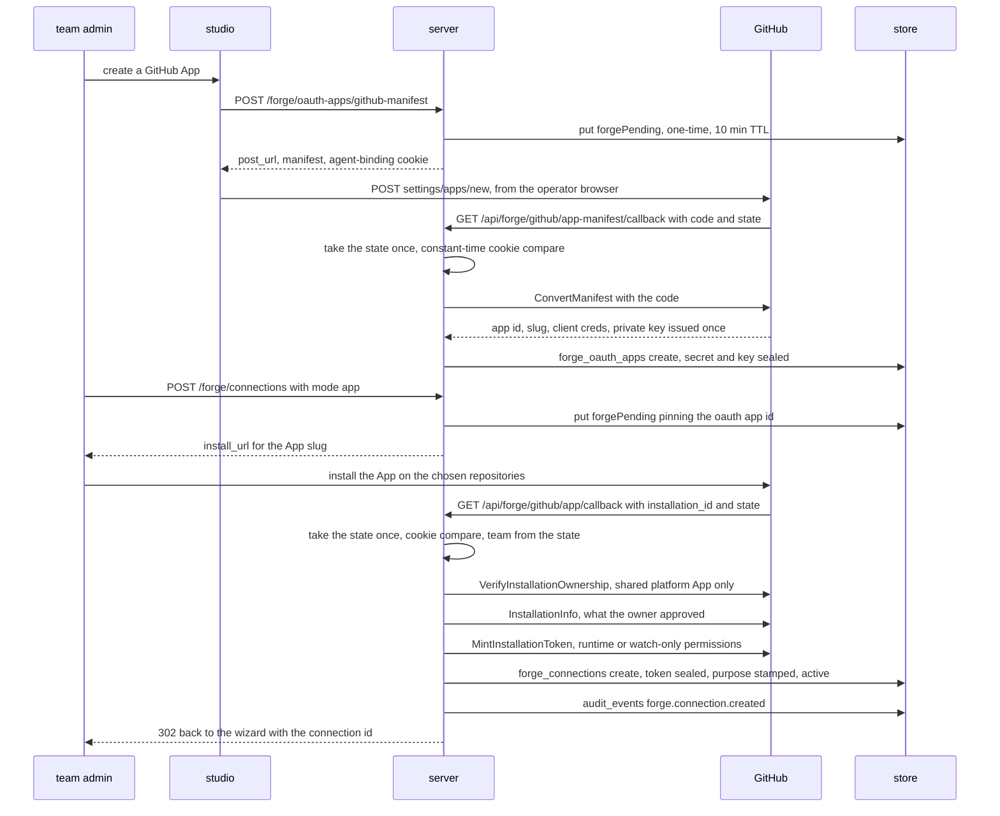
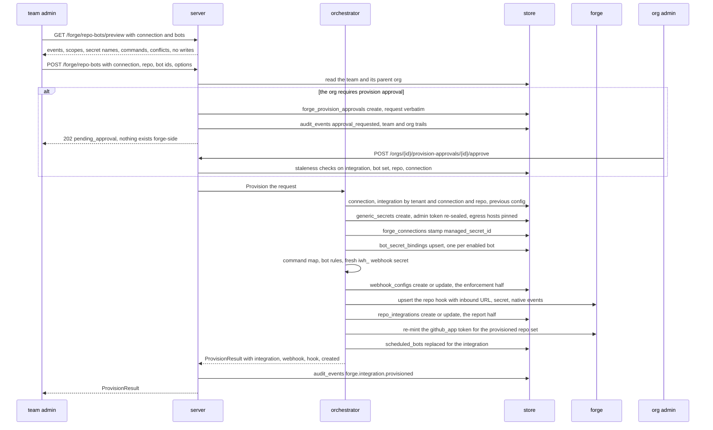

# Forge integrations (connect a repo, auto-provision)

**Audience.** Org admins who want to wire a GitLab/GitHub/Forgejo repo to a
bot (e.g. Revi on merge-request open) without the manual
PAT→secret→binding→webhook→forge-hook chain.

This is the **outbound** complement of [inbound webhooks](webhooks.md):
inbound (`pkg/webhooks`) authenticates deliveries the forge sends *to*
iterion; forge integrations (`pkg/forge`) hold the admin credential that
lets iterion call *out* to the forge to register that delivery — and the
bot-secret binding — in one action.

Diagram: [Flow — connect a forge, enable a bot on a repository](diagrams/flow-forge-connect-enable-bot.md)

## What it does

In the studio, **Integrations → Repositories** (`/integrations`):

1. **Connect a forge** once — OAuth (when an OAuth app is configured) or
   paste a personal access token (the fallback, and the only path for
   self-hosted instances with no registrable OAuth app). iterion validates
   the token (`GET /user`), reads the identity, and stores the credential
   **sealed**.
2. **Enable a repo** — pick a repo the credential can administer, check the
   forge-capable bots (each shows the events it subscribes to + its manifest
   rationale), pick the **`Merge gate`** posture when one of them gates
   merges (`Gate merges`, the default, or `Advisory only` — the
   `gate_enabled` pin of
   [merge-gate.md](merge-gate.md#disabling-the-gate-per-repo--first-review-only-re-review-on-demand))
   — offered only for a repo not yet enabled on this connection; an enabled
   repo changes it on the repo page — and click Enable. The preview says
   `Will deliver to:` and the hook URL about to be registered; the
   connection's **`Webhook delivery`** row above it pins another base for a
   forge that cannot reach this deployment's public URL
   ([webhooks.md](webhooks.md#when-a-forge-cannot-reach-the-deployments-public-url)).
   In one server action iterion:
   - derives a team-scoped **managed `forge_token`** secret from the
     connection (created once per connection);
   - creates (or extends) the iterion **webhook config** for that repo, with
     a fresh `iwh_` secret it holds on both ends, the events the bots need,
     and a per-webhook `SecretOverrides` pin to the managed token;
   - calls the forge API to **create the webhook** on the repo pointing at
     iterion's inbound URL with that `iwh_` secret;
   - records a **`RepoIntegration`** join row.

Disable is the inverse, one click: delete the forge hook, the webhook
config, and the join row (the managed secret survives — it is shared by the
connection's other repos; it is removed when the connection is deleted).

Both halves drawn from the code — the GitHub App connect, then the enable's
fixed write order; the step table, the guards that refuse and the collections
written live on [the flow page](diagrams/flow-forge-connect-enable-bot.md).





## What a bot declares (`forge:` in its manifest)

A bot opts into auto-provisioning with a `forge:` block in its
`manifest.yaml` — advisory, discovery-time metadata (like `dispatch_vars`),
read by the orchestrator, not the runtime:

```yaml
forge:
  events: [pull_request, pull_request_comment]  # normalized; mapped per provider
  token_scopes:
    pull_requests: write
    repository: read
  secret: forge_token            # the workflow-secret name the bot consumes
  webhook:
    launch_vars: { pr_review_mode: summary }
    min_replier_role: developer
    author_allowlist: [dependabot[bot], "*dependabot[bot]"]  # react only to these authors
    author_scope: exclusive   # ...and keep them off every other co-enabled bot
  rationale: |
    Shown in the enable dialog so the operator sees why each scope is asked.
```

Normalized event vocabulary (mapped to the forge's native names by
[pkg/forge/event_map.go](../pkg/forge/event_map.go)):

| normalized | GitLab | GitHub | Forgejo |
|---|---|---|---|
| `pull_request` | `merge_request` | `pull_request` | `pull_request` |
| `pull_request_comment` | `note` | `issue_comment` | `issue_comment` |

(GitLab's native names `merge_request` / `note` are translated a second
time — to the boolean request-body fields `merge_requests_events` /
`note_events` — inside the GitLab admin client when the hook is created.)

Unknown events / scope keys / levels fail manifest parsing
([pkg/bundle/manifest.go:validateForgeRequirements](../pkg/bundle/manifest.go)).

Enabling **several** bots on one repo (a reviewer + a dependency guard)
is the common case: the orchestrator writes one `BotRule` per
co-enabled bot, and an inbound delivery fans out to every rule that
claims the event and admits the author. A bot that sets
`author_scope: exclusive` claims its `author_allowlist` as MINE —
provisioning adds those logins to every other co-enabled bot's denylist,
so a general reviewer stops double-reviewing the dependency PRs the
guard owns. See [Inbound webhooks § Per-bot routing](webhooks.md#per-bot-routing--co-enabling-several-bots-on-one-repo)
for the runtime fan-out, idempotency, and the suffix-wildcard author
match (`*renovate[bot]`).

## The managed-token design (why the downstream is unchanged)

The connection's admin token (OAuth user token / installation token / PAT)
is used **only** to manage iterion's footprint on the forge — create hooks,
list repos. It is **never** what a bot posts with. Instead the orchestrator
derives a managed, team-scoped `forge_token` generic secret from it and pins
it on the webhook via `SecretOverrides` (Tier-0 in
`ResolveGenericWithBindings`). So the entire existing run path —
`forge_token` → `RunBundle` → `/run/iterion/secrets/forge_token` →
`glab`/`gh` — is **unchanged**. OAuth/App tokens are kept fresh by a
background worker ([pkg/forge/refresh.go](../pkg/forge/refresh.go)) that
re-seals the connection blob, then rewrites the managed secret's plaintext;
PAT connections never refresh.

> Note on *identity* (vs envelope): "never what a bot posts with" means the
> **sealing envelope** differs (`forge_conn:<id>` → `generic_secret:<id>`), not
> the credential — the managed secret holds the **same token value**, so a bot
> acts as the **connection's identity** on the forge. Who that is, how it relates
> to the iterion user who launched the bot (it doesn't — different planes),
> least-privilege, and GitHub vs GitLab vs Forgejo are documented in
> **[forge-permissions.md](forge-permissions.md)**.

## Configuration (cloud)

The Mongo stores (`forge_connections`, `repo_integrations`,
`forge_oauth_apps`, `forge_provision_approvals`, `forge_board_bindings`) and the
routes are wired automatically in `iterion server` cloud mode. OAuth apps are
registered **per team, per provider, per instance** at runtime via the
`/api/teams/{id}/forge/oauth-apps` store — the legacy process-global
`ITERION_FORGE_*_OAUTH_*` env map has been replaced and is no longer read.
A `(tenant, provider, base URL)` with no registered app offers only the PAT
path; register one (or use the GitHub App-manifest flow) to enable OAuth, with
no redeploy.

`PublicURL` must be set (the OAuth redirect + the forge hook URL are built
from it).

## Security envelopes

- Connection tokens are sealed with AAD `forge_conn:<id>`; the managed
  secret keeps the existing `generic_secret:<id>` AAD; a **self-service
  manifest-created** GitHub App's private key is sealed in the
  `forge_oauth_apps` store (AAD `forge_oauth_app_key:<id>`), while the
  legacy **platform-global** GitHub-App key lives in deployment config. No
  token is ever logged or placed in a URL.
- `Connection.ForgeBaseURL` is threaded onto `webhooks.Config.ForgeBaseURL`
  so the existing inbound SSRF host-pin keeps applying; the global
  `ITERION_WEBHOOK_FORGE_HOSTS` allowlist still wins.
- The `iwh_` webhook secret is minted server-side and **never shown to the
  operator** — iterion holds both ends. A fresh one is minted on every
  mutating provision so the forge hook secret and the iterion config hash
  stay in lockstep without needing the prior plaintext.
- Insufficient scope (the token can't create a hook) surfaces as a
  structured `insufficient_scope` 403 so the studio can prompt to reconnect
  with broader scope or paste a PAT.
- A forge that refuses the hook's address answers a structured
  `hook_url_refused` 422 that quotes the forge's own message and names the
  remedy for the case — no public URL, a public URL that is not an absolute
  http(s) URL, a pin the forge does not accept, or a base to pin
  ([details](webhooks.md#hook-url-refused)).

## API

All under `/api/teams/{id}/forge/`. Mutations require a team admin or owner, and
so do the `/repo-bots/preview` and `/connections/{conn_id}/repos` reads; listing
connections and integrations, connection health and the GitHub-App grant refresh
are open to a team member. The OAuth callback is a public IdP redirect target
authenticated by signed state + an agent-binding cookie:

| Method | Path | Purpose |
|---|---|---|
| GET | `/connections` | list connections |
| POST | `/connections` | connect (`mode: pat` \| `oauth` \| `app`) → `{connection}`, `{authorize_url}`, or `{install_url}` (GitHub-only `app`) |
| PATCH | `/connections/{conn_id}` | pin or clear the hook base (`{"webhook_base_url": "<base>" \| ""}`, sent alone), or toggle `security_read_enabled` |
| DELETE | `/connections/{conn_id}` | disconnect (deprovisions every repo first) |
| GET | `/connections/{conn_id}/health` | stored + live connection and token health |
| POST | `/connections/{conn_id}/refresh` | GitHub App only: re-probe installation grants, persist them, and mint a fresh token |
| GET | `/connections/{conn_id}/repos?search=&page=` | repo picker (admin-capable only) |
| GET | `/api/forge/oauth/callback` | **public** OAuth redirect target |
| GET | `/repo-bots` | list active integrations |
| GET | `/repo-bots/preview?connection_id=&bots=` | events + scopes + conflicts + the merge-gate posture (`gates_merges`) and the hook base (`hook_base_url`), no writes |
| POST | `/repo-bots` | enable `{connection_id, repo, bot_ids}` → `ProvisionResult`, or `202 {pending_approval, approval_id}` when the org requires an org admin's approval — nothing is created forge-side until then |
| PATCH | `/repo-bots/{integration_id}` | update an integration — bot set and/or operator settings |
| DELETE | `/repo-bots/{integration_id}` | disable |

Both write routes also carry the repo's **operator-owned** settings —
`launch_vars`, `overlap`, `hold_labels`, `label_allowlist`,
`auto_fix_on_gate_failure`. They live on the integration because provisioning
rebuilds the whole webhook config from the manifests: anything set only on that
config is wiped by the next enable/update — **except** the operator-only
webhook fields with no integration half (`review_request_logins`,
`authorized_repliers`, `key_overrides`, rate/monthly limits, …), which the
rebuild carries forward from the previous config precisely because the webhook
PATCH is their only storage (see `carryOperatorWebhookSettings`). Omitting a
field keeps the stored value; an explicit empty list clears it (durable on
Mongo — `hold_labels`/`label_allowlist` carry no `omitempty` for exactly that
reason). When the integration and the config disagree on one of these fields
(a PATCH the integration never caught up with, or a crashed write), the silent
adopt resolves it the same way every time: **the config wins** — it is the
only out-of-band write surface and, with enforcement-first ordering, never
the stale half — and the provision converges the integration to it.
`label_allowlist` is the one that decides which freshly-applied issue label
dispatches the implementer (empty = any label does). On the PATCH, `bot_ids`
itself is optional — absent keeps the stored bot set, an *empty* list is a
400 (removing the last bot is the DELETE).

`launch_vars` has the sharpest rule, because it carries pins like
`gate_context`: a non-nil map is the **exact** desired set — an empty map
clears every pin, and a non-empty map that would drop keys the repo pins
today (on the integration OR the config — the baseline is both stores) is
**refused** (400) with each key named, unless
`"launch_vars_replace": true` makes the whole-map replacement explicit. A
partial write never applies silently. And an *absent* map adopts the stored
one only when the two stores agree: on a diverged pair the silent adopt is
refused too (`ErrProvisionDiverged`, naming the keys — a deliberate drop is
indistinguishable from a stale store, so the echo or the replace flag is
demanded explicitly). The two stores the settings live on
(integration = report, webhook config = enforcement) are written
enforcement-first; the operator-settings write additionally reads both back,
and every divergence — there or on the full rebuild path — fails loudly
and converges on re-run. Switching `gate_context` is
a procedure, not just a PATCH — see [merge-gate.md](merge-gate.md#switch-gate).

## Provider support

| Provider | Mode(s) | Status |
|---|---|---|
| GitLab | OAuth · PAT | live ([pkg/forge/gitlab](../pkg/forge/gitlab)) |
| GitHub | OAuth App · PAT · **GitHub App** | live ([pkg/forge/github](../pkg/forge/github)) |
| Forgejo / Gitea | OAuth · PAT¹ | live ([pkg/forge/forgejo](../pkg/forge/forgejo)) |

¹ Forgejo OAuth-token API auth uses the Gitea `token` scheme like the PAT
path; validate against a live instance before relying on the OAuth (vs PAT)
mode there.

The **GitHub App** mode (a third connect option for GitHub) authenticates
with a per-installation token minted on demand from the App private key
(RS256 JWT → `POST /app/installations/{id}/access_tokens`, cached in the App
client and re-minted ≈60 s before its ~1 h expiry — distinct from the
`RefreshWorker`, whose 5-minute lead rewrites the managed `forge_token` for
OAuth/PAT refresh-token connections). The operator installs
the App via `github.com/apps/<slug>/installations/new?state=…`; GitHub's
"Setup URL" must point at `<PublicURL>/api/forge/github/app/callback`. The
App posts as itself (`<slug>[bot]`), needs no user seat, and uses
fine-grained per-repo permissions. Config:

```
ITERION_FORGE_GITHUB_APP_ID
ITERION_FORGE_GITHUB_APP_PRIVATE_KEY_FILE   (PEM; or _PRIVATE_KEY inline)
ITERION_FORGE_GITHUB_APP_SLUG
ITERION_FORGE_GITHUB_APP_CLIENT_ID
ITERION_FORGE_GITHUB_APP_CLIENT_SECRET
```

The client credentials are what proves at the install callback that the
installation belongs to the authorizing user; an install of the **shared
platform** App without them is refused `412`
([forge-permissions.md](forge-permissions.md#enabling-the-shared-app--the-non-negotiable-part)).

After changing a GitHub App installation's permissions, run
`iterion remote forge refresh <connection-id>` (or call the refresh endpoint)
to pick them up immediately. The response separates the installation's live
grants from the permissions carried by the newly minted token; those can differ,
and the token is what acts.

Adding a provider = implement the `forge.Admin` interface (+ an
`OAuthExchanger`/`TokenRefresher` for OAuth) and register it in the server's
provider dispatch; the orchestrator + studio are provider-agnostic.
