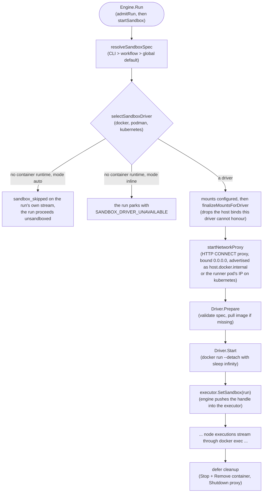

# 🛡️ iterion sandbox

The sandbox is the boundary that makes autonomous agents safe to run: every
coding agent and shell tool node executes inside a throwaway per-run Docker (or
Podman) container instead of against your host credentials and filesystem. It is
**on by default**: at product entry points (`iterion run`, `resume`,
the studio, the dispatcher) a workflow that declares no `sandbox:`
block runs as `sandbox: auto` (devcontainer-aware, falling back to the
published default image). Opting out is explicit and discouraged —
`sandbox: none` in the workflow (flagged by the C128 warning
diagnostic), `--sandbox none`, or `ITERION_SANDBOX_DEFAULT=none` —
because an unsandboxed run executes with the host's credentials and
filesystem. Two branches, two guarantees when the host cannot sandbox
(#1425 — 107 scheduled ticks used to die here on the operator's own
host):

- **`sandbox: auto`** (the default reading of "isolate if you can") —
  on a host with **no container runtime** the run proceeds
  **unsandboxed** with a visible `sandbox_skipped` event on its own
  stream. Whether the mode came from the workflow's own block,
  `--sandbox=auto` or the built-in default, the answer is the same —
  the MODE decides, not the tier that named it. One cost the event
  states explicitly (`file_secrets_dropped: true`): an unsandboxed run
  has nowhere to mount `as: file` secrets, so a workflow that declares
  them will not find them — and a secret whose `sinks:` grants nothing an
  unsandboxed run serves (`egress` with no `command`, `params` or `file`
  beside it; `agent` with no claude_code or in-process claw node) is refused
  at the launch, typed ([secrets](secrets.md#sinks--where-a-declared-secret-may-be-materialised)). (The resolver degrades the same way when it
  can resolve no repository root, or no image at all for a
  `devcontainer.json` it cannot read — both need a library caller that
  supplies neither, since `iterion run`, studio and the runner always
  resolve a repo root and a default image.)
- **`sandbox: { mode: inline, image/build: … }`** — an EXPLICIT
  container the author wired. The refusal is a guarantee: the run
  parks with `FailureCode = SANDBOX_DRIVER_UNAVAILABLE` (the typed
  code persisted on the run as `failure_code`, repeated in its error
  text, and copied onto the schedule record's `last_run_error_code`,
  #1426), and `pkg/retrypolicy` classes it
  Deterministic so a redelivery is acked rather than spun against the
  same absent runtime. To run it anyway, ask for it: `--sandbox none`
  (or `sandbox: none`) executes on the host, deliberately.

Either verdict is readable where an operator looks: the event in
`events.jsonl` and `iterion inspect --events`, and a line of its own in
`iterion report` — "Sandbox skipped — the run is NOT isolated: …", or
"Sandbox refused [SANDBOX_DRIVER_UNAVAILABLE]: …".

(The cloud runner was long assumed to pin `ITERION_SANDBOX_OVERRIDE=none`
— the runner pod as the isolation boundary — but the production
deployment measured on 2026-08-05 does NOT: it carries
`ITERION_SANDBOX_DEFAULT=auto` with an EMPTY override, so cloud runs do
get the k8s sandbox. Anything needing a bind-mounted workspace there
must declare `sandbox: none`.)

**The override does not qualify a deployment to run untrusted
workspaces.** A run whose `trust` is not the trusted default — today the
fork review lane's `trust=fork` — is refused at the engine's admission,
typed, unless its sandbox resolves ACTIVE through the very same
resolution the run's own start would walk (override, workflow block,
global default, then driver selection — a degraded `mode=auto` host with
no container runtime refuses too). Without a per-run sandbox the fork's
agent executes inside the runner's trust domain, where every pod secret
(`ITERION_SECRETS_KEY`, `MONGODB_URI`, the LLM keys) is one
`/proc/self/environ` read away from it. The override keeps meaning what
it means for trusted runs; a deployment that wants to run the fork lane
serves it from a runner class whose sandbox resolves active. The durable
refusal rides the run's `admission` record with code
`untrusted_without_sandbox`.

**A fork run whose sandboxed nodes get no credential is refused before the
container starts.** The sandbox alone is not enough: an operator
authenticated only through a file-based subscription login (`claude login`,
a ChatGPT login) has that login reach a local docker sandbox through the
`host_state` mount — and a `host_state: none` run withdraws exactly that
channel, leaving the node to die mid-run on the backend's opaque "not
logged in". At sandbox start (driver selected, nothing pulled or mounted
yet), a per-backend predicate — `claude_code`, `claw`, pi — answers "will
a credential reach this node's process?" from what each backend actually
delivers: the run's resolved credentials, the launcher env each backend
forwards by name at exec time, the dispatch-time forfait copies, and the
`host_state` mount itself. A node with no channel refuses the launch with
`SANDBOX_CREDENTIAL_UNREACHABLE`, naming the backend, the node, and the
ways out (an API key the backend forwards, or `host_state: auto` on a
runner that still mounts the login — a credential declared `as: file`
reaches the container's filesystem, not the backend CLI's auth, so it does
not lift this refusal); a
node whose backend the predicate cannot read is a
`sandbox_no_credential_warning`, never a refusal on a guess. Trusted runs
are never judged, and handing the operator's own OAuth token to a fork's
container is refused by design — the token is the operator's identity, not
a scoped run credential (#1768).

## Quick start

The shortest path to a sandboxed run:

1. Add (or reuse) a `.devcontainer/devcontainer.json` in your repo.
2. Set `sandbox: auto` on your workflow:

   ```iter fragment
   workflow review:
     worktree: auto
     sandbox: auto
     entry: plan
   ```

3. Run the workflow as usual. iterion will pull the image, start the
   container, route `claw`, `claude_code`, pi, Kimi, Grok, and direct tool nodes
   through it, and tear the container down on exit.

To enable sandboxing without touching the workflow source, pass
`--sandbox=auto` to `iterion run`:

```bash
iterion run review.bot --sandbox=auto
```

## How it works

Diagram: [Flow — sandbox isolation](diagrams/flow-sandbox-isolation.md) — the
four-tier precedence, the driver selection and the whole boot, guard by guard.

### Lifecycle



A **single container** hosts the entire run. Multiple `docker exec`
calls amortise the create+start cost over every `claw`, `claude_code`, pi,
Kimi, Grok, or direct tool-node invocation. The container's PID 1 is
`sleep infinity` —
iterion deliberately ignores the image's CMD/ENTRYPOINT in favour of
treating the container as a long-lived "ssh-like" target.

### Setup phases and their timeouts

Everything between "the container/pod is up" and "the first node runs"
is **setup**, and each phase is bounded on its own. An unbounded phase
does not fail — it *waits*, and a run waiting in setup has no
`sandbox_started` event, holds its queue lease, and only dies when the
run's own `max_duration` fires hours later (measured: 2h 26m in a
workspace copy). So every phase either carries a bound or is named
below as one that does not.

| Phase | Driver | Bound | Env override (Go duration) |
|---|---|---|---|
| `kubectl apply` (per-run Secret, CA Secret, pod, NetworkPolicy, mid-run secret refresh) | kubernetes | 2 min each | `ITERION_SANDBOX_K8S_APPLY_TIMEOUT` |
| Pod Ready wait | kubernetes | 10 min | `ITERION_SANDBOX_K8S_POD_READY_TIMEOUT` |
| Workspace copy (host tar → `kubectl exec` tar) | kubernetes | 15 min | `ITERION_SANDBOX_WORKSPACE_COPY_TIMEOUT` |
| Workspace git fixup | kubernetes | 15 min (shares the copy budget) | `ITERION_SANDBOX_WORKSPACE_COPY_TIMEOUT` |
| Seed copy (the run's attachments: host tar → `kubectl exec` tar, one phase per seed) | kubernetes | 15 min (shares the copy budget) | `ITERION_SANDBOX_WORKSPACE_COPY_TIMEOUT` |
| `post_create` snippet | kubernetes | 30 min | `ITERION_SANDBOX_POST_CREATE_TIMEOUT` |
| Image pull | docker | 10 min | `ITERION_SANDBOX_PULL_TIMEOUT` |
| `post_create` snippet | docker | 30 min (the same knob as kubernetes) | `ITERION_SANDBOX_POST_CREATE_TIMEOUT` |

A budget belongs to the **phase**, not to the driver: `post_create` reads
one knob wherever it runs, so an operator raising it for a slow toolchain
install raises it everywhere. `post_create` gets its own, larger budget
because installing a toolchain legitimately outlasts a copy; raising one
knob does not move another. Every knob takes a Go duration (`5m`, `45m`,
`2h`) and fails **closed**: a value that is not a positive duration —
including `5`, which Go reads as five *nanoseconds*, not five minutes —
is refused rather than honoured, the default applies, and one stderr line
per process names the variable, the value and the default that replaced
it.

The apply bound is enforced on the process: the phase deadline kills the
local `kubectl`. It is deliberately NOT also passed as kubectl's own
`--request-timeout` — setting that flag at any value makes `kubectl` v1.36
discard the in-cluster configuration and dial `http://localhost:8080`, so
every apply fails at once (measured in production on 2026-09-07). `kubectl delete` (the
stale-pod eviction before the pod apply, every rollback, the run's own
cleanup) shares the apply budget but reports a plain deadline — a cleanup
is not a setup phase and is never classified as one.

A phase that burns its budget fails with `sandbox.ErrPhaseTimeout`, which
the engine classifies as `SANDBOX_SETUP_TIMEOUT`: the run parks
**`failed_resumable`** with its checkpoint intact, on a launch and on a
resume alike. In cloud mode the runner then re-offers the delivery to a
fresh pod after 2 minutes (the stall is usually infrastructure catching
its breath); a stall that repeats through every permitted delivery ends
parked on the DLQ, announced, rather than naking into nothing. Halfway
through a phase's budget the runner logs a warning naming that phase and
its own knob, so a slow-but-healthy copy is visible before the bound
strikes.

See [resume](resume.md#sandbox-startup--which-failures-are-resumable) for
the full classification table (which failures are resumable and which
stay terminal).

### Workspace bind-mount

The host worktree (when `worktree: auto`) or repo (when `worktree: none`)
is bind-mounted RW into the container. The default mount target depends
on `host_state` (see below):

- `host_state: auto` (the default) — mounted at the **same absolute
  path as on the host**. This keeps absolute-path-derived state
  identical inside and outside the container (Claude Code project
  keys, prompts that reference `${PROJECT_DIR}`, tool nodes that pass
  absolute paths around).
- `host_state: none` or workflow that pins `workspace_folder` —
  mounted at the configured target (default `/workspace`).

Override via `workspaceFolder` in `.devcontainer/devcontainer.json`
or `workspace_folder:` in the inline `sandbox:` block.

#### Copy-based drivers: a host write does NOT reach the agent

"Bind-mount" is true of the **docker** driver and the **noop**
passthrough — the container and the host share the inode, so a host
write is visible inside immediately. The **kubernetes** driver cannot
bind anything (a pod has no host filesystem): it streams the workspace
in as a **tar at pod start** and exports it back at teardown. The
mount target is still the host's absolute path — that part is
deliberate — but the *contents* are a copy frozen at start.

**Consequence for anything that hands an agent a file PATH** (a system
prompt written to a file, an extension loaded with `-e`, a credential
directory): writing it host-side after the pod booted produces a path
that exists on the host and nowhere else. Sometimes that crashes
loudly (`pi -e …` → `Extension path does not exist`); more often the
agent simply starts without the thing, and nothing says so.

Write through [`sandbox.WorkspaceFileRefresher`](../pkg/sandbox/iface.go)
instead — `RefreshWorkspaceFile(ctx, relPath, value)` writes the file
inside the sandbox, addressed relative to the workspace root. Drivers
that share the host inode deliberately do NOT implement the interface,
so the type assertion is how you learn which world you are in:

```go
if refresher, copyBased := task.Sandbox.(sandbox.WorkspaceFileRefresher); copyBased {
    _ = refresher.RefreshWorkspaceFile(ctx, ".iterion/pi/agent.js", body)
}
```

Callers today: the runner's mid-run git-credential rotation, the claw
executor, and `delegate.mirrorStateFileIntoSandbox` (pi's extension,
system prompt and codex credential). A unit test whose fake
`sandbox.Run` omits this interface tests the shared-filesystem half of
the world only.

#### A promise the driver drops takes its variable with it

The mirror rule for anything the runtime hands the container as a PATH:
every optional host bind (the run's attachments, its run-files
directory, the bot's bundle) is dropped on a copy-based driver, and the
promise made on it must go with it. On the pod backend:

| Promise | On docker | On kubernetes |
|---|---|---|
| `ITERION_ARTIFACT_FILES_DIR` (where an in-sandbox tool drops files for the artifact-files panel) | set, bind-mounted | **absent** — a tool falls back to a temp dir |
| `ITERION_ENGINE_BIN` (the engine's own iterion binary, for a bot script that re-enters the CLI; never resolved from the workspace) | set — the container path the bind mount or the image bakes | set — the container path, via per-exec env, so no bind to drop |
| Attachments path handed to nodes | the container path | the container path — the directory is **copied in** at start (`RunInfo.SeedDirs`, an `emptyDir` per seed, the workspace's tar pipeline; `sandbox_attachments_copied` on the run's stream), its files read-only. A driver that can neither bind nor copy **refuses the run** that holds attachments: `ATTACHMENTS_UNDELIVERABLE`, `sandbox_skipped` with `refused: true` and the names — a run that goes on without what it was given is the worst of the three outcomes (#2086) |
| The bot's bundle `devbox.json` | provisioned from the mount | provisioned — the config is **carried** into the sandbox by the install prologue, since the bundle itself cannot be read from in-container (see [devbox provisioning](#best-effort-never-silent)) |

The attachments are the one dropped bind that is carried, not withdrawn:
a driver that cannot bind the directory but can copy it
(`Capabilities.SupportsHostDirCopy`, kubernetes) receives it as a seed at
the same container path, and on a store with no filesystem root (cloud)
the engine first fetches the run's attachments into a directory of the
run's own, which is what the sandbox binds or seeds — and what the nodes
open when the run executes in the runner's own process.

Every drop is a **run event**, `sandbox_host_binds_dropped` — the driver,
the container targets the dropped binds served, the variables withdrawn
with them and any value handed back — so a reader of the run, not only of
the runner's log, sees what the container never had. And a node that
names an attachment's path (`{{attachments.<name>.path}}`, or the bare
form) while the run holds the attachment with no path it can open fails
**before it runs**, typed `ATTACHMENT_PATH_UNAVAILABLE`, instead of
running on an empty string; `{{attachments.<name>.url}}` serves wherever
the node runs, and so does an image attachment referenced with the plain
spelling in the user prompt of an agent or judge whose every route is
`claw` (that executor sends an image block, by URL when no copy exists). An attachment the run does not hold still renders empty —
a declared optional attachment nobody uploaded is the bot's to test for.

The measured cost of getting this wrong: the run-files variable once
named a directory the pod never had, a gate wrapper redirecting its
report into it died on "Directory nonexistent", and four lots read an
oracle verdict out of an environment failure.

**Known gap — run-files on pods.** Nothing collects a pod's run files:
the collector reads the host directory the bind would have served, and
the pod writes to a temp dir that dies with it. Closing it needs a
read-back seam the driver does not have — an emptyDir at the container
path plus a drain at teardown, i.e. `WorkspaceExporter`'s shape widened
past the workspace. Until then the artifact-files panel is empty for a
pod run, and the variable stays honestly unset rather than naming a
directory nobody reads. The contract that seam implements is written:
[ADR-143](adr/143-sandbox-read-back-contract.md) — a read-back path is
declared, served by storage the driver owns, and drained at teardown, so
the variable is named *because* the content comes back.
`TestSandboxSpec_NoPromiseSurvivesTheBindThatServedIt`
([pkg/runtime](../pkg/runtime/sandbox_bind_promise_canary_test.go)) walks
every `spec.Env` value and every path in `spec.PostCreate` against the
mounts the driver keeps, so the next promise made on a dropped bind
fails in CI rather than in a campaign.

### Host state mounts (`~/.iterion`, `~/.claude`)

When `host_state: auto` (the default), iterion also bind-mounts:

| Host path                | Container path           | Purpose |
|--------------------------|--------------------------|---------|
| `~/.iterion/` (or `$ITERION_HOME`) | same absolute path | Run store: events, artifacts, recoveries, the `runs/<id>/` tree. The in-container `iterion __claw-runner` writes here and host iterion reads it after the run. |
| `~/.claude/`             | same absolute path      | Claude Code OAuth credentials, per-project `projects/<key>/` chat history, user-level `CLAUDE.md`. Keeps memory persistent across runs. |

Both are RW. The container's `HOME` env var is set to the host home so
processes that resolve `~` land in the mounted tree (no EACCES against
a stock image's `/root`). The pin yields to a `HOME` already in the
spec, which is the workflow's `sandbox.env:` alone: a devcontainer's is
refused by the env deny class before it gets there (#2318).

**UID remapping (Linux only):** when `host_state: auto` is active and
the spec doesn't pin a `User`, the docker driver runs the container as
`$(id -u):$(id -g)` so files written into the mounted trees stay owned
by the host user. Emitted as `sandbox_user_remap` in `events.jsonl`.
macOS / Windows Docker Desktop handle this implicitly via userns-remap
and need no intervention. Host UID 0 (CI runners) is a no-op.

If the spec pins a `User` that mismatches the host UID (a
devcontainer with `remoteUser: node` on a host UID ≠ 1000, for
example), iterion respects the spec and emits a
`sandbox_uid_mismatch_warning` so the operator knows why writes back
to the mounted trees may end up owned by an unexpected UID.

**Writable `$HOME` (devbox / version managers first-class).** When
`host_state: auto` lays the host-UID-owned tmpfs at `$HOME` (Linux), it
also lays a user-owned tmpfs at the top-level-under-`$HOME` parent of
every nested bind it adds (e.g. `$HOME/.cache` for the `$HOME/.cache/go-build`
bind, `$HOME/go` for `$HOME/go/pkg/mod`). Docker creates a bind's missing
parents as `root:root`, which would otherwise leave `$HOME/.cache`
unwritable and break `devbox run` (`mkdir … '/home/.../.cache/devbox':
Permission denied`) as well as `go install` (`$HOME/go/bin`). With the
parents re-laid user-owned, the whole `$HOME` subtree is writable, so
version-manager wrappers (`devbox`, `asdf`, `mise`) and `go`/`npm`/`pip`
caches all work inside the sandbox. The nested binds still overlay at
their deeper paths and persist to the host. Deeply-nested binds get
every intermediate ancestor re-laid (`$HOME/.local/share/pnpm` →
`$HOME/.local` and `$HOME/.local/share`), so siblings like
`$HOME/.local/share/fnm` stay writable too.

Where the host-UID remap does NOT run — a non-Linux docker host, or an
engine running as root — there is no host UID to lay with, so the two
ephemeral homes are owned by the CONTAINER user instead: the tmpfs carries
`uid=` from `spec.User` when it names one, and is world-writable
(`mode=0777`) when it does not. This must be emitted, not assumed: a docker
tmpfs without `uid=` is `root:root` (measured: `--user 1000 --tmpfs
d:mode=0755` → `touch: Permission denied`), and a `root:root` ephemeral
home is a home the in-sandbox CLI cannot write. The world-writable
fallback loses nothing — a tmpfs keeps no byte past the run, and the
home's isolation never rested on its mode.

**Warm package caches.** Alongside the Go build/module caches, the Node
package caches (`~/.npm`, `~/.local/share/pnpm`, `~/.cache/yarn`) are served
at the same path inside the container — without them every sandboxed run
re-downloads its packages over the network on a cold `npm ci`/`pnpm install`.
They are the sandbox's OWN caches, not the host's: the source is
`<iterion home>/sandbox-caches/<the path under $HOME>`, created on demand,
shared by every sandboxed run and read by no tool of the host (#2069 —
`$PNPM_HOME` holds the global bins `pnpm setup` puts on the operator's PATH,
the module cache holds the toolchain binary `GOTOOLCHAIN=auto` executes, and
the build cache holds objects `go build` relinks without re-hashing them, so
binding the host's own read-write handed a sandboxed agent the host's next
build). Gated under `host_state`, and on the iterion home being the
operator's own — with no home iterion owns, the run simply builds cold.

Measured cost of the switch: the FIRST sandboxed run after it compiles cold
(12.1 s for `./pkg/runtime` on a dedicated cache, against 0.1 s on the
second run through the same directory), and the caches are stored twice on
disk. Residual, stated: a sandboxed run can still poison the cache the NEXT
sandboxed run uses — they share one store, as parallel runs always did. The
store is created `0700` and owned by the engine's user, so a container that
pins a UID of its own (a devcontainer `remoteUser`/`containerUser`) gets NO
cache and a warn saying why: handing over a directory it cannot even read
would surface as `permission denied` inside `go build` with nothing in the run
record to explain it — the same condition, and the same answer, as the project
scratch's. `iterion clean` reclaims the store by the same age rule as scratch
and discovers a store whose only volume is that cache (`--all-projects`).

**Overlap handling:** when the workspace bind-mount already contains
one of the candidate paths (typically a project-local `<repo>/.iterion/`
opt-in store), the redundant host_state mount is skipped — Docker's
bind semantics would have the more-specific entry win anyway, but the
explicit skip keeps `docker inspect` readable.

**Opt-out and security.** Set `host_state: none` in the workflow,
pass `--sandbox-host-state=none`, or export
`ITERION_SANDBOX_HOST_STATE=none` to disable. This is the recommended
posture for **multi-tenant cloud runners and shared CI**: the RW mount
exposes `~/.claude/.credentials.json` (OAuth) to every exec in the
container, which is fine on a single-user dev box but a leak vector
on shared infrastructure. The `kubernetes` driver hard-errors on
`host_state: auto` for the same reason: cloud pods have no host
filesystem to bind and the design refuses to fake it.

**Host-configuration guard (#2069).** A sandboxed agent — a prompt-injected
one, say — must not be able to plant what the HOST later executes. So under
the guard, on by default wherever the driver has host bind mounts, the two CLI
homes the sandbox gets are NOT the operator's: `~/.claude` and `~/.codex` are
a **per-run tmpfs**, and only what the host reads is bound back on top of it.
The in-sandbox CLI writes its home as freely as ever — in the tmpfs — and
every byte dies with the run.

Read-only by default, and the reason it is that way round is the enumeration
problem. A read-only overlay list must name every path the HOST executes, and
a forgotten one writes the operator's home *in silence*; a tmpfs must name
every path the SANDBOX needs to SEE, and a forgotten one is simply absent in
the container — the shape the CLI meets on a fresh machine. The write set of a
real authenticated run is not a list this repository can hold (measured on the
image's claude 2.1.175: an unauthenticated `--version` already writes
`backups/`, and in a home one state away it does not). The READ set is,
because it is the operator's own configuration.

- what the host EXECUTES or LOADS AS INSTRUCTIONS binds **read-only** on top
  of the tmpfs: under `~/.claude`, `hooks/` (the scripts a settings `command:`
  names — a hook is a pointer, the script is what runs), `local/` (the CLI
  install iterion's own probe resolves and runs), `plugins/`,
  `cowork_plugins/`, `dev-mods/`, `mcp-skill-archives/`, `skills/`,
  `commands/`, `agents/`, `output-styles/`, `rules/`, `workflows/` and
  `routines/` (`hostExecutedClaudeHomeEntries`); `~/.codex/prompts/` and the
  instruction files `~/.codex/AGENTS.md` and `AGENTS.override.md`; and, in the
  iterion home, `plugins/`, `skills/` and `connectors/`
  (`hostLoadedIterionHomeEntries` — the host-side process starts a plugin's
  MCP servers and rewriters, `mirrorLibrarySkills` copies a library skill into
  every run's workspace where the agent loads it as instructions, and a
  connector package decides what a `tool … action:` call reaches and which
  sealed credential goes with it);
- files the CLI reads AND rewrites in place bind a **per-run copy** seeded
  from the host content: `~/.claude/settings.json`, `settings.local.json` and
  `CLAUDE.md`, `~/.codex/config.toml`, the three that are not under an
  ephemeral home — `~/.gitconfig`, `~/.claude.json` and
  `<iterion home>/plugins.yaml` — and the worktree `.git`'s `config`. Reads
  see the operator's config, writes (a permission "always allow" landing in
  `settings.local.json`, say) land in the copy and die with the teardown. The
  copies live in a `0700` scratch dir of `0600` files, removed on every exit
  path of the sandbox start and at teardown; a scratch orphaned by a killed
  engine is swept at the next run's guard (iterion's own prefix, older than
  24 h);
- four paths bind **read-write**, each because an iterion process OUTSIDE the
  container reads or writes the same tree: `~/.claude/projects/` (the session
  transcripts `session: persist` packs from the host path after the run,
  `delegate.SessionFilesRoot` + `sessionpack.CollectBySessionID`),
  `~/.claude/.credentials.json` (the forfait OAuth token the CLI reads and
  refreshes), `~/.codex/auth.json` and `~/.codex/sessions/`. Made ephemeral, a
  sandboxed `claude_code` or `codex` node on a forfait would have no
  credential at all and every persisted session would restart from scratch.

Nothing else of the two homes crosses the boundary. A `~/.claude` entry the
list forgets now costs FIDELITY — an in-sandbox session that does not see a
skill — where it used to cost the host's integrity; extending
`hostExecutedClaudeHomeEntries` is how a future CLI directory joins.

**A bind source is checked, not spelled.** A bind mount's SOURCE is resolved
by the kernel on the HOST, following every symlink in it — so a bind whose
source lives under a directory the sandbox itself writes is a bind whose
source the SANDBOX chooses, and nothing about the mount's string looks wrong.
The iterion home is bound read-write by design (the run store, the memory tree
and the project scratch must outlive the run) and it is the source of the
project scratch, of the sandbox's own cache store and of the `plugins.yaml`
copy; the worktree `.git` tree has the same shape. Before any of those is
emitted, `safepath.RealBindSource` requires the resolved source to BE the path
it is named — `filepath.EvalSymlinks` against the resolved store root,
re-asked after the `MkdirAll` that creates it, so a link planted between the
two does not survive into the mount plan. A failure is a loud warn and a
skip: the cold run, the pre-existing "cache absent" state, never a bind.
Without it a run that replaced
`<iterion home>/sandbox-caches/.cache/go-build` with a symlink to
`~/.claude/hooks` had the NEXT run mount the operator's hooks read-write,
under an audit line still spelling the store.

**The check is asked twice, and the second ask is at the border.** The
daemon resolves a bind's source at container CREATION, but the check above
runs when the PLAN is built — before the driver pulls the image, which is
minutes. A sandboxed run alive through that window can swap a verified leaf
for a symlink and choose where the next creation's mount lands (measured on
docker 29: plan verified, leaf swapped, creation wrote the attacker's host
path through the emitted mount string). So the plan names EVERY source it
verified — whatever a shadow asked `checkBindSource` about, the scratch,
the caches, the overlays — in `Spec.BindSourceChecks`, plus the run's own
workspace: the one bind the DRIVER derives from run metadata rather than
from this plan, read-write, and for a worktree run under the same home. The
workspace's question is not the store's — the checkout IS supposed to be
writable — it is the tree's identity: still the directory the engine laid
for this run, no component a link. It is `MustExist`, the one kind nothing
recreates: a store-backed source that went missing is mkdir'd cold, a
missing workspace refuses the creation. The driver re-asks every entry
immediately before the create command; a source that no longer verifies
refuses it, naming the swap and where the leaf now points; the retry
self-heals, because the guard then sees the planted leaf at plan time and
skips the bind cold. The ask judges the engine's filesystem — a daemon on
another host (remote DOCKER_HOST) resolves sources on a tree these checks
never saw. **Said plainly: the race itself is irreducible.**
Between the last ask and the daemon's own resolution there is always a
window, and no userspace check can shrink it to zero — closing it fully
needs the kernel to pin the resolution (a mount API that hands the daemon
an already-opened path, or a source outside every directory the sandbox
writes). What the second ask buys is the window's SHAPE: minutes of pull
and build become the microseconds between the re-ask and the create, and a
swap caught there stops the container instead of mounting what the swap
chose.

The cache store is also bound **read-only at its own path** inside the
container. The run still writes the caches through the `$HOME` paths they are
bound at — mount options are per mountpoint — and can no longer rewrite the
store itself, which is where such a symlink would be planted.

Docker mounts nested binds by destination depth, parents first, so the
overlays win over the parent binds regardless of list order (measured on
docker 29). Every shadowed path is listed in the
`sandbox_host_state_mounted` event's `guarded` field — `copy:`/`copy-seeded:`,
`ro:`/`ro-created:`, `tmpfs:` and `rw:`/`rw-created:` — so `docker inspect`
never shows a host bind the run's events cannot explain.
`ITERION_SANDBOX_HOST_STATE_GUARD=off` disables the guard and restores the
all-writable posture, for the operator whose bots deliberately manage host
config.

**What a guarded run adds to the operator's home.** Under the two ephemeral
homes: nothing. A path the host does not have is absent in the container too
and a plant lands in the tmpfs, so there is no mountpoint to create — which is
why `~/.claude` and `~/.codex` use the *existing-only* shadows and no file is
seeded there. An `AGENTS.override.md` iterion created in a home that had none
would be a first-wins shadow of the operator's own `AGENTS.md`, forever (the
precedence of `docs/adr/0119`), and an absent instruction file is as
meaningful as its content. What is still created is in iterion's OWN home and
in the worktree iterion made: `<iterion home>/{plugins,skills,connectors}`, an
empty `<iterion home>/plugins.yaml`, `.git/hooks/`, and the two session roots
`~/.claude/projects/` and `~/.codex/sessions/` — created because a
`session: persist` would otherwise have nothing to pack (measured: those two
are the ONLY paths a guarded run adds under the operator's two CLI homes). They are inert
(an empty plugin registry file leaves every plugin's state exactly as its
absence did) and they are never removed.

One write shape changes under the guard, loudly: a copy-bound file absorbs
STREAMING writes into the copy — measured on `~/.claude/settings.json`,
rewritten from inside the container with the host file left byte-identical,
and the image's claude 2.1.175 starts and runs against a copy-bound
`~/.claude.json` — but an ATOMIC write, write a sibling and rename over the
file, FAILS with EBUSY, because a
mountpoint cannot be renamed over. It does not fall back to the copy:
`git config --global user.email …` on a guarded home dies with
`could not write config file …: Device or resource busy` and exit 4, and so
does `--unset` (measured, docker 29.9.2). A bot that must write git config
per run points `GIT_CONFIG_GLOBAL` at a path of its own; a bot that edits
workspace-local git config (golden-master's extend identity swap is the
catalog case) refuses loudly instead of writing, and the hatch above
restores the writable config.

Residual, deliberately out of scope and NOT free of host code execution: a
transcript a sandboxed run wrote under `~/.claude/projects/` is read back by a
later `claude --resume` on the host, which is an instruction surface — and the
read-write bind is what makes `session: persist` work at all. The worktree
`.git` likewise keeps objects/refs writable, which a commit needs. The two
credential files the container can read are the subject of the opt-out above:
`host_state: none` on shared infrastructure.

**One reader for everything that can lower isolation.** `internal/isolationenv`
is the single reader of every environment variable whose value could make the
operator's run LESS isolated than it would be unset: the two sandbox-mode
tiers `ITERION_SANDBOX_DEFAULT` and `ITERION_SANDBOX_OVERRIDE`, the image
`sandbox: auto` starts (`ITERION_SANDBOX_DEFAULT_IMAGE` — the image is the
code that runs with the host state mounted), the proxy's model-host list
(`ITERION_SANDBOX_MODEL_HOSTS`, which decides whose request bodies keep their
placeholders instead of the run's real secrets), and the two hatches
`ITERION_SANDBOX_HOST_STATE_GUARD` and `ITERION_SANDBOX_FLOOR`. All are read
from the environment iterion INHERITED, never from a project `.env`: the
nearest `.env` walking up from the working directory is a file in the
repository under review, which a sandboxed agent of a previous run had as its
workspace. A planted value is IGNORED, with a warn naming the consequence
rather than the setting (and `hatch_ignored` on the `sandbox_floor_applied`
event) — export the variable in the operator's own environment for it to
count. The package doc carries the membership rule and the reason each sibling
variable is NOT in the class, and a second reader is a test failure (a source
scan over the module's non-test Go files): the defect this closes was not a
wrong answer but a SECOND reader. The #1959 floor neutralizes a non-operator
bot's `sandbox: none` by falling THROUGH to `ITERION_SANDBOX_DEFAULT`, which
`os.Getenv` read — so one line in a repository `.env` picked the posture the
floor had just defended, event and warn included.

**host_state mounts only the state the operator chose.** The iterion home
(`$ITERION_HOME`, else `~/.iterion`) and the scratch dir under it are
bind-mounted read-write only when that home is the one the operator chose —
the value they exported, not one a project `.env` filled in
(`store.InheritedIterionDataDir`); the shared `<tmp>/iterion-data` fallback a
process without a home dir writes to is never mounted. Likewise host_state
binds nothing under a home dir a `.env` set (`~/.claude`, `~/.codex`,
`~/.gitconfig`, the caches). Mounting any of them would let a repository pick a host directory
the sandboxed agent can write. The run still starts: the backend keeps its
per-run state in the checkout's `.iterion/`, as with `host_state: none`, and
`${PROJECT_SCRATCH_DIR}` stays container-local.

Audit trail: the `sandbox_host_state_mounted` event in `events.jsonl`
lists the resolved source (CLI / workflow / env / default), the
container workspace path, every mount that landed, the guard's
`guarded` shadow list (#2069), `iterion_home_not_mounted` when the
iterion home was left out, and `home_not_mounted` when a `.env` set the
home dir.

### Network policy

When a sandbox is active **with a non-open network policy**, an
iterion-managed HTTP CONNECT proxy runs on the host (ephemeral port).
The container receives the proxy URL via standard `HTTPS_PROXY` /
`HTTP_PROXY` env vars and reaches it via the `host.docker.internal`
alias under the docker driver, the runner pod's IP under kubernetes.

**Default mode is `open`** — no proxy, full egress — except on a
repo-defined sandbox (mode `auto` with a found `devcontainer.json`)
where the workflow declares no `network:` block: there the default is
the `iterion-default` allowlist preset, because open egress on such a
run is the repository's choice, not the operator's (see [the
devcontainer trust rules](#the-devcontainer-is-the-repositorys-file-not-the-operators)).
Workflows that need the stricter security-first posture elsewhere opt
in by declaring an explicit `network:` block:

```iter fragment:workflow
sandbox:
  image: "ghcr.io/socialgouv/iterion-sandbox-full:edge"
  network:
    mode: allowlist
    preset: "iterion-default"        # quoted: the lexer reads a bare kebab-case name as two words
    rules: ["internal.acme.dev"]     # an inline list, never `- item` lines
```

The shipped **`iterion-default`** preset is the recommended
starting point for allowlist mode: it covers the LLM endpoints
(anthropic, openai and the ChatGPT forfait's chatgpt.com, xAI/Grok,
openrouter, bedrock, googleapis, azure, mistral, z.ai, moonshot)
plus package registries (npm, PyPI, golang proxy) plus code hosts
(github, gitlab, bitbucket) plus apt mirrors. It is **not**
applied implicitly to a workflow that
declares `network:` — operators name it explicitly so the
default-open posture and the curated-allowlist posture are
unambiguous from the YAML. Its one implicit application is the
repo-defined sandbox above, which announces itself with the
`sandbox_network_defaulted` event.

By default the proxy does NOT terminate TLS — only the CONNECT
host:port is inspected, and the encrypted bytes pass through
untouched. This is a cost/simplicity choice (no CA to mint, custody,
or inject), **not** a cert-pinning constraint: the clients iterion
runs (Claude Code, the Anthropic/OpenAI SDKs) are standard
trust-store clients with no certificate pinning — they work behind
TLS-inspecting proxies (Zscaler, CrowdStrike, mitmproxy) once the
proxy CA is trusted. That same property is what the opt-in
TLS-inspection mode (secret egress substitution, see the secrets
docs) relies on.

Pattern syntax (last-match-wins evaluation):

| Pattern              | Matches                                  |
| -------------------- | ---------------------------------------- |
| `api.anthropic.com`  | exact case-insensitive host              |
| `*.example.com`      | exactly one DNS label (`foo.example.com`) |
| `**.example.com`     | one or more labels (`a.b.example.com`)   |
| `api.*.example.com`  | exactly one label in the middle (`api.eu-west-3.example.com`) |
| `**`                 | any host (the "open" sentinel)            |
| `1.2.3.4`            | IPv4 literal exact match                  |
| `10.0.0.0/8`         | CIDR range                                |
| `!pattern`           | exclusion (negation)                      |

Rules expand `${VAR}` / `${VAR:-default}` against the **runner's**
environment when the proxy starts — the same expansion `model:`,
`backend:` and `command:` already honour — so a catalog bot can scope
egress to a host only the deployment knows, above all the
[OpenAI-compatible gateway](backends.md#the-openai-compatible-gateway-openai_compatible)
(`rules: ["${OPENAI_COMPATIBLE_HOST}"]`). A reference that resolves to
nothing refuses the sandbox start and names the rule, rather than
silently dropping it — a dropped allowlist rule would merely confuse,
but a dropped denylist rule would fail *open*. The test is
**per reference**, not the rule's whole text: `api.${REGION}.example.com`
with `REGION` unset expands to a pattern no host matches, the same silent
drop in worse disguise. A rule every reference explicitly defaults is the
author's "no rule when unset" — `rules: ["${EXTRA_EGRESS:-}"]` is dropped
when the variable is absent, the one greppable opt-out.

Modes:

| Mode        | Behaviour for unmatched hosts             |
| ----------- | ----------------------------------------- |
| `allowlist` | deny                                      |
| `denylist`  | allow                                     |
| `open`      | accept everything (skips the proxy entirely; **the default**) |

**IP literals are refused by default in allowlist mode** even when
their hostname is allowed, which closes the cloud-metadata exfiltration
vector (169.254.169.254 etc.). Add explicit IP rules to relax.

**The proxy never dials its own host.** A destination on the proxy
host's loopback, the unspecified address (`0.0.0.0`, `::` — a connect
there lands on the loopback) or a link-local address (169.254.169.254
among them) is refused whatever the policy and however it is spelt — an
IP literal, `localhost.`, a hosts-file alias, a DNS answer: the check
runs on the address the proxy is about to connect to, and the request
is answered `502` naming the refusal. The one sanctioned way to the
host is the `host.docker.internal` alias (the per-run MCP listeners),
which the proxy dials on the host's loopback.

**The gateway's name is pinned.** When the deployment serves an
[OpenAI-compatible gateway](backends.md#the-openai-compatible-gateway-openai_compatible)
(`OPENAI_COMPATIBLE_BASE_URL`), the proxy resolves the gateway's host
itself through iterion's SSRF guard and connects only to an address the
guard validated — no loopback, private, link-local, multicast or
cloud-metadata one, unless the operator exports
`ITERION_LLM_ENDPOINT_ALLOW_PRIVATE=1` — the switch is read as the process
inherited it, so a project `.env` cannot lift it, in the host or in the
runner of a sandboxed crossing alike. Every
client of the run that reaches that name is held to it, through a CONNECT
tunnel, a plain-HTTP forward or an inspected tunnel alike, so an answer the
guard refuses is refused where the connection is made, whatever the
runner's own lookup saw: the request is answered `502` and a
`network_blocked` event names the refusal. No request to the gateway rides
a connection the proxy pooled. The rules still match the gateway by its
name. The proxy reads the gateway from the environment when the run starts
and at every connection, so a gateway an environment reloaded mid-run names
is pinned from the next connection on ([details](backends.md#the-openai-compatible-gateway-openai_compatible)).

Blocked requests surface to the run as a `network_blocked` event in
`events.jsonl`:

```json
{"type": "network_blocked", "data": {"host": "evil.site", "reason": "policy denial", "run_id": "..."}}
```

## Configuration surface

### `.bot` workflow

The DSL accepts both short-form modes and block-form inline specs:

```iter fragment
workflow x:
  # Short form: read .devcontainer/devcontainer.json, or fall back to
  # the default image when no devcontainer is present.
  sandbox: auto

  # OR: explicit opt-out (overrides global/default settings).
  sandbox: none

  # OR: block form. When the block has image/build/env/mount/network
  # fields and no explicit mode, it compiles as mode: inline.
  sandbox:
    image: "ghcr.io/acme/workflow-sandbox:sha256..."
    # build:                         # mutually exclusive with image
    #   dockerfile: "Dockerfile"
    #   context: "."
    #   args:
    #     VERSION: "1.2.3"
    user: "1000:1000"
    workspace_folder: "/workspace"
    host_state: auto         # auto | none. Default: auto. Set "none"
                             # on multi-tenant / shared runners.
    post_create: "npm ci"
    env:
      NODE_ENV: "test"
    mounts: ["type=bind,source=${localEnv:HOME}/.cache,target=/cache"]
    network:
      mode: allowlist
      preset: "iterion-default"
      rules: ["api.github.com", "!evil.site"]
```

`sandbox: auto` reads `.devcontainer/devcontainer.json` from the
workspace if present; otherwise it falls back to the published
**iterion-sandbox-slim** image pinned to the running iterion version.
That fallback ships with `git`, Node 24, devbox, and Nix preinstalled,
so the typical "agent installs deps, edits code, opens a PR" workflow
runs out of the box. See [Default image](#default-image) below.

#### The devcontainer is the repository's file, not the operator's

A found `devcontainer.json` defines the run's sandbox — and the
repository under review authored it. iterion therefore trusts the
workflow over the devcontainer on env and network — the two channels
where the repository could otherwise speak for the operator — and
never lets the repository speak for the operator:

- **Env.** The workflow's `sandbox.env:` keys win per key; the
  devcontainer's `containerEnv`/`remoteEnv` fill what the workflow
  did not author. Keys the repository contributed never shadow the
  values the launch environment carried: an env var the operator
  changed for the run (the overlay carries ONLY the keys the launch
  environment changed or added relative to iterion's own
  environment) overwrites a repo-contributed one (the same authority
  rule a project `.env` lives under). The devcontainer's own keys are
  additionally screened against a deny class, and denied keys are
  removed outright with a `sandbox_env_denied` event naming each key
  whose repository value the screen refused (`containerEnv` wins a
  collision with `remoteEnv`, so a refused `containerEnv` value
  removes the name). The class, matched **case-insensitively in all
  three forms** — suffixes, namespaces and exact names alike, so a
  repository's lower-case `path`, `env`, `editor` or `kubeconfig` key is
  dropped like its upper-case twin. That is a margin, not a claim about a
  consumer: an environment name is case-sensitive to the program that
  reads it (measured, a lower-case `bash_env` is sourced by no bash), and
  the exceptions are deliberate on the consumer's side — curl picks up a
  lower-case `http_proxy`, and the claude CLI reads both spellings of the
  gcloud project. Refusing every spelling costs the repository nothing it
  cannot write in the workflow's own `sandbox.env:`, and it is one rule
  instead of a twin per row. The class:
  - the suffixes `*_BASE_URL`, `*_API_KEY`, `*_TOKEN`, `*_SECRET`,
    `*_PROXY` (covering `NO_PROXY`);
  - the configuration namespaces of the agents iterion runs, of the
    cloud SDKs their providers authenticate through, of git and of the
    code loaders: `ITERION_*`, `CLAW_*`, `CLAWD_*` and `HOOK_*` (the
    in-container runner, the payload its settings hooks — the
    permission gate among them — are told about, and claw's own
    namespace: a plugin tool's payload and its telemetry knobs),
    `CLAUDE_*` (the claude CLI, whose cloud-provider switches
    `CLAUDE_CODE_USE_BEDROCK`, `_VERTEX`, `_FOUNDRY`, … it reads before
    any token), `CCR_*`, `ANT_OTEL_*`, `ANT_CLAUDE_CODE_*`,
    `ANTHROPIC_*`, `OPENCODE_*`, `AWS_*`, `AZURE_*`, `GOOGLE_*`,
    `GCE_METADATA_*`, `CLOUDSDK_*`, `VERTEX_REGION_*`, `OTEL_*`,
    `SENTRY_*` (the iterion binary is its own in-container runner and
    wires error tracking at startup: unset the package is off, so a
    planted DSN switches an outbound channel on), `GIT_*`, the forge
    CLIs' `GH_*` and `GLAB_*` (`GIT_*` covers git's
    config-from-the-environment too: `GIT_CONFIG_COUNT` with
    `GIT_CONFIG_KEY_*` / `GIT_CONFIG_VALUE_*`, and
    `GIT_CONFIG_PARAMETERS`), the dynamic loader's `LD_*`,
    `OPENSSL_*`, nix's `NIX_*` (a `plugin-files` in `NIX_CONFIG` is
    dlopened by the `devbox install` iterion itself runs), bash's
    exported functions `BASH_FUNC_*`, the bun
    runtime's `BUN_*` (`BUN_OPTIONS=--preload` runs a script inside
    the claude CLI's own process) and `NPM_CONFIG_*` (npm turns
    `NPM_CONFIG_NODE_OPTIONS` / `_SCRIPT_SHELL` into the options and
    the shell of every node child it spawns, `npx`-launched MCP
    servers included), and the XDG base dirs `XDG_*`, which is where
    those configurations and credential stores LIVE (git reads
    `$XDG_CONFIG_HOME/git/config`, opencode's login sits under
    `$XDG_DATA_HOME`) — the whole family, not only the two names seen
    planted;
  - the exact names `NODE_OPTIONS`, `NODE_PATH`,
    `GCONV_PATH`, `SHELL`, `BASH_ENV`, `SHELLOPTS`, `BASHOPTS`, `PS4`,
    `ENV`, `ZDOTDIR`, `PATH`, `GOFLAGS`, `SSH_ASKPASS`,
    `SSH_ASKPASS_REQUIRE`, `EDITOR`, `VISUAL`, `TAR_OPTIONS` (GNU tar
    prepends it to its own arguments, and `--checkpoint-action=exec=`
    is an option), `GOENV` / `GOTOOLCHAIN` / `GOROOT` / `GOAUTH` (the
    first names a file that sets `GOFLAGS` itself), `KUBECONFIG` /
    `DOCKER_HOST` / `DOCKER_CONFIG` (a kubeconfig's `exec` plugin and a
    docker `credsStore` are programs); the agents' config homes `CODEX_HOME`,
    `KIMI_CODE_HOME`, `PI_CODING_AGENT_DIR`, and `HOME` itself — every
    one of those files is resolved from it when its own variable is
    unset, `~/.gitconfig` first (the EXACT name only, so a toolchain's
    `JAVA_HOME` or `ANT_HOME` still configures the repository's own
    build); `OPENAI_API_BASE`,
    `BEDROCK_REGION`, `CLOUD_ML_REGION`, `GCLOUD_PROJECT` (one entry for
    both spellings the CLI reads: the names match case-insensitively),
    `AGENT_PROXY_URL`, `SESSION_INGRESS_URL` (the claude CLI's API base
    when no `ANTHROPIC_BASE_URL` is set — the usual case),
    `BETA_TRACING_ENDPOINT`,
    `ENABLE_BETA_TRACING_DETAILED`, `ENABLE_ENHANCED_TELEMETRY_BETA`;
    the binaries a path variable alone names — `VITALS_EMITTER_BIN`,
    `SDK_NATIVE_BIN`, `DS_CHROMIUM_PATH`; Azure's managed-identity chain off the
    `AZURE_*` prefix — `IDENTITY_ENDPOINT`, `IDENTITY_HEADER`,
    `IDENTITY_SERVER_THUMBPRINT`, `IMDS_ENDPOINT`, `MSI_ENDPOINT`,
    `DEFAULT_IDENTITY_CLIENT_ID`, `MSAL_FORCE_REGION`; and the TLS
    trust `NODE_EXTRA_CA_CERTS`,
    `NODE_TLS_REJECT_UNAUTHORIZED`, `SSL_CERT_FILE`, `SSL_CERT_DIR`,
    `CURL_CA_BUNDLE`, `REQUESTS_CA_BUNDLE`,
    `GRPC_DEFAULT_SSL_ROOTS_FILE_PATH`, `GRPC_SSL_CIPHER_SUITES`.

  **Where the class stops.** It takes the names that steer a process
  *iterion* starts for the operator, swept against the claude CLI's own
  192-name list of code-executing environment. Deliberately outside:
  the toolchain variables no process iterion starts reads (compilers
  and their flags, build systems, language runtimes, version managers —
  they configure builds of the repository's code, which already runs in
  that container; that question, not the family, is the membership
  test: `GOFLAGS`, `PATH` and `NIX_*` are toolchain variables too, and
  they are denied because iterion's own nodes and provisioning run
  under them), what
  needs a terminal nobody has there (`PAGER`, `LESSOPEN`, `BROWSER`),
  and the `*_HOME` of a toolchain (`JAVA_HOME`, `ANT_HOME`, `GEM_HOME`):
  `HOME` is an exact name in the class, never a suffix.

  A planted `HOME` or `XDG_CONFIG_HOME` points git at a gitconfig the
  repository committed: an `insteadOf` there rewrites every URL the
  run's clone, fetch and push resolve (a review bot then reviews
  attacker-picked content, and a push can land in an attacker's fork),
  and a `credential.helper` there is RUN and handed the operator's
  token — reproduced on #2316, rounds 5-6. The same road carries the
  agents' `$HOME` settings and hooks where no forfait mount pins their
  config dir, `$HOME/.npmrc`, and under `XDG_DATA_HOME` the credential
  store an agent logs into. The runtime's own `HOME` pin is not the
  guard: it yields to a value already set, it takes `HOME` alone, and
  it exists only where `host_state` binds a home. So a devcontainer
  that sets `HOME` or an `XDG_*` dir no longer gets it — the container
  keeps iterion's pin (under `host_state`) or the image's own value,
  and the `sandbox_env_denied` event names what was refused. A
  repository that needs a home of its own says so in the IMAGE it
  ships, which is its own artefact, or the workflow declares
  `sandbox.env.HOME:` — the operator's reviewed channel, which still
  wins.

  A planted `ANTHROPIC_BASE_URL` would re-route every LLM call the
  container makes to the planter's collector; a planted
  `CLAUDE_CODE_USE_BEDROCK` with the planter's `AWS_ACCESS_KEY_ID` /
  `AWS_SECRET_ACCESS_KEY` would send every prompt of the run's
  `claude_code` nodes to the planter's AWS account — an allowlist that
  lets the run reach the provider lets the redirect through — and the
  planted credentials alone do it under a switch, or a Bedrock model,
  the operator chose; a planted `BASH_FUNC_git%%` would run the
  planter's function in place of `git` in every `bash -c`, and
  `LD_PRELOAD`, `PATH`, `BASH_ENV` and `GOFLAGS` would execute the
  planter's code before any prompt is read. The same names in the
  workflow's `sandbox.env:` or the launch environment are the
  operator's and pass untouched: a repository whose own tooling needs,
  say, `AWS_REGION` gets it from the workflow. Malformed entries (a
  name carrying `=`, a newline or a NUL; a value carrying a newline)
  are dropped the same way — the docker driver would refuse the run
  outright and the kubernetes driver would drop them silently.
- **Network.** The workflow's `network:` block is carried into a
  found-devcontainer run exactly as into a default-image run. When
  the workflow declares none, the run does not inherit the
  repository's implicit "open" posture: the `iterion-default`
  allowlist preset applies and a `sandbox_network_defaulted` event
  says so. A block written without a `mode:` (C312 warns at compile)
  is completed to the allowlist its content is shaped like — and
  rules without a preset also gain the `iterion-default` base, since
  a rules-only allowlist would leave out every LLM endpoint and kill
  the run on its first model call; the event says when the runtime
  chose that base. Declare `network: {mode: open}` (or any other
  policy) to choose explicitly.

The devcontainer's image/build, mounts, user, `workspaceFolder` and
`postCreateCommand` still define the container it describes — that is
auto mode's contract. The default-image fallback branches (no
devcontainer, or one the sandbox cannot use) keep the historical
open-network default: nothing repo-authored survives into those
specs.

### The env an IMAGE bakes in

The deny class above screens `containerEnv` / `remoteEnv`. It does not
see the other channel into the same environment: the devcontainer always
names an `image` or a `build`, and that image's `ENV` applies to every
process iterion starts in the container, because the drivers pass
`--env` for `spec.Env` alone. A repository that commits
`{"image":"ghcr.io/planter/dev:1"}` whose Dockerfile carries
`ENV CLAUDE_CODE_USE_BEDROCK=1` plus the planter's AWS keys redirects
every prompt of the run with **zero `containerEnv` entries** (#2317).

So the runtime screens the image too, once it is local — after the pull,
after a `build:` has materialised it, before anything starts — and the
class gets one of two answers:

- the **credential and routing** sub-class is **neutralised**: the
  container starts with `--env NAME=`, which overrides the image's `ENV`
  with an empty value every one of those consumers reads as absent. It
  is the suffix family (`*_BASE_URL`, `*_API_KEY`, `*_TOKEN`,
  `*_SECRET`, `*_PROXY`), the provider and agent namespaces (`CLAUDE_`,
  `ANTHROPIC_`, `AWS_`, `AZURE_`, `GOOGLE_`, `OPENCODE_`, `CCR_`,
  `OTEL_`, `SENTRY_`, `GH_`, `GLAB_`, `CLAW_`, `CLAWD_`, `HOOK_`, …)
  and the exact endpoint, region, project and managed-identity names
  (`OPENAI_API_BASE`, `BEDROCK_REGION`, `IMDS_ENDPOINT`, …). Each of
  those consumers reads a VALUE — a truthiness, a URL, a key, an
  identity — so an empty one is inert, and no image iterion publishes
  bakes one. This is the **declarative redirection** of the operator's
  own credentials and model routes, and closing it is the whole promise
  of this screen (ARB-121 on Jo's question #63);
- **the rest of the class is told, and keeps its value.** Emptying
  `PATH`, `HOME`, `GOROOT`, a loader library path or an `XDG_` dir
  breaks an image doing its job — iterion's own `full` variant bakes
  `PATH`, and its runner image bakes `ITERION_VERSION` — and emptying
  `KUBECONFIG`, `DOCKER_HOST` or `DOCKER_CONFIG` would send the client
  to its DEFAULT, which under `host_state` is the operator's own,
  **worse** than the planted path. The TLS bundles and the names of
  binaries a CLI spawns are reported for the same reason: an image may
  legally bake them, and their consumers read presence as much as value.
  The names that lead to CODE are in this half too, for a different
  reason, and the next paragraph is that reason.

**Every channel into CODE is told, and kept.** A name an image bakes that
leads to code, or to a configuration a program EXECUTES, at the startup
of a process iterion runs there is **reported and not emptied** — the
operator reads it under `planted` and `reported`, and the value reaches
the container. The channels are real and each was measured to FIRE, on a
disposable image through the program's own startup path; the table in
pkg/runtime's `sandbox_image_env_startup_code_class_test.go` holds the
rows, and these are the measurements, not a list to trust:

- the loader, in every process: `LD_PRELOAD`'s constructor ran in **pid
  1** of a container created with `--env ANTHROPIC_BASE_URL= --env
  AWS_ACCESS_KEY_ID= …` and put the planter's route and keys back — for
  `bash`, for `node` and for an `npm`-started MCP server alike;
  `LD_AUDIT` did it through the audit interface, and
  `LD_LIBRARY_PATH=/planted/lib` with one shim in it (`libdl.so.2`,
  whose glibc original is an empty stub) had **node** read back the
  planter's route, token, access key and Bedrock switch;
- the shells iterion runs a tool node and an agent's Bash tool with:
  `BASH_ENV` is sourced by every *non-interactive* bash, `SHELLOPTS`
  with `PS4` ran the planter's program once per traced command, and a
  planted `BASH_FUNC_git%%` answered `git --version`;
- node and the two npm roads into a node child: `NODE_OPTIONS`
  (`--require=…`, in the CLI's own process), `NODE_PATH`,
  `NPM_CONFIG_NODE_OPTIONS` (npm re-exports it as `NODE_OPTIONS` to
  every `npm run` and `npm exec` child, which is how an MCP server
  starts) and `NPM_CONFIG_SCRIPT_SHELL`;
- the bun runtime the claude CLI is built on: `BUN_OPTIONS`, whose
  `--preload` ran inside `claude --version` itself;
- glibc's and OpenSSL's module roads: `GCONV_PATH`, dlopened by the
  charset conversion python does at interpreter startup — including
  under `python3 -I`, the argv of iterion's own python node — and
  `OPENSSL_CONF`, a config file that dlopens the provider module it
  names, measured in `curl` and in the `openssl` CLI;
- git, by every road that needs no file and no `HOME`: `GIT_CONFIG_COUNT`
  with `GIT_CONFIG_KEY_*` / `GIT_CONFIG_VALUE_*` and
  `GIT_CONFIG_PARAMETERS` are `git -c` spelled in the environment (a
  planted `core.sshCommand` ran on `git ls-remote`, `core.hooksPath` on
  the commit an agent makes, and `credential.helper` is #2316's
  mechanism), and the command-valued names — `GIT_SSH_COMMAND`,
  `GIT_SSH`, `GIT_PROXY_COMMAND`, `GIT_ASKPASS`, `GIT_EDITOR`,
  `GIT_EXTERNAL_DIFF`, `GIT_TEMPLATE_DIR` — are programs git runs: the
  planter's ran once per file of a plain `git diff`, on a fetch, and as
  the hook a `GIT_TEMPLATE_DIR` installs into the agent's own commit;
- GNU tar's own options: `TAR_OPTIONS`, whose `--checkpoint-action=exec=`
  ran in a `tar -czf` iterion starts.

Why they are told and not emptied, said plainly: **an image a repository
chooses is the repository's code** — its binaries, its files and its
`postCreateCommand` — by the same contract that makes "the devcontainer's
image/build, mounts, user, `workspaceFolder` and `postCreateCommand`
still define the container" auto mode's rule, and the fork road into that
position is refused at admission (`admitSandboxImageBackends`). Emptying
one variable of a channel the image's own files re-open promises the
operator something the artefact cannot owe: measured, an image-laid
`/usr/etc/npmrc` re-plants `NODE_OPTIONS` with **no variable at all**,
and an `LD_LIBRARY_PATH` shim re-plants the whole credential half with
every neutralisation applied. So the page makes no promise there — it
reports, which is what an operator can act on, and keeps the one promise
the ENV road can keep. A screen that emptied these names would also break
images doing their job (an image baking `NODE_PATH` for its own global
modules, `OPENSSL_CONF` for its own provider) for a guarantee it does not
buy.

What this screen is NOT, therefore: a defence against a malicious image.
It is the guard that stops a repository from **declaring** a model route
or a credential into the run with nothing but a `devcontainer.json` and
an `ENV` line.

Membership is **case-insensitive in all three forms** — suffixes,
namespaces and exact names alike — so no entry needs a lower-case twin.
It is a margin and not a claim about a consumer: see the devcontainer
channel above, where the same rule is stated with what it costs a
repository.

Every screen that finds something says so **twice**: a warning per
disposition in the run's log, and one `sandbox_image_env_planted` event
carrying the whole class. An image that plants nothing of the class emits
nothing.

**The record is DEDUCED from the container, not predicted from the
spec.** `planted` is the one fact that needs no container: the names of
the class the image bakes, read from `image inspect`, and what an
operator judges the image on. Every other key is a claim about a
container's own environment, so each is a MEASUREMENT of it — the
image's `ENV` compared, name by name, to the `--env`-resolved
environment the container was CREATED with, read back by the driver that
created it (`sandbox.StartedEnvReader`, `docker container inspect -f
'{{json .Config.Env}}'`):

- `neutralized` — the container carries the name EMPTY where the image
  baked a value;
- `reported` — the container carries the image's exact value, which its
  processes read;
- `allowed` — the same measurement for a name the host knob named: the
  image's own value, untouched, as the operator asked;
- `operator_set` — the container carries the value the RUN's own
  reviewed env holds (the workflow's `sandbox.env:`, the launch overlay,
  the forfait config dirs);
- `driver_set` — the container carries ITERION's own value, for a name
  the driver DECLARES its Start sets (`StartEnvNames`): it appends
  `--env` pairs of its own *after* the spec's — the egress proxy's six
  spellings when a network policy is enforced, the six CA bundles and
  the JVM truststore when that proxy inspects TLS — and the last pair
  for a name is the one the container gets;
- `unexplained` — the container's value matches none of those. Nothing
  in this repository produces one; it is the shape of a driver whose
  declaration drifted from its argv, and it is published rather than
  filed under a neighbour.

`neutralized` and `reported` always travel together once the container
was read, the empty list included, so "this half caught nothing" never
reads like "this event does not report that half"; the four others
travel only when they hold, so their presence is the signal.

Why a measurement and not a rule: the rules were applied in the wrong
ORDER twice. A record predicted from them published `HTTP_PROXY` as
emptied of a container carrying the proxy URL (four of nine names on one
run), and then `NODE_EXTRA_CA_CERTS` as "let through untouched" of a
container carrying iterion's per-run CA — an operator who allowed their
image's CA bundle through read that the image controlled the TLS trust
of the connections carrying their credentials. Both times the rules were
right. Read off the container, the question cannot arise: the host knob
withholds iterion's `--env NAME=`, it does not stop the driver's pair
from winning, and the name lands where the container puts it.

**A container that cannot be read says so.** `undeduced` carries the
reason — no container this driver could hand back (the screen refused
the boot, or Start failed, which can be a `postCreateCommand` failing in
a container the driver then removes), the driver cannot read one back,
or the read failed — and then
**not one disposition travels**: `planted` plus that reason is the whole
record. An empty `neutralized` beside it would read as "nothing was
planted" where the fact is "nobody looked". `unscreened` is the same
discipline one step earlier: the class itself was never read, so not
even `planted` is known.

Both partitions cover the **whole** class, the reported half included:
iterion sets some of those names itself — `HOME` under `host_state`, and
under TLS inspection the CA bundles of `caBundleEnvNames` plus the JVM
truststore pair of `javaTrustPairs` (pkg/sandbox/docker, which
`Driver.StartEnvNames` declares to the screen) — so a `reported` list
that held them would promise the image controls the TLS trust of the
connections that carry the run's credentials, when iterion's per-run CA
is what the container got. No count is given here on purpose: the
declaration is read from the driver at run time and `driver_set` is where
those names land, which is a measurement rather than a number this page
would have to keep true.

**A neutralisation the driver refuses stops the run** — and **no docker
image can trigger it today**, which is proved rather than assumed: the
screen only hands over names a driver could pass and a process could
resolve, and docker's own `--env` guard refuses on exactly those
characters, an empty value being refused for nothing else (walked over
1039 names, 0 usable-but-refused, in pkg/sandbox/docker's
`TestUsableEnvNameImpliesTheDockerEnvGuardAccepts`). So read what follows
as the shape of the branch, not as an outcome to watch for: it is kept
closed by default for the NEXT screener, whose guard may be narrower.
The override IS the guard, so the screen is closed by default: when the
class decides a name must be emptied and the driver will not take the
pair, the boot refuses with `FailureCode = CAPABILITY_UNSUPPORTED`,
naming the image and the variables, and **no container starts** — the event goes out first,
under its own `refused` / `refused_names` keys, so the run's record says
what the image planted even though nothing ran. That is a different fact
from `unscreened`, which says the channel was never read (a driver whose
images the kubelet pulls) and under which the run *proceeds*: a reader of
the two keys can tell a blocked boot from a cloud run. The operator's
answer to a refusal they judge acceptable is the host-side allow knob
below.

A name let through keeps its value and is still reported — the operator
asked for the variable, not for silence. What the knob withholds is
ITERION's `--env NAME=`; it does not stop the **driver's own pair** from
winning, so a name it lets through on a run with an enforced network
policy (`HTTPS_PROXY`) or TLS inspection (`NODE_EXTRA_CA_CERTS`) is
published under `driver_set`, not `allowed`: the event says what the
container has. A variable the screen neutralises is **set and empty**,
not absent: `docker inspect` shows it, and a consumer that reads
presence rather than value still sees it. That is the accepted cost of
not refusing an image that works.

**Where the override applies, measured.** The screen acts on the layer
the container is *created* with: `/proc/1/environ` of a run on a planted
image reads `CLAUDE_CODE_USE_BEDROCK=`, set and empty, and a tool node's
own environment carries no planted value either. Two layers, because only
the first is the screen's: a command iterion runs through `docker exec`
also receives the run's own env layer, and that layer may legitimately
set one of these names to the OPERATOR's value — the reviewed channel
winning, which is the point.

So the promise is precise, and it is **about the neutralised sub-class,
through the ENV road, only**: for a name of that sub-class the
repository's value never reaches a process *by way of the image's `ENV`*
— the name may still be *set*, to the operator's own value or to the
driver's, and `operator_set` / `driver_set` say when. For the
**reported** half the image's value *does* reach every process in the
container, **unless this run sets the name itself**: that half is told,
not emptied, and the two dispositions above are what take iterion's own
seven names out of it. Measured on the same run, in the same container,
with a reported name neither iterion nor the operator sets
(`KUBECONFIG`): `/proc/1/environ` and a tool node's own environment both
read back the image's exact value, while the four planted credentials
read empty.

**What the ENV road does not close, measured.** A FILE the image lays
down can re-plant a neutralised name with **no environment variable at
all**: an image that writes `node-options=--require=/planted/replant.js`
into npm's own global config — `/usr/etc/npmrc` in the default image's
npm, which `npm config get globalconfig` names and no variable points at
— had `npm run` and `npm exec` children start with
`NODE_OPTIONS=--require=…` and the planted module re-export the
credentials, with every neutralisation of the table applied. The screen
does not chase it, deliberately: forcing `NPM_CONFIG_GLOBALCONFIG` would
break an image that legitimately configures a corporate registry mirror
there. The residue is the contract rather than a hole — **the files and
binaries an image ships, and its `postCreateCommand`, ARE the
repository's code by the same contract that makes "the devcontainer's
image/build, mounts, user, `workspaceFolder` and `postCreateCommand`
still define the container" auto mode's rule**: the workspace is trusted
to the extent admission allows it (a fork's head never reaches this
code), and what this screen closes is the ENV road into the *operator's
own* credentials and model routes, not a malicious image.

**Not screened, said out loud.** `image inspect` is a local-store read,
so only a driver that resolves images locally can do it: the **docker**
driver screens, the **kubernetes** driver (whose images the kubelet
pulls) and the noop passthrough do not, and a run on them says
`the env image X bakes in was NOT screened` with the reason. A failed
read says the same. Nothing is ever inferred from a silence.

**The escape hatch is the operator's, and host-side only.**
`ITERION_SANDBOX_IMAGE_ENV_ALLOW=NAME1,NAME2` names the variables an
image may contribute untouched — exact names, comma-separated,
case-sensitive (it names a variable as the IMAGE spells it, not a class
entry), no prefix matching. It is read from the runner's own
process environment: never from the workspace, never from a stored bot
var (`ITERION_SANDBOX_` is an infra prefix of the bot-var deny list),
so **the repository under review can never allowlist itself**.

Block form without `mode:` is treated as `mode: inline`. You may also
write `mode: inline` explicitly. Inline mode must declare exactly one of
`image:` or `build:`. `image:` uses a pre-built image reference;
`build:` asks the local docker driver to run `docker buildx build`
against the workflow workspace before starting the container. `env:`,
`mounts:`, `network:`, `user:`, `workspace_folder:`, and
`post_create:` are copied into the runtime sandbox spec for both inline
and auto-mode fallback cases.

Per-node overrides accept the same short or block form on `agent`,
`judge`, and `tool`. They are parsed, but **not honoured at dispatch
today**: every node of a run shares the run's sandbox, so the example
below still runs `shell_helper` in it (a node-level `sandbox: none` draws
the C128 warning saying so; a node-level block draws none yet). To run on
the host, opt the workflow out (`sandbox: none` / `--sandbox none`).

```iter fragment
agent shell_helper:
  sandbox: none      # parsed (C128 warns); not yet honoured:
                     # the node shares the workflow's sandbox

agent custom_env:
  sandbox:
    image: "python:3.12-bookworm"
    env:
      PIP_DISABLE_PIP_VERSION_CHECK: "1"
```

### CLI

```bash
iterion run foo.bot --sandbox=auto    # one-shot override
iterion run foo.bot --sandbox=none    # force off
iterion run foo.bot                   # use workflow + global default
iterion run foo.bot \
    --sandbox-default-image ghcr.io/socialgouv/iterion-sandbox-full:edge
                                       # override the auto-mode fallback image
iterion run foo.bot --sandbox-host-state=none
                                       # disable ~/.iterion + ~/.claude auto-mount
iterion sandbox doctor                 # report driver + capabilities
```

### Environment / project config

- `ITERION_SANDBOX_DEFAULT` — global default (`""`, `none`, or `auto`).
  Lowest precedence. Workflows and CLI override. When UNSET, product
  entry points resolve it to `auto` (sandbox-by-default,
  `runtime.ResolveGlobalSandboxDefault`); set `none` to restore the
  historical opt-in behaviour machine-wide.
- `ITERION_SANDBOX_DEFAULT_IMAGE` — image ref used by `sandbox: auto`
  when no `.devcontainer/devcontainer.json` is found. Falls back to
  `ghcr.io/socialgouv/iterion-sandbox-slim:<iterion-version>` when
  unset. Overridden per-run by `--sandbox-default-image`.
- `ITERION_SANDBOX_HOST_STATE` — global default for the
  `~/.iterion` + `~/.claude` auto-mount (`""`, `auto`, or `none`).
  Defaults to `auto`. Set to `none` on multi-tenant / cloud runners
  to avoid leaking host OAuth credentials.
- `ITERION_SANDBOX_WORKSPACE_COPY_TIMEOUT` — budget of the kubernetes
  driver's workspace copy AND of the git fixup that follows, each
  end-to-end. Unset → 15 min. See [setup phases and their
  timeouts](#setup-phases-and-their-timeouts).
- `ITERION_SANDBOX_POST_CREATE_TIMEOUT` — budget of the `post_create`
  snippet on BOTH drivers. Unset → 30 min. Raise it for a devcontainer
  that installs a large toolchain.
- `ITERION_SANDBOX_K8S_APPLY_TIMEOUT` — budget of one `kubectl` control
  call on the kubernetes driver (every `apply`, every `delete`), enforced
  by killing the process; never passed as kubectl's `--request-timeout`,
  which breaks its in-cluster configuration. Unset → 2 min.
- `ITERION_SANDBOX_OVERRIDE` — CLI-strength mode override (`""`,
  `none`, or `auto`), same precedence tier as `iterion run --sandbox`:
  `none` beats even a workflow's inline `sandbox:` block. Honoured by
  the cloud runner (`iterion runner`): set `none` on a runner that is
  itself the isolation boundary and ships the toolchain (e.g. the
  `iterion-runner-devbox` image), so a bot's sandbox block — written
  for local runs — executes directly in the runner pod instead of
  spawning a sibling sandbox pod. The Helm chart sets this
  automatically whenever `runner.sandbox.enabled` is false.

### Precedence (highest → lowest)

1. CLI `--sandbox` flag — except that `--sandbox=auto` yields to a
   workflow block naming its own container (`image:` or `build:`);
   `--sandbox none` wins everywhere
2. Workflow-level `sandbox:` declaration (DSL)
3. `ITERION_SANDBOX_DEFAULT` env var
4. Built-in `auto` at product entry points (sandbox-by-default).
   Engines embedded without an explicit default (tests, library use)
   stay neutral: no sandbox.

There is no per-node tier: a node-level `sandbox:` is parsed but not
honoured at run time, so every node runs where the run does. Under a
workflow `sandbox: none`, a node declaring `sandbox: auto` or its own
block still runs on the host — isolate a risky step by sandboxing the
whole workflow, not the node.

The tier decides only WHO asked, never what happens when the host
cannot comply: any `auto` degrades gracefully, any explicit `inline`
is refused (see the two branches at the top of this page).

The same chain applies to `host_state` via `--sandbox-host-state`,
`sandbox.host_state:` in the workflow block, and
`ITERION_SANDBOX_HOST_STATE`. The built-in default is `auto`.

### The operator isolation floor (#1959)

The chain above decides between *who asked* — and a workflow-level
`sandbox: none` asked by a bot source the operator does not control is
not honoured: in cloud, a bot resolved from a **team** botsource row (a
fork authored in the studio editor) gets its opt-out neutralized, loudly
— a warn in the run log and a `sandbox_floor_applied` event naming the
tier, the overridden mode and the hatch — and mode resolution falls
through to the operator's own tiers (the CLI-strength override, then the
global default). Operator-origin sources keep their opt-out: the **baked**
catalog the deployment shipped (`bots/copilot` opts out deliberately and
keeps working), the **platform** override, and any local launch, which is
the operator's own file. An unrecognized tier floors too — the floor
fails closed on vocabulary it does not know.

The tier rides the queue message (schema v28) and the run document, so a
resume and a subbot child are judged by the source the launch resolved,
on every attempt — the in-process lane stamps it on the document too, or a
local resume would read the empty tier as the operator's own. The one
decision lives in `runtime.ApplySandboxFloor`; the engine applies it before
admission so the admission probe and the sandbox start judge the same
workflow. `ITERION_SANDBOX_FLOOR=off` is the greppable escape hatch for an
operator who trusts their team tier — read from the operator's own
environment, never from a project `.env` (a planted value is ignored with a
warn, and the event says `hatch_ignored`).

**What the floor does NOT promise.** Neutralizing the opt-out removes the
bot's word on the question; it does not guarantee isolation. Resolution
falls through to the operator's tiers, whose default is `auto`, and `auto`
on a host with no container runtime degrades to an unsandboxed run with its
own `sandbox_skipped` event (#1425). The `sandbox_floor_applied` event says
so in its `isolation` field: read `sandbox_started` / `sandbox_skipped` for
what actually happened. Two publisher-side screens (the run-fallback and
policy-ladder predictions in `pkg/server/cloudpublisher`) read the
workflow's own block UNFLOORED, stated at their sites: they are also reached
from a credential preview that has resolved no source, so they hold no tier
to judge; they are advisory, and the runner's screen is the authority.

## Default image

When `sandbox: auto` is in effect but no `.devcontainer/devcontainer.json`
is found in the workspace, iterion falls back to a published image
pinned to the running iterion version:

| Variant | Image                                                       | Contents                                                                                            |
| ------- | ----------------------------------------------------------- | --------------------------------------------------------------------------------------------------- |
| **slim** (default) | `ghcr.io/socialgouv/iterion-sandbox-slim:<version>` | git, curl, jq, Node 24, devbox + Nix                                                                |
| **full** (opt-in)  | `ghcr.io/socialgouv/iterion-sandbox-full:<version>` | slim + Go (+ `g`), Python 3, pnpm, fnm, direnv, gh, yq (mikefarah), kubectl, helm, k9s              |
| **sec** (opt-in)   | `ghcr.io/socialgouv/iterion-sandbox-sec:<version>`   | full + the security-audit toolchain (the sec-audit bots' floor)                                     |
| **browser** (opt-in) | `ghcr.io/socialgouv/iterion-sandbox-browser:<version>` | slim + Chromium + Playwright MCP (`ULTRA11Y_BROWSER_PATH` names `/usr/bin/chromium`)             |
| **rgaa** (opt-in)  | `ghcr.io/socialgouv/iterion-sandbox-rgaa:<version>`  | browser + the pinned ultra11y engine, installed globally — the rgaa-audit bot's class               |

Tags track iterion releases (`v1.2.3`) plus a rolling `edge` for main.
Snapshot/dev binaries pull the `:edge` tag. The published images can also
ship a **static** `iterion` on their own PATH, which sidesteps the
host-binary bind-mount entirely (`CGO_ENABLED=0`; a nix-dynamic build dies
in-container — see [the dogfood note](agents/workflow/dogfood.md)).

**Declaring a variant from the bot (`sandbox.image` classes, #2632):** the
block form's `image:` takes a bare class name — `slim`, `full`, `sec`,
`browser`, `rgaa` — which resolves at launch to the published variant image
of that class, pinned to the running iterion with the same `:latest`
registry fallback the default carries:

```iter fragment:workflow
sandbox:
  image: rgaa        # ghcr.io/socialgouv/iterion-sandbox-rgaa:<version>
```

The vocabulary is the closed, operator-controlled list in
`pkg/sandbox/imageclass` — a class names an image iterion itself builds and
measures. Everything else keeps its reading: a full reference
(`registry/repo:tag`, a digest pin) is your own image, honoured verbatim
(the escape hatch); an unknown bare word is passed through verbatim too —
it may be a locally built image — with the compiler's C325 warning naming
both readings. The class form is inline mode, so it outranks even
`--sandbox auto` (a block with an `image:` is the author's wired container,
not a degradable `auto`).

**Selecting a variant per-run (operator side):**

```bash
iterion run foo.bot \
  --sandbox-default-image ghcr.io/socialgouv/iterion-sandbox-full:edge
```

**Or globally:**

```bash
export ITERION_SANDBOX_DEFAULT_IMAGE=ghcr.io/socialgouv/iterion-sandbox-full:edge
```

**Bringing your own:** if no variant fits, point the override at
your own image (must support `sleep infinity` as PID 1 — i.e. provide
`/bin/sh` and `sleep`). Or commit a `.devcontainer/devcontainer.json`
to the repo to disable the fallback for that workspace; iterion will
read the devcontainer instead.

## Devbox tools (`devbox.json`)

A run declares the binaries it needs by shipping a `devbox.json` — no
DSL field, no flag; the file's presence is the whole opt-in. The
sandbox images are based on `jetpackio/devbox`, so devbox and Nix are
already in the container.

Two sources, and **both apply together**:

| Source   | Location                              | Installed |
| -------- | ------------------------------------- | --------- |
| **bot**  | next to the bot's `main.bot` (bundle root) | staged into `/tmp/iterion-devbox/bot`, then installed there |
| **repo** | the target repo's workspace root       | in place |

The bot's copy is staged because the bundle is bind-mounted read-only
and devbox writes its `.devbox/` profile beside the config it installs.
The repo's installs in place so relative package references
(`path:./flake`) resolve; devbox drops a self-ignoring
`.devbox/.gitignore`, so the generated profile never rides a `git add
-A` onto a branch.

### Runs without a sandbox (cloud runner pods, plain host runs)

Provisioning is **not** tied to a sandbox container. When no sandbox is
active — which is **every cloud run** (the chart pins
`ITERION_SANDBOX_OVERRIDE=none`: the runner pod is the isolation
boundary, so a bot's inline `sandbox:` block never starts a container)
and every local `iterion run` without a sandbox declaration — the same
two sources are provisioned **on the executing host**: `devbox install`
runs at run start (the bot's config staged into a per-run temp dir,
since a runner image's `/opt/iterion/bots` is read-only for the pod
user; the repo's in place), and the profile bin dirs are threaded into
the `PATH` of every command the run spawns — tool nodes, `claude_code`
CLI spawns, and the claw bash builtin. The
[`iterion-runner-devbox`](../Dockerfile.runner-devbox) image ships the
devbox binary for exactly this; on a host without one the run proceeds
and the gap is surfaced loudly (warning + `errors` in the event below),
never silently.

**Both land on `PATH`, repo first.** A repo that pins its own toolchain
stays authoritative for building itself; the bot's packages fill in what
the repo does not provide. Neither silently wins.

### Why `PATH` and not `devbox shell`

Tool nodes — and the agents' Bash tool — run a **non-interactive `sh
-c`**, which sources no shell profile. Installing packages without
exposing them is therefore an invisible no-op: the binary exists in the
Nix store and nothing on the box can find it. iterion instead computes
each project's profile bin dir
(`<project>/.devbox/nix/profile/default/bin`) and **prepends** it to the
container `PATH` at container creation, so every exec inherits it with
nothing to source.

The prepend never clobbers. A `sandbox.env.PATH:` you declare is kept
as the suffix; when you declare none, the base is the FHS default
(`/usr/local/sbin:/usr/local/bin:/usr/sbin:/usr/bin:/sbin:/bin`) that
the iterion sandbox images ship. A devcontainer `containerEnv.PATH` is
not honored — `PATH` is in the env deny class (a repository must not
choose what binaries its review runs against) — so with devbox
provisioning the base is the FHS default unless the workflow declares
one; without devbox provisioning there is no prepend and the image's
own `PATH` stands. An image with a non-standard
`PATH` should declare `sandbox.env.PATH:` explicitly so its own entries
are preserved.

### Best-effort, never silent

A failed install does **not** fail the run: it prints what is
consequently unavailable to the container's stderr, warns host-side, and
lets the run proceed. The same happens when the image has no `devbox` on
`PATH`. Nothing is dressed up as success — a missing binary would
otherwise read as an agent bug.

Every in-sandbox tool script — and every host tool command, and an agent
node's own environment — also receives `ITERION_TREE_NOISE`: the canonical
tree-noise pathspecs (pkg/treenoise) a scope gate or a whole-tree staging
pastes into its git command, so the gates filter the tree with the engine's
list and not with a literal of their own (#1464). The variable is set when
the spec is built, before the container starts, and the engine's entry is
appended only where nothing set the variable before it — the operator's
own environment, the run's env and the node's env map each win. An
explicitly EMPTY value is not a claim: an empty exclusion list is the
silent-gate failure this list exists to prevent, so the canonical entry
applies. Tool scripts read it UNQUOTED: the value is space-separated and
must word-split into one pathspec per entry.

Provisioning emits `sandbox_devbox_provisioned` (`target`
`"sandbox"|"host"`, `sources`, `configs`, `bin_dirs`, `path`, plus
`errors` on the host target when something failed, and `lock_kept` on the
host target when the repo's `devbox.lock` needed a decision after the
install — devbox rewrites its plugin metadata on a host whose registry is
newer than the pin, and the run's gates would read the tracked file as the
pass's own change, #1459: a plugin-metadata drift is put back, and so is a
lock the install removed or left unparseable (an install cut short
mid-write); a lock the install changed beyond that — the repository's lock
was behind its `devbox.json`, or did not parse — is kept and said; a lock
the install created is removed only where git would show it, kept and said
otherwise — unless the install left it unparseable, which is removed
wherever it is, devbox refusing to run with such a file in place. The
sandbox target's event is emitted when the spec is built, before the
container's post-create prologue runs: the same decisions are taken there
on every lock devbox writes (the prologue compares text: a lock left empty
or not ending in a brace once blanks are removed is restored, or removed
when the install created it; what still ends in a brace — a truncation
stopping on an inner brace, a complete object followed by NUL padding —
reads as a re-lock and is kept, said, and devbox refuses to run on it just
as on any cut-short write, where the host, which parses, restores; the text
comparison can otherwise only diverge from the host on a document no devbox
version produces) — plus one of its own: a comparison the image's
`tr`, `sed` or `cmp` could not complete leaves the lock as found after the
install, said; a restore or removal that could not be carried out is said
as such, never announced as done — and, like an install failure on that
target, are reported on the container's stderr, not on the event) so you
can audit what was picked up — and see when a declared toolchain could **not**
be provisioned. A source that EXISTS and was deliberately declined is
named on the same event, with its own reason:
`skipped_sources` / `skipped_configs` / `skipped_reasons` (parallel
arrays; `reason` joins the distinct ones).

The declines that ship today:

- `repo_devbox off` — the target repo pins a toolchain this run does not
  need (see [dsl.md](dsl.md#the-target-repos-toolchain--repo_devbox)).
- a bot `devbox.json` that **cannot be read**, or whose config+lock pair
  is over the 512 KiB ceiling for carrying it into a sandbox with no
  bundle mount. Both name themselves in the reason.

**A bot's `devbox.json` is honoured on every driver**, the pod backend
included. Its bundle reaches a container as a host bind mount, which the
kubernetes driver has none of — so there the config is not *read* from
in-container, it is *carried* there: the install prologue writes
`devbox.json` (and `devbox.lock`, when the bundle ships one) into
`/tmp/iterion-devbox/bot` before running `devbox install -c` on it.

That needs no copy-in seam, which is what made this look hard: the files
travel inside the post-create snippet itself, so nothing has to run
before `post_create`. The write goes through `printf '%s'` with a
shell-quoted argument — never a here-document, whose delimiter cannot be
proven absent from operator-authored content, and never `printf
<content>`, which would read a `%` in the config as a format directive.

Until 2026-09-10 this was a decline, and the shape of the bug is worth
keeping in mind for its whole class: the feature worked on a laptop
(docker, bind mounts) and was inert on the driver bots actually run on,
with nothing failing except the step that needed the tool.

### Cost

A cold `devbox install` resolves and realises Nix store paths and can
take **minutes**. That is why the step is added only when a
`devbox.json` actually exists — a run whose bot and repo declare none
gets no post-create step and pays nothing. The `/nix` store volume is
persisted across runs by default (see `ITERION_SANDBOX_PERSIST_NIX`), so
the cost is paid once per image.

### Example

`bots/app-dev/devbox.json` gives that bot `crane` (via
`go-containerregistry`) to publish container images without a daemon:

```json
{
  "packages": ["go-containerregistry@latest"],
  "env": { "DEVBOX_NO_PROMPT": "true" }
}
```

### Devbox-ready devcontainer template

If you want a project-pinned toolchain instead of relying on the
implicit fallback, use the
[`examples/devcontainer-devbox/`](../examples/devcontainer-devbox/)
template: a `.devcontainer/devcontainer.json` extending
`iterion-sandbox-slim` plus a workspace `devbox.json`. Drop both at
your repo root and `sandbox: auto` will pick them up.

## Backend compatibility

| Backend       | Sandbox status                                        |
| ------------- | ----------------------------------------------------- |
| `claude_code` | **fully sandboxed** (CLI runs inside the container)   |
| `pi`          | **fully sandboxed** in both RPC and print transports |
| `kimi` / `grok` | architecturally sandboxable, but **in no published image** — same as `opencode` below |
| `opencode`    | **in no published image** (the cloud runner image has the same gap) — the published sandbox images bake claude-code and pi (and carry codex in `node_modules`, off PATH), so a sandboxed `opencode`, `kimi` or `grok` node needs a custom image or a PATH inside the container to supply the binary. A run whose RESOLVED sandbox image is one iterion publishes is **refused at start** rather than dying at `exec: not found` — see [A backend no published image can run](#a-backend-no-published-image-can-run). |
| `codex`       | **unsupported by the outer sandbox** — the pinned SDK cannot use Iterion's command builder, so the node fails explicitly |
| `claw`        | **sandboxed via runner sub-process** (Phase 4 V1) — see below |
| Tool nodes    | **sandboxed**: shell and script recipes run inside the container (`bash -c`); a registry-tool recipe (`command: <tool>`) is a launcher closure, so it runs only for a launcher-placed tool and is refused otherwise — under a Verified Action (`postcondition:`) that refusal fails the node whatever its `policy:`, since no rung can make the recipe runnable |
| MCP servers   | Built-in board tools reach sandboxed `claude_code` and pi RPC over per-run HTTP; ask-user uses HTTP for Claude Code and pi's embedded control channel. Declared stdio servers are started by the `claude_code` CLI itself (in the container when the node is sandboxed) and beside pi for pi RPC. claw connects them in the LAUNCHER, so under an active sandbox it starts only the operator's — a builtin, or a plugin installed under the iterion home the operator's own environment names, enabled and configured by the operator in both cases — see [MCP servers under a sandbox](#mcp-servers-under-a-sandbox). |

### A backend no published image can run

A sandboxed node whose backend runs a CLI the container has no executable
for used to die mid-run at `exec: <cli>: not found` — an explicit failure
that named neither the cause nor the cure (#1643). Three places now say it,
each with what it actually knows:

- **At compile time, a warning (C321).** The backend's `image-presence`
  cell reads `unwired (no image)`: no image iterion publishes carries its
  executable. A warning and not a refusal — the compiler knows neither the
  image the run will resolve nor whether it will be sandboxed at all.
  Silenced by the workflow's own `sandbox: none`.
- **At launch, a warning on the run's log.** Said where the run's
  sandboxing is resolved and the launch's own `model_overrides` backend is
  read — a route the compiler never saw. The launch API still accepts every
  backend name: tightening its enum would refuse a name an operator's own
  image serves.
- **At run start, a typed refusal.** The sandbox spec is resolved, so the
  IMAGE is known. If it is one of the images iterion publishes
  (`iterion-sandbox-slim`/`-full`/`-sec`/`-browser`/`-rgaa`) **and** that image
  carries no CLI for a backend the run will dispatch, the run is refused
  before any pull, with `CAPABILITY_UNSUPPORTED` naming the image, the
  missing executable and both exits. This is the only place the per-image
  fact exists: `codex` is on the runner images' PATH and outside the stock
  sandbox's, so only the resolved image can decide.

**The predicate is the escape hatch.** It speaks only for the images
iterion publishes, because only their contents are measured
(`TestImagePresenceIsDerivedFromTheImageManifests` reads
`docker/llm-clis/package.json` and the Dockerfiles). An image you build —
even from those manifests, under your own namespace, with the CLI baked in —
is yours: `sandbox: { image: … }`, `build:`, `--sandbox-default-image` and
`ITERION_SANDBOX_DEFAULT_IMAGE` all pass. So do `sandbox: none`,
`--sandbox none` and `ITERION_SANDBOX_OVERRIDE=none`, which run the node on
the host. A backend the registry does not know — a custom registration — is
never refused: a measured absence is a fact, the absence of a measurement is
not.

### Claw backend in sandbox

The `claw` backend runs LLM + tools in-process by default. When a
sandbox is active, iterion forwards each claw call to a hidden
`iterion __claw-runner` sub-process inside the container, so the
LLM's tool calls (Bash, file edits) execute inside the sandbox
boundary instead of escaping to the host.

Relative `read_file`, `write_file` and `file_edit` paths follow the run's
effective workspace even without a sandbox: a runner's per-run clone or a
non-isolated subbot's inherited tree, not the launcher's process cwd.
`write_file` and `file_edit` rebase only relative paths; absolute paths keep
their existing behaviour, and this adds no confinement. A top-level `iterion
run` with no explicit engine workspace keeps its process-cwd fallback.

**Container requirement**: the container image must ship the
`iterion` binary on PATH. The production Dockerfile installs it; for
local sandboxes built from third-party images you can mount the host
binary in (subject to architecture matching) via `runArgs`:

> **The mount decision reads the EFFECTIVE backend, not the `.bot`.**
> `--backend '*=claw'` (and `--model`, the studio override object,
> `RunMessage.model_overrides`) is applied at dispatch and never folded
> back into the IR, so the bind is decided through the executor's own
> resolution chain — the same one the node will dispatch on. It is a
> UNION with the authored IR, never a narrowing: a node that *declares*
> `claw` keeps the mount even when an override routes it elsewhere,
> because the resolver reads the HOST's credentials and the container may
> resolve differently, and a missing binary is a hard mid-run death while
> an unused read-only bind costs nothing.

```jsonc
// .devcontainer/devcontainer.json
{
  "image": "node:20-bookworm",
  "runArgs": [
    "-v", "/usr/local/bin/iterion:/usr/local/bin/iterion:ro"
  ]
}
```

**What crosses into the runner.** The runner rebuilds its model
registry from the environment the launcher forwards, and from nothing
else of the host's: the provider keys, the endpoints they are spent on
(`OPENAI_BASE_URL`, `ANTHROPIC_BASE_URL`, `MOONSHOT_BASE_URL`,
`XAI_BASE_URL`, …), the routing settings that decide WHICH deployment,
project, region or API contract a key is spent on
(`AZURE_OPENAI_DEPLOYMENT`, `AZURE_OPENAI_API_VERSION`,
`GOOGLE_CLOUD_PROJECT`, `GOOGLE_CLOUD_REGION`), the spend and
client-identity settings, and the knobs its own loop reads
(`ITERION_CLAW_STREAM_COLD_TIMEOUT` / `_IDLE_TIMEOUT`) — each when the
host sets it. Those routing names are read by claw's own provider
packages rather than by a provider table, which is why they were missing
until #1804; `TestEveryVendoredProviderEnvNameIsDecided` derives them
from the vendored claw the registry imports, so a provider claw gains
arrives forwarded or red. The whole routing list — the endpoints plus
the four names above and `CLAW_OPENAI_REASONING_SUMMARY` — crosses as
explicit EMPTIES when the host leaves them unset, and the exec env
outranks the container's,
so nothing inside — the image's `ENV`, the workflow's `sandbox.env:`,
the workspace's `.env` — re-points a forwarded credential: the host env
is the supported channel for them. Any OTHER name the host leaves unset
is whatever the container's own environment says — its image, a
`containerEnv` key the deny class above lets through, and the
workspace's `.env`, which the runner loads at start as the CLI does —
so set what you rely on, and keep the run on an allowlist. What
deliberately does NOT cross: the web-search credentials
(`BRAVE_API_KEY`, `SEARXNG_URL`, `SEARXNG_ENDPOINT`). `web_search` is
served on the LAUNCHER, with the launcher's credentials
([pkg/backend/tool/sandbox_placement.go](../pkg/backend/tool/sandbox_placement.go)),
so a key in the container would buy nothing and travel into a container a
fork's agent runs in. The display pair (`DISPLAY`, `WAYLAND_DISPLAY`)
never crosses either — decided launcher-side for ever by #2802:
`computer_use` drives the launcher host's display, a sandboxed node has
none, and the tool is refused for a sandboxed node rather than proxied
([claw_vendored_tool_env_test.go](../pkg/backend/model/claw_vendored_tool_env_test.go)
derives and pins the classification). The retry budget the launcher
resolves from `ITERION_NODE_MAX_RETRIES` / `_TRANSIENT_RETRIES` rides the
task envelope instead: it bounds billed attempts, so the container's own
environment never sets it — a runner image older than that field keeps its built-in
budget (3 attempts, 6 for a transient failure) until the image carries
this release. A forwarded endpoint is dialled from inside the container:
a URL on the host's loopback (`127.0.0.1`, `localhost`) names the
container itself there, and under `network: allowlist` its host must be
allowed.

The one exception to that container-env inheritance is the runner's `HOME`:
the launcher sets it to a per-run
`/tmp/iterion-scratch/claw-runner-home-<sha256(home scope)>` on the hidden
runner's exec alone, rather than `task.WorkDir`. The engine-owned scope is
`run:<runID>` on the trunk and `run-branch:<runID>:<branchID>` inside fan-out
branches, deliberately independent from the run/node session identity that
branches do not carry: every node of one run or item shares the home, while
concurrent items do not share their todos. A library caller with no scope or
run ID falls back to the task's deterministic run-store identity (then its
workspace identity). Each home is a top-level entry with no leading dot, so
ordinary scratch retention reclaims it individually and one fresh sibling does
not shield the stale ones. The sweep keeps its existing semantics: this change
neither introduces nor fixes the general remove/recreate race of scratch
cleanup. The existing
`${PROJECT_SCRATCH_DIR}` location keeps that tree outside the checkout and
independent of the host's `HOME` without making it project-shared state.
Explicit forfait config homes (`CODEX_HOME` and
`CLAUDE_CONFIG_DIR`) keep their own paths and precedence; `HOME` does not
replace them.

**V2-1+ wire format**: bidirectional NDJSON envelopes between
launcher and runner (see `pkg/backend/delegate/envelope.go`). Each
line is one envelope of typed payload (`task`, `tool_call`,
`tool_result`, `ask_user`, `ask_user_answer`, `session_capture`,
`session_replay`, `event`, `result`). The launcher's
[delegate.Multiplexer] dispatches runner-initiated envelopes
(tool_call, ask_user, …) to handlers wired against the engine's
existing tool registry / MCP manager / ask_user channel; the runner
executes the in-container tools itself and builds, for each
launcher-placed one, a proxy ToolDef closure that round-trips the call
across the channel.

**The engine classifies a cut from its own context, never from the
crossing's words.** A crossing the engine ends reports what the far side saw
— a killed process, a closed pipe — and never the `context` error that ended
it, so the engine reads the fact where it holds it: the run's context at the
node boundary (a cancelled run), the deadline it froze into the node's
context (a budget stop, which never re-runs the node it cut), and the
branch's context (a sibling retired by the first failure is a stopped
branch, not a failure of its own that would erase the typed code the run
carries). The crossing's words stay as the detail of the error.

**The launcher's side of the crossing has three rules of its own**, in
`executeViaSandboxRunner`, `refuseForwardedCall` and `multiplexerHandler`
([pkg/backend/model/claw_backend.go](../pkg/backend/model/claw_backend.go)):

- **The crossing owns the runner's pipes, and both of its waits are
  bounded.** The launcher holds an `os.Pipe` pair for the runner's stdin and
  another for its stdout (`cmd.Stdin`/`cmd.Stdout`, the parent's spare ends
  closed right after `Start`) — not `StdoutPipe`/`StdinPipe`, whose ends
  `cmd.Wait` closes on its own and whose close under a multiplexer still
  using the pipe loses an envelope the runner had already delivered
  (`StdoutPipe`'s own doc forbids the `Wait` before the reads complete). An
  owned pipe is what makes the safe choreography possible: `cmd.Wait` runs
  on a goroutine BESIDE the multiplexer's loop, and exec holds no part of
  the pipes it would close — the answer already in the pipe survives the
  Wait. `cmd.WaitDelay` (2 s, `clawRunnerWaitDelay`, set before `Start` so
  the context watcher is armed whatever the driver's `Cmd.Cancel`) bounds
  that Wait on every path — the aborts and the final drain — and it never
  shortens a runner still working: the bound expiring is not the node's
  failure, `exec.ErrWaitDelay` on a runner that answered is reported as an
  abandoned drain, never charged to the node. The read that `Wait` used to
  sit BEHIND is bounded by the same choreography: a runner that dies without
  its result envelope while a descendant holds the pipe ends its parked read
  when the reaper closes the owned ends `clawPipeDrainGrace` (3 s) after the
  Wait — a recovery the crossing performs ITSELF, within `WaitDelay + grace`
  of the runner's exit, where it used to park until the run's cancellation
  recovered the node. A cancelled crossing is recovered by the same reaper —
  the kill, then `WaitDelay + grace` — the cancellation closes nothing the
  crossing owns; the +grace is the price of owning the pipe.
  What the grace trades: a pipe's buffered bytes die with its read end, so
  an envelope already in the pipe survives only `clawPipeDrainGrace` past
  the Wait. What can sit buffered behind a Wait is whatever the runner
  wrote while the multiplexer was inside an envelope handler — the terminal
  result, or a tool_call, ask_user, event or session_capture it forwarded
  mid-stream — and a tool_call or ask_user costs the reply-write too: the
  multiplexer writes the handler's reply BEFORE it reads the next envelope,
  so a handler that outlasts the grace loses the buffered envelope and
  lands its reply on the reaper-closed stdin end. A reply-write to a runner
  still alive is not at risk: a live runner means a Wait that has not
  returned and a reaper not yet armed. A runner that exits before the
  launcher's reply and before the reaper is gone for that reply: a
  descendant it leaves as a background job takes /dev/null for its stdin,
  so it holds nothing, and a reply-write to a crossing with no other reader
  dies of the broken pipe that is the truth about that crossing, not a
  defect; a foreground child left in the crossing — the driver's own exec
  client (docker, kubectl) among them — does hold the stdin read end the
  parent closed at Start, and the reply-write to it lands and is dropped,
  which is just as harmless. Past the grace that answer
  is lost, and the dispatch says so: the failure is `errDrainBoundCut`,
  which names the drain bound — not an internal pipe bug — and the pipe
  operation that hit the close (the multiplexer's read of stdout, or its
  reply-write to stdin), keeps the closed-pipe cause and the runner's
  stderr readable through it, and classifies as transient, so the run
  recovers by re-running the node. A cancelled or timed-out crossing is
  gated out of that naming: its context is already done, so the cut keeps
  the plain multiplexer error and stays terminal. A driver that captures
  the runner's stdio for itself (`Cmd.Stdout`/`Cmd.Stdin` already set) is
  refused before any pipe exists, the way `StdoutPipe` refused it, never
  silently clobbered.
- **The runner's stderr is reported on every outcome that joined it.** It is
  the container's one channel for a diagnostic that does not fail the node — a
  replay it could not decode, a relayed event too large to ship, a
  settings-hooks notice — and the only account of a runner that died before the
  launcher finished seeding it. One `defer`, armed after a successful `Start`,
  so the outcomes whose error does not carry the buffer report it too: a node
  that answers has no error at all, and an abort's error folds it nowhere.
  Every `Wait` of the dispatch goes through one chokepoint that marks the
  runner joined, and the report reads nothing before that mark: exec's copier
  goroutine owns the stderr buffer until `Wait` returns, so a dispatch that
  UNWINDS instead of returning — a launcher-side tool panicking through the
  multiplexer — has no readable buffer and reports nothing rather than racing
  the copier for a torn one. What it writes is a log BLOCK whose RENDERED size
  is bounded at `maxFieldSize` — the logger's own bound, because the block's
  continuation prefix is the logger's and a container writing one byte per line
  would otherwise put eight times the cap in the run log — and what arrives is
  the container's log, with the container's newlines and the container's idea of
  how much to write; `WARN` when the crossing failed, `INFO` when the node
  answered. A healthy crossing's empty stderr stays silent, and so does the
  pass below: an operator log that would drop the record on its level is asked
  BEFORE the buffer is scanned, so a silent crossing costs no scan of the
  container's log. The ERROR of a failed crossing keeps the whole buffer: the
  bound here is the log's, and the three error returns that quote the runner's
  stderr hand it to `onDelegateError`, which persists it uncapped — a sibling
  gap of the non-crossing sinks, not something this bound covers. The other
  sibling is the relayed step's own two blocks (the response and the thinking
  text): what bounds them at a crossing is the IPC's per-field budget, which
  is the BODY's, so 1 MiB of single-byte lines reaches the run log as 7.5 MiB
  (measured) and ten such steps as 79 MB. Bounding those is a cut an operator
  reads — the thinking text has no other surface, it is not persisted — so it
  is a decision of its own, not a corollary of this bound.
- **The far side's text crosses the run's redaction before the operator's log
  or an error keeps it.** The container's stderr, the runner's structured
  error, the line the host could not decode and the argument of a refused
  forwarded call go through `Task.RedactSecrets` where the launcher reads them
  (`redactedFarSide`), once per text: the run log AND every error the crossing
  raises carry placeholders. The error matters as much as the log: the hooks
  that report a failed delegation read it where it is raised, before the node
  boundary's own scrub. The texts that reach the log and nothing else — a
  refused call's argument, a relayed event's type and the decoder's complaint
  about it — go through the same pass behind the sink's own gate
  (`farSideForLog`, a `%s` argument the logger formats only for a record it
  keeps), so an operator log that drops the line pays no scan there either. Of
  those, the type the FAR SIDE chose arrives on the DEBUG arm, the one
  reporting an event this host does not consume: `ApplyRelayedEvent` raises a
  decode error only from inside a case on one of this host's own constants, so
  the warn line's type is a host literal today and crosses the pass as the
  honest default for the arm that will one day quote a chosen one. The gate is
  owed at the relayed hooks' sinks too (`hooks.go`), where a relayed retry's
  error is bounded only by the IPC's per-field budget: a run at `--log-level
  error` must not pay a 1 MiB pass for a line it drops. A formatted line owes
  nothing but its argument's laziness; a log BLOCK's body is a string the
  caller builds, so the block sinks of those hooks go through one owner —
  `storeHooks.logFarSideBlock`, which asks the sink and only then redacts —
  rather than each copying the test. A
  relayed payload does NOT cross there — it re-enters the host as an event, so
  its event copy is scrubbed by Layer 0 and its log line by `h.red` at the
  store-hook sink (`hooks.go`): a new relayed hook owes the pass there, at
  every argument of its line, the tool's name and the model's own included. A
  relayed turn capture owes it TWICE over, because what that hook writes is not
  a log line: the `TurnCheckpoint` the per-node timeline and the Fork API serve
  is persisted outside Layer 0's event wrapper, so every far-side value it
  keeps — the tool call's name and its finish reason as much as its input
  preview — crosses `h.red` at that sink or reaches disk in clear. Two of that
  record's far-side strings are kept as produced, each with the reader that
  needs the value itself: `backend`, which a fork reads to pick the child's
  backend and to gate the conversation replay, and `session_id`, the key it
  resumes the backend session with.

  Three sinks of that kind, not one: the turn checkpoint, the run's PLAN store
  (a relayed `todo_write` snapshots the agent's todo list, so a todo's status,
  priority and id cross the pass with its prose — all model-authored, and the
  enums the container's own tool checks are a request, not a verdict), and the
  tool payload's sidecar BLOB, whose
  directory is named with the call's `tool_use_id`. That id crosses the pass
  ONCE, where the blob is written, and the same string goes in the event as
  `<kind>_ref`: the key the studio's tool panel and the files-touched route
  fetch the blob with. Two copies of one far-side value, one of them rewritten
  by Layer 0 and the other not, would leave the far side's text on the
  filesystem under a name nothing can fetch.

  The pass never costs an error its chain: `redactedThrough` rebuilds the
  message only when the pass changed it and answers `errors.Is` / `errors.As`
  either way, without unwrapping, so a reporter that records every link
  (`pkg/errtrack`, Sentry) reaches no link holding the far side's text in
  clear.

  What a CUT crossing's error carries is what the crossing OBSERVED, redacted
  — not the reason the run ended. The multiplexer tests the context only
  between two envelopes, and what unblocks a read parked on a held pipe is
  `clawRunnerWaitDelay` closing this process's own ends, so the error of a
  cancelled or timed-out crossing usually names the closed pipe or the signal
  that killed the runner; the cut reaches the error's chain only when the
  multiplexer happens to notice the context between two envelopes. That is
  left as it is, deliberately: none of the three readers that need the cut
  takes it from the crossing's words. A convergence and the engine's
  duration-budget arm read the context the engine itself holds (above), and
  recovery dispatch reads the one bound the crossing cannot know about — the
  node's own `timeout:` — from the type the site that froze it NAMES
  (`model.ErrNodeDeadline`, written by `executeBackend`, classified by
  `recovery.Classify` before any text needle, and ended by
  `NodeTimeoutRecipe` without a re-run, because a retry would start a fresh
  bound). The needles stay what they were written for: a request-level
  timeout INSIDE the node is the upstream client's own bound and remains a
  transient fault. The guarantee is pinned as a matrix over {run cancel, node
  `timeout:`, run `max_duration`} × the three accounts a backend gives of a
  cut, driven through the real engine
  (`pkg/runtime/recovery/cut_guarantee_matrix_test.go`).

> **Where an advertised tool executes is a boundary, not a fallback.**
> A tool the runner proxies runs on the HOST, with the launcher's
> process, cwd, filesystem and network position — so the routing cannot
> be "local when we happen to know the name". Every tool iterion
> registers for claw carries an explicit placement
> (`tool.SandboxPlacementOf`, `pkg/backend/tool/sandbox_placement.go`);
> a claw tool iterion does not register (`image_gen`, …) has none and
> is refused:
>
> - **sandbox** — it starts a process, reaches a filesystem or opens a
>   model-supplied URL, so the runner executes it in-container:
>   `bash`, `diagnostic_shell`, `repl`, `read_file`, `write_file`,
>   `file_edit`, `notebook_edit`, `glob`, `grep`, `workspace_grep`,
>   `skill`, `command` (the workspace slash-command lookup), `read_image`, `web_fetch`, `remote_trigger`,
>   `send_user_message`, `sleep`, `structured_output`, and `agent` (the
>   runner registers claw's agent tool in the container AND wires the
>   subagent runner there, so a sandboxed node's child conversation runs
>   on the container's tools and the container's keys, bounded by the node
>   exactly as an unsandboxed one is). A missing local registration is a
>   fatal runner error, never a proxy.
> - **launcher** — launcher-owned state, run with the launcher's process:
>   `ask_user` and the async pair, every `mcp.*` / `mcp_*` / `mcp__*`
>   tool, `list_mcp_resources`, `read_mcp_resource`, `mcp_auth`, the
>   `task_*` / `team_*` / `cron_*` registries and `run_task_packet`
>   (which is one of them despite the name), `todo_write`, `config`,
>   `tool_search`, the plan-mode pair, the privacy pair, `web_search`.
>   Three caveats: the MCP tools and the resource pair reach servers
>   through the launcher's MCP manager, which connects a server where it
>   runs — for a stdio server, it starts the process on the launcher; the
>   plan-mode and privacy state live under the run's store directory,
>   which a container can write when that directory is mounted into it
>   (`host_state: auto`, or a project-local `<repo>/.iterion` store with
>   `worktree: none`); and the async question pair (`ask_user_async`,
>   `await_answers`) is not bound to the run's question channel on this
>   path yet, so `interaction: async` on a sandboxed claw node is refused
>   by type when the node executes (`CAPABILITY_UNSUPPORTED`) — a fallback
>   route on another backend can serve it.
> - **refused** — no in-container form at all, so a sandboxed node that
>   declares one is refused when it executes, with the remedy in the
>   message (its `fallbacks:` still get their turn — like the Ask refusal
>   it is an unclassified failure, which every non-`skip` route accepts
>   whatever its `on:` filter): `lsp` (the language
>   servers are the launcher's children), `screenshot` / `computer_use`
>   (the launcher host's display), and the nine `worker_*` tools (a worker
>   is keyed on a model-supplied working directory the launcher reads and
>   writes). Drop the tool, or run the workflow unsandboxed
>   (`sandbox: none` / `--sandbox none`) — a node-level `sandbox:` is not
>   honoured at run time.
>
> A name nothing classifies — a claw bump's new tool — is refused, not
> proxied: the default direction is the safe one. A name that merely
> starts like an MCP tool (`mcp_bash`) is not one: the MCP rule needs a
> server and a tool segment.
>
> **The launcher holds the boundary, not the runner.** The runner is the
> contained side — on Kubernetes an older binary baked into the sandbox
> image, and its IPC stdout is writable by anything in the container
> running as its uid — so its routing is a request: the launcher executes
> a forwarded call only for a tool advertised to the node under that exact
> name, only if it is launcher-placed, and only if the run's `permission:`
> policy allows it. That gate is evaluated again on the launcher, on the
> tool's identity rather than one spelling: a rule written for the
> advertised name (`mcp_<server>_<tool>`) or for the claude_code FQN
> (`mcp__<server>__<tool>`) applies either way, an explicit deny winning.
> Every refusal is logged and emitted as a failed tool call by the
> launcher itself.
>
> **`tool_policy` and the tool classifier.** The launcher's call-time
> guard never sees a call the runner executes in-container, so for a
> sandboxed node the `tool_policy` allowlist is applied when the node is
> built: an in-container tool it denies is not advertised at all.
> Launcher-placed tools keep the call-time guard. The LLM tool classifier
> (`ITERION_LLM_CLASSIFIER_MODEL`) reads each call's input and cannot be
> consulted ahead of time; a sandboxed node whose in-container calls it
> therefore does not see logs a warning naming them.

**Status of V1 limitations**:

- ✅ **MCP-routed tools** are now visible to claw nodes inside the
  sandbox (V2-2). The launcher passes ToolDef metadata over the
  wire as [delegate.IOToolDef]; the runner builds proxy ToolDefs
  whose Execute closures emit `tool_call` envelopes; the launcher's
  multiplexer dispatches each call back to the original closure
  (which may close over the MCP manager, the engine's tool
  registry, or any custom dispatcher).
- ✅ **Mid-tool-loop ask_user** resume now works inside the sandbox
  (V2-3). The launcher-side ask_user ToolDef returns
  [*delegate.ErrAskUser] as it always has; the multiplexer encodes
  the typed payload into a [delegate.AskUserToolFail] field on the
  tool_result envelope; the runner-side proxy rebuilds a typed
  *ErrAskUser so the LLM loop's existing pause/resume path triggers
  identically inside and outside the sandbox.
- ✅ **Compaction-retry across the IPC** now works (V2-4). The
  runner ships a [model.SessionCaptureSink] that emits
  `session_capture` envelopes after every save into its local
  nodeSessionStore; the launcher's [delegate.MultiplexerHandler.OnSessionCapture]
  mirrors the snapshots into the host's nodeSessionStore so
  CompactAndRetry sees the latest history. On the retry spawn, the
  launcher seeds a `session_replay` envelope before the task
  envelope, the runner stashes the snapshot, then loads it into its
  local store once the task arrives so applySessionMessages
  prepends the replayed prior messages to the LLM's first call. Both
  sides address the store by the task's session key — its explicit
  `session_slot:` when the node declares one, the node id otherwise —
  so a slot is one conversation whichever side of the boundary a
  crossing runs on. Neither store is capped and the channel is: each
  direction therefore bounds its snapshot against
  [delegate.MaxEnvelopeLineBytes] first
  (`model.ConstrainSessionSnapshotForWire`), compacting the conversation
  to fit and keeping its recent turns. A conversation that stays over the
  bound is refused with its size named — because writing the line would fail
  the launcher's reader and with it the whole channel. The seed then spawns
  the crossing without its replay, and the mirror keeps that crossing's own
  turns OUT of the session: it holds none of its history, so its capture is
  not a continuation of it, and what the host keeps is what the next attempt
  compacts and replays. The same applies to a crossing the runner says never
  decoded the replay it was seeded — the relayed gap, not the seed's outcome,
  is what the host knows it by. A task that carries its own history gets no
  replay — a pause resumed here (`ResumeConversation`); a continued
  conversation never reaches this arm, `ClawBackend.Execute` refuses it in
  process — because the in-container path ignores the store for such a task,
  as an in-process node does. The BOUND still runs on the host's copy,
  because its verdict is what the mirror reads: a copy this channel can
  carry is one the crossing that produced that carried history was given
  too, so the capture coming back continues the session; a copy it cannot
  carry reached no crossing at all, and what comes back is one blind
  crossing's own turns, which must not replace the session the host holds.
  A pause produced by a stranded crossing carries the stranding WITH it
  (#2461): the launcher stamps the pause result, the runtime checkpoints the
  fact as `backend_session_stranded` beside the conversation, and the resume
  hands it back to the crossing it spawns — whose captures then stay out of
  the session exactly as the original stranded crossing's did, version skew
  (a replay a container could not decode, a reason a newer runner names)
  included. A checkpoint written before the field existed reads as absent,
  the pre-field behaviour: only a pause written by a runner that knows the
  fact can carry it.
  Every gap in the host's copy — a refused snapshot, a refused write, a
  replay the runner could not decode — is relayed as a `session_mirror_gap`
  event, which the launcher logs whatever the crossing's outcome; the
  runner's stderr carries the same gap for the container's own log.
  That bound is a CALLER's duty here, unlike the tool-result clamp
  `pkg/backend/delegate` enforces inside the type's one unexported
  constructor: it needs the claw compactor, which lives in
  `pkg/backend/model` — and `pkg/backend/model` imports
  `pkg/backend/delegate`, so the envelope constructors cannot reach it.
  Five envelopes can carry a conversation, and each answers the line cap
  its own way; a sixth producer has to choose one of them, and nothing in
  the gate will say so. `session_replay` (the seed) and `session_capture`
  (the runner's sink) compact and, failing that, refuse — above. A
  `tool_result`'s `ask_user` payload is refused whole by the clamp
  [delegate.ClampToolResult] — truncating it would resume onto a corrupted
  conversation. The `task` envelope carries a resumed crossing's
  `ResumeConversation`, which that same reason keeps whole, so the launcher
  SIZES it before it spawns anything: an over-cap resume fails its node with
  both sizes named, and no runner is started. The `result` envelope carries
  `PendingConversation`, how a sandboxed crossing reports a pause, and is
  the one left unanswered: the writer refuses it at the source and the
  runner exits on that refusal, its size on the container's own log — so a
  pause over the cap fails loudly, but as a channel-level failure that
  carries no structured result and books none of the crossing's spend.
- ✅ **Per-step LLM observability — metering parity.** The in-container
  runner's claw backend carries [model.SandboxRelayHooks], which emit
  each `llm_request` and `llm_step_finished` (model, input / output /
  cache token counts, response text, thinking) as an `event` envelope;
  the launcher's [delegate.MultiplexerHandler.OnEvent] decodes them
  ([model.ApplyRelayedEvent]) and re-fires its OWN event hooks. A
  sandboxed claw node therefore writes the same `llm_request` /
  `llm_step_finished` / `assistant_text` events as an in-process one, the
  host derives the same `usage_progress` samples from them (a
  supervisor's `cost_gt` monitor works), and the runner pod's org,
  per-credential and pool metering read the steps the same way. The
  launcher still emits `delegate_started` / `delegate_finished` itself;
  with the steps relayed, the delegation total is a summary and is not
  counted again — see [quotas-and-limits.md](quotas-and-limits.md#per-credential-usage--what-did-this-key-cost)
  for what a run whose container carries an older, non-relaying runner
  is charged.
- ✅ **Tool, retry, compaction and turn observability.** The same relay
  carries everything else the in-container loop observes, so a sandboxed
  claw node is not a blind spot on any consumer:
  `tool_started` / `tool_called` for the builtins it executes **inside**
  the container (tool name, correlation id, input, result, duration —
  and, for a failed call, `tool_error` carrying the reason, which is what
  makes an in-container permission denial auditable); `llm_retry`
  (including the context-window force-compaction recovery, which the
  in-process path also reports as a retry); `llm_compacted`; and the
  per-turn `llm_turn_capture` checkpoints, so the studio timeline and
  `iterion fork --turn` anchor on a sandboxed node exactly as on an
  in-process one. Every one of them re-fires the launcher's own hooks, so
  the studio timeline, the `EventObservers` a supervisor's `tool_*`
  monitors ride, and the permission audit see what the in-process path
  produces.

  Two properties of that channel are worth knowing:

  - **Nothing is dropped in silence.** A relayed NDJSON line over
    `delegate.MaxEnvelopeLineBytes` (4 MiB) would fail the launcher's
    reader and with it the whole IPC, so the relay cuts *before* it
    writes, always visibly: a text field over 1 MiB (a tool result, an
    assistant text) is truncated with a marker naming the byte count that
    stayed in the container, and a JSON field over it (a `write_file`
    input) is replaced by a `{"_iterion_sandbox_relay_omitted_bytes":N}`
    marker — a document cut mid-way would not be JSON the host can
    decode. `input_size` keeps the size the container measured, so the
    honest number always travels beside the cut. An event whose fields
    are each in budget but whose SUM is not (a step dispatching six large
    `write_file` calls at once) keeps its **numbers** and loses its bulk,
    every cut marked — the token counts are what the run is metered on. A
    payload still over the cap after that (thousands of short strings,
    nothing left to cut) is refused and reported on the runner's stderr,
    which the launcher reports for the operator: one lost observation,
    never a dead channel, and never a silent one.
  - **The reply direction is bounded the same way.** A host-side tool
    result travelling BACK to the container (an MCP call's result, a
    large file read, a `go test ./...` transcript) is cut to
    `delegate.MaxToolResultBytes` (1 MiB) with a marker naming the bytes
    produced on the host — the same ceiling the executor's own hooks
    apply to an unsandboxed node's tool payload, so a sandboxed run and
    an in-process one show the model the same amount of the same output.
    A `ask_user` payload is the exception: its conversation is the
    pre-pause LLM state the runner rebuilds from, so it crosses whole or
    becomes an explicit tool error naming its size — a cut one would
    resume onto a corrupted conversation. And whatever the producer,
    `EnvelopeWriter` **refuses** an over-cap line at the source with a
    typed error naming the envelope type: a writer that forgot to clamp
    fails where it is, instead of killing the peer's reader with a
    payload it can only report the size of. A terminal claw `result` gets
    one last-resort write, only on `ErrEnvelopeLineTooLong`: the runner
    emits a small replacement preserving `Tokens`, `BackendName` and the
    other scalar metadata, with `Output` reduced to `_tokens`, `_cost_usd`,
    `_model` and `_usage_unreported_calls`. The replacement is checked
    against the same cap after assembly; unbounded `SessionID` /
    `SessionFingerprint` values are then replaced by bounded markers naming
    their size, and `_model` is the next and last accounting value degraded.
    Business output and `Stderr` stay behind; `Error` keeps the original
    refusal first, with its actual size and the cap, and joins the backend
    error. One no larger than 4 KiB crosses whole for the launcher's secret
    guard to redact; a larger one becomes `<omitted N-byte backend error>`
    in the result and the runner's log, never a raw prefix a pre-redaction
    cut could split. The runner still exits with the channel refusal, so
    the launcher books the spend and fails the node. `PendingConversation`
    and `PendingToolUseID` are
    both removed too: an over-cap pause is a failure, never a pause without
    the state its resume would need.
  - **A turn's conversation crosses whole or not at all.** The snapshot a
    fork replays is relayed up to 2 MiB (a full 200k-token context, with
    room under the line cap); a larger one is left out and the turn
    crosses carrying its size, which the launcher logs as a warning
    naming the node and the turn. The turn still anchors the timeline; a
    fork from it starts that node fresh. It crosses on the wire rather
    than being written to a run directory the host reads back because
    there is no such directory to rely on: the kubernetes driver refuses
    `host_state: auto` (no host filesystem in a pod), `host_state: none`
    is the recommended posture for a multi-tenant runner, a store nested
    in the workspace is skipped by the host-state bind, and a cloud run's
    store is Mongo + S3, which no bind-mount reaches.

  One observation of the in-container loop deliberately stays there:
  `OnLLMResponse` (per-call latency). The host's own store hooks leave
  that callback nil — the same numbers reach `llm_step_finished` with
  per-step detail — so relaying it would fire nothing; its single
  optional consumer is the `--metrics` Prometheus latency histogram.

### MCP tools in a sandbox

iterion's built-in MCP tools reach a sandboxed `claude_code` node over a
**per-run HTTP transport** instead of the host stdio pipe the container
cannot see:

- **board capabilities** (`board.*`) — served at `/api/v1/mcp/board`
  ([pkg/server/mcp_board_handler.go](../pkg/server/mcp_board_handler.go));
- **interactive questions** (`ask_user`, `ask_user_async`,
  `await_answers`) — served at `/api/v1/mcp/ask-user`
  ([pkg/askusermcp/http.go](../pkg/askusermcp/http.go)).

Each request is authenticated by an ephemeral `X-Iterion-Run` token the
runtime mints and registers for the run, so a sandboxed agent can call
these tools but nothing else can. Outside a sandbox the same capabilities
are wired as host-side stdio MCP servers (`iterion __mcp-board` /
`iterion __mcp-ask-user`). A user-declared stdio MCP server on `claude_code`
is started by the CLI itself, from the config iterion hands it on
`--mcp-config` — so it runs wherever the CLI runs, in the container for a
sandboxed node. That config is logged redacted: it carries each server's
`env` and `headers` inline, and on a cloud run the backend's log is persisted
with the run.

Pi's RPC extension owns a separate MCP client. In a sandbox it uses the same
per-run HTTP board endpoint, while `ask_user` and async questions ride its
embedded control channel rather than MCP. Workflow-declared HTTP/SSE servers
are contacted from the pi process, and declared stdio servers are spawned next
to that process — therefore container-side when pi itself is sandboxed. Pi
print mode loads no extension and gets none of these bridges.

### MCP servers under a sandbox

An external MCP server is a PROCESS, and where it runs is not where its tools
appear. `claude_code` and pi start their own servers, so a sandboxed node's
servers run in the container with it. claw connects them in the launcher
process — the operator's machine, or the cloud runner pod — so for claw, and
only for claw, a declared server would run OUTSIDE the isolation the run
asked for, with the launcher's environment.

The launcher therefore starts a server only when the OPERATOR is the one who
put it there. What decides is the server's origin — who controls its
definition, not who benefits from it:

| Origin | Where the definition comes from | Started by the launcher of a SANDBOXED run |
|---|---|---|
| `plugin` | an enabled plugin that is the operator's in three respects: its CODE (a builtin, or a manifest under the iterion home the *inherited* environment names), the decision that ENABLED it, and the CONFIGURATION it runs with | yes, as before |
| `project` | `.mcp.json` next to the `.bot`, or at the root of the repository the cloud runner cloned | no |
| `workflow` | the DSL `mcp_server:` block | no |
| unknown (the zero value) | — | no |

Consequences for a claw node under an active sandbox:

- a server whose tools it does not name is dropped with an
  `mcp_server_degraded` event naming the origin and whether the node had
  declared the server (`source: declared`) or inherited it (`source:
  ambient`) — the task is built without those tools, loudly;
- a server whose TOOLS it names (`tools: [mcp.srv.*]`, or an exact
  `mcp.srv.tool`) refuses the node at execution time, as a typed capability
  refusal — so the node's `fallbacks:` are walked and a `claude_code` or pi
  route, which starts the server in the container, can serve it. No degrade
  event is emitted there: the node is not running without those tools, it is
  taking another route;
- the pre-run health check skips those servers rather than probing them: the
  probe IS a connection, and for a stdio server a spawn.

**Name the server when you name a refused server's tool.** The registry also
resolves a BARE tool name (`search` → `mcp.repo.search`) once that server is
connected, but a refused server never connects, so nothing links the bare name
to it — and a refusal that cannot name its server cannot be carried to
execution. Such a node fails at build instead of falling back; the error names
the servers this launcher did not start and the spelling that restores the
fallback. Write `mcp.<server>.<tool>` (or `mcp__<server>__<tool>`) on any
server that may be refused.

Unsandboxed runs keep every server: the run already executes beside the
launcher, so a workflow-controlled server there adds no exposure the run does
not have. The `${VAR}` expansion below follows the same rule and is unchanged
unsandboxed. The per-node scope, however, is not a sandbox rule at all and
applies to every run — see the three facts under it.

Two related rules travel with this one. A workflow-controlled server's
`command`/`args`/`url` no longer expand `${VAR}` against the launcher's
environment (`ITERION_MCP_EXPAND_UNTRUSTED_ENV=true` restores it, and only
when the operator's own environment carries it — a value a project `.env`
planted does not enable the hatch *through that variable*; the expansion also
follows the sandbox, and the two sandbox tiers ARE read live, so a `.env`
setting `ITERION_SANDBOX_DEFAULT=none` reaches the same place — tracked
separately); and `list_mcp_resources`,
`read_mcp_resource` and `mcp_auth`, which take a server NAME the model writes,
are restricted to the node's own active MCP servers — and withheld outright
from an LLM node whose active set is empty, where every call they could make
would be refused. A `tool:` node keeps them: it has no `mcp:` block, so an
empty set means "unrestricted" there, not "nothing".

Three facts about that per-node scope, none of them sandbox-conditional:

- it holds **whether or not a `tool_policy` is configured** — the node's
  `mcp:` block is the author's declaration, not a permission rule, so it is
  applied outside the policy branch and on unsandboxed runs too;
- the check travels **on the tool definition**, so it applies in-process and
  on the launcher's side of a sandboxed run, which executes those same
  definitions;
- it reads the `server` argument **exactly as the tool underneath reads it** —
  out of a `map[string]any` by the literal key, defaulting a missing or
  non-string value to `"default"` as claw does. A guard that decoded it any
  other way would judge a value nobody uses.

Why the qualifier on `plugin`: iterion fills unset variables from the nearest
`.env` walking up from the working directory, before any subcommand runs. That
file sits in a repository — including one under review — and `ITERION_HOME`
selects where plugins are installed, `ITERION_PLUGINS_ENABLE` turns one on,
and `<home>/plugins.yaml` and `ITERION_PLUGIN_<NAME>_<KEY>` decide what an
enabled plugin is configured with (firecrawl's API endpoint and key among
them). A planted value keeps working — it simply does not speak for the
operator, and the record travels to child processes so a fork cannot launder
it. See `internal/envtrust`.

One limitation to know: under `host_state: auto` the operator's iterion home
is bind-mounted read-write into the sandbox, so a sandboxed agent can write a
manifest at the operator's own path. The trust root above answers "did the
operator put this here", not "could a previous run have". Narrowing that mount
is tracked separately.

**Rollout order on a cluster: the sandbox image before the launcher.** The
placement decision is the launcher's, and it refuses what it will not proxy —
so a new launcher paired with an OLDER sandbox image refuses tools that image's
runner would have proxied, and the node fails where it used to work. The
reverse pairing is harmless: an older launcher proxies what a newer runner can
also execute locally. Roll the runner/sandbox image out first, confirm it is
serving, then the server and dispatcher —
[cloud-deployment.md](cloud-deployment.md) for the pinning mechanics (both
sides by digest, never a moving tag).

Running claw's own MCP servers inside the container — parity with
`claude_code` and pi — is the end state, and a follow-up.

## Drivers

| Driver       | When selected                              | Status   |
| ------------ | ------------------------------------------ | -------- |
| `docker`     | host has `docker` on PATH                  | Phase 1 ✅ |
| `podman`     | host has `podman` on PATH (no `docker`)    | Phase 1 ✅ (shares the docker code path) |
| `kubernetes` | running in-cluster (`ITERION_MODE=cloud`)  | Phase 5 V1 ✅ + V2-5 NetworkPolicy |
| `noop`       | always constructible, isolates nothing. Never selected FOR an active mode — `DriverForSpec` refuses instead, and the runtime then degrades `auto` / parks `inline`. Its role is to be the always-available last entry of the preference walk, which is how "this host cannot isolate" is detected; a run reaches it only from a caller that pins it (`FactoryOptions.PreferredDriver`). The spec's seeded env (`ITERION_TREE_NOISE` pathspecs, the default locale) is folded into its commands like a real driver's, so an engine-compiled script pinned to `noop` still reads what the compiler seeded — key by key, the host passthrough keeps a non-empty value the operator's own environment already carries (an empty ambient export is not a claim — the seed fills the gaps) | ✅ |

`iterion sandbox doctor` reports which driver is selected on the
current host and what capabilities it advertises.

### Strict pre-flight (`--strict`)

`iterion sandbox doctor --strict [workflow.bot]` resolves the **exact
sandbox spec a run would use** — host detection + the workflow's
`sandbox:` block (when a file is given) + the same
`--sandbox` / `--sandbox-default-image` / `--sandbox-host-state` flags
`iterion run` accepts — and validates every config combination *before*
a run starts. It exits non-zero on any failure, and each failure carries
an actionable remediation hint. Misconfigs that previously surfaced ~30s
into a run with a cryptic Docker/K8s error are caught in ~1s.

```bash
iterion sandbox doctor --strict                          # host-level checks only
iterion sandbox doctor --strict workflow.bot            # validate the workflow's sandbox: block
iterion sandbox doctor --strict workflow.bot --target cloud   # validate cloud (k8s) compat from a laptop
iterion sandbox doctor --strict --json workflow.bot     # machine-readable report
```

Checks (each `pass` / `warn` / `fail`):

| Check | What it verifies | Failure means |
| ----- | ---------------- | ------------- |
| **driver available** | a real driver (not `noop`) is selectable for the active spec | install Docker/Podman — the doctor is deliberately strict: a `sandbox: auto` run would still execute, degraded to the host with a `sandbox_skipped` event, and an explicit `mode: inline` would park with `SANDBOX_DRIVER_UNAVAILABLE`. **Downgraded to `warn`** under an explicit cross-host `--target` (see below), so a valid cloud/local spec validates from a foreign host |
| **spec valid** | `Spec.Validate` (image XOR build, inline needs image, absolute `workspace_folder`, valid network mode/inherit, valid `host_state`) | fix the `sandbox:` block |
| **docker daemon** | the daemon answers `version --format {{.Server.Version}}` | start Docker Desktop / `systemctl start docker` |
| **spec safety** | no `source=` bind of `docker.sock`, `/proc`, `/sys`, or host credentials; no flag injection on image/user/workdir; no env-var name/value injection | remove/fix the offending bind, arg, or env var |
| **image resolvable** | the image tag resolves in its registry via `docker manifest inspect` — **no pull**; a locally-cached image short-circuits to pass | `fail` = tag not found; `warn` = registry auth/network (can't verify offline) |
| **k8s spec compatible** | the cloud (kubernetes) constraints: no `build:`, image required, numeric `user`, and the **`host_state`-vs-k8s mutual exclusion** (`host_state: auto` is rejected — pods have no host filesystem) | pin `image`, set `host_state: none`, set a numeric `user` |
| **k8s context** | a context is selected and the API server is reachable (in-cluster: service-account + `cluster-info`; off-cluster: `kubectl config current-context` + `cluster-info`) | `fail` in-cluster; `warn` off-cluster (this host is not a runner) |
| **network allowlist syntax** | `network.preset` resolves and every `network.rules` entry compiles (wildcards lead a label, CIDRs parse, one wildcard segment per rule) | fix the offending rule/preset |
| **driver capabilities** | the selected driver supports the requested features (build, mounts, remote user, postCreate) | choose a driver that supports them, or drop the feature |

The `--target` flag selects the battery: `auto` (default — follow the
selected driver), `cloud` (force the kubernetes / host-independent
battery so a cloud workflow can be validated from a laptop), or `local`
(force docker). When an explicit `--target` names a host class this host
cannot serve (e.g. `--target cloud` on a Docker-only laptop, or any
target on a host with no container runtime), the **driver available**
check is reported as `warn` instead of `fail` — local runtime
availability is irrelevant to a cross-host spec check, so a valid spec
still exits 0. A plain `--strict` with no/`auto` target on a
runtime-less host still fails (a genuine local misconfiguration).

**Exit codes:** a failed check exits **1** (host/spec misconfigured); a
bad file or flag exits **2** (usage error). Warnings never change the
exit code. `ITERION_SANDBOX_DOCTOR_TIMEOUT` (Go duration, default `5s`)
caps each shell-out probe so a hung daemon/registry surfaces fast.

### Pre-flight hook in `iterion run` (opt-in)

Set `ITERION_SANDBOX_PREFLIGHT=1` to make `iterion run` run the same
strict battery against the resolved spec *before* booting the engine.
Failures abort the run early (exit 2) with the remediation logged;
warnings are logged but do not abort. It is **off by default** — the
battery shells out to the Docker daemon and an image registry, so the
latency is only paid when the operator opts in (e.g. in CI, or the first
run of a long session). The dispatcher equivalent (one check per daemon
session) is a planned follow-up.

## Cloud (`ITERION_MODE=cloud`)

When iterion runs in-cluster (`iterion server` + `iterion runner`
deployed via the Helm chart) and `runner.sandbox.enabled: true` is
set, each sandboxed run is hosted in its own **sibling pod** in the
runner's namespace.

Architecture:

- The runner pod detects the in-cluster service-account token and
  selects the `kubernetes` driver. The factory's preference order
  on `HostCloud` is `kubernetes → noop`.
- For each iterion run, the driver renders a Pod manifest from
  the resolved `sandbox.Spec` (image, env, user, workspaceFolder,
  postCreate) and applies it via `kubectl apply -f -`.
- The pod's PID 1 is `sleep infinity`; subsequent `claw`, `claude_code`, pi,
  Kimi, Grok, and direct tool-node commands reach in via `kubectl exec`.
  Codex is the exception: its pinned SDK cannot use Iterion's outer
  sandbox and the node fails explicitly.
- **A tool node's end is proven, not read from `kubectl`.** A stream lost
  behind `kubectl exec` — the API server's WebSocket-to-SPDY translator, a
  kubelet or container runtime restart — ends the session with status 0 and
  the output that had arrived, while the command keeps running in the pod.
  Every command the sandbox runs for a tool node therefore leads its own
  session and prints a completion line on stdout after its own output: a
  random nonce and its exit status. The engine strips the line and judges by
  it. A missing line sweeps the command's node session in the pod — tried
  again, within three minutes, while its exec cannot reach the pod — and
  fails the node with `ExecStatusUnknownError`; when no sweep settles it, the
  failure is recorded as `AMBIGUOUS_EFFECT`, which recovery never retries and
  the runner never redelivers. The classification survives parent and branch
  cancellation in every fan-out form, a child read from its run document, and
  an operator cancel racing the cloud failure write. A branch abandoned after
  cancellation grace is also undecided. Other engine execs remain inventoried
  [residuals](#engine-exec-inventory-2660). Files written into the pod
  (`WriteFileExec`) have a size-checked delivery receipt; a missing receipt
  fails the write but does not itself sweep or classify an ambiguous effect ([ADR-127 amendment](adr/127-an-agent-nodes-processes-end-with-the-node.md#amendment-2026-10-21--a-sandboxed-tool-node-proves-its-end)).
- Workspace is provided by an `emptyDir` volume mounted at
  `/workspace`, populated at pod start (V2) by tar-streaming the run's
  workspace (`RunInfo.WorkspacePath`) in via `kubectl exec` — the driver
  has no host filesystem to bind-mount, so it copies. A git worktree's
  `.git` is a pointer file, so the *clone root* is copied (real `.git` +
  `origin`) so the sandboxed bot can commit and push.
- **In-pod git auth (ADR-082 Phase 3 blocker 1).** After the copy, the
  driver re-anchors the clone's git plumbing on the pod path: the
  `credential.helper store --file=…` entry (recorded with the runner's
  HOST absolute path) is re-pointed at the pod-local
  `.git/iterion-credentials`, and stale `.git/worktrees/` registrations
  are removed. Because the workspace is a COPY, the runner's mid-run
  git-credential refresher also *writes through*: on each rotation of the
  forge token it rewrites the pod's credential store via the driver's
  `RefreshWorkspaceFile` seam (value streamed over stdin, never argv) —
  so a `git push` hours into the run still authenticates.
- **Workspace write-back.** Because the workspace is a COPY, the driver
  exports it back at sandbox teardown (reverse tar stream,
  `ExportWorkspace`) onto the host clone — before the pod is destroyed
  and before worktree finalization / the runner's git-metadata capture
  read the host workspace — so in-pod commits survive the pod and feed
  the Commits/Files panels. The host's `.git/config` and
  `.git/iterion-credentials` are excluded (host-authoritative). An
  export failure is loud: warn log + a
  `sandbox_workspace_export_failed` run event.
- **In-pod Claude forfait (blocker 3).** A run whose sealed bundle
  carries a materialised Claude Code OAuth `.credentials.json` ships it
  into the pod on the ADR-070 file-secret channel
  (`/run/iterion/secrets/claude-code-oauth/.credentials.json`,
  read-only, auto-updated on Secret refresh), then the runtime seeds a
  WRITABLE copy at `/tmp/iterion-claude-config` and the claude_code
  delegate points sandboxed CLI spawns at it via `CLAUDE_CONFIG_DIR`
  (the per-spawn `CLAUDE_CODE_OAUTH_TOKEN` env stays as the
  first-precedence path). The runner's forfait refresher rewrites both
  the Secret and the seeded copy mid-run. When the run carries NO sealed
  claude credentials, the delegate forwards the runner's ambient
  Anthropic env (`CLAUDE_CODE_OAUTH_TOKEN` / `ANTHROPIC_API_KEY` /
  `ANTHROPIC_AUTH_TOKEN`+`BASE_URL`) into sandboxed spawns verbatim —
  host spawns inherit `os.Environ()`, a `kubectl exec` does not, and the
  prod runner-pod-level forfait otherwise never reaches the in-pod CLI
  (`Not logged in` on every exec, observed on run 019f8a6c).
- Cleanup deletes the pod (and its emptyDir) on run exit.

#### Orphan garbage collection (ADR-070)

`Run.Cleanup` fires only on a graceful engine exit. A runner pod
SIGKILLed / OOM-killed / node-evicted mid-run never runs it, so its
sandbox pod, both Secrets — including the one holding **plaintext BYOK/
forge credentials** — and the NetworkPolicy would otherwise leak with no
TTL. Three cooperating mechanisms GC them without relying on `Cleanup`:

- **`spec.activeDeadlineSeconds`** on the sandbox pod, derived from the
  run's `max_duration` + a 30-minute margin. A leaked pod self-fails once
  it passes the deadline instead of idling on `sleep infinity` forever.
  Runs with no `max_duration` budget get no deadline (the reaper is the
  backstop there).
- **`ownerReference` → the runner pod** on every per-run resource (pod,
  both Secrets, NetworkPolicy), read best-effort from the downward-API env
  vars `ITERION_RUNNER_POD_NAME` / `ITERION_RUNNER_POD_UID`. When a runner
  pod is removed (rollout, drain, scale-down) the cluster cascade-GCs its
  whole sandbox footprint — closing the plaintext-credential-at-rest
  window — with no reaper round-trip. Wire them in the Helm chart via:

  ```yaml
  env:
    - name: ITERION_RUNNER_POD_NAME
      valueFrom: {fieldRef: {fieldPath: metadata.name}}
    - name: ITERION_RUNNER_POD_UID
      valueFrom: {fieldRef: {fieldPath: metadata.uid}}
  ```

  When unset, the pod keeps `activeDeadlineSeconds` + the reaper only.
- **A labelled-resource reaper** (`ReapOrphanResources`, the kubernetes
  peer of the docker `ReapOrphanContainers`) sweeps managed pods, Secrets
  and NetworkPolicies whose owning run is terminal/absent, at boot and on
  a periodic tick. It targets all three kinds explicitly because they are
  owned by the runner pod, not the sandbox pod (so deleting the pod does
  not cascade the Secrets/NetworkPolicy). It is liveness-first, so it never
  reaps a live run's sandbox, and runs in **two homes**:
  - **Self-hosted (filesystem store in k8s)** — in the `runview.Service`
    at boot + reconcile tick, gated on cross-process-lock authority (the
    flock), off on the lock-less cloud server.
  - **Managed cloud** — in the **runner** claim-loop
    ([pkg/runner/reaper.go](../pkg/runner/reaper.go)), boot + a ticker.
    The cloud server is lock-less (gate off) and the cloud runner runs no
    `runview.Service`, so the runner is where the reaper lives in cloud. Its
    liveness authority is the runner's **NATS KV lease** (`IsRunLocked`, the
    signal the queue sweeper trusts): a run still leased by any runner is
    skipped, and a terminal/absent run with no lease is reaped — so a healthy
    **sibling** runner reaps a dead runner's orphaned sandbox within one tick.
    This closes the OOM-with-surviving-pod window the `ownerReference` cascade
    misses (the cascade only fires on runner-pod *deletion*; an in-place
    container OOM/SIGKILL keeps the pod UID, so nothing cascades — the
    plaintext-credential Secret would otherwise leak until the next rollout).
    Cadence: `ITERION_SANDBOX_REAP_INTERVAL` (default 60s; `0` = boot scan only).

#### Scheduling: requests and node spread

A sibling pod that requests nothing scores every node the same, so the
scheduler packs a campaign's runs onto whichever node already holds the
sandbox image (image locality is the tie-breaker). Measured on a three-worker
pool: five of six run pods on one 8-core node at 89 % CPU while two workers
idled, and an oracle's 300 s application boot budget blown at 459 s. The
driver therefore stamps a deployment-level scheduling policy on every pod it
creates, read from the runner's environment once at startup — wired through
the chart's `runner.sandbox.scheduling` values, which render as **literal
PodTemplate env** (never the shared ConfigMap: a pod created from an old
ReplicaSet must keep the policy it was rolled out with, the same reason the
epoch is literal — bump `config.rollout.runnerEpoch` with the rollout like any
runner change):

| Env var | Effect |
|---|---|
| `ITERION_SANDBOX_K8S_REQUESTS_CPU` / `…_REQUESTS_MEMORY` | `resources.requests` of the workload container. Unset → not rendered. |
| `ITERION_SANDBOX_K8S_LIMITS_CPU` / `…_LIMITS_MEMORY` | `resources.limits`. Unset → not rendered (a run must be able to burst on a build). A limit needs its request (the API server would otherwise copy the limit into the request at admission) and cannot be below it. |
| `ITERION_SANDBOX_K8S_SPREAD` | Topology key of a **soft** `topologySpreadConstraints` (maxSkew 1, `ScheduleAnyway`) over every `iterion.io/component=sandbox-run` pod of the namespace. Unset / `none` / `off` → no constraint (the default: the scheduler's own policy, as before). `hostname` → `kubernetes.io/hostname`. Any other value must be a **prefixed** label key the nodes carry (e.g. `topology.kubernetes.io/zone`) — a bare word is refused, because the API server would accept it as a label no node has; and a soft constraint does **not** waive the label: nodes without it are excluded, a key no node carries leaves every run Pending. |
| `ITERION_SANDBOX_K8S_POD_READY_TIMEOUT` | How long `Start` waits for the pod to be Ready, a Go duration of at least `1s` (chart: `runner.sandbox.scheduling.podReadyTimeout`). Unset → 10 min. The wait covers scheduling — once pods carry requests, a full cluster makes the autoscaler add a node, which takes minutes — a fresh node's CNI setup and the image pull (a 736 MB sandbox image took 1m37 to 3m05 on cold nodes). Measured with the former 180 s cap: a run scheduled 2 min after apply onto a node the autoscaler had just added was killed one second after its container started. |

Quantities are the subset operators write — a decimal (`2`, `.5`, `500m`),
an exponent, or the SI/binary byte suffixes (`4Gi`); `m` on memory
(milli-bytes) and a byte suffix on CPU are refused, as are zero quantities
(a block that schedules like no block). The API server owns the rest.

**When the deadline does expire, the failure is classified.** The driver
reads the pod's own status once, before deleting it, and decides between
a PLACEMENT failure — the pod is still `Pending`, which is the API's own
guarantee that no container was created: unscheduled (`Unschedulable`,
`Insufficient cpu`) or scheduled onto a node that had not started it — and
everything else. A placement failure carries `sandbox.ErrCapacity`, so the run parks
`failed_resumable` + `SANDBOX_CAPACITY` and the cloud runner re-offers
the delivery after a delay long enough for an autoscaler cycle, instead
of dying terminal and silently losing an hourly sentinel's tick. A broken
image reference, an invalid spec, a crash-looping container or a pod the
driver could not read stay terminal `failed`: a redelivery re-hits them
identically and spends a pod for it. The full table is in
[resume](resume.md#sandbox-startup--which-failures-are-resumable).

The capacity signal is read from the pod's `PodScheduled` condition, not
from the `TriggeredScaleUp` **Event** the autoscaler writes: Events need
a `get events` verb the runner's namespaced Role deliberately does not
grant, and the condition already says the same thing. There is no second
"keep waiting while a node is coming" deadline either — the resumable
classification IS that wait, with the queue as its timer and a different,
less loaded pod free to claim the redelivery; a run that needs longer in
one shot raises `ITERION_SANDBOX_K8S_POD_READY_TIMEOUT`.

**Nothing is shipped by default.** Measured on a three-worker cluster with the
image on one node only: no requests → 2/3/1, requests alone → 2/2/2, requests
plus spread → 2/2/2 — the request is the half that moves the pods (it is what
`LeastAllocated` scores and what a cluster autoscaler sizes the pool on); the
spread steers what equal requests leave equal. Set at least the requests on any
multi-node cluster. It is a policy of the deployment, not of the workflow: a
bot cannot lower it. It is also a policy of the **attempt**: a resume
force-deletes and re-creates the pod under the policy of the runner that
claims it, so during a rollout the two fleets may render one run differently —
every `sandbox_started` event records the policy the pod was rendered under.

A malformed value is refused with the variable and the value named at **three**
gates: the runner refuses to start (`runner: sandbox scheduling policy: …`,
before it claims the rollout epoch — the driver factory skips constructor
errors, so the driver cannot refuse for it), `iterion sandbox doctor` (basic
and `--strict`) reports the policy in force or that error — `--strict` also
checks that the nodes carry a custom spread key, which needs `nodes/list`, a
cluster-scoped permission the chart's namespaced runner Role does not grant on
purpose: in-cluster the check warns with kubectl's reason and the operator runs
`kubectl get nodes -L <key>` from a context that can — and every `Start`
returns it. Accept a rollout on the **admitted** pod (`kubectl get pod … -o
jsonpath='{.spec.containers[0].resources}{.spec.topologySpreadConstraints}'`),
then on a burst of runs: placement skew, `PodScheduled` reasons, start
latency. A pod that never becomes Ready reports its `PodScheduled` condition
in the error, so a request no node can hold reads differently from a slow
image pull.

Security defaults applied to every sibling pod:

| Setting                          | Value                              |
| -------------------------------- | ---------------------------------- |
| `restartPolicy`                  | `Never`                            |
| `automountServiceAccountToken`   | `false`                            |
| pod `securityContext.runAsNonRoot` | `true`                           |
| `seccompProfile.type`            | `RuntimeDefault`                   |
| container `allowPrivilegeEscalation` | `false`                          |
| container `capabilities.drop`    | `[ALL]`                            |
| `runAsUser` / `runAsGroup`       | from `sandbox.user` (numeric form) |

RBAC: the chart provisions a `Role` (namespace-scoped, NOT
ClusterRole) granting the runner `pods:get/list/watch/create/delete`,
`pods/exec:create/get`, `pods/log:get/list`, `pods/status:get`, plus
`secrets` and `networkpolicies` (`networking.k8s.io`)
`get/list/create/delete` (create/delete for the per-run CA + file-secrets
Secrets and NetworkPolicy; **`list` is required by the orphan reaper** —
see "Orphan garbage collection" above). Enable via:

```yaml
# values-prod.yaml
runner:
  sandbox:
    enabled: true
```

V1 limitations (deferred to V2):

- **Per-run NetworkPolicy** is now synthesised (V2-5): every sibling
  pod gets a NetworkPolicy locking egress to the runner pod's IP
  (proxy) plus DNS to `kube-system / k8s-app=kube-dns`. **Enforcement
  requires a NetworkPolicy-aware CNI** — Calico, Cilium, weave-net,
  kube-router. Default kindnetd / EKS VPC CNI without policy add-on
  do **not** enforce; the resource still applies cleanly but is a
  no-op. The CONNECT proxy continues to enforce hostname allowlist
  at the application layer regardless of CNI.
- **`sandbox.build`** (Dockerfile-at-run-start) is **rejected in
  cloud mode** — see "BuildKit (local docker only)" below for the
  rationale and the cloud-side workaround.
- ✅ **`sandbox.mounts`** now honours PVC / ConfigMap / Secret
  entries (V2-7). Mount string format mirrors the docker driver
  with k8s-native types:
  ```
  mounts:
    - "type=pvc,source=cargo-cache,target=/cargo"
    - "type=configmap,source=app-cfg,target=/etc/app.json,key=app.json,readonly"
    - "type=secret,source=db-creds,target=/secrets"
  ```
  Bind mounts are explicitly rejected — pods have no host
  filesystem; the error message points authors at the PVC
  alternative. PVCs must exist in the namespace before the run pod
  is admitted; iterion does not provision them. Secrets always
  mount with `defaultMode=0400`.
- **Image-pull secrets** for private registries beyond the
  runner's own image are not propagated; declare them on the
  pod's namespace ServiceAccount as `imagePullSecrets` and they
  will apply to sibling pods automatically.

### BuildKit (local docker only) — V2-6

`sandbox.build:` is wired only on the docker driver. The driver
invokes `docker buildx build --load` against the host's Docker
daemon — BuildKit is already part of the daemon, so no separate
service is deployed; the resulting image lands in the local Docker
image store and the sibling container of the run consumes it via
`docker run` like any pre-built ref.

```iter fragment:workflow
sandbox:
  build:
    dockerfile: "examples/sandbox_build.dockerfile"
    context: "examples"
    args:
      VERSION: "1.2.3"   # forwarded as --build-arg
  user: "1000:1000"
```

Runtime flow:

1. Engine calls `docker.Driver.Prepare(spec)` — only validates.
2. Engine sees `spec.Build != nil` and the driver implements
   `sandbox.Builder`, emits `sandbox_build_started`, and calls
   `Driver.Build(prepared, info)`.
3. `docker.Build()` shells out to `docker buildx build -f
   <ws/dockerfile> -t iterion-sandbox-build:<run-id> --load
   [--build-arg K=V ...] <ws/context>`.
4. On success, `sandbox_build_finished` fires (with `target` and
   `duration_ms`); `prepared.Spec.Image` is mutated to the
   freshly-built tag and `prepared.Spec.Build` is cleared.
5. `Driver.Start()` proceeds normally, pulling the tag from the
   local Docker image store.

Failure modes (definitive `failed`, no checkpoint):

- `RunInfo.WorkspacePath` empty — engine bug; should not happen.
- `docker buildx build` exits non-zero → the last 4 KB of stderr
  (typically the `ERROR: failed to solve` footer) is surfaced into
  the `sandbox_build_failed` event payload and the wrapping run
  error.

#### Why cloud doesn't have this

The kubernetes driver intentionally rejects `sandbox.build:`. Cloud
deployments already use sibling pods (V1) or the runner pod itself
as their isolation unit; building images at run-start in cloud
would require a buildkitd Deployment, an in-cluster registry, RBAC,
NetworkPolicy, rootless seccomp/AppArmor relaxation, etc. — significant
operational complexity for a use case that production cloud users
already cover via CI:

- Build the workflow's image in CI (GitHub Actions, GitLab CI…),
  push to a registry, pin by digest.
- Reference the digest from the workflow:
  ```iter fragment:workflow
  sandbox:
    image: "ghcr.io/myorg/myimage@sha256:<digest>"
  ```

This pattern is more reproducible (the digest is signed and immutable),
faster (no per-run build), and uses existing operational infrastructure
(registries, CI cache, signing). `sandbox.build:` is therefore a
local-development convenience for iterating on the Dockerfile alongside
the workflow; cloud is the production path with pre-built artifacts.

Out-of-scope for V2-6 (tracked for V2-7+):

- **Tag-by-content-hash + cleanup** — the `iterion-sandbox-build:*`
  repo accumulates one tag per run on the host. V1 leaves cleanup
  to `docker image prune` against that repo; V2 may swap to
  digest-based reuse so identical Dockerfiles share an image.
- **podman support** — the docker driver also handles podman, but
  `podman build` lacks the `--load` semantics buildx provides; we'd
  need a small shim to mirror the local-image-store contract.

The kubernetes runner pod must inject the downward API env var
`ITERION_POD_IP` (sourced from `status.podIP`) so the engine knows
its own IP for both the network proxy advertisement and the
NetworkPolicy egress rule. The Helm chart wires this automatically
when `runner.sandbox.enabled=true`; raw manifests must declare:

```yaml
env:
  - name: ITERION_POD_IP
    valueFrom:
      fieldRef:
        fieldPath: status.podIP
```

## Troubleshooting

### `docker: pull <image>: Cannot connect to the Docker daemon`

The user account doesn't have access to the docker socket. Either
add yourself to the `docker` group (Linux), use `sudo`, or switch to
rootless podman.

### `mode=auto but no .devcontainer/devcontainer.json found`

You should not see this error from normal CLI / editor use. The CLI
always supplies a non-empty fallback image
(`iterion-sandbox-slim:<version>` by default), so the error path only
fires when iterion is embedded programmatically and
`runtime.WithSandboxDefaultImage("")` is invoked while passing no
devcontainer. The fix is to either supply an image ref or commit a
`.devcontainer/devcontainer.json` (see
[`examples/devcontainer-devbox/`](../examples/devcontainer-devbox/)).

### `claw backend: spawn runner: exec: "iterion": executable file not found`

Sandboxed `claw` calls are executed by running the hidden
`iterion __claw-runner` command inside the container. The runtime emits
`sandbox_claw_routed_via_runner` when this path is used and, on local
hosts, tries to bind-mount a discovered host `iterion` binary at
`/usr/local/bin/iterion`. If the container still cannot find `iterion`,
use an iterion sandbox image that includes the binary, add it to your
custom image, set `ITERION_BIN` so the host can mount it, or add an
explicit read-only mount that places a compatible `iterion` binary on
the container PATH.

The bind and the `sandbox_claw_routed_via_runner` event are decided on
the backend DISPATCH resolves, launch overrides included — so a workflow
of `claude_code` nodes run with `--backend '*=claw'` gets both.

### `network_blocked` events you don't expect

This only happens when the workflow opted in to an `allowlist`
(or `denylist`) `network:` block — `mode: open` is the default and
skips the proxy entirely. Either the rule set you picked is too
restrictive for your workflow (extend `network.rules` or drop back
to `mode: open`), or the agent is genuinely talking to a domain
you didn't intend to allow. Check `events.jsonl` for the host
pattern that fired.

A reason starting `pinned host:` is the gateway's pin (see
[Network policy](#network-policy)) refusing the address the gateway's
name resolved to: a private answer for a gateway that should be public —
a rebinding resolver, or a self-hosted gateway that needs
`ITERION_LLM_ENDPOINT_ALLOW_PRIVATE=1` exported by the operator — or a name
that did not resolve.

A few claude-code endpoints (telemetry / MCP probes) are
**silent-denied** by default — the connection is still refused, but
no `network_blocked` event is emitted, so the run console stays
focused on signal. See
[`pkg/sandbox/netproxy/proxy.go::defaultSilentDenyHosts`](../pkg/sandbox/netproxy/proxy.go)
for the list.

### Performance

Container create+start adds ~1.5–4 s on Linux SSDs and ~5–10 s on
Docker Desktop (macOS/Windows). For workflows with many short nodes
the overhead is meaningful. Mitigation: run multiple delegate calls
through the same long-lived container (already the case — iterion
creates one container per *run*, not per node).


## Engine exec inventory (#2660)

The ADR-127 tool-command proof does not yet cover all engine commands in a
container. This inventory lists the residuals explicitly; it does not claim
that an exec client's exit status proves the remote command ended. Both
`docker.Run.Exec` and `kubernetes.Run.Exec` call `sandbox.ExecCmd`, which reads
only the client's `ProcessState.ExitCode` and normalizes `*exec.ExitError` into
`ExecResult.ExitCode`. The `childPathRun` decorator forwards to these seams.

The 20 internal `Run.Exec` call sites, excluding the driver implementations
and forwarding decorator, are:

| File and call-site line | Operation | Evidence and current error handling |
|---|---|---|
| `pkg/runner/loop_checkpoint.go:121` | `checkpointWorkspaceOnce`: add/commit | HEAD/tree/SHA tuple; error or missing tuple abandons the tick. |
| `pkg/runner/loop_checkpoint.go:165` | Push checkpoint | Client status; error logged/emitted, a later tick can retry. |
| `pkg/runner/loop_checkpoint.go:211` | `preserveSupersededCheckpoint`: ls-remote | Client status; empty stdout means absent; warning on error lets push continue. |
| `pkg/runner/loop_checkpoint.go:230` | Fetch/push prior checkpoint | Client status; error logged/emitted. |
| `pkg/runtime/scratch_bank.go:314` | `bankScratch`: list scratch | Client status; empty stdout can delete the previous bank. |
| `pkg/runtime/scratch_bank.go:348` | Quiesce scratch writers | Client statuses 0/3/4; failure becomes an `unquiesced` reason. |
| `pkg/runtime/scratch_bank.go:367` | Resume scratch writers | Client status; failure becomes `resumeFailed` text. |
| `pkg/runtime/scratch_bank.go:419` | Archive scratch | Client status, tar warnings, size/cap; retries, no completion receipt. |
| `pkg/runtime/scratch_bank.go:1064` | `restoreScratch` | Client status; 0 accepted, 5 is local refusal. |
| `pkg/runtime/child_sandbox_resources.go:163` | `snapshotSharedChildResources`: snapshot **and** restore | Client status via `sharedResourceScriptError`. |
| `pkg/runtime/child_sandbox_resources.go:228` | Clear borrowed resources | Client status; ordinary returned error. |
| `pkg/runtime/child_sandbox_resources.go:287` | Install child devbox | Client status; failure recorded as provisioning diagnostic, otherwise PATH attached. |
| `pkg/runtime/child_sandbox_resources.go:299` | Remove devbox staging | Client status; error only logged. |
| `pkg/runtime/sandbox_secret_files.go:270` | Seed Claude/Codex forfait config | Client status; ordinary setup error. |
| `pkg/backend/model/claw_host_forfait.go:144` | Remove forfait copy | Client status; error only logged. |
| `pkg/backend/model/executor_tool.go:695` | Remove copied script | Result and error ignored. |
| `pkg/sandbox/exec_helpers.go:77` | `RunPostCreate`, both drivers and runtime devbox provisioning | Client status; phase timeout, no completion receipt. |
| `pkg/sandbox/execwrite.go:61` | `WriteFileExec` | Size + `iterion-written` receipt already checked; missing receipt returns bare `ErrExecStatusUnknown`, without sweep or ambiguous classification. |
| `pkg/sandbox/kubernetes/driver.go:1217` | `CaptureWorkspaceHead` | Client status + nonempty stdout; failure becomes `WorkspaceIntegrity.CaptureErr`. |
| `pkg/sandbox/kubernetes/driver.go:1539` | `fixupWorkspaceGit` | Client status only. |

Two more execs **bypass `Run.Exec`**: Kubernetes `populateWorkspace`
(`driver.go:1175`, pod tar extraction) and `exportOnce` (`driver.go:1476`, pod
tar archive). Both call `kubectlCmdContext` directly and wait for the client;
archive validation does not prove the remote process ended. Completion must
preserve binary/streamed stdout rather than insert a line into an archive.

Other `Run.Command` calls already have distinct protocols: the tool command
builder in `pkg/backend/model/executor_tool.go` uses `Completion`; the sweeps
in `pkg/sandbox/completion.go` and
`pkg/backend/delegate/claude_code_sandbox_kill.go` parse explicit sweep reports.
The delegated sessions (`claude_code.go`, `pi_rpc.go`, `cliagent.go`) and claw's
in-container runner (`claw_backend.go`) retain ADR-127 session marking and
teardown. A sweep must not recursively wrap itself in completion.

The remaining `CommandContext` calls are not commands executed inside the
sandbox: Docker build/create/remove/inspect/probes; Kubernetes
apply/delete/wait/get/probes; host tar and git in the copy driver; host git in
`pkg/runtime/worktree.go`, `pkg/runner/loop_gitws.go` and `pkg/git`; host devbox
in `pkg/runtime/devbox_host.go`; and the noop driver's real host process.
`childPathRun.Command` only forwards. Their host process exit status has a
different meaning from a container exec client's status.

A deterministic residual witness uses a fake `kubectl` whose entire body is
`exit 0`. Calling `fixupWorkspaceGit` then leaves `.git/worktrees` untouched
while returning nil; calling `runPostCreate` with `touch <owned marker>` leaves
the marker absent while returning nil. Requiring `ErrExecStatusUnknown` makes
both cases red. A production-path mutation that wraps `kubernetes.Run.Exec`
with `Completion.Wrap` and checks `Settle` makes that witness green. That is a
proof of the missing guard, **not** a complete fix: the sweep, streaming and
binary stdout, direct tar execs, and consumers that discard or flatten errors
remain to be implemented together before these routes claim
`AMBIGUOUS_EFFECT` propagation.
