# Inbound webhooks

**Audience.** Org admins wiring a forge or a custom caller to iterion,
and operators reviewing the auth + rate-limit + audit story before
opening `/api/webhooks/*` to public traffic.

This document covers **inbound** webhooks — external events arriving on
`/api/webhooks/<provider>/<id>` to launch a bot. The mirror feature
("call me back when this run finishes") is documented in
[outbound-callbacks.md](outbound-callbacks.md).

> **Prefer the forge integrations for forge repos.** The manual lifecycle
> below (mint a token, paste the URL + token into the forge) is the
> low-level path. For a GitLab/GitHub/Forgejo repo, the studio's
> **Integrations → Repositories** tab (`/integrations`) connects the forge
> once (OAuth or PAT) and **provisions the hook + token + this webhook
> config for you** when you enable a bot — see
> [forge-integrations.md](forge-integrations.md). Such configs carry a
> `provisioned_by` marker, render read-only here, and reject direct
> delete/rotate (409) — manage them from **Integrations → Repositories**.
> The manual path remains for the Generic JSON trigger and for webhooks
> you want to own by hand.

Four providers are wired: GitLab (incl. `/revi` re-review command),
GitHub, Forgejo/Gitea, and a bot-agnostic Generic JSON endpoint
([pkg/server/webhooks_routes.go:supportedProviders](../pkg/server/webhooks_routes.go)).

Diagram: [diagrams/data-model-forge-bots.md](diagrams/data-model-forge-bots.md) — the forge and bot data model (connections, repository bindings, the delivery lifecycle).

Diagram: [Flow — webhook-to-run: the admission gates, every refusal, and the one chokepoint](diagrams/flow-webhook-to-run.md)

## Lifecycle

1. An org admin creates a webhook through the studio (the `Webhooks` tab
   of **Integrations**, `/integrations`) or the API. Iterion mints an
   `iwh_…` token (32 bytes of randomness behind a recognisable prefix)
   and returns it **exactly once** alongside the new `Config` document
   ([pkg/webhooks/token.go:MintToken](../pkg/webhooks/token.go)).
2. The admin pastes the inbound URL + token into the forge:
   - GitLab → Settings → Webhooks → URL `https://…/api/webhooks/gitlab/<id>` + Secret Token `iwh_…`
   - GitHub → Settings → Webhooks → Payload URL `https://…/api/webhooks/github/<id>` + Secret `iwh_…`
   - Forgejo/Gitea → Settings → Webhooks → Target URL + Secret `iwh_…`
   - Generic → any HTTP client, header `X-Iterion-Webhook-Token: iwh_…`
3. From then on, each delivery is admitted through the middleware,
   parsed by the provider, dispatched to a bot, and recorded as a
   `Delivery` row. The token plaintext is **not** kept at rest — only a
   salted hash, the last 4 chars, and a SHA-256 fingerprint
   ([pkg/webhooks/types.go:Config](../pkg/webhooks/types.go)).

Rotate or revoke at any time: `POST /api/teams/{id}/webhooks/{webhook_id}/rotate`
returns a fresh plaintext (also shown once); updating the forge's
"secret" field is then a manual step.

## When a forge cannot reach the deployment's public URL

Provisioned hook URLs are built from the deployment's public URL
(`auth.publicUrl` → `forge.Orchestrator.PublicURL`), which is what every
connection wants: move the deployment and the next provision moves its
hooks with it.

A forge may refuse that host outright. **GitLab** rejects any webhook URL
outside its instance-wide outbound allowlist with `Invalid url given`
(HTTP 422, which the enable reports as
[`hook_url_refused`](#hook-url-refused)), and getting a host listed
is an administrative act on the forge's side — Admin area → Settings →
Network → Outbound requests. A deployment that serves two names, or that is
migrating between them, then has one connection that cannot follow.

`Connection.WebhookBaseURL` pins the base for **that connection only** — and
an OAuth app registered with a `webhook_base_url` hands that base to every
connection made through it, so an instance-wide fact is said once by whoever
registered the application (a platform app covers every team;
[forge-integrations.md](forge-integrations.md#platform-oauth-apps)):

```sh
iterion remote forge connections webhook-base <conn-id> \
  --url https://iterion.old-and-allowlisted.example
iterion remote forge connections webhook-base <conn-id> --url ""   # clear
```

**From the studio**, the same pin lives on the connection card:
**Integrations → Repositories** (`/integrations`) → the connection's
**`Webhook delivery`** row, which says where this connection's hooks point:
the pinned base in monospace, or else `this deployment's public URL`. An
admin sets one with `Pin a base URL`, and afterwards `Change` / `Unpin`.
The connect wizard's **Repositories** step
carries the same row above the bot list, so a connection that needs the pin
gets it before its first repo is enabled. A watch-only
([`security_read`](forge-security-read.md)) connection provisions no hook,
so the row is absent there. Below it, the Enable panel's preview reads
`Will deliver to:` followed by `<base>/api/webhooks/<provider>/…` — the
address the hook will carry, read before the write rather than after it;
only the webhook id is elided, since the base is what the pin moves. A
deployment with no public URL and no pin has no address to announce, and the
line says that instead of disappearing: `Will deliver to: no address — this
deployment has no public URL; pin a base URL on the connection above.` A base
that is not an absolute http(s) URL — a public URL set without its scheme —
gets the same warning, quoting it: `no address — "<base>" is not an absolute
http(s) URL (auth.publicUrl / ITERION_PUBLIC_URL)`, followed by the same remedy.
Both provisioning surfaces carry the line and the warning: the Enable panel
and the bind wizard's Review step.

It takes effect at the next provision of each repo on that connection, and
the value must be scheme+host (the `/api/webhooks/<provider>/<id>` route is
appended to it). An unparseable or path-carrying value is refused with 422 at
the PATCH, on purpose: a wrong base does not fail when it is set — it fails
as hooks that register successfully and never arrive.

Re-provisioning a repo is the gesture that applies it, and it is a
**reconcile**: `POST /api/teams/{id}/forge/repo-bots` with the repo's current
`bot_ids` and nothing else (`launch_vars`, `overlap`,
`auto_fix_on_gate_failure` and `hold_labels` all mean "leave the stored one
alone" when omitted, so re-sending them is a chance to mistype
`gate_context`, not a safety). It compares the address the forge *should* be
calling against the one it is, and rewrites the hook in place when they
differ — same hook id, same webhook id, and the fresh `iwh_` reaches both
ends together. Where nothing has moved it touches the forge not at all, so
it is safe to re-run across a whole fleet.

That comparison is what makes a public-URL change reachable at all: the
idempotence test used to look at bots and events only, so an instance that
moved could never repair its own hooks — provisioning answered 200, changed
nothing, and the deliveries kept going to an address it no longer served.

Two more properties of that endpoint worth knowing:

- **It refuses a body carrying `webhook_base_url` *and*
  `security_read_enabled` together (400).** They act on different systems —
  one pins a URL, the other mints or withdraws a live org token on GitHub —
  and nothing makes them atomic. Sent together, a failure of the
  security-read half would drop the URL change while the error named only
  security-read. Send them as separate requests.
- **An `http://` base on a non-loopback host is accepted but warned**: the
  forge then delivers the payload *and* the signature header in the clear.
  An internal-network endpoint is a legitimate thing to pin, so this is a
  log line, not a refusal.

**Declaring the pin is what makes the exception durable.** A hook URL that
merely predates a public-URL change is one re-provision away from being
silently rewritten to an address the forge is not allowed to call — and
enabling one more bot, or moving the repo to another team, is a
re-provision. The write succeeds; only the deliveries stop.

Prefer getting the canonical host allowlisted and clearing the pin. It is
an escape hatch for the interval where that is out of your hands, not a
target state — the pinned host has to keep resolving and serving for as
long as the pin is there.

### <a name="hook-url-refused"></a>`hook_url_refused` — the forge said no to the URL

A forge that refuses the hook URL fails the enable with **HTTP 422**
`{"error":"hook_url_refused","detail":"…"}` — a typed refusal ahead of the
generic upstream mapping, because the operator's next gesture depends on
what the connection pins today. Both the create and the update path raise
it, so a re-enable that moves a hook reports it exactly like a first enable.

The detail opens on the provider, the refused URL and the forge's own
sentence, read from the body it refused with and quoted — `gitlab refused to
register the webhook at https://… (HTTP 422: "Invalid url given")` — one
line, whitespace collapsed and capped, absent when the answer carried no
message. That quote is what tells two refusals apart: a 422 is also how a
forge refuses a hook for something other than its address (a project hook
limit, a rejected field), so the remedy after it hedges rather than asserts,
and it is one of four:

- **No public URL.** With nothing pinned and a refused address that is
  relative (it starts with `/`), the deployment had no base to build it from —
  `auth.publicUrl` / `ITERION_PUBLIC_URL` is empty, which the chart's
  defaults allow — and no forge accepts a relative address. The detail leads
  with this cause, because setting the public URL is the fix and a
  per-connection pin is the wrong lesson to draw from a relative address.
- **Not an absolute http(s) URL.** With nothing pinned and a refused address
  that is neither relative nor `http(s)://host…` — a public URL set without
  its scheme is the usual shape, since the configuration checks the scheme
  only when canonical redirects are on — the detail quotes the address and
  asks for the public URL as scheme+host (`https://…`), or a pin.
- **Unpinned.** The detail names the usual cause — a forge that only
  delivers to allowlisted hosts — and gives the two doors to a pin: the
  connection's `Webhook delivery` row, or the `webhook-base` CLI above. Then
  retry the enable; on an org that requires provisioning approval, approve
  the pending request again rather than parking a duplicate.
- **Pinned.** The detail names the base this connection pins and sends the
  reader to the forge's own allowlist (GitLab: Admin area → Settings →
  Network → Outbound requests) or to changing the pin. A pin the forge
  refuses in turn is the common second mistake: the 422 is about the
  address, not about a pin being missing.

**A refused re-provision leaves the working hook working.** A re-provision
mints a fresh `iwh_` and stores the new webhook config *before* it touches
the forge hook, since the two ends have to move together. What iterion does
when that hook upsert fails follows what the failure proves about the forge:

- **A failure the forge could not have applied** leaves the forge holding
  the hook it already had, and the previous stored config goes back, so the
  old URL and old secret keep authenticating the deliveries that are still
  arriving. That is: a forge 4xx other than 408 and 499 (the 422 above, a
  401/403 on the grant, a hook that is gone); a request that never left
  (a DNS failure, a refused connection, a failed TLS certificate check); a
  step that ended on a read — the probe that looks the hook up by its
  delivery URL — when nothing before it was applied; a hook request that was
  never sent, because the credential it goes with could not be minted (a
  GitHub App's installation token); or no forge call at all (opening the
  connection's admin client failed).
- **A failure that proves nothing** may have been applied: the forge may
  already sign with the new secret. That is a 408 or a 499 (a gateway may
  have forwarded the write before giving up), a 5xx, a timeout or a reset
  mid-flight, a cancelled request. Restoring the old config there is what
  would break the hook, so the new one stays and the error says so, naming
  the remedy — re-run the same request, provisioning converges. Such an
  outcome is also logged at Warn with the webhook id, since it may need an
  operator who is not the one watching the answer.

The restore is a compare-and-set rather than a blind write: it re-reads the
stored config and puts the previous one back only while the token hash is
still the one this provision wrote. A concurrent provision that won the race
is left alone — its secret is the one the forge now holds. A re-read or a
write that fails in turn is returned with the hook failure instead of being
swallowed: a hook nobody can authenticate is not something to learn from the
delivery log. That answer is a 500 that tells the restore's story first; when
the hook failure behind it was a refused address, it keeps the
`hook_url_refused` code and the remedy above after it. A *fresh* provision has nothing to restore and keeps its own
rollback, deleting the config it just created.

**Known limit: concurrent re-provisions of the same repo are not
serialised.** Two that overlap can interleave their config write and their
hook write, and leave the stored config and the forge hook on different
secrets — the compare-and-set bounds what a loser's restore can overwrite,
it does not order the two provisions. Re-run the request if two raced: a
re-provision reconciles both ends from the stored config.

## Auth modes — token vs HMAC

Iterion's middleware has two authentication modes, picked per provider
to match how the forge actually signs the request
([pkg/webhooks/types.go:SignatureMode](../pkg/webhooks/types.go),
[pkg/server/webhooks_routes.go:defaultSignMode](../pkg/server/webhooks_routes.go)).

| Provider | Default `sign_mode` | What proves authenticity | Header iterion reads |
|---|---|---|---|
| GitLab | `token` | The forge echoes the `iwh_` plaintext verbatim | `X-Gitlab-Token` (or `X-Iterion-Webhook-Token`) |
| GitHub | `hmac` (forced) | HMAC-SHA256 of the raw body, key = `iwh_` plaintext | `X-Hub-Signature-256` |
| Forgejo/Gitea | `hmac` (forced) | HMAC-SHA256 of the raw body | `X-Forgejo-Signature` (falls back to `X-Gitea-Signature`) |
| Generic | `token` (default; `hmac` opt-in) | Header bearer token, or HMAC of body | `X-Iterion-Webhook-Token` / `X-Iterion-Webhook-Signature` |

The same `iwh_…` plaintext that's shown at create time is used in both
modes — operators paste it once into the forge's "secret" field. For
HMAC providers, iterion seals that plaintext at rest under an AAD bound
to the webhook ID
([pkg/webhooks/token.go:SealHMACSecret](../pkg/webhooks/token.go)) so
the same value can be reused on every delivery to recompute the
signature without storing cleartext. Rotating the token reseals it.

**Why per-provider, not per-org?** GitHub and Forgejo's hooks **only**
sign the body — they don't echo any token header at all, so an operator
who picks token-mode for them would lock themselves out. GitLab's
"Secret Token" field is exactly the bearer model. The middleware skips
the header check entirely under `sign_mode: hmac` so the body bytes
stay intact for the provider handler's signature recomputation
([pkg/server/middleware_webhook.go:webhookAuth](../pkg/server/middleware_webhook.go)).

## Per-provider behaviour

### GitLab (`POST /api/webhooks/gitlab/{id}`)

Single URL, two event kinds dispatched on `X-Gitlab-Event`
([pkg/server/webhooks_gitlab.go](../pkg/server/webhooks_gitlab.go)):

- **`Merge Request Hook`** — auto-review on `open`/`reopen`, and on the
  **draft→ready transition**. A **draft MR never auto-launches** (the author
  is still iterating — auto-running a bot wastes budget and churns an
  unfinished branch). GitLab has no dedicated ready action, so the trigger is
  the `update` whose `changes.draft` (or the deprecated `work_in_progress`)
  went `true→false`. Ordinary pushes (action `update` with an unchanged draft
  flag) deliberately do **not** re-trigger — auto-review on every push was
  found too noisy; cf.
  [pkg/webhooks/gitlab/parser.go:IsReviewable](../pkg/webhooks/gitlab/parser.go).
  An `update` whose `changes.reviewers` **(re-)requests a review from
  iterion's own bot account** is the exception — the re-request-review
  button; see <a href="#re-request-review">below</a>. A **fork MR never
  auto-launches**, on any action: the payload names both projects
  (`source_project_id`/`target_project_id` and the source project's own
  path under `object_attributes.source`), so a proven fork is filtered
  with a reason naming the fork (`gitlab.Parsed.IsFork`) — the same
  posture as the GitHub/Forgejo lanes; a payload naming neither project
  stays on its way, and the API-side lanes fail closed on it.
- **`Note Hook`** — the generic slash-command and conversation surface.
  A note's first non-whitespace token is the command; quoting "please run
  /revi" mid-text never triggers (anti-oscillation guard —
  `ParseSlashCommand` requires the first non-blank, non-quote line to
  *start with* `/`; [pkg/webhooks/gitlab/note.go](../pkg/webhooks/gitlab/note.go)).
  Four routes, in the order the handler tries them
  ([pkg/server/webhooks_gitlab.go](../pkg/server/webhooks_gitlab.go)):
  1. a `/command` on an **open issue** → the generic command handler
     with `surface="issue"`, so the bot opens an MR back-linking the
     issue. A non-command issue note is filtered.
  2. **every** command on an open MR — `/revi` included, no bot-specific
     branch — resolved through the SAME generic command registry as the
     GitHub/Forgejo `issue_comment` lane: `review-pr`'s
     `when_args_empty` route claims a bare `/revi` (on-demand
     re-review), `revi-converse`'s `when_args_present` route claims
     `/revi <question>`; an unknown command is filtered. This surface
     also resolves the MR via the forge API to prove the fork guard
     (`forge.PullRef.SameRepoAs` — the note payload carries neither
     `source_project_id` nor `target_project_id`, so same-project can
     only be proven, never assumed from the payload; the adapter resolves
     a fork's source project by id — `GET /projects/:id`, cached per
     instance for an hour — so the refusal names the fork's own path, and
     a source project the token cannot see stays unproven) and carries the
     note's own conversational plumbing (`discussion_id`,
     `trigger_note`/`trigger_command`/`trigger_args`, `replier`) plus a
     best-effort `thread_context` for any command that carries args. A
     dedicated `/revi approve [reason]` override is intercepted before
     this routing — see [merge-gate.md](merge-gate.md).
  3. a plain reply **in a thread Revi is part of**, with no command at
     all, when `revi-converse` is enabled — so "just replying" to Revi
     works. This is the ONLY bespoke lane left: a reply carries no
     command for the registry to resolve, so classifying "is this a
     Revi thread" stays a dedicated gate
     (`realWebhookNoteGate`/`gitlabNoteGateWithAPI`). It proves the head
     project through the same resolver the command lane uses and launches
     on `forge.PullRef.HeadCloneURL`/`SourceBranch`, so the pair it hands
     the runner names ONE repository.
- **`Issue Hook`** — adding a trigger label (e.g. `implement`) launches the
  webhook's bot, same as GitHub `issues` (below). GitLab has no `labeled`
  action, so the parser diffs `changes.labels` (previous→current) and fires
  only on a *freshly-added* label that passes `label_allowlist`, on an OPEN
  issue ([pkg/webhooks/gitlab/issue.go](../pkg/webhooks/gitlab/issue.go)).

Default event allowlist: `{merge_request, note}` — both kinds reach a
zero-config webhook
([pkg/webhooks/match.go:MatchEvent](../pkg/webhooks/match.go)).
Operators who want only the auto-review path list `["merge_request"]`
explicitly; that disables `/revi` while keeping open/reopen.

Vars stamped on the run: `pr_url`, `base_ref`, `scope_notes`,
`post_to_board=false`, `pr_review_mode=inline`, plus `re_review=true` for a
`when_args_empty`-routed command (bare `/revi`; a `when_args_present`
sibling sharing the same command, e.g. `/revi <question>`, does not get it —
answering a question is not a re-review). The webhook's `LaunchVars`
override these.

### GitHub (`POST /api/webhooks/github/{id}`)

HMAC over the body, header `X-Hub-Signature-256` (`sha256=<hex>`). Four
event paths trigger; ping / push / everything else is silently filtered
(returns 200 — a 4xx makes GitHub disable the webhook after repeated
failures; [pkg/server/webhooks_github.go](../pkg/server/webhooks_github.go)):

- **`pull_request`** with action **`closed`** (merged or not) → every run
  still bound to that PR is **stopped**, and any armed usage-window retry is
  **disarmed**. That includes the runs a **comment** launched (`/billy`, a
  review-thread reply): those record the comment's own id as their subject,
  so the delivery carries a `parent_subject_id` pointing at the pull
  request, and the stop matches on either. Scoped to the PR across every
  bot, unlike
  `overlap: supersede` which replaces one bot's work with newer work of the
  same bot. Without it a review in flight keeps spending provider quota on a
  diff nobody will merge, and a review PARKED on a quota window wakes hours
  later to comment on a dead pull request. Nothing is ever launched on this
  action.
- **`pull_request`** with action `opened`, `reopened`, or `ready_for_review`
  — **plus `synchronize` when the webhook sets `review_on_sync`**, so a push
  to the head re-reviews and the `revi/review` status re-evaluates on the new
  head SHA (this is what makes a required check track the fixed revision; see
  [merge-gate.md](merge-gate.md)). The synchronize lane is **debounced**: the
  launch waits out a quiet window (`ITERION_WEBHOOK_SYNC_DEBOUNCE`, default
  `3m`, `0` disables) and a newer push on the same PR replaces the parked
  launch and re-arms the window, so a volley of pushes costs ONE review of
  the final head instead of N−1 runs cancelled mid-flight
  ([pkg/server/webhooks_debounce.go](../pkg/server/webhooks_debounce.go); the
  delivery answers `202 {"status":"deferred"}`, a 20s sweep launches due
  entries, multi-replica-safe via a store lease, and the launch tail's
  idempotency key keeps a lease replay from double-launching). PR open,
  `/revi` and a re-request click stay immediate — a human is waiting on
  those. During the window the required check is simply absent, the same
  honest "nothing is reviewing this yet" as the seconds between push and
  launch; the in-flight claim still lands at the real launch. What gets
  parked is the **newest** head, not the last-arrived one: forges do not
  guarantee delivery order, so the payloads are ordered by the forge's
  own event timestamp and a delivery that lost the race answers
  `200 {"status":"filtered"}` rather than overwriting a newer parked
  push. Two further properties are worth knowing when a parked review
  does not appear: the **config at fire time governs** — disabling the
  webhook, clearing `review_on_sync`, or removing the bot from
  `bot_ids` during the window drops the parked launch (with a
  `filtered` delivery naming why), because the sweep re-enters none of
  the admission the inbound request passed; and a parked launch the
  admission gate refuses (org concurrency, launch rate) or that fails
  outright is **re-armed with backoff**, not dropped — the forge was
  answered `202 deferred` and will never redeliver, so the retry has to
  live here. That chain is bounded (8 attempts, ~45 min); past it, or
  on a monthly quota/cost denial that resets weeks away, the review is
  abandoned with a `launch_error` delivery naming the loss rather than
  disappearing.
  → PR auto-**review** (Revi / `review-pr`). This lane is **review-only**: a
  PR-open NEVER auto-launches the mutating branch-improve loop (Billy) — see
  *PR auto-lane: review, not mutate* below. A **draft PR is never auto-reviewed**
  (`IsReviewable` and `IsSynchronize` both refuse a draft — the trigger is
  `ready_for_review`, which clears the flag); no other lane reads the flag, so a
  `/revi` comment or a "Re-request review" click reviews a draft on demand.
  A **fork PR** (head branch in a different repo, or one the payload does not
  name) is likewise never auto-launched, and the `/command` lanes refuse it too
  — same-repo only, silently: the fork's work needs a branch in the base repo
  before any bot runs on it — the anti budget-exhaustion boundary
  ([pkg/webhooks/prforge/parser.go:IsReviewable](../pkg/webhooks/prforge/parser.go) +
  `SameRepoAsBase` behind `forkGuardRefusal`). A PR opened by iterion's **own forge bot** (another iterion
  bot's PR — see below) is also skipped.

  **Fork pull requests are refused on every lane, and no configuration lifts
  it.** The auto-review lane, the `/command` lanes, the reply-in-thread lane,
  the gate relaunch and the gate auto-fix lane each require a head repository
  PROVEN equal to the base before anything launches; a head the payload does
  not name counts as unproven, which is the shape a deleted or blocked fork
  takes. The reason is not only trust: the launch pair a fork produces — the
  base repo's clone URL plus a head branch that lives elsewhere — does not
  name one repository, so the checkout misses or hits a same-named branch on
  the base and the bot reviews, comments and pushes against the wrong code
  under iterion's own identity. Serving forks needs a lane of its own
  (read-only, no publish grant, no fixer launch, no repo secrets, project
  settings not honoured), not a switch on the existing ones — see
  [the fork review lane](#fork-review-lane) for the half of that lane that
  ships today.
- **`issue_comment`** → the universal `/command` slash path (e.g.
  `/featurly <prompt>`, `/billy`), routed through the command registry —
  including the `/revi <question>` ⇄ bare `/revi` split, resolved by the
  manifests' complementary `when_args_empty`/`when_args_present`
  disambiguators (question → the converse bot, bare → re-review).
- **`pull_request_review_comment`** with action `created` → the
  conversational reply lane: replying inside one of the bot's review
  threads launches the converse bot, which answers **in the same
  thread**. Loop-guarded (the bot's own answer echoes back as this
  event), thread-classified (a human↔human thread never triggers), and
  replier-gated like every comment lane — through the same client
  resolution as the other lanes: the team connection covering the PR
  first, the webhook's `forge_token` binding as the fallback. Requires the converse bot in
  `bot_ids` and the event in `event_allowlist` (a re-provision
  regenerates both from the converse bot's own manifest event
  `pull_request_review_comment` — deliberately separate from
  `pull_request_comment`, so repos without the conversational bot
  never subscribe the per-inline-comment delivery firehose). GitHub
  only for now. See
  [forge-conversations.md](forge-conversations.md).
- **`issues`** with action `labeled` → launches the webhook's bot with
  the labeled issue turned into a feature task. The handler derives
  `feature_prompt` (issue title + body), `open_mr=true`, and
  `source_issue_ref` (the issue URL), so an implementer bot (featurly)
  implements the issue, opens a PR, and comments the PR URL back onto the
  issue. Scope which label fires with **`label_allowlist`** (below);
  re-applying the same label is an idempotent replay.
- **`issues`** with action `opened` + **`auto_implement_on_open`** → the
  zero-touch lane, now **author-gated**: the issue AUTHOR must be
  trusted — on the static `author_allowlist`, OR
  `author_association` ∈ OWNER/MEMBER/COLLABORATOR (decoded from the
  payload, no API call), OR live `CollaboratorPermission` ≥
  **`min_author_role`** (gitlab vocabulary; no webhook route accepts this
  field, so the threshold is always its `""` default — developer ≡ write;
  read through the team connection covering the repo when its client
  can serve, else the webhook's `forge_token` binding — the same client
  the command gate resolves). Unknown = untrusted (**fail-closed** —
  this is the budget boundary against drive-by issues, unlike the
  fail-open org quotas). An untrusted author's delivery filters (200,
  visible reason) and the issue's board card parks with
  `needs:approval` for the operator's "Approve & triage". The `labeled`
  lane is NOT author-gated: applying the trigger label already requires
  triage+ rights on the forge — labeling IS the approval gesture.

The label path (GitHub `issues` and GitLab `Issue Hook`) routes through
the same dispatcher sink as the `/command` path, so when a tenant cloud
board is wired it also **materialises a one-way tracking card** for the
issue — a read-only mirror linked back to the source issue via
`source_issue_ref` (idempotent per issue). GitHub/GitLab stay the source
of truth; iterion only writes back to them (PR + back-link comment). With
a board *coordinator* running, the card is the unit of work the dispatcher
executes; without one, the card is a tracking record and the run launches
directly ([pkg/server/invocation_dispatch.go:dispatchInvocation](../pkg/server/invocation_dispatch.go)).

### Forgejo / Gitea (`POST /api/webhooks/forgejo/{id}`)

Same wire shape as GitHub-style PRs, two header spellings accepted:
`X-Forgejo-Signature` (current) or `X-Gitea-Signature` (older Gitea
deployments); same for `X-Forgejo-Event` / `X-Gitea-Event`. The
signature header is treated as a hex digest with or without the
`sha256=` prefix
([pkg/server/webhooks_forgejo.go:forgejoSignatureHeader](../pkg/server/webhooks_forgejo.go)).

The same draft/fork guards as GitHub apply (shared `prforge` parser):
a draft PR (`pull_request.draft == true`) never auto-launches, and a fork
PR never auto-launches. **Caveat:** Forgejo/Gitea has no `ready_for_review`
webhook action (marking a WIP PR ready arrives as `edited`, which does not
auto-trigger), so on Forgejo the draft→ready re-trigger is on-demand — a
collaborator reopens the PR or uses the `/command` path. The no-draft and
no-fork guarantees hold regardless.

### <a name="fork-review-lane"></a>The fork review lane — what ships today

A fork pull request is still refused on every ordinary lane, unconditionally,
and no setting lifts that. What exists now is the **enforcement half** of the
separate lane [#874](https://github.com/SocialGouv/iterion/issues/874)
specifies: the controls that make serving a fork survivable. The **admission**
half — the maintainer gesture that opts one pull request in, and the
per-contributor budget — is a follow-up, so today **nothing produces a fork
launch** and the lane admits nothing.

**A run says who wrote its code.** `store.RunTrust` rides the run document,
not the launching surface, because the decisions it governs are taken again
long after the launch: a resume, a usage-window retry and a forked child all
rebuild their credentials from the stored run. `RunTrustFork` marks a
workspace authored outside the tenant. Every enforcement site calls
`Trusted()`, which admits exactly ONE value — an unrecognised trust loses the
capabilities rather than inheriting them.

**What it withdraws, and where:**

| Capability | Withdrawn at | Refusal |
|---|---|---|
| The forge publish grant (review, comment, and the `revi/review` commit status that gates the merge) | `injectForgePublishVars` refuses to MINT; `runOwnsGrant` refuses to HONOUR — on opposite sides of the run's creation, so no single mistake clears both | `forge publish grant refused for an untrusted workspace`; audit `forge.grant.untrusted_run` |
| The tenant's workflow secrets — chiefly `forge_token`, which the runner writes into the clone as a git credential store | the cloud publisher skips the generic credential tier, on launch AND on resume | a declared secret that is not `optional:` makes the launch fail loudly rather than run with it unset |
| The same token by its SECOND carrier — the secret id pinned on the run, opened server-side at merge time | `forgeTokenForRun` | `runs on an untrusted workspace … the tenant's forge token is never opened for it` |
| Executing a tree nobody approved | the runner compares the fetched commit against the one the admission pinned (`RepoSHAExpected`), after the fetch and before the checkout | the run is refused, naming both commits |

**And what it does NOT withdraw yet.** That table is not #874's five
constraints. Two are **unenforced**, and belong to the admission half:

| #874 constraint | State | Why |
|---|---|---|
| **4b** — fork code must not execute the TARGET repo's toolchain/config (`repo_devbox: off`, sandbox `network: allowlist`) | **deferred to PR2** | `store.RunTrust` *does* reach `pkg/runtime` and `pkg/runner` — it rides the queue message, refuses a pinless untrusted workspace, and is stamped onto a sub-bot's document. What no path routes it into is the **toolchain and network policy**: `resolveRepoDevbox(override, workflow)` takes no trust argument, and the sandbox network policy has none either |
| **5 beyond the gate context** — the base repo's project settings not honoured (launch vars, hold labels), plus the per-contributor bound | **deferred to PR2** | among those surfaces only the gate-context write is trust-gated; `applyWebhookVarLayers` layers `cfg.LaunchVars`/`OperatorLaunchVars` whatever the trust, the hold-label veto is trust-blind, and `orgusage.ForkAuthorSubject` has no production caller |

Deferred rather than done here because nothing sets `RunTrustFork`: this half's
safety is **safety-by-refusal**, so the marker's READERS must be right before
anything can carry it. 4b and 5 are admission-time controls — they shape how a
fork run is *built*, which is the half that does not exist yet, and a guard
whose condition can never be true reads as working while proving nothing. Both
are on #874's remainder.

**Lane kinds are disjoint.** `webhooks.Config.ForkLane` makes a config a lane
KIND, not a permission. The check sits at the launch tail
(`launchWebhookTarget`) rather than at the top of each provider handler,
because three of that function's five callers never cross a handler — the
sync-debounce sweep, the gate relaunch and the gate auto-fix rebuild a target
from stored state and enter the tail directly, minutes to hours later. Both
directions are refused: a fork target on an ordinary subscription (the
dangerous one — that config carries the repo's grant and secret pins), and a
same-repo target on the fork lane. A board-mode route is refused separately
inside `dispatchInvocation`: it returns before the tail, and a board card has
no seat for provenance.

`ForkLane` is **not settable through the API yet**, deliberately — no
create/PATCH request struct carries it — so every config decodes `false`. When
the admission half makes it settable, the PATCH route must refuse changing it
on an existing config, because the per-contributor budget will be keyed on it.

**An opt-in is a GESTURE, not a record.** The admission half will be a
maintainer `/command` on the pull request, authorised by the collaborator-
permission gate the `/command` lanes already apply, resolving the head through
the forge API at that moment and pinning THAT commit onto the launch. Iterion
stores no "this PR is opted in" row, deliberately — and this is the design's
invariant, not an implementation detail:

- a stored opt-in is a standing grant, and a standing grant goes stale. The
  gesture would be recorded against a pull request whose head the contributor
  can replace a second later, so the record would have to be invalidated by
  something, and every such scheme is a race between the invalidator and the
  push;
- a gesture cannot go stale because it is not kept: one gesture authorises one
  review of one commit. "Opted in, then force-pushed" is not a case to defend
  against — there is nothing left to reuse, and the runner refuses the run
  when the fetched commit is not the pinned one;
- and it removes the durable state entirely, with its two store
  implementations and its whole time-of-check/time-of-use surface.

The cost is honest and small: re-reviewing a new head is a new gesture.

**GitLab: the seam is named, and nothing refuses it yet.** The lane's launch
pair needs the base project's own merge-request head ref —
`refs/merge-requests/<iid>/head`, GitLab's twin of `refs/pull/<n>/head` — and
that is the seam a GitLab fork lane would be built on. It is named here rather
than wired. Nothing refuses a GitLab fork-lane config today for the simple
reason that nothing can set `ForkLane` at all; the admission half must add
that provider refusal in the same change that makes the field settable, or
GitLab gets a half-built path instead of an honest "no".

**Why a fork lane can name one repository at all.** The launch pair that made
the original refusal unconditional was `<base>.CloneURL` + a head branch
living elsewhere. The lane does not build that pair: it launches on the base
repo's own pull-request head ref (`refs/pull/<n>/head` on GitHub and Forgejo),
which names ONE repository — the base — and resolves to the fork's commit. The
base stays the clone's only remote, so `base_ref` and `origin/<base>` remain
the base's, not a tree the contributor controls.

### PR auto-lane: review, not mutate (Revi vs Billy)

The PR/MR **open** lane (GitHub `pull_request`, GitLab `merge_request`,
Forgejo PR) is **review-only**. Opening a PR auto-launches the read-only
reviewer **Revi** (`review-pr`) and nothing else — it never runs the
mutating branch-improve loop **Billy** (`branch-improve-loop`). Two
carve-outs sit around that rule
([pkg/server/webhooks_github.go:handlePRForgeReview](../pkg/server/webhooks_github.go),
[pkg/server/webhooks_common.go:isIterionForgeBotAuthor](../pkg/server/webhooks_common.go)):

- **Iterion-bot PRs are skipped.** A PR opened by iterion's OWN forge bot
  (another iterion bot — Doki, Willy, Featurly… — pushing through the
  tenant's forge integration) is **not** auto-reviewed: it already
  converged inside its own loop, so re-reviewing it just wastes budget and
  adds noise. The author is matched against the tenant's provisioned forge
  connection — a GitHub/Forgejo App's `<app_slug>[bot]` login, or (GitLab)
  the connected bot account — **not** a generic `[bot]` suffix, so
  Dependabot / Renovate PRs stay reviewable. A human can still force a
  review with a manual `/revi`. Filtered as a clean 200 (visible reason).
- **Merge-queue auto-heal is preserved.** A PR *ejected from the GitHub
  merge queue* for a healable reason (`dequeued`, `NeedsAutoHeal`) still
  dispatches **Billy** to rebase, resolve the conflict / fix the combined
  break, and re-enter the queue — a narrow, distinct trigger
  (same-repo + project/author allowlist + bot-permitted, one attempt per
  head SHA), unrelated to the review lane.

**Billy on demand — `/billy` (alias `/improve`).** To run Billy on a PR,
a repo collaborator issues a **`/billy`** slash-command in a PR/MR comment.
The command reuses the SAME authorization gate as every other
`/command` / `/revi` (loop-guard + `AuthorizedRepliers` allowlist OR a
repo permission ≥ the route's `min_replier_role`), so a non-collaborator
cannot invoke it. Billy then commits its hardening onto the PR's own
branch (or opens a separate PR with `branch_improve_as_pr`). When Revi has
already reviewed that PR, the handler seeds Billy's run with Revi's most
recent readable findings under the **`prior_review`** var — so Billy starts
from that review instead of re-deriving it. Billy's `from: review-pr`
declaration means no readable Revi review leaves the seed empty rather than
substituting another producer's review
([pkg/server/webhooks_handoff.go](../pkg/server/webhooks_handoff.go)).

### <a name="re-request-review"></a>On-demand re-review: the "Re-request review" button

Alongside `/revi`, the forge-native **"Re-request review" button** is a
second on-demand re-review gesture — the one non-comment surface a product
developer already knows. Clicking it on iterion's bot reviewer (or adding
the bot to the reviewer set in the first place) relaunches the review bot on
the MR/PR's current head:

- **GitLab** — a `merge_request` `update` whose `changes.reviewers` carries
  `re_requested: true` on the bot's account (GitLab ≥ 18.5,
  [gitlab-org/gitlab!205274](https://gitlab.com/gitlab-org/gitlab/-/merge_requests/205274)),
  or simply shows the bot newly added (the only expressible form on older
  GitLab). To make the button exist, the server's publish step
  **self-assigns the bot as an MR reviewer** after each posted review
  ([forge.ReviewerAssigner](../pkg/forge/reviews.go) — read-modify-write,
  never dropping human reviewers; best-effort, a miss only costs the
  button). The assigner resolves **who it is at call time**, through a live
  `WhoAmI` on the connection's own token, and refuses to write when that
  answer is not a usable numeric user id — GitLab reads a `0` in
  `reviewer_ids` as "add nobody", which would report success while adding
  no one. On "no button on this repo", the server has already said why: the
  failure logs at **Warn** naming provider, repo, MR number and the
  underlying error (`resolve own account: …` or `own account id %q is not a
  usable GitLab user id`), while the review itself completes untouched.
- **GitHub / Forgejo** — a `pull_request` event with action
  `review_requested` whose `requested_reviewer` is iterion's identity.
  That identity is the **App bot login only** (`<app_slug>[bot]`): a
  PAT/OAuth connection's account may be a HUMAN's, and treating it as the
  bot would turn an ordinary human-to-human review request into an LLM
  launch (and disarm the anti-loop actor guard). A GitHub App cannot be a
  PR reviewer at all (forge restriction) and a Forgejo connection carries
  no App slug (there is no Forgejo App kind), so the derived identity
  leaves the lane inert on both.

  **`review_request_logins` is what lights it up.** The operator names the
  review identity explicitly on the webhook, and those logins join the same
  set both halves of the guard read — so the lane answers their request AND
  the actor guard recognises their own writes. On GitHub that identity has
  to be a **User account**: only a user can be a requested reviewer.
  Nothing is derived from the connection for this — see the config table.

  **And the App closes the request after publishing.** GitHub lifts a
  review request only when the **requested account** submits the review —
  the review is posted by `<app_slug>[bot]`, and an App cannot be a
  reviewer at all — so the request would otherwise SURVIVE the review
  answering it: the "review requested" pastille stays pending forever and
  re-adding the reviewer is not a repeatable gesture (you have to remove
  then re-add it by hand between two asks). So after each successful
  publish the server withdraws the armed logins' pending request
  ([forge.ReviewRequestWithdrawer](../pkg/forge/reviews.go), `DELETE
  /repos/{owner}/{repo}/pulls/{n}/requested_reviewers`). Three properties
  make it safe:

  - **read-then-intersect, never a blind delete** — the pending set is
    fetched first and only the intersection with `review_request_logins`
    is withdrawn, so it cannot drop a reviewer it was not named, leaves
    team requests alone, and is a **no-op** (zero writes) when none of the
    logins is pending. GitHub 422s a removal naming an account that is not
    currently requested, which is what a blind delete would hit on every
    second publish;
  - **best-effort, strictly behind the response and the merge gate** — it
    runs in the same detached tail as the GitLab self-assign above, so a
    slow or refusing forge never delays the publish nor the required
    check. On a connection short of `pull_requests: write` the withdrawal
    fails and logs at **Warn** naming that grant, while the published
    review and its gate status stand untouched. Nothing new is granted for
    this: `pull_requests: write` is already in the App manifest baseline
    ([RuntimeInstallationPermissions](../pkg/forge/github/app_client.go));
  - **it does not relaunch itself** — the `review_request_removed` the
    withdrawal emits is filtered twice over before the actor guard is even
    consulted: the re-request predicate only matches action
    `review_requested`, and `IsReviewable` excludes
    `review_request_removed`
    ([pkg/webhooks/prforge/parser.go](../pkg/webhooks/prforge/parser.go)).

  GitLab is the deliberate **non**-implementation, for the opposite
  reason: there the reviewer role is exactly what makes the native button
  exist, so withdrawing it would dismantle the affordance the self-assign
  just created. Forgejo is an accepted gap — its re-request lane is not
  wired either.

Semantics, shared with `/revi` (deliberate manual gesture):

- **NOT exempt from the hold-label pause** — unlike `/revi`. The forge
  emits the same event for a CODEOWNERS auto-request, which needs no
  permission from the requester and carries no field distinguishing it
  from a click ([about-code-owners](https://docs.github.com/en/repositories/managing-your-repositorys-settings-and-features/customizing-your-repository/about-code-owners)),
  so the lane cannot claim a command's deliberateness — and the label's
  promise is that it freezes *every* automation on one PR;
- **repeatable once the head's review has FINISHED** — such a click is its
  own delivery (the idempotency key is then salted with the MR/PR
  `updated_at`), so re-requesting twice on the same head reviews twice.
  On GitHub the *pastille* is now cleared too, by the withdrawal above, so
  the second ask is an ordinary "add the reviewer" gesture rather than a
  manual remove-then-re-add. On
  GitHub a click landing while EVERY fanned-out bot's review of that head is
  still in flight collapses onto them instead (the CODEOWNERS auto-request
  dedupe) — unless the webhook's `overlap` is `supersede`, which takes
  precedence: the click salts, the stale run is cancelled and the fresh one
  replaces it ("newest request wins" is the operator's explicit choice). A
  click on a head no review has claimed yet takes the ordinary per-head
  key. GitLab keeps the unconditional salt (its lane only arms on an
  `update` action, so the open itself never double-fires; an auto-assign
  arriving as a follow-up update salts per click, bounded by the overlap
  policy); forge redeliveries of the same click stay deduped;
- **open PRs/MRs only** — reviewer edits arrive freely on closed/merged
  ones and never burn a run;
- **replier-gated like `/revi`** — the click is authorized through the
  same `authorized_repliers` allowlist / `min_replier_role` project-role
  gate (default developer) as every other manual trigger, on every
  provider. "The forge gates reviewer edits" is not enough: GitLab lets
  an MR AUTHOR edit their own MR's reviewers without holding a project
  role, and GitHub grants "request review" at the **Triage** role —
  below the write floor the command gate enforces — either of which
  would hand an under-privileged account a repeatable trigger. An
  unauthorized click is demoted — the delivery rides whatever automatic
  lane still admits it (with the hold label honoured) or is filtered;
- **never self-triggering** — a reviewers change whose *actor* is the bot
  itself (the self-assign echoing back) is filtered
  ([pkg/server/webhooks_common.go:isIterionBotReviewRequest](../pkg/server/webhooks_common.go)).

Pairs with the per-repo gate opt-out (`gate_enabled: "false"` pinned on the
integration's launch vars): first review automatic on open, every re-review
a button click or a `/revi` — see
[merge-gate.md](merge-gate.md#disabling-the-gate-per-repo--first-review-only-re-review-on-demand).

**Two things the withdrawal deliberately does NOT do.**

- **GitHub's native ↻ "Re-request review" button stays out of reach.** The
  forge only renders it next to a reviewer who has **submitted** a review,
  and on an App connection the submitter is `<app_slug>[bot]`, never the
  requested account. Getting the button would require the designated
  account to post the review itself — i.e. a write credential for that
  account, a separate arbitration that would undo the per-product
  attribution settled on 2026-09-10. The gesture iterion makes repeatable
  is **"add the reviewer"**, which needs no new identity.
- **A budget escalation notice withdraws nothing.** The gate escalation
  posts on the PR through `CreatePullReview` without going through the
  publish tail
  ([pkg/server/forge_gate_launch_budget.go](../pkg/server/forge_gate_launch_budget.go)),
  so a request standing when a launch was refused for budget stays
  pending — on purpose. That notice says a review could *not* be produced;
  the pending request is then an accurate record of a review still owed,
  and clearing it would erase the ask while nothing answered it. The
  request is withdrawn by a review that **landed**, never by one that was
  refused.

### <a name="two-identities"></a>Two identities: the App connection reads, a PAT binding writes

An operator who wires BOTH a team **forge App connection** covering the
repo AND a webhook **`forge_token` PAT binding** on the same webhook gets
a bot that reads and writes under **two different logins**, and neither
guard connects them by itself:

- **the server-side read side** — the command gate, the author-trust
  probe, the reply-thread gate, the PR fetch behind `/revi` — resolves
  its client through `prforgeReplierAPIFor`
  ([pkg/server/webhooks_prforge.go](../pkg/server/webhooks_prforge.go)):
  the covering App connection FIRST (mints an installation token,
  identity `<app_slug>[bot]`), the webhook's `forge_token` binding only
  as fallback when the connection cannot serve. The merge-gate commit
  status is App-only — it rides the connection the publish grant names,
  with no binding fallback at all;
- **the bot's runtime write side** — the review comments, the verdict,
  a `/billy` push, the reply the bot posts inside its own review thread
  — posts through the `forge_token` PAT the run resolves from its bot
  binding, identity = whichever user owns that PAT.

`iterionBotLogins` — the shared identity set the bot-author actor guard
(`isIterionForgeBotAuthor`), the review-request predicate
(`isIterionBotReviewRequest`) and the per-login classifier
(`iterionBotAuthorPredicate`) all read
([pkg/server/webhooks_common.go](../pkg/server/webhooks_common.go)) — is
built from the connection alone: operator-configured
`review_request_logins` first, then `<app_slug>[bot]` on GitHub/Forgejo
Apps, then `AccountLogin` on GitLab only. **The PAT's login is NOT in
that set unless you list it.** Symptom: on a delivery whose actor is the
PAT — the bot's own review comment echoing back on the `note` /
`issue_comment` lane, or a `review_requested` naming the PAT user — the
actor guard reads the write as a human's and either loops (re-reacts to
its own comment) or never fires (the reviewer-request button routes
nowhere).

**What to list.** Add the PAT's login to
[`review_request_logins`](#other-config-keys-settable-through-the-crud-api)
on the webhook (with or without the leading `@`). It joins the shared
identity set both halves read: the actor guard skips the PAT's writes,
and the "Re-request review" button relaunches when that user is added
as reviewer.

**How to check the identities.** For the App side,
`iterion remote forge refresh <conn-id>` re-probes the installation and
prints the account it acts as (`installation`; `installation_account`
under `--json`); `iterion remote forge connections` lists every
connection's `account_login`. For a `forge_token` PAT there is no
built-in whoami: you named the account when you set the token, or you
ask the forge directly with the token in hand (`GET /user` on
GitHub / Forgejo, `GET /api/v4/user` on GitLab).

The reply-thread gate compensates in one place: `reviewReplyGateWithAPI`
issues a live `WhoAmI` on whatever client it resolved and unions the
answer into its own bot-identity check, so an in-thread self-reply is
caught even when the identity is not in `iterionBotLogins`. That union
is scoped to that one gate; the actor guard on the delivery envelope and
the reviewer-request predicate stay driven by `iterionBotLogins`, so
`review_request_logins` remains the knob for those two — and, on a
setup where the connection SERVES the read side, the WhoAmI returns the
App login rather than the PAT's, so listing the PAT stays required.

### Generic (`POST /api/webhooks/generic/{id}`)

Bot-agnostic: the caller picks which bot to launch by name (or relies
on the webhook's `default_bot_id` / single-bot scope). Request shape
([pkg/webhooks/generic/generic.go:Request](../pkg/webhooks/generic/generic.go)):

```json
{
  "bot": "review-pr",
  "vars": { "pr_url": "https://gitlab.local/group/repo/-/merge_requests/7" },
  "idempotency_key": "ci-build-42",
  "repo_url": "https://gitlab.local/group/repo.git",
  "repo_ref": "feature/x",
  "project_path": "group/repo"
}
```

Field bounds: `vars` is capped at **256 keys**, each key must match
`[A-Za-z_][A-Za-z0-9_]{0,63}`, each value at **4 KiB**. Anything else
is a 400 (`generic: too many vars` / `bad var key` / `var value too
large`).

Curl example:

```bash
curl -X POST https://iterion.example.com/api/webhooks/generic/<id> \
  -H "X-Iterion-Webhook-Token: $IWH_TOKEN" \
  -H "Content-Type: application/json" \
  -d '{
    "bot": "review-pr",
    "vars": { "pr_url": "https://gitlab.local/group/repo/-/merge_requests/7" },
    "idempotency_key": "ci-build-42"
  }'
```

**Var precedence.** Body vars merge in first, then the webhook's configured
`LaunchVars`, then the repo's `OperatorLaunchVars` — each layer overrides the
one before, so the operator pin wins last (`applyWebhookVarLayers`). The
operator is the security-critical knob — a malicious caller cannot escalate by
renaming a key the org-admin has pinned (`handleGenericWebhook` in
[pkg/server/webhooks_generic.go](../pkg/server/webhooks_generic.go)).

## Matching: project + event + author allowlists, bot scope

Every webhook carries four selection filters plus a bot-agnostic hold gate
([pkg/webhooks/types.go:Config](../pkg/webhooks/types.go)):

- **`event_allowlist`** — provider-event names allowed; empty defaults
  to the provider's natural set (GitLab uses `{merge_request, note}`,
  the others use `{pull_request}`, and the GitHub/Forgejo `issues`
  path defaults to `{issues}`). A bare `*` matches everything.
- **`label_allowlist`** — for the `issues` (labeled) path only: which
  freshly-applied label fires (e.g. `["implement"]`). Empty = any label;
  case-insensitive; a bare `*` matches everything. No effect on the
  `pull_request` / `issue_comment` paths. On a **provisioned** webhook, set
  it through the integration (`label_allowlist` on
  `POST/PATCH /api/teams/{id}/forge/repo-bots`) rather than the webhook
  config: provisioning rebuilds that config from the manifests, so a
  narrowing living only there is dropped by the next bot-set change — and
  that regression is fail-*open*. An allowlist already PATCHed onto the
  config is adopted onto the integration by the next provision.
- **`hold_labels`** — a **bot-agnostic suppression** set. When the
  triggering PR or issue carries any of these labels, the auto-launch
  lanes (PR-open review, merge-queue auto-heal, auto-implement-on-open)
  suppress the launch — *whatever* bot would have run — and record a
  filtered delivery. It is the operator's escape hatch to pause
  automation on one PR/issue without disabling the webhook; a human can
  still trigger a bot manually via a `/command`. Applies to all four
  auto-launch lanes (GitHub/Forgejo PR review + auto-heal, GitHub issue,
  GitLab MR review, GitLab issue). Case-insensitive; empty = off; a `*`
  entry holds everything. Fail-open: a minimal payload that doesn't carry
  the label set simply isn't suppressed. Unlike `label_allowlist` (which
  *selects* a bot), `hold_labels` *vetoes* them.
- **`project_allowlist`** — `owner/repo` patterns. Empty = every project
  the forge fires for. Supports `*` (any), `owner/*`, or exact paths.
- **`author_allowlist`** — PR/MR author logins allowed to trigger a
  launch. Empty = any author. Case-insensitive; entries may be bot
  logins like `dependabot[bot]` / `renovate[bot]`, so a webhook can
  react ONLY to a dependency bot's PRs and ignore human PRs on the same
  repo. A bare `*` opts back into allow-all. The matched author login is
  also stamped onto every review run as the `pr_author` var. (Applies to
  the PR/MR *open* path; comment/`/revi` triggers use `min_replier_role`
  / `authorized_repliers` instead.) When auto-provisioning, a bot sets
  this from its manifest `forge.webhook.author_allowlist`; co-enabling a
  bot that reviews all authors re-opens the shared webhook. With a
  per-bot routing table (next section) this flat filter is superseded by
  each bot's own `author_allowlist`, kept per rule.
- **`bot_ids` + `wildcard_bots`** — the only bots a delivery may
  launch. A wildcard (`["*"]` with `wildcard_bots=true`) must be
  declared **explicitly** so the studio + audit can flag it; the create
  endpoint logs a `webhooks: wildcard-bot webhook` warning at WARN level
  and the audit row carries `wildcard_bots: true`
  ([pkg/server/webhooks_routes.go:normalizeBotScope](../pkg/server/webhooks_routes.go)).

For a forge webhook with no explicit `default_bot_id` and no single bot in
scope, iterion falls back to a platform **role binding**: the **`reviewer`**
one — `review-pr`, the default that ships with the Revi catalog — on a
review-shaped delivery when the webhook carries no bot rules
(`resolveForgeEventBots`, which logs a WARN naming the bot it picked), and on
an issue it launches, bot rules or not, the **`implementer`** one first
when its scope admits it (`selectIssueLabeledBot`). A super-admin re-points a role through
`PUT /api/admin/settings/bot-roles`, which such a webhook then follows when
its bot scope admits that bot
([pkg/server/webhooks_common.go:resolveForgeEventBots](../pkg/server/webhooks_common.go),
[pkg/server/platform_settings.go:roleBots](../pkg/server/platform_settings.go)).
The generic webhook deliberately does **not** apply this default — a
bot-agnostic endpoint must pick deterministically, so missing-bot is a
400.

### Per-bot routing — co-enabling several bots on one repo

The filters above describe a **single-bot** webhook. A repo usually wants
**several** bots on the same delivery — a reviewer *and* a dependency
guard — and a flattened config cannot express that: `SelectBot()` returns
`""` as soon as two bots are in scope, so the lane fell back to the
hardcoded reviewer and the guard was lost entirely.

A webhook that an auto-provisioned integration has migrated therefore
carries a **per-bot routing table** (`BotRules`, one entry per
co-enabled bot). An inbound delivery then **fans out to every bot whose
own rule claims the event and admits the author** — each with its own
author filter, label filter, and launch vars, its own idempotency key,
and a FRESH vars map (so two bots never share one publish grant)
([pkg/webhooks/types.go:BotRule](../pkg/webhooks/types.go),
[pkg/server/webhooks_common.go:resolveForgeEventBots](../pkg/server/webhooks_common.go)).

A bot's rule is materialised by the forge orchestrator from its manifest
`forge.webhook` block:

- **`events`** — the normalized event kinds this bot claims (e.g.
  `pull_request`, `pull_request_comment`). A command-only bot claims none
  and is routed only by its `CommandMap`.
- **`author_allowlist`** — restricts THIS bot to PRs/MRs from these
  logins (empty = any author). Entries support a **suffix wildcard**:
  `*renovate[bot]` matches `acme-renovate[bot]` too, because
  self-hosting Renovate/Dependabot under an org GitHub App (the usual way
  to make their PRs trigger CI) **renames** the bot.
- **`author_scope: exclusive`** — the authors in `author_allowlist` are
  MINE: provisioning adds them to every OTHER co-enabled bot's
  `author_denylist`, so a general reviewer stops double-reviewing the
  dependency PRs this guard owns — without the reviewer's manifest
  naming the guard. The default `shared` leaves the authors open to all.
  (Meaningful only with a non-empty `author_allowlist`.)
- **`launch_vars`** — THIS bot's default run vars, kept per bot so two
  bots' vars cannot collide in one flat map.

A config written before this field existed carries no `BotRules`, and
the legacy single-bot path — `SelectBot`/`default_bot_id` and its
idempotency keys — is kept **byte-identical**; re-provisioning an
unchanged bot set backfills the table without minting a token or calling
the forge. One contract change follows from the fan-out: a delivery no
enabled bot claims is now **filtered (200)** rather than 403 — a 4xx on
a forge hook is what makes GitHub disable it.

## Idempotency

Iterion durably dedupes deliveries via a unique index on
`idempotency_key` alone — every key it derives hashes the tenant id into its
own material (a terminal row's random UUID needs none), so the index carries
no tenant column. A duplicate insert returns
`ErrDuplicate`, and the single-bot tail replies 200 with `{status:"duplicate",
run_id, delivery_id}` ([pkg/webhooks/mongo.go:EnsureSchema](../pkg/webhooks/mongo.go),
[pkg/server/webhooks_common.go:insertAndLaunchWebhook](../pkg/server/webhooks_common.go)).
The key space is **path-disjoint** so the same event id can't collide
across paths — most paths carry a literal prefix (`mr|`, `gh|`, `fj|`,
`generic|`), while the GitLab note path stays disjoint via its
`note:<note_id>` subject segment rather than a prefix:

| Key prefix | Identifying tuple | Bumps on |
|---|---|---|
| `mr\|` | `(tenant, webhook, project_id, mr_iid, head_sha)` | a new push (new head SHA) → fresh launch |
| _(none)_ | `(tenant, webhook, project_id, note:note_id)` | a new `/revi` comment → fresh launch |
| `gh\|` | `(tenant, webhook, project_path, pr_number, head_sha)` | a new push → fresh launch |
| `fj\|` | `(tenant, webhook, project_path, pr_number, head_sha)` | a new push → fresh launch |
| `generic\|` | `(tenant, webhook, request.idempotency_key OR sha256(body))` | any change in dedup token or body → fresh launch |

Rows recorded as terminal without ever being claimed — `invalid`, `filtered`,
and the `launch_error` rows written as their own audit row rather than a
claimed delivery — get a **random UUID** as their idempotency key, so they never
collide with the real dedup key
([pkg/server/webhooks_common.go:recordTerminalWebhookDelivery](../pkg/server/webhooks_common.go)).
A claimed launch failure with no run keeps the real key and becomes
`launch_error`. Its saved target allows a bounded periodic sweep or a
super-admin `POST /api/webhooks/deliveries/{id}/retry` to claim the same row.
A replay that already produced a run never launches again. Intake now answers
`202 {"status":"accepted","delivery_id":"…"}` immediately after the claim;
launch continues on a bounded context detached from the connection.
See [receipts and retry](webhooks/retry.md) for backoff, attempt limits,
shutdown behavior and terminal refusals.

## The path a delivery takes

The middleware authenticates and admits, the provider handler decides whether
this event deserves a run and for which bots, and one shared launch tail does
everything that costs something; the step table, every refusal and the
collections touched live on [the flow page](diagrams/flow-webhook-to-run.md).

```mermaid
flowchart TD
%% the auth middleware - webhookAuth, entirely before the handler
    IN["a forge or CI POSTs to api/webhooks/github, gitlab, forgejo or generic, with the webhook id in the path"] --> JWT["isPublicPath skips the operator JWT gate: this route authenticates itself"]
    JWT --> CFG{"the webhook_configs row for that URL id, resolved with NO tenant context - the webhook IS the tenant selector"}
    CFG -- "missing, or the provider does not match" --> E401["401 invalid webhook - one answer for both, so the id space is not probeable"]
    CFG -- "token mode" --> TOK{"constant-time compare of X-Gitlab-Token or X-Iterion-Webhook-Token against cfg.TokenHash"}
    TOK -- "mismatch" --> E401T["401 invalid webhook token, with a WARN naming the config and the client IP"]
    CFG -- "hmac mode: skipped here, the body is the proof" --> EN
    TOK -- "match" --> EN{"cfg.Enabled"}
    EN -- "no" --> E410["410 webhook disabled"]
    EN -- "yes" --> RATE{"per-webhook token bucket, default rate 1.0 and burst 10"}
    RATE -- "empty" --> E429R["429 with Retry-After - NO delivery row, only the throttled metric"]
    RATE -- "a token taken" --> QUO{"monthly call CAS in webhook_quotas - the org key, then a per-webhook key when capped"}
    QUO -- "cap breached" --> E429Q["429 monthly call quota exceeded - NO delivery row either"]
    QUO -- "the counter is unreadable" --> E500["500 quota check failed"]
    QUO -- "admitted" --> TEAM{"GetTeam on cfg.TenantID"}
    TEAM -- "ErrNotFound" --> E403N["403 tenant no longer exists - a webhook outliving its team"]
    TEAM -- "any other store error" --> E503["503 tenant lookup unavailable - fail CLOSED"]
    TEAM -- "not CanLaunch" --> E403S["403 org suspended"]
    TEAM -- "readable and able to launch" --> STAMP["stamp the synthetic principal, RoleMember and KindWebhook, with the config and the loaded team on ctx; write last_used_at detached"]
%% the provider handler
    STAMP --> HMAC{"hmac mode: HMAC-SHA256 over the raw body, before any delivery row"}
    HMAC -- "unreadable body, capped at 5 MiB" --> E400B["400 read body"]
    HMAC -- "bad signature" --> E401H["401 invalid signature - no delivery row, but the rate token and the monthly count above stay spent"]
    HMAC -- "verified, or token mode" --> EV{"dispatch on the provider event header, then parse into a provider-agnostic webhookEventMeta - the generic endpoint reads no header and parses its own JSON body"}
    EV -- "unsupported event" --> FIL1["200 filtered on github and forgejo; gitlab alone answers 400 invalid"]
    EV -- "unparsable payload" --> E400P["400 invalid"]
    EV -- "the generic endpoint: no event header at all, its JSON body names the bot, repo, ref and vars" --> GEN{"its own refusals: 200 filtered outside the project allowlist, then 400 bot required and 403 for a bot outside cfg.AllowsBot, both filed invalid"} -- "a named, permitted bot" --> LWT
    EV -- "a pull request or merge request" --> DEAD{"closed or merged"}
    DEAD -- "yes - stopping is not launching, so this runs first" --> STOPD["purge the parked row FIRST, then per launched run disarm the armed retry before cancelling it with RunEndReasonPRClosed, then 200 filtered"]
    DEAD -- "open" --> FORK{"fork guard: the head repo PROVEN equal to the base - after the scope filter on the gitlab merge-request lane"}
    FORK -- "not proven, an absent head repo included" --> FIL2["200 filtered - no config lifts it on the auto path"]
    FORK -- "same repo" --> HOLD{"a configured hold label on the subject - after the routing table and the replier gate on the gitlab merge-request lane"}
    HOLD -- "held" --> FIL3["200 filtered - every auto lane, whatever bot would have run"]
    HOLD -- "none, or a payload carrying no labels" --> MQ{"a merge-queue action - the github lane only"}
    MQ -- "dequeued with a healable reason" --> HEAL{"project, author and the brancher role bot all permitted"}
    HEAL -- "no" --> FIL4["200 filtered - auto-heal not permitted"]
    HEAL -- "yes" --> HEALT["one target for the brancher role, carrying fix_head_sha and deliberately not head_sha"]
    MQ -- "enqueued again" --> FIL5["stop the heal runs, then 200 filtered"]
    MQ -- "neither" --> SCOPE{"reviewable, or a review_on_sync resync, or a review re-request - AND the event, project and author allowlists; first after the closed-subject stop on the gitlab merge-request lane"}
    SCOPE -- "any one fails" --> FIL6["200 filtered with an empty reason"]
    SCOPE -- "in scope" --> REPL{"re-request only: the clicker in authorized_repliers, or a collaborator permission at least min_replier_role"}
    REPL -- "unauthorized, or an authz error, while an automatic lane co-rides" --> DEM["the gesture is DEMOTED - the delivery rides whatever automatic lane still admits it"]
    REPL -- "unauthorized, and the click was the delivery's only reason" --> FILR["200 filtered, carrying the gate's own reason"]
    REPL -- "an authz error, and the click was the delivery's only reason" --> LE1["200 launch_error"]
    REPL -- "authorized" --> SELF
    DEM --> SELF{"the sender is iterion's own forge identity"}
    SELF -- "yes, and this is neither a gate resync nor a re-request" --> FIL7["200 filtered - a review command still forces one"]
    SELF -- "no" --> RULES{"resolveForgeEventBots: a bot rule claims this event and admits the author - the pull request's author on github and forgejo, the event SENDER on the gitlab merge-request lane, which resolves this before the replier gate"}
    RULES -- "none" --> FIL8["200 filtered, deliberately not 403 - but a config carrying no bot_rules at all skips the author filter and routes to the pinned reviewer-role bot instead"]
    RULES -- "one or more" --> TGT["one target per rule: a FRESH vars map, layered base then config then rule then the operator pin - config applies only where the rule pins nothing - and its own idempotency key"]
    TGT --> SYNC{"a synchronize launch, with a quiet window configured"}
    SYNC -- "no - a human is waiting on an open, a command or a click" --> LWT
    HEALT --> LWT
%% the debounce detour - the request leaves entirely
    SYNC -- "yes" --> DROPT{"drop the targets whose key already names a non-retryable delivery"}
    DROPT -- "all dropped" --> DUP1["200 duplicate"]
    DROPT -- "some remain" --> UPS{"Upsert the parked row, keyed tenant, webhook, project and subject, ordered by the FORGE timestamp"}
    UPS -- "a strictly newer order_key is already parked" --> FIL9["200 filtered out-of-order - and emphatically no supersede"]
    UPS -- "store error" --> LWT
    UPS -- "accepted" --> PARK["under an overlap policy resolving to supersede only, cancel this subject's live runs; then 202 deferred - and no delivery row"]
    PARK --> SWEEP["the 20s sweeper claims due rows under a 2-minute lease, first replica wins"]
    SWEEP --> NOW{"re-read the config as it stands NOW"}
    NOW -- "the config is gone" --> DEL1["drop the row"]
    NOW -- "not Enabled, or review_on_sync cleared" --> DEL2["a filtered row naming why, then drop"]
    NOW -- "a transient read error" --> KEEP["keep it: the lease lapses and the next sweep retries"]
    NOW -- "still armed" --> RST["re-stamp the synthetic webhook identity and the mirrored public base; skip a bot no longer in the webhook's scope"]
    RST --> LWT
%% the chokepoint
    GATE["the merge-gate relaunch and auto-fix lanes rebuild a target from stored state, crossing no handler"] --> LWT
    LWT{"launchWebhookTarget - the chokepoint all five callers cross"}
    LWT -- "a lane mismatch in either direction, or an untrusted target with no commit pin" --> FIL10["200 filtered, before anything is metered or launched"]
    LWT -- "the lane is proven" --> RPL{"a delivery row already holds this idempotency key"}
    RPL -- "any status but launch_error" --> DUP2["200 duplicate, echoing the winner's run id and delivery id"]
    RPL -- "launch_error: RETRYABLE, so the row is reused" --> SUP
    RPL -- "unclaimed" --> SUP{"the webhook's overlap policy resolves to supersede - the default, an empty policy, supersedes nothing"}
    SUP -- "it does: cancel the live runs of THIS project, subject and bot with RunEndReasonSuperseded" --> ADM
    SUP -- "it does not" --> ADM{"gateLaunch: the member rung, which a webhook principal is exempt from, then suspend, the repo cap, concurrency, the launch bucket, and the monthly CAS that IS the metering"}
    ADM -- "denied" --> LE2["the denial's own 402, 403 or 429, plus a launch_error row under a RANDOM key so a retry after the reset still launches"]
    ADM -- "admitted" --> CLM{"claim the row at accepted - Insert, or ClaimFailedRetry on a prior failure"}
    CLM -- "a duplicate key, or the CAS lost" --> ROLL["roll the metered unit back, then 200 duplicate"]
    CLM -- "claimed: ACK 202 accepted + delivery_id" --> SEED{"seed the hand-offs, then mint the per-run forge publish grant"}
    SEED -- "another team's grant, or grant capacity exhausted" --> LE3["record launch_error and a rollback; retry if eligible"]
    SEED -- "minted, or withheld from an untrusted workspace" --> RES["resolve the bot - the team's bot_sources row, then the platform row, then the baked catalog - and build the LaunchSpec with the trust and the admitted commit"]
    RES --> LCH{"runs.Launch"}
    LCH -- "failed" --> LE4["record launch_error; refund only when RunMayHaveStarted is false"]
    LCH -- "a run exists" --> OK["the already-acknowledged row flips to launched with its run id"]
    OK --> MARK["trusted only: claim the gate and fixer contexts on the forge, so the minutes before the verdict read as running"]
    MARK --> SPN["publish the launch on the trigger bus, carrying launched_run_id - observational, so the spine's evaluator never relaunches it"]
```



## Limits + admission

A delivery passes through these gates in order, each enforced by the
middleware before the provider handler runs
([pkg/server/middleware_webhook.go:webhookAuth](../pkg/server/middleware_webhook.go)):

| Step | Outcome on fail | HTTP |
|---|---|---|
| Resolve `Config` by URL id | not found / provider mismatch | 401 `invalid webhook` |
| Verify token (token-mode only) | bad token | 401 `invalid webhook token` |
| Config not disabled | `enabled=false` | 410 `webhook disabled` |
| Per-webhook token-bucket rate (default `rate=1.0, burst=10`) | bucket empty | 429 with `Retry-After` |
| Per-org monthly call quota (default **10 000**; `monthly_call_limit` adds a per-webhook cap) | quota exhausted | 429 `monthly call quota exceeded` |
| The same quota read | the counter is unreadable | 500 `quota check failed` |
| Org status `active`, from one team lookup | suspended / read-only | 403 `org suspended` |
| The same team lookup | the team no longer exists | 403 `tenant no longer exists` |
| The same team lookup | the identity store fails — fail-closed | 503 `tenant lookup unavailable` |

Then the provider handler verifies the body (HMAC for github/forgejo,
optional HMAC for generic), parses, applies the event/project/bot
filters above, and finally hands off to `insertAndLaunchWebhook`
which runs the **launch-admission gate** (org-level quotas / cost cap
/ concurrency / launch rate — see
[quotas-and-limits.md](quotas-and-limits.md)) before publishing the
run.

A denial at the launch-admission step writes a `launch_error` delivery
row carrying the stable denial reason (`monthly_run_quota_exceeded`,
`monthly_cost_cap_exceeded`, …) and returns the standard launch-denial
envelope to the forge — so the forge sees a 402/429 it can decide what
to do with, not a synthetic 200.

## Delivery audit + statuses

Every accepted request lands in `webhook_deliveries` with one of these
statuses ([pkg/webhooks/types.go status constants](../pkg/webhooks/types.go)):

| Status | Meaning |
|---|---|
| `accepted` | Auth/quota passed, awaiting launch result (intermediate state) |
| `launch_exhausted` | Retry budget exhausted or the current config permanently refuses the saved target |
| `launch_uncertain` | Publication may have landed without a known run ID; no retry that could create a second run |
| `launched` | Run published to the queue; `run_id` set, `launched_at` stamped |
| `filtered` | Refused before any launch — by a selection filter, the hold-label gate, the fork guard or another pre-launch check |
| `invalid` | Refused as unprocessable — for example a pull-request, issue or generic payload that does not decode, on the generic lane an unnamed bot, on the issue and generic lanes an out-of-scope one, or an event kind the GitLab handler does not take |
| `launch_error` | The launch-admission gate refused (cost cap / run quota / repo quota / launch rate / concurrency / org suspended, for example) OR the launch failed before or after admission (a PR head that does not resolve, an authorization check, bot resolution, contribution payload, queue publish, the LLM-route resolution, for example). A run row the failed launch had already persisted is flipped to `failed` with `failure_code: LAUNCH_FAILED` by the publisher itself — never left `queued` with no queue message behind it |

Delivery rows never carry the raw payload. They carry a SHA-256 hash, the
selected fields (`event_kind`, `event_action`, `project_path`,
`subject_id`, `subject_sha`), the source IP, and (for launched rows)
the resulting `run_id`. Direct launch rows also retain an internal resolved retry
target, excluded from JSON. A row under a real idempotency key also counts
its launch `attempts` (1 on the first, +1 each time a `launch_error` row
is retried under the same key) and stamps `failed_at` on a failed one —
the unattended gate lanes read those two as their failure budget (see
[merge-gate.md](merge-gate.md#autofix)); direct-launch retries stop at the configured attempt ceiling
([retry policy](webhooks/retry.md)). Read them at
`GET /api/teams/{id}/webhooks/{webhook_id}/deliveries` (last 100 by
default).

## Webhook CRUD API

All routes are mounted under `/api/teams/{id}/webhooks/…` and require
team admin (`canManageTeam`) for mutations; team membership
(`canViewTeam`) for reads
([pkg/server/webhooks_routes.go:registerWebhookRoutes](../pkg/server/webhooks_routes.go)).

| Method | Path | Auth | Purpose |
|---|---|---|---|
| `GET` | `/api/teams/{id}/webhooks` | team member | List webhooks for the team |
| `POST` | `/api/teams/{id}/webhooks` | team admin | Create + mint token (returned once) |
| `GET` | `/api/teams/{id}/webhooks/{webhook_id}` | team member | Read a single webhook |
| `PATCH` | `/api/teams/{id}/webhooks/{webhook_id}` | team admin | Update name/enabled/scope/rate/quota/vars/key_overrides and the config keys below |
| `DELETE` | `/api/teams/{id}/webhooks/{webhook_id}` | team admin | Remove (deliveries kept for audit) |
| `POST` | `/api/teams/{id}/webhooks/{webhook_id}/rotate` | team admin | Rotate token + re-seal HMAC secret |
| `GET` | `/api/teams/{id}/webhooks/{webhook_id}/deliveries` | team member | List recent deliveries (default 100) |
| `POST` | `/api/webhooks/{provider}/{id}` | webhook token / HMAC | Public delivery endpoint, one per provider |

The `POST` create response shape:

```json
{
  "config": { "id": "…", "tenant_id": "…", "provider": "gitlab", "token_last4": "Vp3a", … },
  "token": "iwh_…"
}
```

The `token` field is the **only** way to recover the plaintext — once
the response is closed, only the salted hash remains. The studio shows
it inside a "copy now, you won't see it again" affordance.

### `key_overrides` — pin a BYOK key per webhook

`key_overrides` maps a provider name (`"anthropic"`, `"openai"`, …) to a
BYOK API-key id owned by the same team. Runs launched through this
webhook then use that exact key for the named provider, overriding the
org/user default in
[pkg/secrets/byok.go:Resolve](../pkg/secrets/byok.go). Use it to bill
several webhooks for the same bot against different keys (e.g. one
"production" webhook on the org's primary key, one "internal-CI"
webhook on a sandbox key). Mismatched provider, missing key, or a key
that belongs to another org are 400s
([pkg/server/webhooks_routes.go:validateKeyOverrides](../pkg/server/webhooks_routes.go)).

### `launch_vars` — pin run vars from the org config

Anything in `launch_vars` is merged into the run's variable map **after**
the handler-derived vars, so the operator's keys always win. Useful for:
e.g. forcing `severity_threshold=high` on a security webhook, or pinning
`pr_review_mode=summary` regardless of what the forge said (the review-pr
enum is `inline|summary`, default `inline`).

### Other `Config` keys settable through the CRUD API

All live on [pkg/webhooks/types.go:Config](../pkg/webhooks/types.go). The
request struct both routes decode into accepts every key below except
`operator_launch_vars` and the four `retry_*` keys, which it does not
declare — and the decode is non-strict, so sending one of those five is
accepted with the key dropped, never refused
([pkg/server/webhooks_routes.go:webhookConfigReq](../pkg/server/webhooks_routes.go)):

| Key | Default | Meaning |
|---|---|---|
| `review_request_logins` | *(empty)* | Logins whose `review_requested` / reviewer-add delivery relaunches the reviewer, IN ADDITION to the identity derived from the connection. **This is what makes the lane work on GitHub**, where only a User account can be a requested reviewer. It is also the set the publish tail **withdraws from `requested_reviewers` after posting a review** — GitHub never lifts the request itself (the review is posted by `<app_slug>[bot]`, not by the requested account), so without the withdrawal the pastille stays pending and the gesture is not repeatable; read-then-intersect, so a login that is not pending costs no write, and `pull_requests: write` is what it degrades without. Explicit only — never derived from a connection's account, which on the PAT path is typically a maintainer's own, and deriving would turn every reviewer ping addressed to that human into a bot run. The logins join the shared identity set, so the anti-loop actor guard recognises them too. Also the knob for the [mixed-identity setup](#two-identities) where a webhook rides an App connection for reads and a `forge_token` PAT for writes — list the PAT's login here so both guards recognise the bot's own posts. |
| `review_on_sync` | `false` | Re-review on each push to a PR head, so a required status re-evaluates on the revision that fixed it. Required for a blocking [merge gate](merge-gate.md). The lane is debounced (`ITERION_WEBHOOK_SYNC_DEBOUNCE`, default `3m`): a push volley costs one review of the final head — see the GitHub section above. |
| `overlap` | *(empty = allow)* | Concurrency policy for runs this webhook launches, keyed on (webhook, subject, bot) — one PR's reviews, not the whole repo's. `allow` / `skip` / `supersede`. **Empty means allow**, not `pkg/schedgate`'s `skip` default: a webhook is event-driven and every delivery has always launched, so the gate applies only when explicitly set. An explicit clear via PATCH (`"overlap": ""`) is normalized to `allow` — enforcement-identical, but readable as a decision, so the gesture survives re-provisioning (stored `""` would read as never-set and the integration's stale value would win). `supersede` is the one worth setting alongside `review_on_sync` — three pushes in two minutes otherwise launch three runs, two of which review dead commits. |
| `operator_launch_vars` | — | Vars layered **over** the handler-derived base and a bot's own rule vars (precedence: base < bot rule vars < these). Kept separate from `launch_vars` so co-enabling two bots that declare the same key does not make them share whichever value won. Written by the integration rather than this API: `launch_vars` on `POST /api/teams/{id}/forge/repo-bots` or `PATCH …/repo-bots/{integration_id}` lands here (the per-repo `gate_enabled` / `gate_context` pins, for example), and a re-provision carries it. |
| `secret_overrides` | — | Pins a stored secret per workflow-secret name, so several webhooks for the same bot can post under different forge tokens / bot identities. The secret twin of `key_overrides`. |
| `retry_usage_window`, `retry_max_attempts`, `retry_max_wait`, `retry_jitter` | *(bot manifest, then machine default)* | The launch-surface layer of the [retry policy](scheduling.md#retry--a-provider-quota-window-is-waited-out-not-re-attempted) for a run that dies on an exhausted provider usage window. A stored value overrides the layers below and survives a re-provision, but no webhook route sets one — the webhook request struct declares none of the four — so a webhook-launched run takes its bot manifest's policy and the machine default, clamped by the platform ceiling (`ITERION_CLOUD_RETRY_MAX_ATTEMPTS`, `ITERION_CLOUD_RETRY_MAX_WAIT`). |
| `forge_base_url` | *(derived)* | Explicit forge base URL for a self-hosted instance. |

`authorized_repliers` / `min_replier_role` gate who may talk back to a
bot in a note thread — see
[forge-conversations.md](forge-conversations.md).

### `branch_improve_as_pr` — how the branch-improvement bot lands its work

A boolean toggle ([pkg/webhooks/types.go:Config.BranchImproveAsPR](../pkg/webhooks/types.go),
patchable via the CRUD API) that changes how the branch-improvement bot
(Billy) delivers its hardening on a PR it reviews. Default (`false`): Billy
commits and pushes **directly onto the PR's own source branch** in place, so
the author merges their PR and gets the improvements with it. `true`: Billy
instead opens a **separate PR targeting that source branch** (routed through
`open_mr=true` + `mr_base=<source branch>`), so the author reviews the bot's
changes as an isolated diff before integrating — the right posture for a
third-party contributor who should stay in control of their branch. Applied
on the GitHub / GitLab / Forgejo PR and `/revi` comment paths
([pkg/server/webhooks_github.go:branchImproveVars](../pkg/server/webhooks_github.go),
[pkg/server/webhooks_prforge.go:stampBranchImprovePushBack](../pkg/server/webhooks_prforge.go)).

## Observability

Every delivery bumps a label set on `iterion_webhook_deliveries_total`
(`provider`, `status`) and pre-handler throttles bump
`iterion_webhook_throttled_total` (`provider`, `reason`)
([pkg/cloud/metrics/metrics.go](../pkg/cloud/metrics/metrics.go)). There
are **deliberately no tenant labels** — cardinality discipline — so
per-org accounting lives in Mongo (`org_usage` + `webhook_deliveries`),
not Prometheus.

The starter PrometheusRule pack ships an alert on
`increase(iterion_webhook_throttled_total[1h]) > 50` that surfaces a
noisy forge integration or an abusive caller. See
[charts/iterion/README.md](../charts/iterion/README.md) for the full
alert pack.

### Authorization service failures

If the forge fails while checking a command, thread reply, review request or
approval, the webhook acknowledges the delivery with HTTP 200 and records
`launch_error` with its cause. It neither launches work nor replies to an
unverified actor. Check the delivery audit and restore the forge connection
before triggering the action again. An independent automatic review on the
same event may still proceed under its own admission rules.
